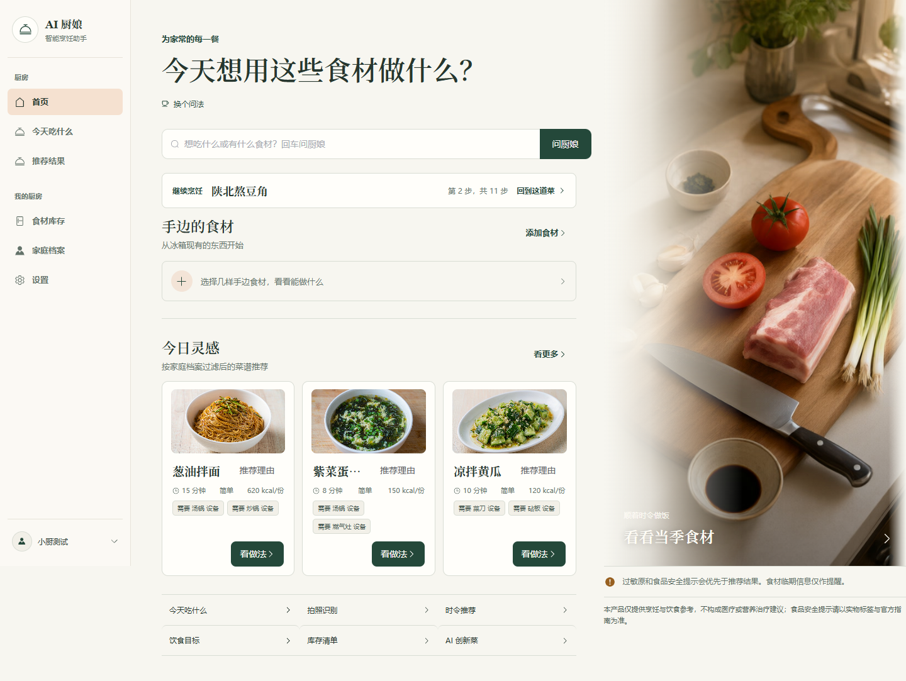
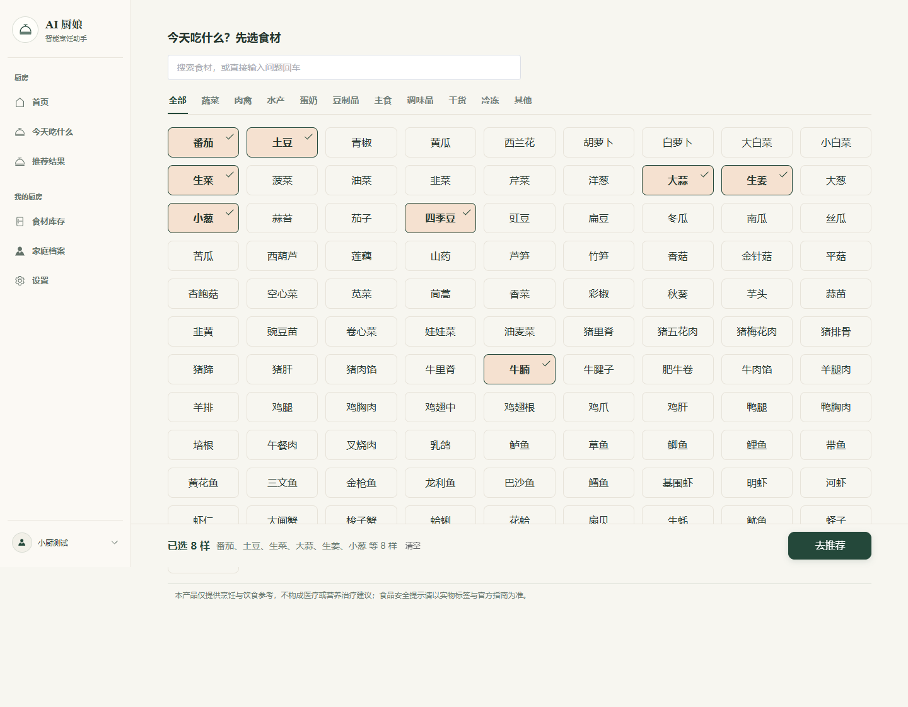
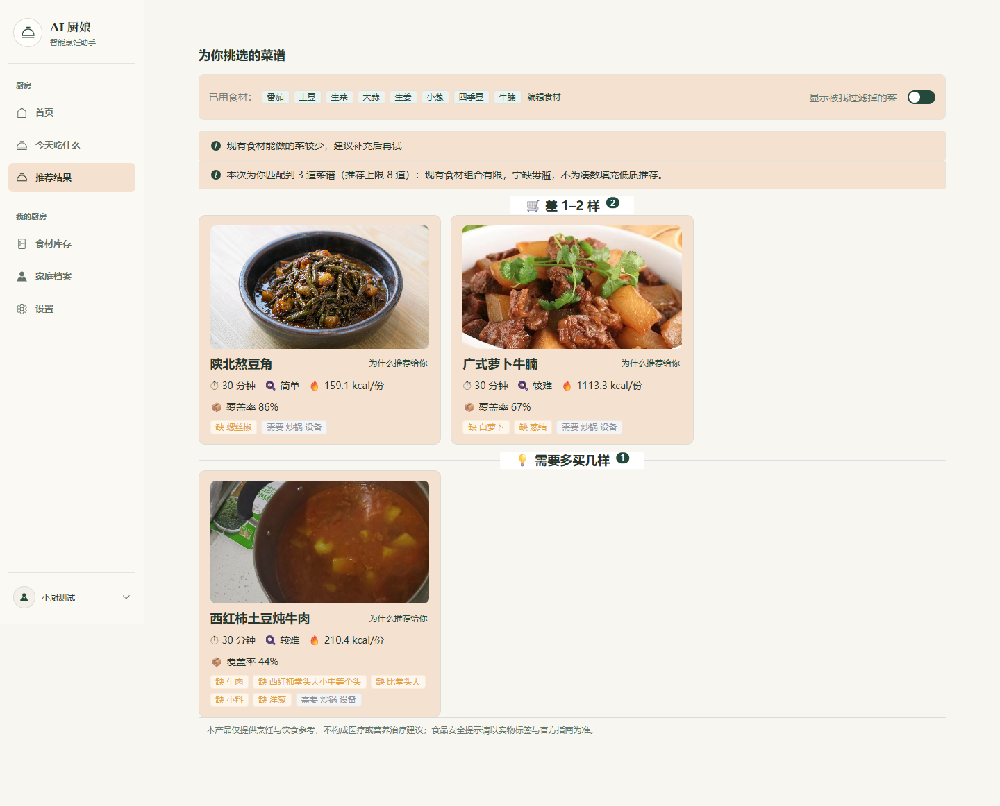
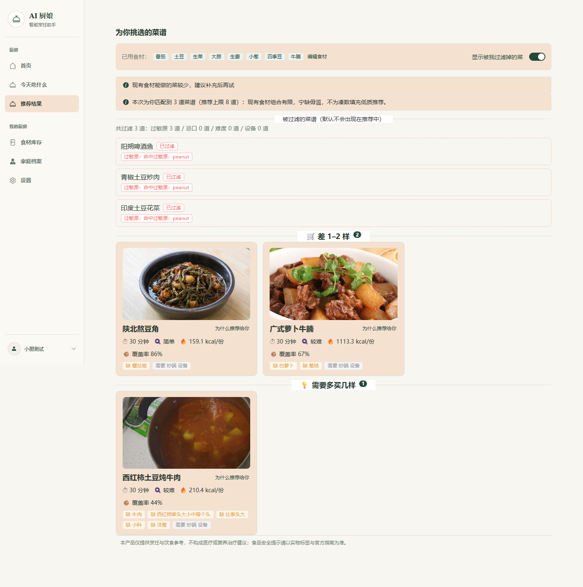
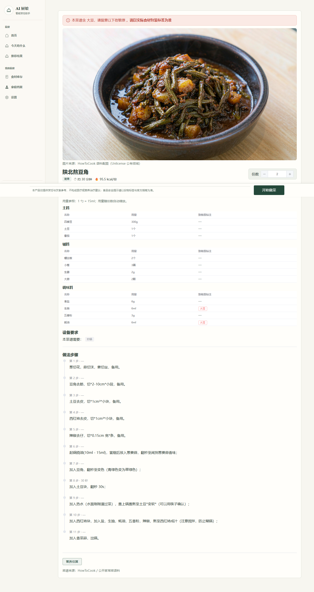
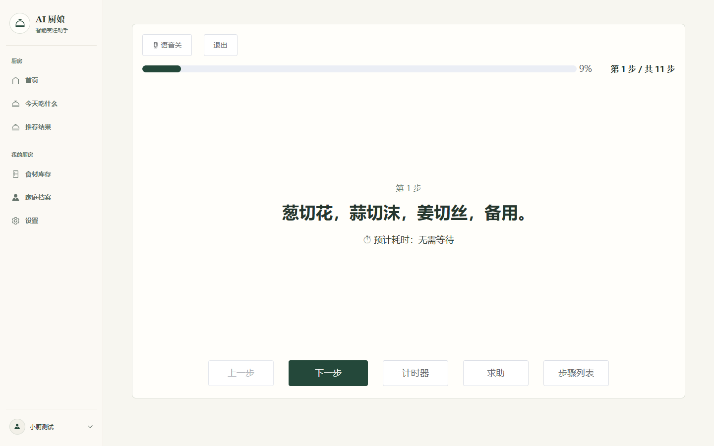
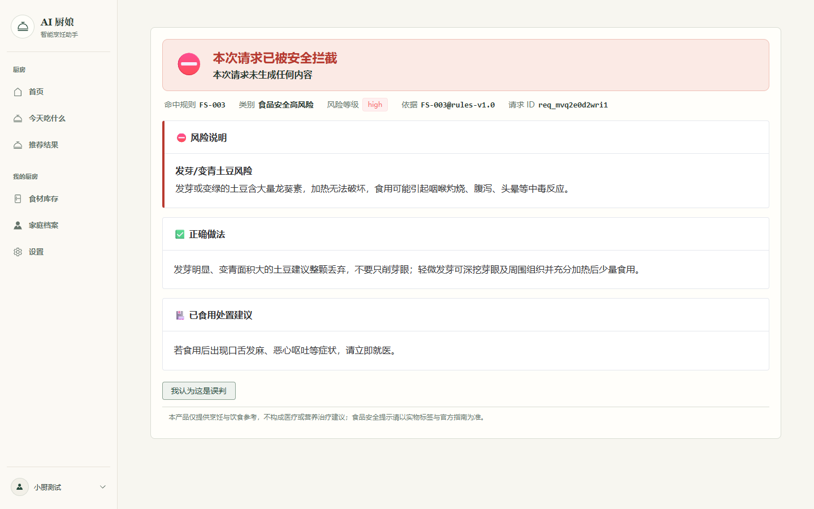
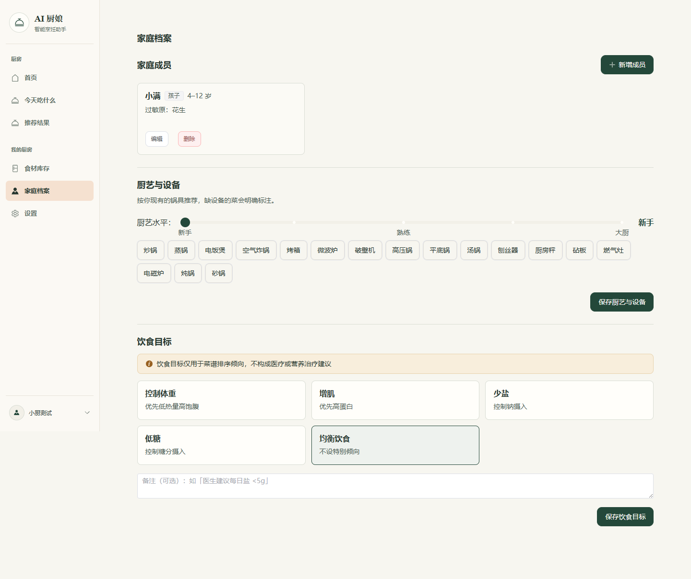

# AI 厨娘 · 智能烹饪助手

面向家庭日常烹饪的食材与菜谱助手。从选择食材开始，经过推荐、菜谱详情到分步烹饪，把食材覆盖、家庭档案、过敏原与食品安全规则结合在一条可控 Agent 主链路上。

后端使用 FastAPI + LangGraph，前端包含 Web 用户端、管理后台与微信小程序端，部署采用 Docker Compose。

## 功能特性

- **食材与库存**：选择、管理家中现有食材，支持临期提醒。
- **推荐与今日菜单**：结合食材覆盖、家庭口味、历史偏好与时令食材生成推荐。
- **菜谱与分步烹饪**：菜谱详情、分步引导、计时与未完成烹饪续做。
- **家庭档案与过敏原**：家庭成员、年龄段、忌口与过敏原硬过滤，不因排序降权而绕过。
- **食品安全风控**：11 类高危问题一票否决，命中后短路返回，不输出普通推荐结果。
- **语音与视觉**：语音输入、语音播报、拍照识别食材；Provider 可配置，缺省为 mock。
- **会员与支付**：会员套餐与订单链路，当前使用模拟支付 Provider。
- **行为埋点**：客户端批量上报、服务端白名单与敏感字段剥离、管理员审计查询。
- **评测与回归门禁**：意图、风控、检索等离线评测数据集与报告。

## 技术架构

```text
web-stage1 (Vue 3)      admin-web (Vue 3)      web-mini (uni-app)
        │                       │                     │
        └────────────── HTTP /v1, /admin/v1 ───────────┘
                                │
                         nginx (Docker)
                                │
                     FastAPI + LangGraph
                                │
        ┌───────────────┬───────┴────────┬────────────────┐
        │               │                │                │
   风控 / 过敏原     意图识别        检索 / RAG       推荐 / 问答
   硬过滤（短路）   （关键词兜底）   （向量 + 文本）    创新菜 / 排序
        │               │                │                │
        └───────────────┴────────┬───────┴────────────────┘
                                 │
                    PostgreSQL 16 + pgvector
```

核心设计：

- 风控与过敏原过滤位于推荐链路之前，命中即短路，属于硬约束而不是排序因子。
- LLM、视觉、语音、向量等外部能力均通过 Provider 适配层接入，未配置凭证时使用 mock 或本地哈希实现，保证离线可运行。
- LangGraph 负责编排意图识别、检索、工具调用、推荐组合与输出侧兜底。

## 目录结构

```text
backend/          FastAPI 后端、LangGraph 编排、Alembic 迁移、种子数据、Eval、pytest
web-stage1/       用户端 Web（Vue 3 + Vite + TypeScript + Pinia + Element Plus）
admin-web/        管理后台（Vue 3 + Element Plus）
web-mini/         微信小程序端（uni-app Vue 3）
frontend/         项目答辩演示站点
artifacts/        演示截图、答辩材料与构建产物
nginx/            反向代理配置
scripts/          一键管理脚本与语料工具
docs/             产品、演示与页面配置文档
项目开发文档/      架构、PRD、部署手册、评测与讲稿
```

## 快速开始

### 方式一：Docker Compose

需要 Docker Desktop 或 Docker Engine + Compose。

```bash
# 可选：配置真实 LLM / 视觉 / 语音 Key；不配置则使用 mock/哈希实现
cp backend/.env.example backend/.env

docker compose up -d
docker compose exec api python -m app.seed
```

访问地址：

- 用户端：<http://localhost/>
- 管理后台：<http://localhost/admin/>（账号 `admin`，口令取 `ADMIN_PASSWORD`）
- 后端 API：<http://localhost:8000/v1/healthz>

生产部署使用 `docker-compose.prod.yml`，数据库口令、管理员口令与 JWT 密钥均通过环境变量强制注入，配置模板见 `.env.production.example`。

### 方式二：本地开发

需要 PostgreSQL 16，并安装 pgvector 扩展。

```bash
# 后端
cd backend
python -m venv .venv
.venv/Scripts/python -m pip install -r requirements.txt   # Windows
# source .venv/bin/activate && pip install -r requirements.txt  # macOS / Linux

cp .env.example .env        # 按需填写数据库与模型配置
.venv/Scripts/python -m app.seed
.venv/Scripts/python -m uvicorn app.main:app --reload --port 8000
```

```bash
# 用户端
cd web-stage1
npm install
npm run dev                  # http://localhost:5173
```

Windows 下也可以使用一键脚本：

```powershell
powershell -ExecutionPolicy Bypass -File scripts\manage.ps1 -Action start -InitDb
```

## 配置说明

后端配置集中在 `backend/.env`，模板为 `backend/.env.example`。常用项：

| 配置 | 说明 |
| --- | --- |
| `DB_HOST` / `DB_PORT` / `DB_USER` / `DB_PASSWORD` / `DB_NAME` | PostgreSQL 连接 |
| `LLM_BASE_URL` / `LLM_API_KEY` / `LLM_MODEL` | OpenAI 兼容大模型接口 |
| `VISION_PROVIDER` / `VISION_API_KEY` | 拍照识别食材，缺省 mock |
| `SPEECH_PROVIDER` / `SPEECH_API_KEY` | 语音转写，支持 DashScope realtime |
| `TTS_PROVIDER` / `TTS_API_KEY` | 语音合成，支持 DashScope SDK |
| `EMBEDDING_PROVIDER` | `hash` 为本地确定性实现，`bailian` 为真实向量模型 |
| `RETRIEVAL_VECTOR` | 向量召回总开关 |

所有外部 Provider 在凭证缺失或调用失败时会降级到确定性路径，接口不会因外部依赖不可用而整体失败。

## 测试与评测

```bash
# 后端测试（需要可用的 PostgreSQL 与已初始化的种子数据）
cd backend
.venv/Scripts/python -m pytest tests -q

# 静态检查
.venv/Scripts/python -m ruff check app tests

# 用户端测试
cd web-stage1
npm test

# 离线评测（意图 / 风控 / 检索）
cd backend
.venv/Scripts/python -m eval.run_eval --offline
```

评测数据集位于 `backend/eval/datasets/`，报告输出到 `backend/eval/reports/`。

## 界面截图

以下截图来自 2026-10-27 的本地开发版本，流程为：登录 → 建立家庭档案（成员对花生过敏）→ 选择食材 → 推荐（过敏原硬过滤）→ 菜谱详情 → 分步烹饪 → 安全拦截。

| 首页 | 选择食材 | 推荐结果 | 过敏原过滤 |
| --- | --- | --- | --- |
|  |  |  |  |

| 菜谱详情 | 分步烹饪 | 安全拦截 | 家庭档案 |
| --- | --- | --- | --- |
|  |  |  |  |

更多截图见 `artifacts/screenshots-20261027/`，包括登录、免责声明、PIPL 敏感信息单独同意、今日菜单、时令食材、库存、设置与会员中心。

## 已知限制

- 本项目为演示与阶段一交付实现。未配置真实 Provider 时，视觉、语音、向量等能力返回 mock 或本地确定性结果。
- 会员支付为模拟 Provider，微信支付仅保留接口骨架，未接入真实商户凭证。
- 部分菜品封面由 AI 生成，仅用于演示；语料内容来自 [HowToCook](https://github.com/Anduin2017/HowToCook)（Unlicense）。
- 项目暂未指定开源许可证。

## 文档索引

- [后端说明](backend/README.md)
- [产品与视觉规范](PRODUCT.md) / [DESIGN.md](DESIGN.md)
- [LangGraph 图结构分析](项目开发文档/19-LangGraph图结构分析-V1.0.md)
- [架构与数据库设计](项目开发文档/02-架构设计与数据库设计文档-V1.1.md)
- [部署手册](项目开发文档/18-腾讯云8005生产部署指南-V1.0.md)
- [项目介绍与讲稿](项目开发文档/22-项目介绍-五分钟版-V1.0.md)
