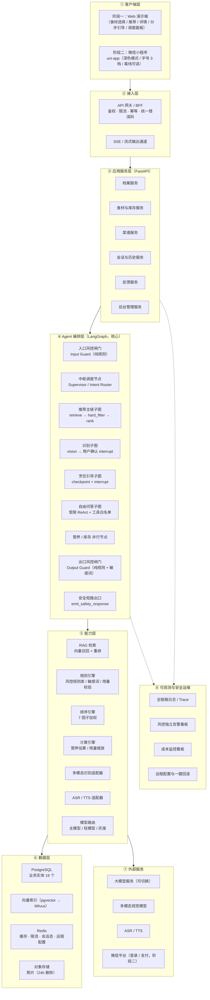
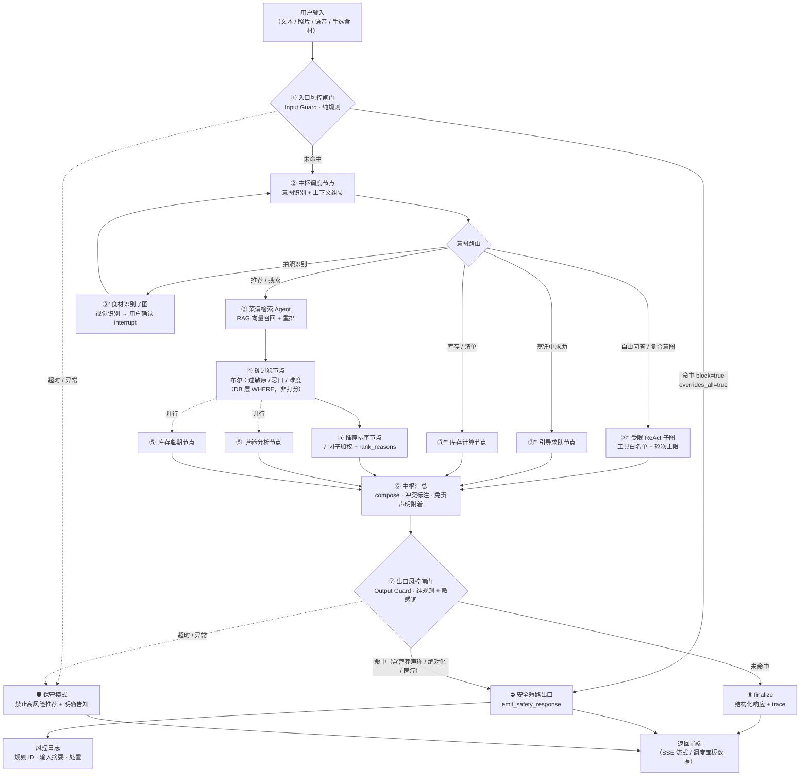

# AI 厨娘・智能烹饪助手 —— 架构设计与技术方案建议书

> 🏠 **项目**：项目六 ｜ AI 厨娘・智能烹饪助手（多智能体协作）
> 📄 **文档编号**：B-D3-预 / 讨论稿
> 🏷️ **版本**：V0.1（讨论稿） ｜ **状态**：🟡 待甲方确认
> 👤 **产出方**：乙方（开发方） ｜ **审核方**：甲方产品
> 📅 **日期**：2026-10-05
> ⏸ **阶段**：**PRD 前置方案讨论阶段** —— 本文件不是 PRD，是 PRD 的输入

---

## 0. 本建议书的定位与边界

| 项 | 说明 |
| --- | --- |
| **本文件是什么** | PRD 前的**方案建议 + 待决策清单**。回答「这套多智能体到底怎么落地」 |
| **本文件不是什么** | ❌ 不是 PRD（不逐页写交互、不写五态、不写埋点落点）；❌ 不重写需求文档的功能清单与验收标准 |
| **上游依据** | 需求说明文档 V1.0-r5（§1.4 / §3 / §4 / §5 / §6 / §8 / §11.10）、阶段一文档、04 交付要求、06 合规红线、07 项目管理、08 附录 |
| **冲突处理** | 本文件与需求说明文档**冲突之处以需求说明文档为准**；本文件所有新增假设均带【假设】标记，**必须由甲方确认或推翻** |
| **本次交付物** | ① 架构设计建议 ② 智能体角色与协作模式划分 ③ 核心功能模块清单 ④ 关键技术选型建议 ⑤ **需要甲方决策的关键问题** |
| **暂停点** | ⏸ **本文件提交后暂停**，等待甲方逐条确认第 7 章决策项，**确认通过后再产出正式 PRD** |

### 0.1 已继承的既有决策（不重复讨论）

| 决策 | 结论 | 来源 |
| --- | --- | --- |
| 分两阶段交付 | 阶段一 7 个工作日 PoC（先决门）→ 阶段二 2.5 个月 MVP | §1.4 |
| 阶段一 Agent 数 | **≥5 个**，少于 5 个不构成多智能体验证 | §1.4.1 |
| 架构本质 | **主体是「流水线 Pipeline」而非「投票 Voting」**；权重仅用于推荐排序 7 因子 | §4.3 |
| 风控定位 | 独立运行、**一票否决**、不参与加权、**不调大模型（纯规则）** | §4.2 / §02-2.3 |
| 过敏原 | **布尔硬过滤，严禁实现为降权**（P0 缺陷判定） | RL-6 / §5.4 图 3 |
| 双重风控 | 输入侧 + 输出侧，**两侧都不可省** | §4.4 |
| 风控失败 | **一律降级为保守模式，禁止直连模型** | RL-4 / US-M3 |
| 识别结果 | **未确认不入库**，`need_user_confirm` 恒为 `true`，不可被配置关闭 | RL-5 / §4.2 |
| 营养数据源 | USDA FoodData Central（CC0，可商用）；中餐先覆盖常见 100 条，缺失如实标注 | Q-02 |
| 技术栈基线 | 前端 uni-app（阶段二）/ Web（阶段一）；后端 Python + FastAPI；编排 LangGraph | 附录 C |
| 远程配置 | 4 个模块级开关（推荐 / 识别 / 问答 / 支付）**强制交付** | §11.8 / Q-66 |

---

## 1. 结论先行（TL;DR）

> 先给结论，再展开论证。以下 6 条是本建议书的**核心判断**，也是需要甲方最先拍板的部分。

| # | 核心判断 | 一句话理由 |
| --- | --- | --- |
| **1** | **架构形态：确定性主图 + 分支式 Supervisor，而不是「多智能体自由协商」** | 需求文档已明确主体是流水线（§4.3）。自由协商会带来不可控顺序、不可解释、验收困难；而本项目的核心价值恰恰是**顺序可控 + 结果可解释** |
| **2** | **风控不是「一个 Agent 节点」，而是「两条强制闸门（输入侧 / 输出侧）+ 一个短路出口」** | 一票否决的本质是**控制流短路**，不是打分。用 LangGraph 的条件边直接跳转到终止节点，比「标记后由中枢丢弃」更可靠、更可审计 |
| **3** | **硬过滤必须是检索与排序之间的一个独立节点（数据库层布尔条件），不能写进排序打分** | 只有把它做成独立节点 + 独立单测，才能在验收 P7「证明是布尔过滤而非降权」时拿出证据 |
| **4** | **8 个 Agent 按三种形态落地：规则型 / LLM+工具型 / 纯计算型** | 全部做成 LLM Agent 会同时推高成本、延迟与不确定性；只有该用模型的地方用模型（见 §3.1） |
| **5** | **阶段一形态：Vue 3 + Element Plus Web 端 + FastAPI + LangGraph（不引入小程序、不做登录）** | 7 个工作日零缓冲。Element Plus 提供表格/卡片/步骤条/消息提示等成熟组件，比裸写更快；且与阶段二管理后台同基座可复用 |
| **6** | **成本大头在推荐链路（约 70%），必须做「节点级缓存 + 分级模型 + RAG Top-K 收窄」** | NFR-8 已把成本列为非功能需求；且护栏是「成本不劣化」，需在架构层就设计，而非后期优化 |

---

## 2. 总体架构建议

### 2.1 架构原则（5 条，逐条可追溯到甲方 NFR）

| # | 原则 | 落地方式 | 对应需求 |
| --- | --- | --- | --- |
| P1 | **安全优先于智能** | 风控闸门置于链路两端且不可绕过；风控不依赖模型 | NFR-1.1~1.3、RL-4 |
| P2 | **确定性优先于灵活性** | 主链路是显式 DAG（节点 + 条件边），只有自由问答/复合意图才进入 Agent 自主循环 | §4.3、US-M1 |
| P3 | **可解释即可验收** | 每个节点产出结构化 trace（入参、出参、耗时、模型、token、规则 ID），前端可渲染调度面板 | NFR-5.1、阶段一交付物 3 |
| P4 | **最小必要数据传递** | 节点只接收所需字段；健康信息 / 过敏原不出安全域；照片不入非必要节点 | §4.4、NFR-7 |
| P5 | **可插拔、可热更、可回滚** | Agent 以注册表接入中枢；规则库与菜谱库走配置热更新；4 个模块级远程开关 | NFR-4.1~4.3、§11.8 |

### 2.2 分层架构图



### 2.3 运行时视图：一次「推荐请求」穿过哪些层

```
小程序/Web
  → BFF（鉴权 / 幂等键 request_id / 限流）
  → FastAPI 推荐接口
  → LangGraph：入口风控闸门（纯规则，毫秒级）
      ├ 命中 → 短路到 emit_safety → 返回风控话术（业务节点全部未执行）
      └ 未命中 → 中枢调度节点（意图 = recommend_by_ingredients）
            → 推荐主链子图：assemble_context → retrieve → hard_filter → rank
                  ├ 并行：营养估算、库存临期检查
            → 中枢汇总（compose，附加 rank_reasons + 免责声明 ID）
  → 出口风控闸门（纯规则 + 敏感词 / 营养声称 / 绝对化用语）
      ├ 命中 → 短路到 emit_safety
      └ 未命中 → finalize
  → Trace 落库（各节点耗时 / 规则命中 / token / 成本）
  → SSE 返回前端（含调度面板数据）
```

### 2.4 架构对 NFR 的覆盖映射（架构追溯表首版）

| 需求编号 | 要求摘要 | 架构落点 | 证据形式 |
| --- | --- | --- | --- |
| NFR-1.1 | 高风险拦截率 100% | 输入侧闸门 + 输出侧闸门（纯规则，短路语义） | 规则单测报告 + 拦截日志 |
| NFR-1.2 | 过敏原五处生效 | hard_filter 节点（DB 层布尔条件）+ 前端警示组件 + 购物清单标注 + 引导前二次确认 | P7 验收 + 截图 |
| NFR-1.3 | 输出侧敏感词过滤 | 出口闸门的输出侧规则（营养声称 / 绝对化 / 医疗） | 自动化抽检脚本 |
| NFR-2.1 | 推荐 P95 ≤ 6s | 节点级缓存 + RAG Top-K 收窄 + 营养/库存并行 + 本地优先 | 压测数据 |
| NFR-2.5 | 计时器后台可靠 | **本地优先实现 + 明确告知边界**（见 §7-B8） | 真机测试 |
| NFR-3.6 | 离线可读 | 已打开菜谱步骤本地缓存（小程序 storage / Web IndexedDB） | 断网演示 |
| NFR-4.1 | Agent 可插拔 | Agent 注册表 + 图节点工厂 | 演示新增节点 |
| NFR-4.2 | 知识库热更新 | 规则/菜谱走配置表 + Redis 版本戳，不重启 | 热更新演示 |
| NFR-5.4 / 8.1 | 成本可查 | 每次模型调用写 token 与单价，按日/功能/用户聚合 | 看板截图 |
| NFR-7.2 / 7.3 | 照片 24h 删除 / 音频不落盘 | OSS TTL 策略 + 识别适配器禁用音频持久化 | 策略配置截图 |
| §11.8 | 4 个模块级远程开关 | Redis 配置中心 + 客户端心跳拉取 | 开关演示 |
| TC-9 | 核心安全逻辑覆盖率 ≥80% | hard_filter / guard / 规则引擎 纳入强制覆盖率门槛 | CI 覆盖率报告 |

---

## 3. 智能体角色与协作模式划分

### 3.1 先分类：8 个 Agent 其实有三种形态

> 需求文档把它们统称「Agent」。工程上必须先分类，否则会出现「给规则引擎硬套 LLM」或「给计算任务堆模型」两类浪费。

| 形态 | 特征 | 是否调大模型 | 延迟 | 成本 | 本项目的成员 |
| --- | --- | --- | --- | --- | --- |
| **Ⅰ 规则型 Agent** | 确定性、可审计、可回滚；关键词/正则/语义规则 + 规则库 | ❌ **不调** | 毫秒级 | 0 | **食品安全与过敏原风控 Agent** |
| **Ⅱ LLM+工具型 Agent** | 需理解自然语言 / 生成表达；以工具调用为主，不许自由编造事实 | ✅ 调（分级模型） | 秒级 | 中～高 | 中枢调度、菜谱检索、烹饪引导、自由问答 |
| **Ⅲ 纯计算型 Agent** | 输入输出均为结构化数据；算法确定，不需要语言能力 | ❌（LLM 仅在兜底解释时可选调用） | 毫秒～百毫秒 | 极低 | 推荐排序、营养分析、库存管理、食材识别（视觉模型调用，非 LLM） |

> **关键设计约束**：Ⅰ 型**永远不调模型**（这是阶段一 PoC 技术决策，见 02-§2.3）；Ⅲ 型**默认不调模型**；只有 Ⅱ 型允许调模型，且**必须支持分级（主模型/轻模型）与灰度切换**（NFR-4.5）。

### 3.2 8 个 Agent 角色卡

| # | Agent | 形态 | 触发条件 | 输入 | 输出 | 硬约束 |
| --- | --- | --- | --- | --- | --- | --- |
| 1 | **食品安全与过敏原风控 Agent** | Ⅰ 规则型 | **所有输入，先于一切** | 用户输入、食材、菜谱配方、档案过敏原与特殊人群标记 | 风险判定（类别 / 等级 / 阻断 / 话术 ID / 依据） | **一票否决**；不调模型；规则专家签字；命中即短路 |
| 2 | **中枢调度 Agent** | Ⅱ LLM+工具 | 每次请求 | 用户输入、上下文、各节点输出 | 意图、调度决策、汇总结果、冲突标注 | 不得绕过闸门；输出侧敏感词过滤不可关闭 |
| 3 | **食材识别 Agent** | Ⅲ 计算型（视觉模型） | 上传照片 / 语音 / 手选 | 图片 / 转写文本 / 手选 ID | 食材候选（含置信度、裁剪框） | **必须用户确认**；`need_user_confirm` 恒真；未确认不入库 |
| 4 | **菜谱检索 Agent** | Ⅱ LLM+工具 | 推荐 / 搜索 / 详情 | 食材列表、查询文本、过滤条件 | 候选菜谱（含步骤、用量、标签、来源） | 必须返回来源标注；**缺量化用量的菜谱不得进入结果** |
| 5 | **推荐排序 Agent** | Ⅲ 计算型 | 候选生成后 | 候选菜谱、档案、库存、反馈、临期标记 | 排序结果 + `rank_reasons` + `filtered_by` | 硬过滤**先于**排序；不得用降权替代过滤 |
| 6 | **烹饪引导 Agent** | Ⅱ LLM+工具 | 进入烹饪模式 | 菜谱 ID、份数、厨艺水平、语音指令 | 当前步骤、时长、要点、失败补救 | 进入前二次确认过敏原；求助走闸门 |
| 7 | **营养分析 Agent** | Ⅲ 计算型 | 详情 / 完成做菜 / 营养页 | 菜谱用量、份数、成分数据 | 热量与营养素、未纳入统计项、误差标注 | 必须标「估算值」；**缺失数据不得按 0 计** |
| 8 | **库存管理 Agent** | Ⅲ 计算型 | 入库 / 做菜完成 / 临期检查 | 食材、数量档位、日期、菜谱用量 | 库存列表、扣减建议、临期提醒 | **不得判定食材可食性**，仅提醒 |

> **关于「≥5 个 Agent」的验收口径**（对应 P2 验收项）：建议按**可被独立调度、可独立产出 trace、可独立降级**的节点计数。据此阶段一实际可调度节点为 **6 个**（输入闸门、中枢、检索、硬过滤、排序、营养 + 输出闸门），满足「≥5 且单次请求 ≥3」的要求。
> ⚠️ 这里存在一个**需要甲方明确的口径问题**（见 §7-A2）：硬过滤节点是否算作独立 Agent？本文件建议**算**（它是一个可独立测试、可独立降级的处理单元），否则按「具名 Agent」口径只有 5 个，恰好卡在线上。

### 3.3 协作模式选型：为什么是「确定性主图 + 分支式 Supervisor」

| 候选方案 | 描述 | 优点 | 缺点 | 是否采纳 |
| --- | --- | --- | --- | --- |
| **A. 全 Supervisor**（中心调度 + 子 Agent 工具化） | 中枢用 LLM 决定调用哪些子 Agent，子 Agent 之间自由交接 | 灵活、扩展性好、看起来最「多智能体」 | 调度顺序不确定 → **一票否决的时序无法保证**；延迟高；不可解释；验收困难 | ❌ |
| **B. 纯 DAG 流水线** | 显式节点 + 固定边 | 可控、可解释、延迟低、易验收 | 复合意图 / 自由问答处理僵硬；「多智能体」感弱 | ⚠️ 部分采纳 |
| **C. 混合编排：确定性主图 + 分支式 Supervisor** | 主图是显式 DAG；**意图路由**决定进入哪条子图；仅「自由问答 / 复合意图」子图内启用 LLM 自主循环（受限 ReAct + 工具白名单） | 安全链路的顺序**由图的拓扑保证**；自由问答又保留灵活性；可解释性最好 | 设计复杂度略高 | ✅ **推荐** |

**结论：采纳 C。** 三条硬理由：

1. **一票否决必须在拓扑上被保证**。只有主图显式规定「输入闸门 → 业务链 → 输出闸门」，才能用**编译期静态校验 + 单测**证明「不存在绕过闸门到达 END 的路径」。若交给 LLM 自主决定，这项证明做不出来，P5/P8 验收无证据。
2. **需求文档 §4.3 已经否定了「投票」语义**。既然主体是流水线，就不该再引入协商式编排。
3. **成本与延迟**。主链路节点固定 = 缓存命中率高（NFR-8.5）；自由协商每次调用次数不可预测，成本不可控。

### 3.4 端到端协作流程图（含分支与闸门）



> 🔴 **三条不可违背的拓扑规则**（建议写入架构文档并被单测强制）
> 1. 不存在「不经过 ① 就进入业务节点」的路径。
> 2. 不存在「不经过 ⑦ 就直接 END」的路径。
> 3. 分支「命中 → V」必须先于「⑥ 中枢汇总」；**不允许「先汇总再打标记」**。

### 3.5 一票否决的工程实现（🔴 关键小节）

> 这是验收 §11.4 / P5 的直接证据来源，也是 04 文档 §4.3 要求「必须正面回答」的第一问。

| 问题 | 本方案的回答 |
| --- | --- |
| **「一票否决」在代码层面如何实现？** | 闸门节点返回结构化判定 `RiskVerdict`；当 `hit=true && block=true` 时置 `overrides_all=true`。图中用**条件边**直接路由到 `emit_safety_response` 终止节点，**业务节点在同一 superstep 中根本不会被执行**（而非「执行后丢弃」） |
| **中枢收到 `overrides_all=true` 后的处理路径？** | 双重保险：① 拓扑上已经短路，中枢拿不到控制权；② 中枢节点入口处增加 **assert 守卫**：若 state 中已存在 `risk_verdict.overrides_all == true`，直接返回 `Command(goto="emit_safety_response")`，不透传任何业务字段 |
| **如何证明「其余输出被完全丢弃」？** | 三份证据：① 图结构单测（断言不存在绕过闸门的路径）；② 请求级 trace 中业务节点 `not_executed`；③ 返回体 JSON 中不含任何 `results` / `candidates` 字段 |
| **输入侧与输出侧分别部署在哪？** | 输入侧 = 主图入口前的第一个节点（在意图识别之前）；输出侧 = 汇总之后、`finalize` 之前。两侧都是**独立节点 + 同一条规则库**，但**规则集不同**（输入侧判「用户问了什么」，输出侧判「系统准备说什么」） |
| **两侧不可省的理由与延迟代价？** | 输入侧拦不住的「用户明示的违规意图」会在输出侧被拦（如用户诱导模型说出违规表述）；输出侧拦不住「用户输入本身即高危」的场景（如直接给了错误做法）。代价：两次规则匹配，**纯规则实现下为毫秒级**，对延迟影响可忽略（这也是坚持风控不调模型的核心收益） |
| **如何保证「风控不可用时进保守模式」而非直连模型？** | 采用**白名单式短路**：闸门节点用 try/except 包裹，**任何异常 / 超时都会返回 `SAFE_MODE` 判定**，而不是抛出异常让上层「跳过该节点」。业务节点入口统一 assert `risk_verdict.status != UNKNOWN`，`UNKNOWN` 状态一律拒绝执行业务链 |
| **如何防止 Prompt 注入绕过风控？** | ① 闸门不调模型 → 无 Prompt 注入面；② 自由问答子图的工具调用走白名单，模型不能自行「关闭风控」；③ 输入侧规则含注入特征识别（对应边界清单 #28） |

**风控判定契约（对齐需求文档 §4.2 建议 Schema）**

```json
{
  "agent_id": "food_safety_guard",
  "agent_version": "1.0.0",
  "stage": "input",
  "status": "OK",
  "hit": true,
  "category": "food_safety_high_risk",
  "sub_category": "soaked_fungus_long_time",
  "risk_level": "high",
  "block": true,
  "confidence": 0.94,
  "message_id": "FS_WOOD_EAR_SOAK_01",
  "correct_action": "木耳建议冷藏泡发且不超过 4 小时……",
  "after_consumption_advice": "如已食用并出现恶心、呕吐等症状，请及时就医",
  "evidence_ref": ["FS-018@rules-v1.2"],
  "override_scope": "all",
  "overrides_all": true
}
```

### 3.6 建议的节点执行矩阵（串行 / 并行 / 超时 / 降级）

| 节点 | 执行方式 | 超时阈值【假设】 | 失败后果 | 降级动作 |
| --- | --- | --- | --- | --- |
| ① 入口闸门 | 串行 · 强制 | 500ms | **致命** | 保守模式（禁止高风险推荐） |
| ② 中枢调度 | 串行 | 3s | 可降级 | 回退到规则意图分类（关键词兜底） |
| ③ 检索（RAG） | 串行 | 3s | 可降级 | 兜底文案「建议稍后重试」 |
| ④ 硬过滤 | 串行 · 强制 | 500ms | **致命** | **不允许失败**；异常时返回空结果集（宁少不错） |
| ⑤ 排序 | 串行 | 1s | 可降级 | 退化为「食材覆盖率单因子排序」 |
| ⑤' 营养 | **并行** | 2s | 可降级 | 标「营养数据暂不可用」，不阻塞推荐 |
| ⑤' 库存临期 | **并行** | 1s | 可降级 | 忽略临期加权 |
| ⑥ 汇总 | 串行 | 1s | 可降级 | 直接透传各部分结果 |
| ⑦ 出口闸门 | 串行 · 强制 | 500ms | **致命** | 保守模式 |
| 整链路 | — | 12s（阶段二口径） | — | 阶段一口径放宽至 P95 ≤ 10s（P12） |

> ⚠️ 以上阈值为【假设】，需甲方与乙方共同确认（对应 Q-50）。

### 3.7 状态与检查点：两类会话，两种持久化策略

| 会话类型 | 生命周期 | 持久化策略 | 目的 |
| --- | --- | --- | --- |
| **请求型**（推荐 / 搜索 / 问答） | 秒级 | 可选 checkpoint（建议开，便于 trace 复盘） | 可观测、可复现 |
| **烹饪会话型**（分步引导） | 分钟～小时 | **必须 checkpoint**（thread_id = 烹饪会话 ID） | 断点续做（US-F1 第 7 条）、切后台恢复、崩溃可恢复 |
| **识别任务型** | 分钟级 | 必须 checkpoint（等待用户确认的 `interrupt` 点） | 用户中途离开再回来仍能看到待确认结果 |

---

## 4. LangGraph 实现设计要点

> 版本说明：LangGraph 1.x 为当前主线版本，核心概念（`StateGraph` / 条件边 / `Command` / `interrupt` / checkpointer / Store / 子图 / 节点缓存）在 1.x 已稳定。
> ⚠️ **本文档只锁定「设计」，具体 API 细节以落地时锁定的版本为准**（见 §7-B1）。

### 4.1 主图节点清单

| 节点名 | 类型 | 说明 |
| --- | --- | --- |
| `intake_guard` | 规则节点 | 入口风控闸门（输入侧） |
| `supervisor` | LLM 节点 | 意图识别 + 上下文组装 + 路由决策 |
| `subgraph_recommend` | 子图 | `assemble_context → recipe_retrieve → hard_filter → recipe_rank` |
| `subgraph_vision` | 子图 | 视觉识别 → `interrupt`（等用户确认）→ 回写 |
| `subgraph_qa` | 子图 | 受限 ReAct + 工具白名单 + 轮次上限 |
| `node_nutrition` | 计算节点 | 与推荐链并行 |
| `node_inventory` | 计算节点 | 与推荐链并行 |
| `node_cooking_help` | LLM 节点 | 烹饪中求助（短答 ≤3 条要点） |
| `compose` | 规则+轻 LLM | 汇总 / 冲突标注 / 免责声明附着 |
| `output_guard` | 规则节点 | 出口风控闸门（输出侧 + 敏感词） |
| `emit_safety_response` | 终止节点 | 一票否决出口 |
| `finalize` | 终止节点 | 正常出口 |

### 4.2 State 结构（建议）

```python
class CookingState(TypedDict, total=False):
    # 请求元信息
    request_id: str
    thread_id: str
    user_id: str
    intent: str

    # 安全域（只读、加密字段不落 trace）
    safety_profile: SafetyProfile      # 过敏原集合 / 特殊人群标记
    input_verdict:  RiskVerdict        # 输入侧闸门判定
    output_verdict: RiskVerdict        # 输出侧闸门判定
    safe_mode: bool                    # 保守模式标记

    # 业务数据
    confirmed_ingredients: list[Ingredient]
    candidates: list[Recipe]
    filtered_out: dict[str, int]       # 供「显示被我过滤掉的菜」
    results: list[RankedRecipe]        # 含 rank_reasons
    nutrition: NutritionResult

    # 响应与可观测
    response: FinalResponse
    trace: Annotated[list[TraceSpan], add]   # 用 reducer 累加，节点各自 append
```

> `trace` 使用 `Annotated[..., operator.add]` 作为 reducer，使并行节点的 trace 能正确合并——这正是「Agent 调度可视化」的数据来源。

### 4.3 路由与条件边

```python
# 伪代码：闸门 → 短路 或 继续
def route_after_intake_guard(state) -> str:
    v = state["input_verdict"]
    if v.status == "UNKNOWN":        # 风控不可用 → 保守模式，绝不直连模型
        return "safe_mode"
    if v.hit and v.block:
        return "emit_safety_response"  # ★ 一票否决：短路，业务节点不执行
    return "supervisor"

# 意图路由（确定性映射，不用 LLM 二次决策）
INTENT_ROUTES = {
    "recommend_by_ingredients": "subgraph_recommend",
    "search_recipe":            "subgraph_recommend",
    "photo_recognize":          "subgraph_vision",
    "free_qa":                  "subgraph_qa",
    "cooking_help":             "node_cooking_help",
    "inventory_op":             "node_inventory",
}
```

> **有意的设计选择**：意图路由用「LLM 识别意图 → 确定性字典映射到子图」，而不是「LLM 直接决定调哪个工具」。前者可枚举、可测试、可审计，后者不可枚举也就无法验收。

### 4.4 子图划分

| 子图 | 是否独立 checkpoint | 是否含 interrupt | 说明 |
| --- | --- | --- | --- |
| `subgraph_recommend` | 否 | 否 | 纯计算 + 检索，无人工介入 |
| `subgraph_vision` | **是** | **是** | 等待用户确认识别结果（RL-5 强制） |
| `subgraph_qa` | 否 | 否 | 轮次上限 1 轮反追问（US-E4 第 4 条） |
| `subgraph_cook` | **是** | **是** | 烹饪会话，逐步 interrupt 等待用户「下一步 / 上一步」 |

### 4.5 持久化与中断恢复

| 场景 | 机制 |
| --- | --- |
| 断点续做 | `thread_id = cooking_session_id`，checkpointer 持久化步骤序号 |
| 切后台恢复 | 前端上报 state 版本号，后端按 thread_id 读取最新 checkpoint |
| 幂等（边界 #45） | `request_id` 作为 checkpointer 的幂等键；重复提交直接返回已存在的 checkpoint 结果 |
| 存储选型 | 阶段一内存 / SQLite；阶段二 PostgreSQL checkpointer（与业务库同源，运维简单） |

### 4.6 可观测性 = 阶段一交付物 3「Agent 调度可视化」

| 需求 | 实现 |
| --- | --- |
| 本次调用了哪些 Agent | 从 `trace` 提取已执行的节点列表（未执行节点显式标 `not_executed`） |
| 各 Agent 耗时 | 每节点 span 的 `duration_ms` |
| 风控判定结果 | `input_verdict` / `output_verdict` 的 `hit`、`category`、`message_id` |
| 是否触发一票否决 | `overrides_all=true` 时面板高亮 + 显示「其余 N 个节点未执行」 |
| 兜底方案 | 若甲方不接受引入 LangSmith 等在线平台（数据出境考量），**自建 trace 表 + 前端渲染**；两者都建议保留本地结构化日志 |

### 4.7 版本与依赖注意事项

| 项 | 建议 |
| --- | --- |
| LangGraph 版本 | 落地时锁定具体 1.x 小版本并写入 `requirements.txt`；不用 `latest` 浮动版本 |
| checkpointer | 阶段二使用 Postgres checkpointer；阶段一用轻量实现，避免过早引依赖 |
| 子图与 interrupt 的兼容性 | 含 `interrupt` 的子图**必须**带独立 checkpointer，否则恢复会失败——这是最常见的踩坑点 |
| 许可证 | LangGraph / LangChain 为 MIT，可商用（符合附录 B.2 合规矩阵）；其余依赖需逐项登记（B-D8） |

---

## 5. 核心功能模块清单

> 甲方已定义 **14 个模块 / 44 条 US**。本表**不复制验收标准**，只做「模块 → 归属 Agent → 交付阶段 → 关键架构依赖」的映射，供 PRD 追溯表复用。

| 模块 | 名称 | 优先级 | US 数 | 归属 Agent / 能力 | 交付阶段 | 关键架构依赖 |
| --- | --- | --- | --- | --- | --- | --- |
| **A** | 准入与免责声明 | P0 | 2 | 应用服务层（非 Agent） | 阶段二（阶段一简版） | 同意记录持久化；免责声明组件 |
| **B** | 首页 | P0 | 1 | 应用服务层 + 调度入口 | 阶段二 | 五大入口；未完成会话续做 |
| **C** | 用户档案与口味偏好（**含过敏原**） | P0 | 3 | 应用服务层（**风控强依赖**） | 阶段二（阶段一简版） | 过敏原集合 → 安全域；加密存储 |
| **D** | 食材输入与识别 | P0/P1 | 3 | **食材识别 Agent**（视觉） | 阶段一：手选简版 / 阶段二：拍照+语音 | 识别子图 + interrupt 确认 |
| **E** | **智能菜谱推荐**（主打） | P0 | 4 | **菜谱检索 + 硬过滤 + 推荐排序** | **阶段一** | RAG、硬过滤节点、7 因子排序 |
| **F** | **分步烹饪引导**（主打） | P0 | 5 | **烹饪引导 Agent** | 阶段一：单步大字简版 / 阶段二：语音+计时器 | 烹饪子图 + checkpoint + 常亮 + 离线 |
| **G** | 营养分析与健康管理 | P1 | 4 | **营养分析 Agent** + 拒答规则 | 阶段一：热量+三大营养素简版 | USDA 数据匹配；缺失标注 |
| **H** | 食材库存与购物清单 | P1 | 3 | **库存管理 Agent** | 阶段二 | 临期标记；扣减建议（用户确认） |
| **I** | 收藏、历史与个人中心 | P0/P1 | 3 | 应用服务层 | 阶段二 | 字号 3 档 / 深色 / 无障碍 |
| **J** | 会员与支付 | P1 | 2 | 微信虚拟支付 + 权益服务 | 阶段二 | **iOS 端按方案 B 处理**（隐藏入口） |
| **K** | 后台管理端 | P0 | 6 | 管理后台 + 规则管理 | 阶段二 | 规则热更新 + 一键回滚 + 操作日志 |
| **L** | **食品安全与过敏原风控 Agent** | **P0** | 4 | **风控闸门（Ⅰ 规则型）** | **阶段一** | 规则库、双重扫描、一票否决、日志 |
| **M** | 中枢调度 Agent | P0 | 3 | **中枢调度（Ⅱ LLM+工具）** | **阶段一** | 意图路由、汇总、冲突标注、敏感词 |
| **N** | 用户反馈 | P1 | 1 | 应用服务层 + 反馈闭环 | 阶段二 | 会话日志关联 |

### 5.1 阶段一范围（7 个工作日，只做这些）

```
✅ 做：手选食材（简版）· RAG 检索 · 硬过滤 · 7 因子排序（权重可配）· 菜谱详情
      单步大字引导（无语音）· 热量+三大营养素估算 · 风控闸门（双重扫描+一票否决）
      中枢调度 · Agent 调度可视化面板
❌ 不做：小程序 · 拍照识别 · 语音 · 支付 · 用户体系 · 库存 · 后台端 · 备案 · 专家签字
```

### 5.2 阶段一必须守住的 4 条安全约束（不可砍）

| # | 约束 | 架构落点 |
| --- | --- | --- |
| 1 | 风控一票否决**真实生效**（命中即丢弃其余输出） | `route_after_intake_guard` 短路 + 拓扑单测 |
| 2 | 过敏原**布尔硬过滤**，非降权 | `hard_filter` 独立节点 + DB 层 WHERE |
| 3 | 风控**双重扫描**（输入侧 + 输出侧） | `intake_guard` + `output_guard` |
| 4 | 风控失败→**保守模式**，不直连模型 | `status == UNKNOWN → safe_mode` |

---

## 6. 关键技术选型建议

> 状态说明：✅ 建议采纳（有明确理由）｜⚠️ **需甲方决策**（见第 7 章）｜🟡 待实测验证

| 层 | 建议选型 | 备选 | 理由 | 状态 |
| --- | --- | --- | --- | --- |
| **编排框架** | **LangGraph 1.x** | LlamaIndex Workflows / 自研 DAG | 甲方技术栈已建议（附录 C）；原生支持有状态图、条件边、interrupt、checkpoint，**「短路式一票否决」与「断点续做」都能直接映射**；MIT 许可可商用 | ⚠️ **需确认**（Q-48 / §7-B1） |
| **后端框架** | **Python 3.11 + FastAPI + Pydantic v2** | Django / Node.js | 与 Agent 生态同栈；Pydantic 天然承担 Agent 契约校验（§4.2 的 4 个 Schema） | ✅ |
| **关系数据库** | **PostgreSQL 16** | MySQL 8 | 可与 `pgvector` 同库，避免 MVP 阶段维护两套存储；JSONB 适合 Agent trace | ⚠️ 需确认（§7-B3） |
| **向量库** | **pgvector（MVP）→ Milvus（规模化）** | 直接上 Milvus / faiss | 362 篇菜谱的体量下 pgvector 完全够用，且运维成本最低；预留抽象层便于后续迁移 | ⚠️ 需确认（§7-B3） |
| **缓存 / 配置** | **Redis** | 无 | 推荐结果缓存（NFR-8.5）、限流、会话态、**4 个远程开关的配置下发** | ✅ |
| **Embedding** | **bge-m3** | text-embedding-3 / Qwen-embedding | 中文菜谱语料检索效果好、可本地部署、无出境问题 | ⚠️ 需确认（§7-B4） |
| **主大模型** | 国产合规优先（DeepSeek / 通义千问 / 豆包 / GLM 任一），**必须支持切换** | 境外模型 | **数据出境合规（RL-16 / Q-56）** 是硬约束；分级调用（主模型处理复杂意图，轻模型处理指令类） | ⚠️ **需确认**（§7-B4） |
| **多模态识别** | 国产 VLM（Qwen-VL / GLM-4V / 豆包视觉）或专用食物识别模型 | 境外 VLM | 同出境考量；需支撑 NFR-6 的 Top-3 ≥ 90% | ⚠️ 需确认（§7-B5） |
| **ASR / TTS** | 国内厂商（讯飞 / 阿里 / 腾讯云），**音频不落盘** | — | 中文识别率与合规性最优；延迟目标 1.5s | ⚠️ 需确认（§7-B6） |
| **前端（阶段一 Web 演示端）** | **Vue 3 + Vite + Element Plus** | 原生轻量 Vue3 / Streamlit | ① 组件化便于 7 天内搭出多状态交互页（分步引导、Agent 调度面板）；② Element Plus 提供表格 / 卡片 / 步骤条 / 抽屉 / 消息提示等成熟组件；③ **与管理后台同基座，可复用组件与主题变量** | ✅ **甲方已决策** |
| **前端（阶段二 小程序）** | **uni-app → 微信小程序** | Taro | 甲方建议（附录 C）；需支持深色模式与字号 3 档。⚠️ **Element Plus 是 Web 组件库，小程序不可用**（无 DOM / 浏览器 API），故小程序保持 uni-app | ✅ |
| **前端（管理后台）** | **Vue 3 + Vite + Element Plus** | — | 与阶段一 Web 同基座，复用组件与主题变量 | ✅ |
| **部署** | **Docker Compose**（MVP 单机）→ K8s 预留 | 云托管 | 甲方要求「可在甲方环境独立部署」（TC-10） | ✅ |
| **可观测** | 结构化日志 + OpenTelemetry + **风控独立告警** + 成本看板 | LangSmith（需评估数据出境） | NFR-5 强制项；LangSmith 涉及把 trace 传出境，**建议自建为主** | ⚠️ 需确认（§7-B7） |
| **远程配置** | Redis 配置中心 + 版本戳 + 一键回滚 | Nacos / Apollo | §11.8 强制 4 个模块开关；越简单越能保证「不重新发版」 | ✅ |
| **测试** | pytest + 关键安全逻辑覆盖率 **≥ 80%** | — | TC-9 / Q-60；硬过滤与闸门必须有单测 | ✅（目标值待确认） |
| **风控实现** | **自研规则引擎**（关键词 / 正则 / 同义扩展 / 规则表驱动） | 引入第三方内容安全 SDK | **不调模型**是阶段一技术决策；规则表驱动才能做到「热更新 + 一键回滚 + 规则 ID 可追溯」 | ✅ |

### 6.1 成本控制设计（对应 NFR-8）

| 手段 | 架构落点 | 预期收益 |
| --- | --- | --- |
| **节点级缓存** | 推荐子图的 `recipe_rank` 按「食材组合 + 档案摘要」哈希缓存（Redis，TTL 可配） | 家庭食材组合重复度高，命中率预期最高 |
| **分级模型** | 模型路由节点：指令类（下一步 / 计时）走轻模型或不走模型 | 直接砍掉低价值调用 |
| **RAG Top-K 收窄** | 召回 Top-20 → 重排后只把 Top-8 注入生成上下文 | 上下文 token 显著下降 |
| **本地优先** | 步骤切换 / 计时器 / 已打开菜谱 **完全不走网络** | 延迟与成本双降 |
| **图片压缩** | 前端压缩后再上传多模态 | 按图片计费场景直接降本 |
| **TTS 缓存** | 步骤播报文本固定，预生成音频缓存 | 语音成本下降 |

---

## 7. 🔴 需要甲方决策的关键问题（本轮）

> 以下 **21 项**是本轮需要甲方拍板的问题。**「建议默认值」是我的推荐**，甲方可直接采纳、也可推翻。
> 「阻塞」列含义：🔴 = 不确认则无法进入 PRD 编写；🟡 = 不确认则 PRD 可写但会在开发期返工；⚪ = 可延后。

### A. 范围与阶段（3 项）

| 编号 | 问题 | 我的建议默认值 | 影响 | 阻塞 |
| --- | --- | --- | --- | --- |
| **A1** | 本次 PRD 的覆盖范围？照需求文档是「阶段一 + 阶段二 MVP」全量，但二者的页面与状态差异很大 | **建议产出「一份 PRD、两个交付标记」**：完整覆盖 44 条 US，但每章用 `【阶段一】/【阶段二】` 标记，避免阶段一开发时误读阶段二需求 | PRD 篇幅与结构 | 🔴 |
| **A2** | 「≥5 个 Agent」的计数口径？（见 §3.2 末） | **建议按「可独立调度、可独立产出 trace、可独立降级」的节点计数**，阶段一为 6～7 个。若甲方坚持「具名 Agent」口径，则阶段一需额外拆出一个具名 Agent 以满足要求 | 直接影响 P2 验收项判定 | 🔴 |
| **A3** | 阶段一前端形态？ | ✅ **已决策：Vue 3 + Vite + Element Plus**（与管理后台同基座；不用 Streamlit）。⚠️ 小程序仍为 uni-app —— **Element Plus 不适用于小程序** | 阶段一 7 天工期风险 | ✅ 已确认 |

### B. 架构与技术选型（10 项）

| 编号 | 问题 | 我的建议默认值 | 影响 | 阻塞 |
| --- | --- | --- | --- | --- |
| **B1** | 编排框架是否锁定 **LangGraph**？版本如何管理？（原 Q-48） | **建议锁定 LangGraph 1.x 具体小版本**并写入依赖清单；不使用浮动版本 | 全部 Agent 实现方式 | 🔴 |
| **B2** | 是否接受「风控不调大模型、纯规则实现」作为**架构级约束**？（原 02-§2.3 已定，需在 PRD 中复述） | **建议接受**。这是「确定性 + 可审计 + 零成本 + 毫秒级 + 无注入面」五个收益同时成立的唯一方案 | 风控强度、P5/P8 验收 | 🔴 |
| **B3** | 数据库与向量库选型？（原 Q-48 相邻项） | **建议 PostgreSQL 16 + pgvector**（MVP 一套存储）；规模化再迁 Milvus | 数据模型与部署复杂度 | 🟡 |
| **B4** | 大模型选型：是否使用境外模型？（原 Q-56 / RL-16） | **建议全程使用国产模型**，从架构上规避数据出境评估；Embedding 用 bge-m3 本地部署 | 合规风险 + 成本 | 🔴 |
| **B5** | 多模态识别方案？（原 Q-54 相关） | **建议国产 VLM**；并要求甲方提供 500–1000 张测试集，否则 NFR-6 无法验收 | 识别功能能否验收 | 🟡 |
| **B6** | ASR / TTS 服务商？（原 Q-21） | **建议国内主流厂商，音频不落盘**；阶段二启用 | 语音功能 | ⚪（阶段二） |
| **B7** | 可观测方案：是否允许引入 LangSmith 等**在线** trace 平台？ | **建议自建 trace（落库 + 前端渲染）**，避免 trace 数据出境；LangSmith 仅作开发期可选 | 可观测性与合规 | 🟡 |
| **B8** | 计时器后台提醒的技术边界？（原 Q-26） | **建议明确告知：小程序切后台后可靠提醒存在平台限制**。阶段二优先用「本地通知 + 返回前台补偿校准」，订阅消息作为增强 | 核心体验预期管理 | ⚪（阶段二） |
| **B9** | 超时阈值与降级策略是否认可 §3.6 的建议值？（原 Q-50） | **建议认可**；其中硬过滤与双侧闸门「不允许降级只允许保守模式」 | 稳定性与安全 | 🟡 |
| **B10** | 双重风控是否都保留？是否接受其延迟与成本代价？（原 Q-52） | **建议保留**。纯规则实现下代价为毫秒级，**远小于它带来的安全收益** | P8 验收 | 🔴 |

### C. 安全与合规（4 项）

| 编号 | 问题 | 我的建议默认值 | 影响 | 阻塞 |
| --- | --- | --- | --- | --- |
| **C1** | 未建档 / 未填过敏原时，风控如何生效？（原 Q-13） | **建议采用甲方已决策的「软引导 + 免责收口」**，并在架构上补一条：未建档用户走**保守推荐集**（不含任何已标注致敏原的菜谱） | 安全合规缺口 | 🔴 |
| **C2** | 敏感个人信息（过敏史 / 健康目标）的**单独同意**流程？（原 Q-59 / RL-14） | **建议在 PRD 中单独设计一个「单独同意」弹层**（与总免责声明分离），同意记录落库 | PIPL 合规 | 🟡 |
| **C3** | 阶段一风控规则用「公开资料版」并标 `signed_by_expert: false`，是否确认？（原 Q-44） | **建议确认**（甲方已决策）；架构上保证该标记为**数据字段而非硬编码**，专家签字后可通过配置切换 | 阶段一可开工 | 🔴 |
| **C4** | 生成式 AI 备案适用路径（U1）是否已由法务确认？ | **建议立即启动确认**（甲方已决策启动）。**架构上不阻塞**，但必须在阶段二上线前闭环 | 上线阻塞 | ⚪（但与开发进度无关，建议并行推进） |

### D. 数据与内容（2 项）

| 编号 | 问题 | 我的建议默认值 | 影响 | 阻塞 |
| --- | --- | --- | --- | --- |
| **D1** | 食材库与菜谱语料的清洗边界？（原 Q-01 / 附录 B.4.1） | **建议明确分工**：语料获取 + Markdown 结构化 + **区间型用量归一化（30.5%）** + **厨房设备字段补标（语料仅 26%）** 由乙方负责；专家审核由甲方负责 | 工作量与工期 | 🔴 |
| **D2** | 排序权重初值 + 负反馈是否转硬过滤？（原 Q-23） | **建议先按 §4.3 权重上线（可配置化），负反馈首次降权、同类型第 2 次转硬过滤**；权重调参需记录变更单 | 推荐效果与验收 | 🟡 |

### E. 成本与资源（2 项）

| 编号 | 问题 | 我的建议默认值 | 影响 | 阻塞 |
| --- | --- | --- | --- | --- |
| **E1** | API Key 与费用归属？（原 Q-06） | **建议阶段一由甲方提供自有账号 Key（自付）**，即 10-05 D1 必须到位——这是阶段一唯一的硬前置 | 阶段一能否开工 | 🔴 |
| **E2** | 月度预算上限与降本手段的接受度？ | **建议甲方给出月度预算上限**，乙方据此在 §6.1 六项手段中选择落地组合；预算达 80% 告警、100% 可熔断 | 成本模型与效果权衡 | 🟡 |

---

## 8. 确认后的下一步

### 8.1 流转

```
本建议书提交（2026-10-05）
   │
   └─→ ⏸ 暂停，等待甲方逐条确认第 7 章 21 项决策
          │
          ├─ 有异议 → 评论说明 + 乙方给替代方案 → 24h 内答复
          │
          └─ ✅ 全部确认（或标记「按建议值执行」）
                │
                └─→ 产出《PRD V1.0》（B-D1），含：
                      · 文档信息块 + 需求追溯表（44 US + 45 NFR）
                      · 信息架构与页面地图
                      · 全局规则（登录态 / 五态 / 字号 / 深色 / 单位）
                      · 页面级说明（结构与交互规则）
                      · 状态机（烹饪会话 / 识别任务 / 库存条目）
                      · 边界与异常（逐条对应需求文档 §9 的 50 项）
                      · 文案表 / 埋点（24 个事件）/ 数据字段需求
                      · 待确认问题（编号续接）
                      · 🎨 Mermaid 图表：
                         ① 系统架构图（分层 + Agent 编排）
                         ② 智能体协作流程图（含一票否决与降级）
                         ③ 核心业务时序图（推荐主链路）
                         ④ 核心业务时序图（风控一票否决）
```

### 8.2 本建议书自查（对应 04 文档「提交前自检清单」）

- ☑ 文档信息块完整（编号 / 版本 / 状态 / 产出方 / 日期）
- ☑ 架构追溯表已建立首版（§2.4），待 PRD 阶段补全 45 条 NFR + 22 条 RL
- ☑ 已编号列出待确认问题，**未擅自替甲方决策**（全部标注「建议默认值」）
- ☑ 与需求文档无冲突；新增假设均带【假设】或「建议」标记
- ☑ Agent 编排 DAG 已给出，**风控设计的关键问题已正面回答 7 项**（§3.5）
- ☐ 数据模型 19 实体、成本模型单价依据、接口清单 —— **属架构设计文档（B-D3）范围，PRD 确认后产出**
- ☐ 四张 Mermaid 图表 —— **PRD 阶段产出**

---

**最后更新**：2026-10-05　|　**产出方**：乙方（开发方）　|　**版本**：V0.1（讨论稿）　|　**状态**：🟡 待甲方确认
