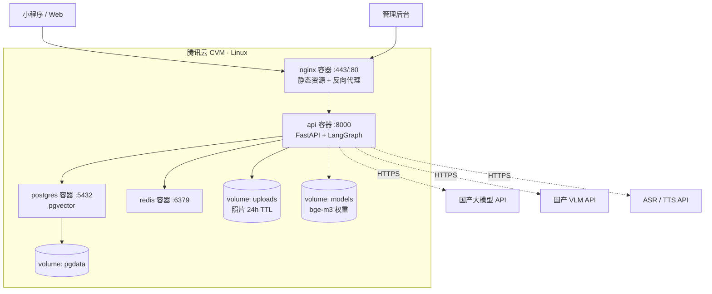
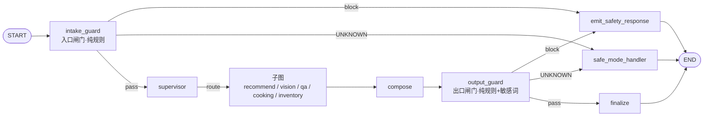

# AI 厨娘・智能烹饪助手 —— 架构设计与数据库设计文档

> 🏠 **所属知识库**：AI 厨娘・智能烹饪助手 ｜ **节点位置**：04｜设计与研发交付物 → 架构设计
> 📄 **文档编号**：B-D3 ｜ **版本**：V1.1 ｜ **状态**：🟡 待甲方评审
> 👤 **产出方**：乙方（开发方） ｜ **审核方**：甲方产品
> 📅 **日期**：2026-10-05
> 📚 **上游依据**：《PRD V1.0》（B-D1）、《需求说明文档 V1.0-r5》
> ⚖️ **一致性声明**：本文档**不引入 PRD 未定义的功能与技术**；与需求文档冲突时以需求文档为准

---

## 0. 文档信息

| 项 | 内容 |
| --- | --- |
| **文档编号** | B-D3 |
| **版本** | V1.0 |
| **对应 PRD** | 01-PRD-AI厨娘智能烹饪助手-V1.1.md |
| **必填章节覆盖** | 需求文档 04-§4.1 的 19 项章节全部覆盖（对照表见 §17） |
| **技术栈基线** | Python 3.11 + FastAPI + LangGraph 1.x + PostgreSQL 16(pgvector) + Redis + **Vue 3 + Element Plus（Web / 后台）** + **uni-app（小程序）** + Docker Compose |

### 0.1 修订记录

| 版本 | 日期 | 修订人 | 说明 |
| --- | --- | --- | --- |
| V1.0 | 2026-10-05 | 乙方架构师 | 首版。基于 PRD V1.0 与架构建议书确认结论产出 |
| **V1.1** | **2026-10-08** | 乙方架构师 | 随 **CR-20261008-01** 同步：新增 **M17 `innovation` 模块**、`subgraph_innovation` 子图与意图路由、7 个创新接口、**4 张创新相关表**（19 核心 + 13 配套 = 32 张）、7 条索引、**第 5 个远程开关 `switch.innovation`** |

---

## 1. 架构目标与约束

### 1.1 架构目标（对应 PRD §1.3 的 7 项 G 目标）

| 目标 | 架构支撑 |
| --- | --- |
| G-1 多智能体框架跑通闭环 | LangGraph 主图 + 子图编排，节点可插拔注册 |
| G-2/G-3 推荐与引导体验 | 硬过滤 + 7 因子排序；本地优先的分步引导 |
| **G-4 风控一票否决** | 双侧闸门 + 控制流短路（§5） |
| G-5 营养估算 | 成分表驱动计算引擎 + 缺失项显式标注 |
| G-6 库存与临期 | 库存状态机 + 临期窗口计算 |
| G-7 会员付费验证 | 微信虚拟支付 + 权益服务 |

### 1.2 架构约束（对应 PRD 需求文档 §6 的 8 类 NFR）

| NFR 类 | 关键约束 | 架构落点 |
| --- | --- | --- |
| NFR-1 合规与食品安全（最高优先级） | 拦截率 100%、过敏原五处生效、输出侧敏感词、拒答 | §5 风控实现设计 |
| NFR-2 性能 | 推荐 P95 ≤ 6s、识别 ≤ 5s、语音 ≤ 1.5s、步骤切换 ≤ 300ms | §11 性能设计 |
| NFR-3 体验（厨房场景） | 大字、常亮、湿手可操作、深色、离线可读、五态 | 前端层 + §11.4 离线缓存 |
| NFR-4 可扩展性 | Agent 可插拔、知识库热更新、数据源可替换、多端预留、模型可切换 | §4.7、§15 |
| NFR-5 可观测性 | 全链路日志、风控独立告警、错误追踪、成本监控 | §13 |
| NFR-6 多模态识别质量 | Top-3 ≥ 90%、召回 ≥ 85%、纠正率 ≤ 15%、低置信保护 | §8.1 |
| NFR-7 数据安全与隐私 | 加密、照片 24h 删除、音频不落盘、日志脱敏、数据权利、出境 | §14 |
| NFR-8 成本可控性 | 可观测、单次成本基线、预算告警、不劣化、缓存 | §12 |

### 1.3 合规约束（22 条 RL 的技术落点）

| RL 组 | 技术落点 |
| --- | --- |
| A 食品安全（RL-1~6） | 规则引擎（不调模型）+ 双侧闸门 + 布尔硬过滤 + 识别确认强制 |
| B 内容宣传（RL-7~11） | 输出侧敏感词/营养声称过滤 + 话术模板表（`risk_message`） |
| C 数据资质（RL-12~19） | 备案信息展示位 + 字段加密 + 语料来源标注 + 依赖许可证清单（§16） |
| D 平台规则（RL-20~22） | 小程序虚拟支付对接 + iOS 端服务端下发「隐藏购买入口」开关 |

---

## 2. 总体架构

### 2.1 分层架构

> 完整分层图见 **PRD §11.4**（8 层：客户端 / 接入 / 应用 / Agent 编排 / 能力 / 数据 / 外部服务 / 可观测）。本节补充工程视角的实现细节。


### 2.2 模块划分

**后端模块（FastAPI 应用）**

| # | 模块 | 职责 | 对应 PRD 章节 |
| --- | --- | --- | --- |
| M1 | `auth` | 匿名会话、微信登录、登录态、权限 | §5.2 |
| M2 | `profile` | 家庭档案、成员（含过敏原）、厨艺设备、饮食目标、单独同意 | §6.4、§6.5 |
| M3 | `ingredient` | 食材库、别名、分类、致敏原标注 | §7.1 |
| M4 | `vision` | 拍照识别接入、结果确认回写、照片 TTL 清理 | §7.2 |
| M5 | `speech` | ASR / TTS 适配、指令解析、音频不落盘 | §7.3、§8.2.5 |
| M6 | `recipe` | 菜谱 CRUD、检索、详情、用量缩放、替代食材 | §7.7 |
| M7 | `recommend` | 硬过滤、7 因子排序、rank_reasons、被过滤清单 | §7.4 |
| M8 | `cooking` | 烹饪会话、分步引导、计时器、求助 | §8.2、§8.3 |
| M9 | `nutrition` | 营养估算、缺失项标注、今日/近 7 天汇总、手动补录 | §8.4、§8.5 |
| M10 | `inventory` | 库存状态机、临期计算、扣减建议、购物清单 | §8.6、§8.7 |
| M11 | `safety` | **风控规则引擎、双侧闸门、话术模板、风控日志** | §10 |
| M12 | `orchestrator` | LangGraph 主图、意图路由、子图、一票否决、降级 | §11 |
| M13 | `member` | 会员权益、额度、订单、虚拟支付回调 | §8.9 |
| M14 | `feedback` | 用户反馈闭环 | §8.10 |
| M15 | `admin` | 后台管理：菜谱/食材/营养/风控规则/日志/权限/操作日志/远程开关 | §9 |
| M16 | `observability` | trace 落库、成本统计、风控告警看板 | §9.6、§11.9 |
| **M17** | **`innovation` 🆕** | **AI 菜品创新：安全前置校验、食材性质匹配、搭配规则校验、受约束生成、采纳闭环** | **§7.8、§10.9** |

**代码目录结构（建议）**

```
ai-cook/
├── backend/
│   ├── app/
│   │   ├── main.py                  # FastAPI 入口
│   │   ├── api/                     # 路由层（M1~M15 各一子包）
│   │   ├── services/                # 业务服务实现
│   │   ├── graph/                   # M12 Agent 编排
│   │   │   ├── state.py             # CookingState 定义
│   │   │   ├── main_graph.py        # 主图装配
│   │   │   ├── nodes/               # 节点：guards / supervisor / compose
│   │   │   ├── subgraphs/           # 子图：recommend / vision / qa / cooking
│   │   │   └── registry.py          # Agent 注册表（可插拔）
│   │   ├── safety/                  # M11 规则引擎
│   │   │   ├── engine.py            # 规则匹配（不调模型）
│   │   │   ├── rules/               # 规则定义（表驱动）
│   │   │   └── sensitive_words.py   # 输出侧敏感词
│   │   ├── ability/                 # 能力层（RAG/排序/计算/适配器）
│   │   ├── models/                  # SQLAlchemy 2.0 ORM
│   │   ├── schemas/                 # Pydantic v2 契约
│   │   └── core/                    # 配置/日志/中间件/脱敏
│   ├── alembic/                     # 数据库迁移
│   ├── tests/                       # 单测 + 集成测试
│   └── requirements.txt
├── web-stage1/                      # 阶段一 Web 演示端 · Vue3 + Element Plus（含调度面板）
├── miniprogram/                     # 阶段二 uni-app 小程序
├── admin-web/                       # 管理后台
├── deploy/                          # Docker 部署（见 04-部署手册）
└── docs/
```

### 2.3 技术栈清单（与 PRD 附录 C / §15 一致，不新增）

| 层 | 选型 | 版本 |
| --- | --- | --- |
| 后端语言 | Python | 3.11 |
| Web 框架 | FastAPI + Pydantic v2 | 最新稳定 |
| Agent 编排 | **LangGraph** | 1.x（锁定小版本） |
| ORM / 迁移 | SQLAlchemy 2.0 + Alembic | — |
| 关系库 | **PostgreSQL** | 16 |
| 向量 | **pgvector**（规模化再迁 Milvus） | 0.7+ |
| 缓存 | Redis | 7.x |
| Embedding | bge-m3（本地部署） | — |
| 主/轻大模型 | 国产大模型（可切换、分级） | — |
| 多模态 | 国产 VLM | — |
| ASR / TTS | 国内厂商（音频不落盘） | — |
| **前端（阶段一 Web 演示端）** | **Vue 3 + Vite + Element Plus** | — |
| **前端（阶段二 小程序）** | **uni-app → 微信小程序** | — |
| **前端（管理后台）** | **Vue 3 + Vite + Element Plus** | — |

> 🔴 **组件库适用范围**：**Element Plus 为 Web（浏览器）组件库，仅用于阶段一 Web 演示端与管理后台**。微信小程序运行在微信自绘渲染层、无 DOM 与浏览器 API，**不可使用 Element Plus**；阶段二小程序按需求文档 TC-1 使用 **uni-app**。
>
> **两套前端共用同一套后端接口**（以 `client_type` 区分端，NFR-4.4）：业务逻辑（硬过滤、排序、风控、营养计算）**全部在后端**，前端不得重复实现业务规则 —— 这是保证「过敏原布尔硬过滤」等安全逻辑只有一处实现的关键约束。
| 部署 | Docker + Docker Compose | — |

### 2.4 部署拓扑（MVP 单机，K8s 预留）



---

## 3. 核心业务流程

### 3.1 模块划分与流程的关系

> 本节 3 条主链路与需求文档 §5.1 一一对应；分支流程与 §5.2 的 BR-1~BR-16 一一对应。

### 3.2 主链路 A：从「有什么」到「做完一道菜」

```
① 免责声明校验（首次）
② 食材输入（手选 / 拍照识别并确认 / 语音并确认）
③ 【风控闸门·输入侧】扫描 → 命中则短路
④ 中枢调度：意图识别 + 组装上下文
     上下文 = 已确认食材 + 档案(过敏原/忌口/口味/目标) + 厨艺水平 + 设备 + 临期标记
⑤ 菜谱检索 Agent（RAG）召回候选
⑥ 【硬过滤】布尔：过敏原 / 忌口 / 难度   ← 先于排序，DB 层 WHERE
⑦ 推荐排序 Agent：7 因子加权 → rank_reasons
     （并行：营养估算、库存临期）
⑧ 【风控闸门·输出侧】+ 敏感词过滤
⑨ 返回三档推荐列表
⑩ 菜谱详情（用量/步骤/过敏原/营养）
⑪ 开始做菜 → 过敏原二次确认
⑫ 分步引导（大字/常亮/语音/计时器/求助）
⑬ 完成评分 → 营养小结 → 库存扣减建议（用户确认）
⑭ 反馈信号写回排序（闭环回到 ⑦）
```

### 3.3 主链路 B：营养目标驱动

```
设置饮食目标 → 疾病相关目标弹合规提示 → 排序中「目标匹配度」权重提升
→ 推荐/详情/营养页全链标注「估算值，仅供参考」
→ 完成后营养小结 + 今日/近 7 天汇总
```

### 3.4 主链路 C：库存与临期驱动

```
录入库存（含到期日）→ 临期窗口检查 → 首页提醒条 → 针对性推荐（临期加权）
→ 完成后库存扣减建议 → 缺料进购物清单（合并去重）→ 分享
```

### 3.5 分支流程映射（BR-1 ~ BR-16）

| 分支 | 技术处理 | 落点模块 |
| --- | --- | --- |
| BR-1 未同意免责 | 准入中间件阻断 | M1 |
| BR-2 风控命中高危 | 控制流短路 → 终止节点 | M11 + M12 |
| BR-3 搜索含自身过敏原 | 放行 + 警示条标记 | M7 |
| BR-4 识别置信度全低 | 降级手选，不消耗额度 | M4 |
| BR-5 疑似变质特征 | 仅提示，不判定 | M4 |
| BR-6 推荐不足 8 条 | 如实说明，不填充 | M7 |
| BR-7 疾病/用药提问 | 拒答规则 | M11 |
| BR-8 食物相克 | 科普澄清 | M11 |
| BR-9 语音识别失败 | 降级屏幕操作 | M5 |
| BR-10 麦克风权限被拒 | 前端降级 | 客户端 |
| BR-11 单 Agent 超时 | 部分输出 + 标注 | M12 |
| BR-12 多 Agent 冲突 | 标注差异，不阻断 | M12 |
| BR-13 免费额度用尽 | 权益预览 | M13 |
| BR-14 未建档直接推荐 | 通用规则 + 黄条 | M2 + M7 |
| BR-15 计时器后台运行 | 本地通知 + 回前台补偿校准（PRD-Q-6） | 客户端 |
| BR-16 库存已过期 | 提醒确认，不判定 | M10 |

---

## 4. Agent 编排设计（LangGraph）

### 4.1 主图结构



**节点清单**

| 节点 | 类型 | 实现要点 |
| --- | --- | --- |
| `intake_guard` | 规则节点 | 调用 M11 规则引擎（**不调模型**），返回 `RiskVerdict` |
| `supervisor` | LLM 节点 | 意图识别（LLM）→ **确定性字典路由**；组装最小必要上下文 |
| `subgraph_recommend` | 子图 | `assemble_context → recipe_retrieve → hard_filter → recipe_rank` |
| `subgraph_vision` | 子图 | `vision_recognize → interrupt(用户确认) → write_back` |
| `subgraph_qa` | 子图 | 受限 ReAct：工具白名单 + 轮次上限 1 轮 |
| `node_nutrition` | 计算节点 | 与推荐链并行 |
| `node_inventory` | 计算节点 | 与推荐链并行 |
| `node_cooking_help` | LLM 节点 | 短答 ≤ 3 条要点，结果过出口闸门 |
| `compose` | 规则 + 轻 LLM | 汇总、冲突标注、免责声明附着 |
| `output_guard` | 规则节点 | 敏感词 + 营养声称 + 绝对化 + 医疗（**不调模型**） |
| `emit_safety_response` | 终止节点 | 一票否决出口，仅返回风控话术 |
| `safe_mode_handler` | 终止节点 | 保守模式出口 |
| `finalize` | 终止节点 | 正常出口 + trace 落库 |

### 4.2 State 定义（Pydantic / TypedDict）

```python
class CookingState(TypedDict, total=False):
    # 请求元信息
    request_id: str
    thread_id: str
    user_id: str
    intent: str

    # 安全域（加密字段不落 trace）
    safety_profile: SafetyProfile          # 过敏原集合 / 特殊人群标记
    input_verdict: RiskVerdict             # 输入侧闸门判定
    output_verdict: RiskVerdict            # 输出侧闸门判定
    safe_mode: bool                        # 保守模式标记

    # 业务数据
    confirmed_ingredients: list[Ingredient]
    candidates: list[Recipe]
    filtered_out: dict[str, int]           # 供「显示被我过滤掉的菜」
    results: list[RankedRecipe]            # 含 rank_reasons
    nutrition: NutritionResult

    # 响应与可观测
    response: FinalResponse
    trace: Annotated[list[TraceSpan], operator.add]   # reducer 累加，支持并行合并
```

> `trace` 用 `operator.add` 作 reducer，是并行节点 trace 能正确合并、并被「Agent 调度可视化面板」消费的关键。

### 4.3 意图路由（确定性映射）

```python
INTENT_ROUTES = {
    "recommend_by_ingredients": "subgraph_recommend",
    "search_recipe":            "subgraph_recommend",
    "photo_recognize":          "subgraph_vision",
    "free_qa":                  "subgraph_qa",
    "cooking_help":             "node_cooking_help",
    "nutrition_query":          "node_nutrition",
    "inventory_op":             "node_inventory",
    "innovation":               "subgraph_innovation",   # 🆕
    "smalltalk_or_out_of_scope":"fallback_node",
}
```

> **设计理由**：LLM 只负责「识别意图」，路由映射由代码字典固定 —— 可枚举、可测试、可审计；不允许 LLM 自行决定调用哪个工具。

### 4.4 一票否决的实现（🔴 核心）

```python
def route_after_intake_guard(state: CookingState) -> str:
    v = state["input_verdict"]
    if v.status == "UNKNOWN":          # 风控不可用 → 保守模式，绝不直连模型
        return "safe_mode_handler"
    if v.hit and v.block:              # ★ 一票否决：短路，业务节点不执行
        return "emit_safety_response"
    return "supervisor"

# 双保险：中枢节点入口守卫
def supervisor_node(state: CookingState) -> Command:
    iv = state.get("input_verdict")
    if iv and iv.overrides_all:
        return Command(goto="emit_safety_response")   # 不透传任何业务字段
    ...
```

| 关键点 | 说明 |
| --- | --- |
| **短路而非丢弃** | 命中时业务节点在**同一 superstep 中根本不执行**，而非「执行后丢弃」 |
| **拓扑保证** | 图编译期 + 单元测试断言：不存在绕过闸门直达 `END` 的路径 |
| **返回值纯净** | 短路返回体**不含** `results` / `candidates` / `nutrition` 任何字段 |
| **三份证据** | ① 图结构单测；② trace 中业务节点 `not_executed`；③ 返回体字段断言 |
| **风控不调模型** | 无 Prompt 注入面；毫秒级；零成本；规则 ID 可追溯 |

### 4.5 子图与检查点

| 子图 | 独立 checkpointer | 含 `interrupt` | thread_id |
| --- | --- | --- | --- |
| `subgraph_recommend` | 否 | 否 | 请求级 |
| `subgraph_vision` | **是** | **是**（等待用户确认，RL-5） | 识别任务 ID |
| `subgraph_qa` | 否 | 否 | 请求级 |
| **`subgraph_innovation` 🆕** | **是** | **是**（等待用户采纳） | 创新任务 ID |
| `subgraph_cooking` | **是** | **是**（逐步等待「下一步」） | 烹饪会话 ID |

> ⚠️ **踩坑提示（工程约束）**：含 `interrupt` 的子图**必须**带独立 checkpointer，否则恢复会失败。阶段一用轻量实现（内存/SQLite），阶段二切 PostgreSQL checkpointer（与业务库同源）。

### 4.6 超时与降级矩阵

| 节点 | 执行方式 | 超时【假设】 | 失败后果 | 降级动作 |
| --- | --- | --- | --- | --- |
| `intake_guard` | 串行 · 强制 | 500ms | **致命** | 保守模式 |
| `supervisor` | 串行 | 3s | 可降级 | 关键词意图兜底 |
| `recipe_retrieve` | 串行 | 3s | 可降级 | 兜底文案 |
| `hard_filter` | 串行 · 强制 | 500ms | **致命** | **返回空结果集**（宁少不错） |
| `recipe_rank` | 串行 | 1s | 可降级 | 退化为覆盖率单因子 |
| `node_nutrition` | **并行** | 2s | 可降级 | 标「营养数据暂不可用」 |
| `node_inventory` | **并行** | 1s | 可降级 | 忽略临期加权 |
| `compose` | 串行 | 1s | 可降级 | 透传各部分结果 |
| `output_guard` | 串行 · 强制 | 500ms | **致命** | 保守模式 |
| 整链路 | — | 12s（阶段二）/ 10s（阶段一） | — | — |

### 4.7 Agent 可插拔（NFR-4.1）

```python
# registry.py — 新增 Agent 只需注册，不改中枢核心
AGENT_REGISTRY: dict[str, AgentSpec] = {}

def register(name: str, node_factory, forms: str, timeout_ms: int):
    AGENT_REGISTRY[name] = AgentSpec(name, node_factory, forms, timeout_ms)

# 主图装配时按注册表动态 add_node
for spec in AGENT_REGISTRY.values():
    builder.add_node(spec.name, spec.node_factory())
```

---

## 5. 风控实现设计（🔴 必须正面回答的 8 问）

> 对应需求文档 04-§4.3 与 PRD §10。**这是全项目技术风险最高、最容易被验收打回的部分。**

| # | 问题 | 本设计回答 |
| --- | --- | --- |
| 1 | 「一票否决」代码层如何实现？中枢收到 `overrides_all=true` 后的路径？ | 条件边 `route_after_intake_guard` 直接 `goto emit_safety_response`，**业务节点不执行**；中枢节点另有入口守卫 `if iv.overrides_all: Command(goto=...)` 作双保险，**不透传任何业务字段**（§4.4） |
| 2 | 输入侧 / 输出侧分别部署在哪？两侧不可省的理由与延迟代价？ | 输入侧 = 主图入口首个节点（在意图识别之前）；输出侧 = `compose` 之后、`finalize` 之前。**理由**：输入侧拦不住「用户诱导模型说出违规表述」，输出侧拦不住「用户输入本身即高危」。**代价**：两次纯规则匹配，**毫秒级**，对链路延迟影响可忽略 |
| 3 | 风控不可用时如何保证进保守模式而非直连模型？有无物理隔离？ | 闸门节点用 try/except 全包裹，**任何异常/超时都返回 `status=UNKNOWN` 判定**（而非抛异常让上层跳过节点）；业务节点入口统一断言 `risk_verdict.status != UNKNOWN`，`UNKNOWN` 一律拒绝执行业务链 → `safe_mode_handler`。**物理隔离**：规则引擎为纯本地模块（无网络依赖），与应用同一进程但**无外部调用**，不存在「超时后降级去问模型」的代码路径 |
| 4 | 过敏原为何必须前置为布尔过滤？代码中如何防止被实现成降权？ | **理由**：含致敏原菜谱出现在默认结果即 P0 缺陷（RL-6）。**实现**：`hard_filter` 是**独立节点**，在 SQL 层用 `WHERE NOT (r.allergen_codes && :user_allergens)` 排除，**结果集不进入排序**；排序函数签名只接受已过滤集合，**结构上无法给被过滤项打分**。**防护**：① 独立单测断言「含致敏原菜谱数 = 0」；② 单测断言排序输入集与过滤输出集完全一致；③ `filtered_by` 计数落库供验收 P7 取证 |
| 5 | 规则库如何做到远程热更新 + 一键回滚？ | 规则存表 `risk_rule`（含 `version` / `enabled` / `effective_scope`），Redis 存**规则指纹**；应用每 30s 拉取指纹，变化则热加载，**不重启、不发版**。回滚：保留历史版本行 + `remote_config.version` 指针，后台一键切回上一版本（§15） |
| 6 | 如何防止 Prompt 注入绕过风控？ | ① 闸门**不调模型** → 无注入面；② ReAct 子图工具**白名单**，模型不能调用「关闭风控」类工具；③ 输入侧规则含注入特征识别（边界 #28）；④ 输出侧二次复核兜底 |
| 7 | 「未确认不入库」在数据层如何强制？能否被配置关闭？ | **强制三层**：① `subgraph_vision` 在写库前必须经过 `interrupt` 确认节点；② 写库接口 `POST /ingredient/confirm` **必须传 `task_id` 且任务状态 = `confirmed`**，否则 409；③ 识别任务状态机中 `pending_confirm` 态**不写库存、不进推荐上下文**。**不可关闭**：无配置开关，`need_user_confirm` 恒为 `true`（RL-5 硬约束） |
| 8 | 全链路日志如何留痕并支持后台复核？ | `risk_log`（规则 ID / 输入摘要 / 处置 / 时间）+ `agent_trace`（节点 / 耗时 / token / 成本）；后台 `US-K4` 支持按会话 ID / 用户 ID / 时间 / Agent 四维检索；🔴 用户标识、位置、健康信息脱敏后落库 |

### 5.1 规则引擎实现（不调模型）

```python
class RiskEngine:
    """确定性规则匹配：关键词 + 正则 + 同义扩展 + 语义特征，全部本地执行"""

    def scan(self, stage: Literal["input", "output"],
             text: str,
             ctx: SafetyProfile) -> RiskVerdict:
        try:
            rules = self._load_rules(stage=stage, enabled=True)   # 内存缓存 + 指纹校验
            for rule in rules:                                    # 按 risk_level 降序
                if self._match(rule, text, ctx):
                    return RiskVerdict(
                        hit=True, rule_code=rule.rule_code,
                        category=rule.category, risk_level=rule.risk_level,
                        block=rule.block, message_id=rule.response_message_id,
                        overrides_all=rule.block,
                        evidence_ref=[f"{rule.rule_code}@{rule.version}"],
                    )
            return RiskVerdict(hit=False, status="OK")
        except Exception:
            return RiskVerdict(status="UNKNOWN")   # ★ 永不放过，只降级
```

**规则类别（对应 PRD §10.3~§10.6）**

| category | 阶段 | 说明 |
| --- | --- | --- |
| `food_safety_high_risk` | input + output | 11 类高危（久泡木耳、未熟豆角…） |
| `special_population` | input + output | 孕妇/婴幼儿/老人/慢病 |
| `medical_refusal` | input | 疾病/用药/治疗方案 → 拒答 |
| `pseudoscience` | input | 食物相克 → 科普澄清 |
| `output_ban` | **output only** | 营养声称 / 绝对化 / 安全承诺 / 医疗宣称 |

---

## 6. 检索与向量化设计

| 项 | 方案 |
| --- | --- |
| 语料来源 | HowToCook（Unlicense）373 篇 → 清洗后 362 篇结构化菜谱 |
| 切片策略 | **按菜谱整体切片**（不按段落），单条 = 菜名 + 食材清单 + 步骤摘要 + 标签；超长菜谱按步骤分组二级切片 |
| 向量模型 | **bge-m3**（本地部署，规避数据出境） |
| 向量维度 | 1024 |
| 索引 | pgvector `ivfflat`（MVP，lists=100）→ 规模化迁 Milvus |
| 召回 | 向量 Top-20 + 关键词/别名精确召回（混合召回） |
| 重排 | 轻量重排（食材覆盖率 + 标签匹配），**只把 Top-8 注入生成上下文**（成本控制） |
| 过滤前置 | 召回后进入 `hard_filter` 独立节点（**SQL + 内存双保险**） |
| 🔴 **检索分区（本次新增）** | 向量表带 `source` 字段：`verified`（正式菜谱）/ `ai_private`（用户创新菜）。**默认推荐只检索 `verified`**；**创新链路**检索 `verified` + **本人** `ai_private`（`owner_user_id` 过滤）→ 未验证内容不污染推荐，但用户可复用自己的创新菜（NFR-9.4 / NFR-9.7） |
| 来源标注 | `recipe.source_label` / `source_license` 必填，详情页展示（RL-17） |
| 热更新 | 菜谱入库后触发向量重建任务（增量），不重启服务（NFR-4.2） |

---

## 7. 推荐排序实现

### 7.1 执行顺序（🔴 不可颠倒）

```python
def recommend_pipeline(candidates, profile):
    # 第 1 步：布尔硬过滤（数据库层 WHERE，非打分）
    filtered = hard_filter(candidates, profile)      # 过敏原 / 忌口 / 难度
    # 第 2 步：多因子加权排序（只作用于已过滤集合）
    ranked = weighted_rank(filtered, profile)        # 7 因子
    # 第 3 步：输出
    return top_n(ranked, n=8), build_reasons(ranked), filter_stats(candidates, filtered)
```

### 7.2 硬过滤（SQL 层）

```sql
-- 过敏原：布尔硬过滤，含致敏原菜谱完全排除
SELECT r.* FROM recipe r
WHERE r.status = 'published'
  AND NOT (r.allergen_codes && :user_allergen_codes)          -- 数组重叠即排除
  AND NOT (r.ingredient_allergen_codes && :user_allergen_codes)
  AND NOT (r.dietary_flags && :user_dietary_restrictions)     -- 忌口
  AND r.difficulty <= :difficulty_cap;                        -- 难度
```

> **禁止**把上述任一条件改写成排序加分项。违反即为 P0 缺陷（PRD §7.4.3）。

### 7.3 7 因子加权

| # | 因子 | 权重 | 归一化方式 |
| --- | --- | --- | --- |
| 1 | 食材覆盖率 | 0.30 | 已覆盖食材数 / 菜谱所需食材数 |
| 2 | 临期食材优先 | 0.15 | 命中临期食材数 / 临期总数（无临期=0） |
| 3 | 口味匹配度 | 0.15 | 辣度/咸淡/甜度三档余弦相似 |
| 4 | 饮食目标匹配度 | 0.15 | 目标规则命中（减脂看热量、控糖看碳水…） |
| 5 | 难度匹配度 | 0.10 | 1 − |菜谱难度 − 厨艺上限| / 上限 |
| 6 | 历史偏好 | 0.10 | 收藏/评分/做过次数 − 负反馈惩罚 |
| 7 | 热度 | 0.05 | 站内点击与完成率分位 |

| 规则 | 内容 |
| --- | --- |
| 冷启动 | 无历史偏好时，0.10 按比例摊给「食材覆盖率」与「热度」 |
| 负反馈 | 首次降权；**同一用户重复点同类型第 2 次起转硬过滤** |
| 权值可配 | 权重存 `remote_config`，可热调，变更留操作日志 |
| 可解释 | 每条结果必须产出 `rank_reasons`（≥1 条） |

---

## 8. 多模态识别链路 / 语音链路

### 8.1 多模态识别链路

```
前端压缩（>10MB）→ 上传 → 视觉模型识别
  → 结果按置信度分区（高置信 / 低置信独立分区，NFR-6.4）
  → interrupt 等待用户确认（RL-5）
  → 用户确认后写库（inventory_item）
  → 原图 24h 后由清理任务删除（OSS TTL + 定时任务）
```

| 项 | 方案 |
| --- | --- |
| 置信度阈值 | 高于阈值 → 高置信区；低于 → 低置信区并标注「不确定」 |
| 全部低于阈值 | 降级引导手选，**不消耗会员额度**，不产生脏数据 |
| 非食物图片 | 返回「未识别到食材」，**不编造** |
| 质量指标 | Top-3 ≥ 90%、召回 ≥ 85%、纠正率 ≤ 15%（离线测试集口径） |

### 8.2 语音链路

```
麦克风 → ASR（流式）→ 文字回显可编辑 → 指令意图解析 → 前端动作
                          ↓
                   原始音频【不落盘】，仅存转写文本
```

| 项 | 方案 |
| --- | --- |
| 指令集 | 下一步 / 上一步 / 重复 / 读一遍 / 计时 X 分钟 / 暂停计时 / 退出 |
| 延迟 | P95 ≤ 1.5s |
| 失败降级 | 提示改用屏幕操作，**不打断当前步骤** |
| TTS 缓存 | 步骤播报文本固定，预生成音频缓存（降本） |
| 唤醒词 | V1.0 不做；「保持麦克风开启 + 长按说话」二选一（PRD §8.2.5） |

---

## 9. 接口设计

> 全部接口以 `client_type` 区分端（NFR-4.4）；写操作需 `request_id` 幂等键。

### 9.1 接口清单

| # | 方法 | 路径 | 说明 | 幂等 |
| --- | --- | --- | --- | --- |
| 1 | POST | `/v1/auth/anonymous` | 匿名会话 | — |
| 2 | POST | `/v1/auth/wx-login` | 微信登录 | — |
| 3 | POST | `/v1/consent/disclaimer` | 免责同意记录 | ✅ |
| 4 | POST | `/v1/consent/sensitive` | 敏感信息单独同意 | ✅ |
| 5 | GET/PUT | `/v1/profile/family` | 家庭档案 | ✅ |
| 6 | POST/PUT/DELETE | `/v1/profile/members` | 家庭成员 CRUD | ✅ |
| 7 | GET/PUT | `/v1/profile/skill` | 厨艺与设备 | ✅ |
| 8 | GET/PUT | `/v1/profile/diet-goal` | 饮食目标 | ✅ |
| 9 | GET | `/v1/ingredients` | 食材库（分类 / 搜索 / 别名） | — |
| 10 | POST | `/v1/vision/recognize` | 拍照识别（返回待确认） | ✅ |
| 11 | POST | `/v1/vision/confirm` | **识别结果确认入库**（强制） | ✅ |
| 12 | POST | `/v1/speech/asr` | 语音转写（音频不落盘） | — |
| 13 | POST | `/v1/recommend` | **推荐**（主接口，三档 + rank_reasons） | ✅ |
| 14 | GET | `/v1/recommend/filtered` | 被过滤清单 | — |
| 15 | POST | `/v1/search` | 搜索 / 自然语言提问 | ✅ |
| 16 | GET | `/v1/recipes/{id}` | 菜谱详情 | — |
| 17 | GET | `/v1/recipes/{id}/nutrition` | 营养估算 | — |
| 18 | POST | `/v1/cooking/sessions` | 创建烹饪会话（含过敏原确认） | ✅ |
| 19 | PATCH | `/v1/cooking/sessions/{id}` | 步骤推进 / 断点续做 | ✅ |
| 20 | POST | `/v1/cooking/sessions/{id}/help` | 烹饪中求助（走风控） | ✅ |
| 21 | POST | `/v1/cooking/sessions/{id}/finish` | 完成评分 | ✅ |
| 22 | GET | `/v1/nutrition/summary` | 今日 / 近 7 天汇总 | — |
| 23 | POST | `/v1/nutrition/manual` | 手动补录 | ✅ |
| 24 | GET/POST/PUT/DELETE | `/v1/inventory` | 库存 CRUD | ✅ |
| 25 | POST | `/v1/inventory/deduct-suggest` | 扣减建议 | ✅ |
| 26 | GET/POST | `/v1/shopping-list` | 购物清单 | ✅ |
| 27 | POST | `/v1/feedback` | 用户反馈 | ✅ |
| 28 | GET/POST | `/v1/member/*` | 权益 / 订单 / 支付回调 | ✅ |
| 29 | GET | `/v1/config/switches` | 远程开关（4 个模块） | — |
| 30 | GET | `/v1/trace/{request_id}` | **Agent 调度 trace（阶段一面板）** | — |
| 31 | — | `/admin/v1/**` | 后台管理接口（菜谱/食材/规则/日志/权限） | ✅ |
| **32** | POST | `/v1/innovation/precheck` 🆕 | **创新安全前置校验（只校验不生成）** | ✅ |
| **33** | POST | `/v1/innovation/generate` 🆕 | **生成创新菜**（安全前置 + 规则匹配 + 受约束生成） | ✅ |
| **34** | GET | `/v1/innovation/recipes/{id}` 🆕 | 创新菜详情（含创新依据） | — |
| **35** | POST | `/v1/innovation/recipes/{id}/adopt` 🆕 | 采纳 → 我的创新菜 | ✅ |
| **36** | POST | `/v1/innovation/recipes/{id}/index` 🆕 | 🔴 **确认入库 → 写入用户私有向量分区** | ✅ |
| **37** | POST | `/v1/innovation/recipes/{id}/reuse` 🆕 | **复用已有创新菜**（直接进入烹饪会话） | ✅ |
| **38** | POST | `/v1/innovation/recipes/{id}/feedback` 🆕 | 反馈（回流规则权重） | ✅ |
| **39** | — | `/admin/v1/innovation/rules` 🆕 | 后台：食材性质 / 搭配规则 / 技法库 / 配比模板 | ✅ |
| **40** | — | `/admin/v1/innovation/inbox` 🆕 | 后台：创新菜**巡检与下架**（**不做审核升格**） | ✅ |

### 9.2 推荐接口示例

**Request**

```json
POST /v1/recommend
{
  "request_id": "req_20261005_8f3a",
  "client_type": "web_stage1",
  "ingredients": [{"ingredient_id": 1021, "quantity_level": "enough"}],
  "options": {"show_filtered": false}
}
```

**Response（正常路径）**

```json
{
  "request_id": "req_20261005_8f3a",
  "safe_mode": false,
  "results": [
    {
      "recipe_id": 30217, "title": "青椒土豆炒肉片",
      "match_level": "can_cook_now",
      "covered_ingredients": ["五花肉", "青椒", "土豆"],
      "missing_ingredients": [],
      "time_minutes": 20, "difficulty": "easy", "calories_kcal": 420,
      "allergens": [], "required_equipment": ["炒锅"],
      "rank_score": 0.87,
      "rank_reasons": ["用掉 3 样你现有的食材", "含临期的青椒"],
      "source": "HowToCook / 家常菜"
    }
  ],
  "filtered_by": {"allergen": 12, "dietary_restriction": 4, "difficulty": 7},
  "disclaimer_id": "DISCLAIMER_V1",
  "trace_id": "tr_9c1b"
}
```

**Response（一票否决短路）**

```json
{
  "request_id": "req_20261005_a71c",
  "blocked": true,
  "overrides_all": true,
  "risk": {
    "category": "food_safety_high_risk",
    "rule_code": "FS-018",
    "risk_level": "high",
    "message_id": "FS_WOOD_EAR_SOAK_01",
    "correct_action": "木耳建议冷藏泡发且不超过 4 小时……",
    "after_consumption_advice": "如已食用并出现恶心、呕吐等症状，请及时就医",
    "evidence_ref": ["FS-018@rules-v1.2"]
  },
  "disclaimer_id": "DISCLAIMER_V1",
  "trace_id": "tr_9c20"
}
```

> ⚠️ **注意**：短路返回体**不含** `results` / `candidates` / `nutrition` 任何字段。

---

## 10. 数据库设计

### 10.1 设计约定

| 项 | 约定 |
| --- | --- |
| 数据库 | PostgreSQL 16（+ pgvector 扩展） |
| 命名 | 表名 / 字段名 `snake_case`；主键统一 `id` |
| 主键 | `BIGSERIAL`（业务表）；必要时用 UUID |
| 时间 | `TIMESTAMPTZ`，DB 内一律 UTC |
| 金额 | `*_cents INTEGER`（分为单位，避免浮点） |
| 软删除 | 需要保留追溯的表用 `deleted_at TIMESTAMPTZ NULL` |
| 多值字段 | 标签类用 `JSONB`（便于数组重叠查询 `&&`）；枚举类用 `VARCHAR + CHECK` |
| 字符集 | UTF8 |
| 迁移 | Alembic 管理，**禁止手工改线上表结构** |

### 10.2 ER 图

```mermaid
erDiagram
    USER ||--o| FAMILY : "拥有"
    USER ||--o| USER_SKILL_PROFILE : "拥有"
    USER ||--o{ DIET_GOAL : "设置"
    USER ||--o{ DISCLAIMER_CONSENT : "签署"
    USER ||--o{ CONSENT_RECORD : "单独同意"
    USER ||--o{ INVENTORY_ITEM : "维护"
    USER ||--o{ COOKING_SESSION : "发起"
    USER ||--o{ RECIPE_FEEDBACK : "反馈"
    USER ||--o{ SHOPPING_LIST_ITEM : "拥有"
    USER ||--o{ ORDER : "下单"
    USER ||--o{ MEAL_RECORD : "记录"
    USER ||--o{ FEEDBACK : "提交"

    FAMILY ||--o{ FAMILY_MEMBER : "包含"

    INGREDIENT ||--o{ INGREDIENT_ALIAS : "别名"
    INGREDIENT ||--o| INGREDIENT_NUTRITION : "营养"
    INGREDIENT ||--o{ INVENTORY_ITEM : "被库存引用"
    INGREDIENT ||--o{ RECIPE_INGREDIENT : "被菜谱引用"

    RECIPE ||--o{ RECIPE_INGREDIENT : "包含食材"
    RECIPE ||--o{ RECIPE_STEP : "包含步骤"
    RECIPE ||--o{ COOKING_SESSION : "被烹饪"
    RECIPE ||--o{ RECIPE_FEEDBACK : "被评价"

    COOKING_SESSION ||--o{ COOKING_HELP_LOG : "求助记录"

    RISK_RULE ||--o{ RISK_LOG : "被命中"
    RISK_MESSAGE ||--o{ RISK_RULE : "话术模板"

    ADMIN_USER ||--o{ OPERATION_LOG : "操作"
```



### 10.3 表清单

| # | 表名 | 中文名 | 类型 | PRD 来源 |
| --- | --- | --- | --- | --- |
| 1 | `user` | 用户 | 核心 | §15.1-1 |
| 2 | `family` | 家庭档案 | 核心 | §15.1-2 |
| 3 | `family_member` | 家庭成员 | 核心 | §15.1-3 |
| 4 | `user_skill_profile` | 厨艺与设备档案 | 核心 | §15.1-4 |
| 5 | `diet_goal` | 饮食目标 | 核心 | §15.1-5 |
| 6 | `ingredient` | 食材 | 核心 | §15.1-6 |
| 7 | `ingredient_nutrition` | 营养数据 | 核心 | §15.1-7 |
| 8 | `inventory_item` | 库存条目 | 核心 | §15.1-8 |
| 9 | `recipe` | 菜谱 | 核心 | §15.1-9 |
| 10 | `recipe_ingredient` | 菜谱食材 | 核心 | §15.1-10 |
| 11 | `recipe_step` | 菜谱步骤 | 核心 | §15.1-11 |
| 12 | `cooking_session` | 烹饪会话 | 核心 | §15.1-12 |
| 13 | `cooking_help_log` | 求助记录 | 核心 | §15.1-13 |
| 14 | `recipe_feedback` | 评分与反馈 | 核心 | §15.1-14 |
| 15 | `shopping_list_item` | 购物清单 | 核心 | §15.1-15 |
| 16 | `risk_rule` | 风控规则 | 核心 | §15.1-16 |
| 17 | `risk_log` | 风控日志 | 核心 | §15.1-17 |
| 18 | `agent_trace` | Agent 调用日志 | 核心 | §15.1-18 |
| 19 | `order` | 订单 | 核心 | §15.1-19 |
| 20 | `disclaimer_consent` | 免责同意记录 | 配套 | PRD §6.1（US-A1） |
| 21 | `consent_record` | 敏感信息单独同意 | 配套 | PRD §6.2（RL-14） |
| 22 | `ingredient_alias` | 食材别名 | 配套 | PRD §7.1（US-D1） |
| 23 | `meal_record` | 饮食记录 / 手动补录 | 配套 | PRD §8.5（US-G2） |
| 24 | `risk_message` | 风控话术模板 | 配套 | PRD §10.3（US-L2） |
| 25 | `remote_config` | 远程开关与权重配置 | 配套 | PRD §5.8（§11.8） |
| 26 | `admin_user` | 后台账号 | 配套 | PRD §9.5（US-K6） |
| 27 | `operation_log` | 后台操作日志 | 配套 | PRD §9.5（US-K6） |
| 28 | `feedback` | 用户反馈 | 配套 | PRD §8.10（US-N1） |
| **29** | `ingredient_property` 🆕 | **食材性质库** | 新增 | PRD §7.8.1（模块 O） |
| **30** | `flavor_pairing_rule` 🆕 | **搭配规则库** | 新增 | PRD §7.8.1 / §9.7 |
| **31** | `technique_library` 🆕 | **技法库（白名单）** | 新增 | PRD §7.8.1 |
| **32** | `innovation_recipe` 🆕 | **创新菜** | 新增 | PRD §7.8 / §12.6 |

> ⚠️ **表数量变更**：由 **28 张 → 32 张**（19 核心 + **13 配套**）。新增 4 张表服务于模块 O（AI 菜品创新），须随 **CR-20261008-01** 一并确认。

### 10.4 表结构详细定义

#### 10.4.1 `user` 用户

| 字段 | 类型 | 约束 | 说明 |
| --- | --- | --- | --- |
| `id` | BIGSERIAL | PK | 用户 ID |
| `anonymous_id` | VARCHAR(64) | UNIQUE NOT NULL | 匿名会话标识 |
| `wx_openid` | VARCHAR(64) | UNIQUE NULL | 微信 openid |
| `wx_unionid` | VARCHAR(64) | NULL | 微信 unionid |
| `phone` | VARCHAR(20) | NULL | ⚠️PRD-Q / Q-57 是否采集待定 |
| `nickname` | VARCHAR(50) | NULL | 昵称 |
| `avatar_url` | VARCHAR(255) | NULL | 头像 |
| `created_at` | TIMESTAMPTZ | NOT NULL DEFAULT now() | — |
| `updated_at` | TIMESTAMPTZ | NOT NULL DEFAULT now() | — |

#### 10.4.2 `disclaimer_consent` 免责同意记录

| 字段 | 类型 | 约束 | 说明 |
| --- | --- | --- | --- |
| `id` | BIGSERIAL | PK | — |
| `user_id` | BIGINT | FK → `user.id` NOT NULL | — |
| `agreement_version` | VARCHAR(20) | NOT NULL | 协议版本号 |
| `agreed_at` | TIMESTAMPTZ | NOT NULL | 同意时间 |
| `device_id` | VARCHAR(128) | NULL | 设备标识 |
| `ip` | INET | NULL | 记录 IP |

#### 10.4.3 `consent_record` 敏感个人信息单独同意

| 字段 | 类型 | 约束 | 说明 |
| --- | --- | --- | --- |
| `id` | BIGSERIAL | PK | — |
| `user_id` | BIGINT | FK → `user.id` NOT NULL | — |
| `scope` | VARCHAR(30) | NOT NULL CHECK IN (`allergen`,`health_goal`,`special_population`) | 同意范围 |
| `version` | VARCHAR(20) | NOT NULL | 文案版本 |
| `agreed` | BOOLEAN | NOT NULL | 是否同意 |
| `agreed_at` | TIMESTAMPTZ | NOT NULL | — |
| `revoked_at` | TIMESTAMPTZ | NULL | 撤回时间 |

#### 10.4.4 `family` 家庭档案

| 字段 | 类型 | 约束 | 说明 |
| --- | --- | --- | --- |
| `id` | BIGSERIAL | PK | — |
| `user_id` | BIGINT | FK → `user.id` NOT NULL | 归属用户 |
| `name` | VARCHAR(50) | NOT NULL | 家庭名称 |
| `member_limit` | SMALLINT | NOT NULL DEFAULT 4 | 免费 4 / 会员 10（Q-14） |
| `created_at` / `updated_at` | TIMESTAMPTZ | NOT NULL | — |
| `deleted_at` | TIMESTAMPTZ | NULL | 软删除 |

#### 10.4.5 `family_member` 家庭成员 🔴 风控强依赖

| 字段 | 类型 | 约束 | 说明 |
| --- | --- | --- | --- |
| `id` | BIGSERIAL | PK | — |
| `family_id` | BIGINT | FK → `family.id` NOT NULL | — |
| `nickname` | VARCHAR(10) | NOT NULL | 称呼 |
| `age_group` | VARCHAR(20) | NOT NULL CHECK IN (`0-3`,`4-12`,`13-17`,`18-59`,`60+`) | 年龄段 |
| `taste_spicy` | SMALLINT | NULL CHECK 0–2 | 辣度 |
| `taste_salt` | SMALLINT | NULL CHECK 0–2 | 咸淡 |
| `taste_sweet` | SMALLINT | NULL CHECK 0–2 | 甜度 |
| `dietary_restrictions` | JSONB | NOT NULL DEFAULT `'[]'` | 忌口 |
| `**allergen_codes**` | **JSONB** | **NOT NULL DEFAULT `'[]'`** | 过敏原 code 集合（GB 7718 八类） |
| `no_known_allergen` | BOOLEAN | NOT NULL DEFAULT false | 「暂无已知过敏」 |
| `special_diet` | JSONB | NOT NULL DEFAULT `'[]'` | 素食/清真/低盐/低糖/低脂/无麸质 |
| `special_population` | JSONB | NOT NULL DEFAULT `'[]'` | 孕妇/哺乳期/婴幼儿/老人/慢病 |
| `created_at` / `updated_at` | TIMESTAMPTZ | NOT NULL | — |
| `deleted_at` | TIMESTAMPTZ | NULL | 软删除 |

**表级约束（强制「过敏原必选」，Q-13）**

```sql
ALTER TABLE family_member ADD CONSTRAINT chk_allergen_required
  CHECK (no_known_allergen = true OR jsonb_array_length(allergen_codes) > 0);
```

#### 10.4.6 `user_skill_profile` 厨艺与设备档案

| 字段 | 类型 | 约束 | 说明 |
| --- | --- | --- | --- |
| `id` | BIGSERIAL | PK | — |
| `user_id` | BIGINT | FK → `user.id` UNIQUE NOT NULL | 一人一份 |
| `skill_level` | VARCHAR(12) | NOT NULL CHECK IN (`beginner`,`skilled`,`expert`) | 厨艺水平 |
| `difficulty_cap` | SMALLINT | NOT NULL DEFAULT 2 | 难度上限（新手=1/熟练=3/高手=5） |
| `equipment` | JSONB | NOT NULL DEFAULT `'[]'` | 13 项设备 |
| `created_at` / `updated_at` | TIMESTAMPTZ | NOT NULL | — |

#### 10.4.7 `diet_goal` 饮食目标

| 字段 | 类型 | 约束 | 说明 |
| --- | --- | --- | --- |
| `id` | BIGSERIAL | PK | — |
| `user_id` | BIGINT | FK → `user.id` NOT NULL | — |
| `goal_type` | VARCHAR(20) | NOT NULL CHECK IN (`balanced`,`fat_loss`,`muscle_gain`,`sugar_control`,`low_sodium`) | 5 类目标 |
| `target_kcal` | INTEGER | NULL | 热量上限 |
| `effective_from` | DATE | NOT NULL | — |
| `effective_to` | DATE | NULL | — |
| `compliance_ack_at` | TIMESTAMPTZ | NULL | **疾病相关目标的合规提示确认记录**（US-G3） |
| `created_at` / `updated_at` | TIMESTAMPTZ | NOT NULL | — |

#### 10.4.8 `ingredient` 食材

| 字段 | 类型 | 约束 | 说明 |
| --- | --- | --- | --- |
| `id` | BIGSERIAL | PK | — |
| `name` | VARCHAR(50) | NOT NULL | 名称 |
| `category` | VARCHAR(20) | NOT NULL CHECK IN (`veg`,`meat`,`seafood`,`egg_milk`,`soy`,`staple`,`seasoning`,`dry`,`frozen`,`other`) | 10 分类 |
| `allergen_codes` | JSONB | NOT NULL DEFAULT `'[]'` | 致敏原 |
| `allergen_verified` | BOOLEAN | NOT NULL DEFAULT false | **数据缺失标注**（false → 前端「待核实」） |
| `unit_conversion` | JSONB | NULL | 单位换算（g/ml/勺/碗） |
| `is_active` | BOOLEAN | NOT NULL DEFAULT true | 上下架 |
| `created_at` / `updated_at` | TIMESTAMPTZ | NOT NULL | — |

> 食材库需覆盖 **≥ 800 条**（Q-18）。

#### 10.4.9 `ingredient_alias` 食材别名

| 字段 | 类型 | 约束 | 说明 |
| --- | --- | --- | --- |
| `id` | BIGSERIAL | PK | — |
| `ingredient_id` | BIGINT | FK → `ingredient.id` NOT NULL | — |
| `alias` | VARCHAR(50) | NOT NULL | 别名（西红柿/番茄/洋柿子） |

#### 10.4.10 `ingredient_nutrition` 营养数据

| 字段 | 类型 | 约束 | 说明 |
| --- | --- | --- | --- |
| `id` | BIGSERIAL | PK | — |
| `ingredient_id` | BIGINT | FK → `ingredient.id` UNIQUE NOT NULL | 一对一 |
| `kcal_100g` | NUMERIC(8,2) | NULL | 每 100g 热量 |
| `protein_g` | NUMERIC(8,2) | NULL | — |
| `fat_g` | NUMERIC(8,2) | NULL | — |
| `carbs_g` | NUMERIC(8,2) | NULL | — |
| `sodium_mg` | NUMERIC(8,2) | NULL | — |
| `data_source` | VARCHAR(100) | NOT NULL | **数据来源**（USDA / 授权表） |
| `source_license` | VARCHAR(50) | NOT NULL | 许可状态（CC0 / 待授权） |
| `created_at` / `updated_at` | TIMESTAMPTZ | NOT NULL | — |

> **缺失处理**：字段为 NULL 即代表「未纳入统计」，**不得按 0 计算**（PRD §8.4）。

#### 10.4.11 `inventory_item` 库存条目

| 字段 | 类型 | 约束 | 说明 |
| --- | --- | --- | --- |
| `id` | BIGSERIAL | PK | — |
| `user_id` | BIGINT | FK → `user.id` NOT NULL | — |
| `ingredient_id` | BIGINT | FK → `ingredient.id` NOT NULL | — |
| `quantity_level` | VARCHAR(10) | NOT NULL CHECK IN (`has`,`little`,`enough`) | 数量档位（三档） |
| `storage` | VARCHAR(10) | NOT NULL CHECK IN (`fridge`,`freezer`,`room`,`dry`) | 存放位置 |
| `purchase_date` | DATE | NULL | 入库日期 |
| `expiry_date` | DATE | NULL | 到期日（**用户自填，仅提醒用途**，RL-3） |
| `status` | VARCHAR(12) | NOT NULL DEFAULT `normal` CHECK IN (`normal`,`expiring`,`consumed`,`expired`,`deleted`) | 状态机 |
| `source` | VARCHAR(10) | NOT NULL CHECK IN (`manual`,`vision`,`recipe`) | 入库来源 |
| `created_at` / `updated_at` | TIMESTAMPTZ | NOT NULL | — |

#### 10.4.12 `recipe` 菜谱

| 字段 | 类型 | 约束 | 说明 |
| --- | --- | --- | --- |
| `id` | BIGSERIAL | PK | — |
| `title` | VARCHAR(100) | NOT NULL | 菜名 |
| `cuisine` | VARCHAR(30) | NULL | 菜系 |
| `cooking_method` | VARCHAR(20) | NULL | 烹饪方式 |
| `difficulty` | SMALLINT | NOT NULL CHECK BETWEEN 1 AND 5 | 难度 1–5 |
| `time_minutes` | INTEGER | NULL | 耗时 |
| `servings` | SMALLINT | NOT NULL DEFAULT 2 | 份数 |
| `calories_kcal` | INTEGER | NULL | 语料自带总热量（100% 覆盖） |
| `allergen_codes` | JSONB | NOT NULL DEFAULT `'[]'` | 致敏原 |
| `**ingredient_allergen_codes**` | **JSONB** | **NOT NULL DEFAULT `'[]'`** | 由食材聚合的致敏原（冗余，供硬过滤 SQL 用） |
| `dietary_flags` | JSONB | NOT NULL DEFAULT `'[]'` | 素食/低盐等，供忌口过滤 |
| `equipment` | JSONB | NOT NULL DEFAULT `'[]'` | 设备需求（**须人工补标**，语料仅 26% 显式） |
| `cover_image_url` | VARCHAR(255) | NULL | 成品图（**不得用 HowToCook 原图**） |
| `source_label` | VARCHAR(100) | NOT NULL | 来源标注（RL-17） |
| `source_license` | VARCHAR(50) | NOT NULL | 许可 |
| `status` | VARCHAR(10) | NOT NULL DEFAULT `draft` CHECK IN (`draft`,`published`,`offline`) | 状态 |
| `version` | INTEGER | NOT NULL DEFAULT 1 | 版本 |
| `created_at` / `updated_at` | TIMESTAMPTZ | NOT NULL | — |

#### 10.4.13 `recipe_ingredient` 菜谱食材

| 字段 | 类型 | 约束 | 说明 |
| --- | --- | --- | --- |
| `id` | BIGSERIAL | PK | — |
| `recipe_id` | BIGINT | FK → `recipe.id` NOT NULL | — |
| `ingredient_id` | BIGINT | FK → `ingredient.id` NOT NULL | — |
| `amount_value` | NUMERIC(10,2) | NULL | 量化用量 |
| `amount_min` / `amount_max` | NUMERIC(10,2) | NULL | **区间用量**（30.5% 未量化的真实形态） |
| `amount_unit` | VARCHAR(10) | NULL | g / ml / 勺 / 个 |
| `amount_note` | VARCHAR(50) | NULL | 参照说明（「1 勺 ≈ 15ml」） |
| `amount_type` | VARCHAR(10) | NOT NULL CHECK IN (`main`,`minor`,`seasoning`) | 主料/辅料/调味料 |
| `sort_order` | SMALLINT | NOT NULL DEFAULT 0 | 排序 |

**表级约束（CT-6：调味料不得「适量/少许」）**

```sql
ALTER TABLE recipe_ingredient ADD CONSTRAINT chk_amount_quantified
  CHECK (amount_value IS NOT NULL
         OR (amount_min IS NOT NULL AND amount_max IS NOT NULL));
```

#### 10.4.14 `recipe_step` 菜谱步骤

| 字段 | 类型 | 约束 | 说明 |
| --- | --- | --- | --- |
| `id` | BIGSERIAL | PK | — |
| `recipe_id` | BIGINT | FK → `recipe.id` NOT NULL | — |
| `step_no` | SMALLINT | NOT NULL | 序号 |
| `description` | TEXT | NOT NULL | 描述 |
| `duration_seconds` | INTEGER | NULL | 本步时长（供一键起计时器） |
| `key_point` | VARCHAR(200) | NULL | 关键动作要点（新手模式） |
| `failure_tips` | TEXT | NULL | 常见失败与补救 |
| `amount_hint` | VARCHAR(100) | NULL | 本步用量提示 |

#### 10.4.15 `cooking_session` 烹饪会话

| 字段 | 类型 | 约束 | 说明 |
| --- | --- | --- | --- |
| `id` | BIGSERIAL | PK | 会话 ID（= LangGraph thread_id） |
| `user_id` | BIGINT | FK → `user.id` NOT NULL | — |
| `recipe_id` | BIGINT | FK → `recipe.id` NOT NULL | — |
| `servings` | SMALLINT | NOT NULL | 份数 |
| `current_step_no` | SMALLINT | NOT NULL DEFAULT 1 | 当前步骤（断点续做） |
| `status` | VARCHAR(20) | NOT NULL CHECK IN (`not_started`,`allergen_checking`,`ongoing`,`rating`,`completed`) | 状态机 §12.1 |
| `allergen_conflict` | BOOLEAN | NOT NULL DEFAULT false | 是否过敏原冲突 |
| `allergen_conflict_ack` | BOOLEAN | NOT NULL DEFAULT false | 用户是否「仍要继续」 |
| `abandoned_step_no` | SMALLINT | NULL | 放弃时所在步骤 |
| `timers` | JSONB | NOT NULL DEFAULT `'[]'` | 计时器列表 |
| `started_at` | TIMESTAMPTZ | NULL | — |
| `completed_at` | TIMESTAMPTZ | NULL | — |
| `created_at` / `updated_at` | TIMESTAMPTZ | NOT NULL | — |

#### 10.4.16 `cooking_help_log` 求助记录

| 字段 | 类型 | 约束 | 说明 |
| --- | --- | --- | --- |
| `id` | BIGSERIAL | PK | — |
| `session_id` | BIGINT | FK → `cooking_session.id` NOT NULL | — |
| `question` | VARCHAR(500) | NOT NULL | 问题 |
| `answer` | TEXT | NOT NULL | 回答（≤3 条要点） |
| `risk_hit` | BOOLEAN | NOT NULL DEFAULT false | 是否命中风控 |
| `rule_code` | VARCHAR(30) | NULL | 命中规则 |
| `created_at` | TIMESTAMPTZ | NOT NULL | — |

#### 10.4.17 `recipe_feedback` 评分与反馈

| 字段 | 类型 | 约束 | 说明 |
| --- | --- | --- | --- |
| `id` | BIGSERIAL | PK | — |
| `user_id` | BIGINT | FK → `user.id` NOT NULL | — |
| `recipe_id` | BIGINT | FK → `recipe.id` NOT NULL | — |
| `session_id` | BIGINT | FK → `cooking_session.id` NULL | 关联会话 |
| `rating` | SMALLINT | NULL CHECK BETWEEN 1 AND 5 | 星级 |
| `tags` | JSONB | NOT NULL DEFAULT `'[]'` | 太咸/太淡/火大了/完美 |
| `feedback_type` | VARCHAR(10) | NOT NULL CHECK IN (`like`,`dislike`,`cooked`) | 排序信号 |
| `created_at` | TIMESTAMPTZ | NOT NULL | — |

#### 10.4.18 `shopping_list_item` 购物清单

| 字段 | 类型 | 约束 | 说明 |
| --- | --- | --- | --- |
| `id` | BIGSERIAL | PK | — |
| `user_id` | BIGINT | FK → `user.id` NOT NULL | — |
| `ingredient_id` | BIGINT | FK → `ingredient.id` NULL | 关联食材 |
| `name` | VARCHAR(50) | NOT NULL | 名称（自定义项） |
| `category` | VARCHAR(20) | NULL | 分组 |
| `source_recipe_ids` | JSONB | NOT NULL DEFAULT `'[]'` | 来源菜谱（多道菜合并去重） |
| `checked` | BOOLEAN | NOT NULL DEFAULT false | 勾选 |
| `created_at` / `updated_at` | TIMESTAMPTZ | NOT NULL | — |

#### 10.4.19 `risk_rule` 风控规则 🔴

| 字段 | 类型 | 约束 | 说明 |
| --- | --- | --- | --- |
| `id` | BIGSERIAL | PK | — |
| `rule_code` | VARCHAR(30) | NOT NULL | 规则编码（FS-018） |
| `category` | VARCHAR(30) | NOT NULL CHECK IN (`food_safety_high_risk`,`special_population`,`medical_refusal`,`pseudoscience`,`output_ban`) | 类别 |
| `stage_scope` | VARCHAR(10) | NOT NULL CHECK IN (`input`,`output`,`both`) | 生效阶段 |
| `trigger_condition` | JSONB | NOT NULL | 触发条件（关键词/正则/组合） |
| `response_message_id` | VARCHAR(40) | FK → `risk_message.message_id` | 话术 |
| `block` | BOOLEAN | NOT NULL | 是否阻断 |
| `risk_level` | VARCHAR(10) | NOT NULL CHECK IN (`critical`,`high`,`medium`) | 风险等级 |
| `evidence_ref` | VARCHAR(200) | NULL | 依据来源 |
| `**signed_by_expert**` | **BOOLEAN** | **NOT NULL DEFAULT false** | 专家签字标记（阶段一恒 false） |
| `version` | VARCHAR(20) | NOT NULL | 版本 |
| `enabled` | BOOLEAN | NOT NULL DEFAULT true | 启用 |
| `created_at` / `updated_at` | TIMESTAMPTZ | NOT NULL | — |

#### 10.4.20 `risk_message` 风控话术模板

| 字段 | 类型 | 约束 | 说明 |
| --- | --- | --- | --- |
| `id` | BIGSERIAL | PK | — |
| `message_id` | VARCHAR(40) | UNIQUE NOT NULL | 话术 ID |
| `category` | VARCHAR(30) | NOT NULL | 类别 |
| `title` | VARCHAR(100) | NOT NULL | 标题（TXT-G01） |
| `body` | TEXT | NOT NULL | 风险说明 |
| `correct_action` | TEXT | NULL | 正确做法 |
| `after_consumption_advice` | TEXT | NULL | **已食用处置建议（食品安全类必填）** |
| `disclaimer_id` | VARCHAR(30) | NOT NULL | 免责声明 ID |
| `updated_at` | TIMESTAMPTZ | NOT NULL | — |

> 🔴 话术**不由模型生成**，全部来自本表（RL-1 / US-L2）。

#### 10.4.21 `risk_log` 风控日志

| 字段 | 类型 | 约束 | 说明 |
| --- | --- | --- | --- |
| `id` | BIGSERIAL | PK | — |
| `request_id` | VARCHAR(40) | NOT NULL | 请求 ID |
| `session_id` | BIGINT | NULL | 会话（烹饪求助场景） |
| `user_id` | BIGINT | NULL | 用户（脱敏展示） |
| `stage` | VARCHAR(10) | NOT NULL CHECK IN (`input`,`output`) | 扫描阶段 |
| `rule_code` | VARCHAR(30) | NULL | 命中规则 |
| `category` | VARCHAR(30) | NULL | 类别 |
| `risk_level` | VARCHAR(10) | NULL | 等级 |
| `input_digest` | VARCHAR(200) | NULL | **输入摘要（脱敏后）** |
| `action` | VARCHAR(12) | NOT NULL CHECK IN (`blocked`,`safe_mode`,`passed`) | 处置 |
| `message_id` | VARCHAR(40) | NULL | 输出话术 |
| `created_at` | TIMESTAMPTZ | NOT NULL DEFAULT now() | — |

#### 10.4.22 `agent_trace` Agent 调用日志

| 字段 | 类型 | 约束 | 说明 |
| --- | --- | --- | --- |
| `id` | BIGSERIAL | PK | — |
| `request_id` | VARCHAR(40) | NOT NULL | 请求 ID |
| `thread_id` | VARCHAR(64) | NULL | 会话 |
| `user_id_hash` | VARCHAR(64) | NULL | **用户标识哈希（脱敏，NFR-7.4）** |
| `node_name` | VARCHAR(40) | NOT NULL | 节点名 |
| `status` | VARCHAR(20) | NOT NULL CHECK IN (`not_executed`,`running`,`ok`,`degraded`,`failed`,`timeout`,`skipped_by_veto`) | 编排状态 §12.4 |
| `duration_ms` | INTEGER | NULL | 耗时 |
| `model_name` | VARCHAR(50) | NULL | 模型 |
| `prompt_tokens` | INTEGER | NULL | — |
| `completion_tokens` | INTEGER | NULL | — |
| `cost_cents` | NUMERIC(10,4) | NULL | 成本（分） |
| `rule_hit` | VARCHAR(30) | NULL | 命中规则 |
| `created_at` | TIMESTAMPTZ | NOT NULL DEFAULT now() | — |

#### 10.4.23 `order` 订单

| 字段 | 类型 | 约束 | 说明 |
| --- | --- | --- | --- |
| `id` | BIGSERIAL | PK | — |
| `order_no` | VARCHAR(40) | UNIQUE NOT NULL | 订单号 |
| `user_id` | BIGINT | FK → `user.id` NOT NULL | — |
| `product_type` | VARCHAR(20) | NOT NULL | 月卡/季卡/年卡 |
| `amount_cents` | INTEGER | NOT NULL | 金额（分） |
| `currency` | VARCHAR(8) | NOT NULL DEFAULT `CNY` | — |
| `status` | VARCHAR(12) | NOT NULL CHECK IN (`pending`,`paid`,`failed`,`refunded`,`closed`) | 状态 |
| `wx_transaction_id` | VARCHAR(64) | NULL | 微信交易号 |
| `paid_at` | TIMESTAMPTZ | NULL | — |
| `created_at` / `updated_at` | TIMESTAMPTZ | NOT NULL | — |

#### 10.4.24 `meal_record` 饮食记录

| 字段 | 类型 | 约束 | 说明 |
| --- | --- | --- | --- |
| `id` | BIGSERIAL | PK | — |
| `user_id` | BIGINT | FK → `user.id` NOT NULL | — |
| `recorded_date` | DATE | NOT NULL | 归属日期 |
| `meal_type` | VARCHAR(10) | NOT NULL CHECK IN (`breakfast`,`lunch`,`dinner`,`snack`) | 餐次 |
| `recipe_id` | BIGINT | FK → `recipe.id` NULL | 来自做菜 |
| `custom_name` | VARCHAR(100) | NULL | 手动补录名称 |
| `servings` | NUMERIC(5,2) | NULL | 份量 |
| `kcal` / `protein_g` / `fat_g` / `carbs_g` / `sodium_mg` | NUMERIC(8,2) | NULL | 估算值 |
| `source` | VARCHAR(10) | NOT NULL CHECK IN (`cooking`,`manual`) | 来源 |
| `created_at` | TIMESTAMPTZ | NOT NULL | — |

#### 10.4.25 `remote_config` 远程开关与配置

| 字段 | 类型 | 约束 | 说明 |
| --- | --- | --- | --- |
| `id` | BIGSERIAL | PK | — |
| `config_key` | VARCHAR(60) | UNIQUE NOT NULL | `switch.recommend` / `switch.vision` / `switch.qa` / `switch.payment` / `rank.weights` |
| `value` | JSONB | NOT NULL | 值 |
| `version` | INTEGER | NOT NULL DEFAULT 1 | 版本（回滚指针） |
| `updated_by` | BIGINT | FK → `admin_user.id` NULL | — |
| `updated_at` | TIMESTAMPTZ | NOT NULL | — |

#### 10.4.26 `admin_user` / 10.4.27 `operation_log` / 10.4.28 `feedback`

| `admin_user` | 字段 | 说明 |
| --- | --- | --- |
| `id` | BIGSERIAL PK | — |
| `username` | VARCHAR(50) UNIQUE NOT NULL | 账号 |
| `password_hash` | VARCHAR(255) NOT NULL | 密码哈希 |
| `role` | VARCHAR(20) NOT NULL CHECK IN (`super_admin`,`content_ops`,`readonly`) | 三级角色（US-K6） |
| `status` | VARCHAR(10) NOT NULL DEFAULT `active` | — |
| `last_login_at` | TIMESTAMPTZ NULL | — |

| `operation_log` | 字段 | 说明 |
| --- | --- | --- |
| `id` | BIGSERIAL PK | — |
| `admin_user_id` | BIGINT FK → `admin_user.id` | 操作人 |
| `module` | VARCHAR(30) NOT NULL | 模块 |
| `action` | VARCHAR(30) NOT NULL | 动作 |
| `target_type` / `target_id` | VARCHAR(30) / BIGINT | 对象 |
| `before_snapshot` / `after_snapshot` | JSONB NULL | **改前改后**（US-K6） |
| `ip` | INET NULL | — |
| `created_at` | TIMESTAMPTZ NOT NULL | — |

| `feedback` | 字段 | 说明 |
| --- | --- | --- |
| `id` | BIGSERIAL PK | — |
| `user_id` | BIGINT FK → `user.id` | — |
| `type` | VARCHAR(20) NOT NULL CHECK IN (`content_error`,`vision_inaccurate`,`recommend_inaccurate`,`malfunction`,`other`) | 分类 |
| `content` | TEXT NOT NULL | 内容 |
| `images` | JSONB NOT NULL DEFAULT `'[]'` | 图片 |
| `session_request_id` | VARCHAR(40) NULL | **关联会话日志**（US-N1） |
| `status` | VARCHAR(12) NOT NULL DEFAULT `pending` CHECK IN (`pending`,`processing`,`resolved`,`ignored`) | 流转 |
| `reply` / `replied_at` | TEXT / TIMESTAMPTZ NULL | 回执 |
| `created_at` / `updated_at` | TIMESTAMPTZ NOT NULL | — |

#### 10.4.29 `ingredient_property` 食材性质库 🆕

| 字段 | 类型 | 约束 | 说明 |
| --- | --- | --- | --- |
| `id` | BIGSERIAL | PK | — |
| `ingredient_id` | BIGINT | FK → `ingredient.id` UNIQUE NOT NULL | 一对一 |
| `texture` | JSONB | NOT NULL DEFAULT `'[]'` | 质地：脆 / 嫩 / 韧 / 粉 / 胶质 |
| `water_content` | VARCHAR(10) | CHECK IN (`high`,`medium`,`low`) | 含水量 |
| `flavor_profile` | JSONB | NOT NULL DEFAULT `'[]'` | 风味：鲜 / 甜 / 酸 / 苦 / 辛 / 油香 |
| `flavor_intensity` | SMALLINT | CHECK BETWEEN 1 AND 5 | 风味强度 |
| `heat_tolerance` | VARCHAR(20) | CHECK IN (`tender`,`normal`,`needs_thorough_cook`) | 耐热性 |
| `oil_absorption` | VARCHAR(10) | CHECK IN (`high`,`medium`,`low`) | 吸油性 |
| `**requires_thorough_cook**` | BOOLEAN | NOT NULL DEFAULT false | 🔴 **是否必须彻底加热**（豆角 / 豆浆类） |
| `**high_risk_category**` | VARCHAR(30) | NULL | 🔴 若属 11 类高危则填类别 → **禁止参与创新** |
| `innovation_allowed` | BOOLEAN | NOT NULL DEFAULT true | 是否允许参与创新 |
| `data_source` | VARCHAR(100) | NULL | 依据来源 |
| `updated_at` | TIMESTAMPTZ | NOT NULL | — |

> 🔴 **字段约束说明**：本表**只存可观测的烹饪科学属性**（质地 / 含水量 / 风味 / 耐热性 / 吸油性），**不设任何中医性味、寒热温凉、归经、功效类字段**——否则会触碰 RL-7 / RL-11（PRD-Q-11）。

#### 10.4.30 `flavor_pairing_rule` 搭配规则库 🆕

| 字段 | 类型 | 约束 | 说明 |
| --- | --- | --- | --- |
| `id` | BIGSERIAL | PK | — |
| `rule_code` | VARCHAR(30) | UNIQUE NOT NULL | 规则编码（PR-001） |
| `rule_type` | VARCHAR(20) | NOT NULL CHECK IN (`recommend`,`caution`,`forbid`) | 推荐 / 需注意 / **禁止** |
| `property_a` / `property_b` | VARCHAR(40) | NOT NULL | 性质组合（如 `texture=crunchy` × `texture=tender`） |
| `rationale` | TEXT | NOT NULL | **依据（性质互补的说明）**——用于 PRD「创新依据」展示 |
| `technique_scope` | JSONB | NOT NULL DEFAULT `'[]'` | 适用技法白名单 |
| `weight` | NUMERIC(4,3) | NOT NULL DEFAULT 1.000 | 权重（**反馈回流可调**，对应 US-O4 闭环） |
| `enabled` | BOOLEAN | NOT NULL DEFAULT true | 启停 |
| `grayscale_ratio` | SMALLINT | NOT NULL DEFAULT 100 | 灰度比例 |
| `**signed_by_expert**` | BOOLEAN | NOT NULL DEFAULT false | 🔴 专家签字标记 |
| `version` | VARCHAR(20) | NOT NULL | 版本（回滚用） |
| `created_at` / `updated_at` | TIMESTAMPTZ | NOT NULL | — |

> ⚠️ **架构级约束**：创新菜的搭配结论**必须来自本表**（可追溯到 `rule_code`），**LLM 无权自行决定食材能否搭配**（PRD §10.9 #2）。

#### 10.4.31 `technique_library` 技法库（白名单）🆕

| 字段 | 类型 | 约束 | 说明 |
| --- | --- | --- | --- |
| `id` | BIGSERIAL | PK | — |
| `technique_code` | VARCHAR(20) | UNIQUE NOT NULL | 技法编码 |
| `name` | VARCHAR(20) | NOT NULL | 炒 / 爆 / 熘 / 煸 / 炖 / 煨 / 蒸 / 汆 / 拌 / 煎 / 烤 / 焖 / 烧 / 烩 … |
| `**allow_in_innovation**` | BOOLEAN | NOT NULL DEFAULT true | 🔴 是否允许用于创新（生食 / 久泡 / 自制发酵类为 false） |
| `requires_thorough_cook` | BOOLEAN | NOT NULL DEFAULT false | 是否要求彻底加热 |
| `applicable_texture` | JSONB | NOT NULL DEFAULT `'[]'` | 适用质地 |
| `default_duration_sec` | INTEGER | NULL | 默认时长（供步骤生成） |
| `note` | VARCHAR(200) | NULL | — |

#### 10.4.32 `innovation_recipe` 创新菜 🆕 🔴

| 字段 | 类型 | 约束 | 说明 |
| --- | --- | --- | --- |
| `id` | BIGSERIAL | PK | — |
| `user_id` | BIGINT | FK → `user.id` NOT NULL | — |
| `title` | VARCHAR(100) | NOT NULL | 菜名 |
| `source_ingredient_ids` | JSONB | NOT NULL | 参与创新的食材 |
| `**matched_rule_ids**` | JSONB | NOT NULL | **命中的搭配规则（可追溯）** |
| `technique_code` | VARCHAR(20) | NULL | 采用的技法 |
| `steps` | JSONB | NOT NULL | 步骤（**含量化用量，不得为空**） |
| `nutrition_estimate` | JSONB | NULL | 营养估算（含 `excluded_items`） |
| `**is_ai_innovated**` | BOOLEAN | NOT NULL DEFAULT true | 🔴 **恒真，不可被配置关闭**（PRD §10.9 #6） |
| `**status**` | VARCHAR(12) | NOT NULL DEFAULT `generated` CHECK IN (`generated`,`adopted`,`indexed`,`removed`) | 状态（PRD §12.6，**已取消审核态**） |
| `**visibility**` | VARCHAR(10) | NOT NULL DEFAULT `private` CHECK IN (`private`,`global`) | 🔴 **检索可见范围；当前仅 `private`**（NFR-9.7） |
| `indexed_at` | TIMESTAMPTZ | NULL | 写入**用户私有向量分区**的时间 |
| `removed_at` / `removed_reason` | TIMESTAMPTZ / VARCHAR(100) | NULL | 下架记录（K-20） |
| `adopted_at` | TIMESTAMPTZ | NULL | 采纳时间 |
| `rating` | SMALLINT | NULL CHECK BETWEEN 1 AND 5 | 评分 |
| `failure_tags` | JSONB | NOT NULL DEFAULT `'[]'` | 失败标签（回流降权） |
| `precheck_result` | JSONB | NOT NULL | **安全前置校验结果**（通过 / 阻断 / 原因） |
| `created_at` / `updated_at` | TIMESTAMPTZ | NOT NULL | — |

> 🔴 **硬约束（甲方 2026-10-08 确认：不做人工审核）**：创新菜写入向量库时必须打标 `source='ai_private'` + `owner_user_id`；**默认推荐链路只检索 `source='verified'` 分区**（NFR-9.4 / NFR-9.7）。**「不审核」与「进公共语料」二者不可同时成立** —— 若后续要求跨用户分发，必须重新引入审核（PRD-Q-18）。

### 10.5 主外键关系汇总

| 子表 | 外键字段 | 父表 | 关系 | 删除策略 |
| --- | --- | --- | --- | --- |
| `disclaimer_consent` | `user_id` | `user` | N:1 | 随用户注销 |
| `consent_record` | `user_id` | `user` | N:1 | 随用户注销 |
| `family` | `user_id` | `user` | 1:1 | 软删除 |
| `family_member` | `family_id` | `family` | N:1 | 随家庭删除（CASCADE） |
| `user_skill_profile` | `user_id` | `user` | 1:1 | CASCADE |
| `diet_goal` | `user_id` | `user` | N:1 | CASCADE |
| `ingredient_alias` | `ingredient_id` | `ingredient` | N:1 | CASCADE |
| `ingredient_nutrition` | `ingredient_id` | `ingredient` | 1:1 | CASCADE |
| `inventory_item` | `user_id` / `ingredient_id` | `user` / `ingredient` | N:1 / N:1 | 用户删除 CASCADE；食材删除 RESTRICT |
| `recipe_ingredient` | `recipe_id` / `ingredient_id` | `recipe` / `ingredient` | N:1 / N:1 | 菜谱删除 CASCADE；食材 RESTRICT |
| `recipe_step` | `recipe_id` | `recipe` | N:1 | CASCADE |
| `cooking_session` | `user_id` / `recipe_id` | `user` / `recipe` | N:1 | 用户 CASCADE；菜谱 RESTRICT（下架不删） |
| `cooking_help_log` | `session_id` | `cooking_session` | N:1 | CASCADE |
| `recipe_feedback` | `user_id` / `recipe_id` / `session_id` | — | N:1 | 用户 CASCADE |
| `shopping_list_item` | `user_id` / `ingredient_id` | — | N:1 | 用户 CASCADE |
| `meal_record` | `user_id` / `recipe_id` | — | N:1 | 用户 CASCADE |
| `risk_rule` | `response_message_id` | `risk_message` | N:1 | RESTRICT |
| `risk_log` | — | — | 独立（仅存 `request_id`） | 按月归档 |
| `agent_trace` | — | — | 独立 | 按期归档 |
| `order` | `user_id` | `user` | N:1 | **不随用户删除**（保留交易凭证） |
| `operation_log` | `admin_user_id` | `admin_user` | N:1 | 不删除 |
| `feedback` | `user_id` | `user` | N:1 | 保留但脱敏 |
| `ingredient_property` 🆕 | `ingredient_id` | `ingredient` | 1:1 | CASCADE |
| `flavor_pairing_rule` 🆕 | — | — | 独立（性质以字符串键表达） | 不可删，只可停用 |
| `technique_library` 🆕 | — | — | 独立 | 不可删，只可停用 |
| `innovation_recipe` 🆕 | `user_id` | `user` | N:1 | 用户删除 CASCADE |

### 10.6 索引设计与说明

**主键索引**：所有表 `id` 均为主键（B-tree）。

| 表 | 索引名 | 字段 | 类型 | 用途说明 |
| --- | --- | --- | --- | --- |
| `user` | `uq_user_anonymous` | `anonymous_id` | UNIQUE | 匿名会话查询 |
| `user` | `uq_user_openid` | `wx_openid` | UNIQUE (partial, NOT NULL) | 微信登录 |
| `family_member` | `idx_member_family` | `family_id` | B-tree | 按家庭查成员 |
| `family_member` | `gin_member_allergen` | `allergen_codes` | **GIN** | **过敏原集合重叠查询（硬过滤关键）** |
| `inventory_item` | `idx_inv_user_status` | `(user_id, status)` | B-tree | 库存列表 / 状态过滤 |
| `inventory_item` | `idx_inv_expiry` | `(user_id, expiry_date)` | B-tree (partial, status IN normal,expiring) | **临期窗口扫描** |
| `inventory_item` | `idx_inv_ingredient` | `ingredient_id` | B-tree | 食材反查 |
| `ingredient` | `idx_ing_category` | `category` | B-tree | 分类浏览 |
| `ingredient` | `gin_ing_allergen` | `allergen_codes` | GIN | 致敏原查询 |
| `ingredient_alias` | `idx_alias_text` | `alias` | B-tree (或 pg_trgm) | 别名检索 |
| `recipe` | `idx_recipe_status` | `(status, difficulty)` | B-tree | 发布态 + 难度过滤 |
| `recipe` | `gin_recipe_allergen` | `allergen_codes` | **GIN** | 致敏原硬过滤 |
| `recipe` | `gin_recipe_ing_allergen` | `ingredient_allergen_codes` | **GIN** | 食材聚合致敏原硬过滤 |
| `recipe` | `gin_recipe_dietary` | `dietary_flags` | GIN | 忌口过滤 |
| `recipe` | `gin_recipe_equipment` | `equipment` | GIN | 设备标注查询 |
| `recipe` | `idx_recipe_title_trgm` | `title` | GIN (pg_trgm) | 菜名模糊搜索 |
| `recipe_ingredient` | `idx_ri_recipe` | `(recipe_id, amount_type)` | B-tree | 按菜谱取食材清单 |
| `recipe_step` | `uq_step_recipe_no` | `(recipe_id, step_no)` | UNIQUE | 步骤唯一 |
| `cooking_session` | `idx_session_user_status` | `(user_id, status)` | B-tree | 「继续上次的菜」 |
| `cooking_session` | `idx_session_recipe` | `recipe_id` | B-tree | 反查 |
| `recipe_feedback` | `idx_fb_user_recipe` | `(user_id, recipe_id)` | B-tree | 历史偏好计算 |
| `recipe_feedback` | `idx_fb_type` | `(recipe_id, feedback_type)` | B-tree | 热度/负反馈统计 |
| `shopping_list_item` | `idx_sl_user_checked` | `(user_id, checked)` | B-tree | 清单分组 |
| `risk_rule` | `idx_rule_stage_enabled` | `(stage_scope, enabled)` | B-tree | **规则热加载扫描** |
| `risk_rule` | `uq_rule_code_version` | `(rule_code, version)` | UNIQUE | 版本管理 |
| `risk_log` | `idx_risklog_created` | `created_at` | B-tree | 时间范围检索 / 归档 |
| `risk_log` | `idx_risklog_rule` | `(rule_code, created_at)` | B-tree | 规则命中分布看板 |
| `risk_log` | `idx_risklog_request` | `request_id` | B-tree | 请求追溯 |
| `agent_trace` | `idx_trace_request` | `request_id` | B-tree | **调度面板查询（阶段一核心）** |
| `agent_trace` | `idx_trace_created_node` | `(created_at, node_name)` | B-tree | 性能与成本统计 |
| `order` | `uq_order_no` | `order_no` | UNIQUE | 幂等 + 查询 |
| `order` | `idx_order_user` | `(user_id, status)` | B-tree | 我的订单 |
| `meal_record` | `idx_meal_user_date` | `(user_id, recorded_date)` | B-tree | 今日/近 7 天汇总 |
| `operation_log` | `idx_oplog_module_time` | `(module, created_at)` | B-tree | 操作审计 |
| `feedback` | `idx_fb_status` | `(status, created_at)` | B-tree | 反馈工单列表 |
| `ingredient_property` 🆕 | `idx_iprop_innovation` | `(innovation_allowed, requires_thorough_cook)` | B-tree (partial) | **创新食材快速筛选** |
| `flavor_pairing_rule` 🆕 | `idx_pair_type_enabled` | `(rule_type, enabled)` | B-tree | 规则匹配热加载 |
| `flavor_pairing_rule` 🆕 | `uq_pair_code_version` | `(rule_code, version)` | UNIQUE | 版本管理 |
| `technique_library` 🆕 | `idx_tech_allow` | `(allow_in_innovation)` | B-tree (partial) | 技法白名单 |
| `innovation_recipe` 🆕 | `idx_irecipe_user_status` | `(user_id, status)` | B-tree | 我的创新菜列表 |
| `innovation_recipe` 🆕 | `idx_irecipe_visibility` | `(visibility, status)` | B-tree (partial, `visibility = 'private'`) | 🔴 **分区隔离：默认推荐排除** |
| `innovation_recipe` 🆕 | `idx_irecipe_indexed` | `(status, rating)` | B-tree (partial, `status = 'indexed'`) | 复用检索与巡检队列 |

**向量索引**

```sql
CREATE EXTENSION IF NOT EXISTS vector;
-- 菜谱向量表（或并入 recipe 表）
CREATE TABLE recipe_embedding (
  id BIGSERIAL PRIMARY KEY,
  -- 🔴 检索分区：verified = 正式菜谱；ai_private = 用户创新菜
  source VARCHAR(16) NOT NULL CHECK (source IN ('verified','ai_private')),
  recipe_id BIGINT NULL REFERENCES recipe(id) ON DELETE CASCADE,
  innovation_recipe_id BIGINT NULL REFERENCES innovation_recipe(id) ON DELETE CASCADE,
  owner_user_id BIGINT NULL,          -- ai_private 时的归属用户
  embedding vector(1024) NOT NULL,
  updated_at TIMESTAMPTZ NOT NULL DEFAULT now(),
  CHECK (
    (source = 'verified'   AND recipe_id IS NOT NULL)
 OR (source = 'ai_private' AND innovation_recipe_id IS NOT NULL AND owner_user_id IS NOT NULL)
  )
);
CREATE INDEX idx_emb_source ON recipe_embedding (source);
CREATE INDEX idx_emb_owner  ON recipe_embedding (owner_user_id) WHERE source = 'ai_private';
CREATE INDEX idx_recipe_emb ON recipe_embedding
  USING ivfflat (embedding vector_cosine_ops) WITH (lists = 100);
```

> 🔴 **检索分区规则（NFR-9.4 / NFR-9.7）**
> - **默认推荐链路**：`WHERE source = 'verified'` —— 创新菜一律不参与推荐。
> - **创新链路**：`WHERE source = 'verified' OR (source = 'ai_private' AND owner_user_id = :current_user)` —— 用户可复用自己的创新菜，**看不到别人的**。

**索引设计三条原则**

| # | 原则 |
| --- | --- |
| 1 | **硬过滤条件必须有索引支撑**：过敏原走 GIN，难度走复合 B-tree，避免全表扫描导致 P95 劣化（NFR-2.1） |
| 2 | **部分索引控制体积**：临期扫描只索引 `status IN (normal, expiring)`，排除已消耗/已删除行 |
| 3 | **时间序列表按月分区（预留）**：`risk_log` / `agent_trace` 量大后按 `created_at` 做 RANGE 分区，保证看板查询不拖慢主库 |

### 10.7 关键查询示例（硬过滤）

```sql
-- 推荐候选（硬过滤先于排序），带索引命中
SELECT r.id, r.title, r.difficulty, r.time_minutes, r.calories_kcal,
       r.allergen_codes, r.equipment
FROM recipe r
WHERE r.status = 'published'
  AND r.difficulty <= :difficulty_cap                        -- idx_recipe_status
  AND NOT (r.allergen_codes && :user_allergens)              -- gin_recipe_allergen
  AND NOT (r.ingredient_allergen_codes && :user_allergens)   -- gin_recipe_ing_allergen
  AND NOT (r.dietary_flags && :user_restrictions)            -- gin_recipe_dietary
ORDER BY r.id
LIMIT 200;   -- 候选池，随后进入内存加权排序
```

```sql
-- 临期食材扫描（定时任务）
SELECT ingredient_id, expiry_date
FROM inventory_item
WHERE user_id = :uid
  AND status IN ('normal','expiring')
  AND expiry_date IS NOT NULL
  AND expiry_date <= (CURRENT_DATE + :n_days);                -- idx_inv_expiry
```

---

## 11. 性能设计

| 需求 | 目标 | 实现 |
| --- | --- | --- |
| 推荐响应（NFR-2.1） | P95 ≤ 6s / P99 ≤ 10s | 候选池 + 内存排序；RAG Top-8 上下文；节点级缓存 |
| 食材识别（NFR-2.2） | P95 ≤ 5s | 前端压缩 + 异步任务 + 进度反馈 |
| 语音指令（NFR-2.3） | P95 ≤ 1.5s | 流式 ASR + 指令白名单本地解析 |
| 步骤切换（NFR-2.4） | P95 ≤ 300ms | **完全本地，不走网络** |
| 菜谱详情（NFR-2.6） | P95 ≤ 2s | 图片懒加载 + CDN/静态托管 + 骨架屏 |
| 计时器（NFR-2.5） | 后台 5 分钟误差 ≤ 3s | 本地通知 + 回前台补偿校准（PRD-Q-6） |

**缓存策略**

| 缓存对象 | 位置 | TTL | 失效 |
| --- | --- | --- | --- |
| 推荐结果（食材组合 + 档案摘要哈希） | Redis | 10 min | 菜谱/规则变更时按前缀清 |
| 高频菜谱详情 | Redis | 30 min | 菜谱更新时失效 |
| 风控规则 | 应用内存 + Redis 指纹 | 30s 轮询 | 指纹变化即热加载 |
| 远程开关 | Redis | 60s | 后台修改立即推送 |
| 向量索引 | pgvector | — | 增量重建 |

**离线可读（NFR-3.6）**：进入烹饪引导时将菜谱步骤写入小程序本地存储（Web 用 IndexedDB），断网可读。

---

## 12. 成本模型

> ⚠️ NFR-8.2 要求在架构文档中提供**各功能单次成本测算表**。下方为**结构与方法**，**具体单价需按选定国产模型的真实报价填写**（⚠️【Q-06】预算上限待甲方确认）。

### 12.1 单次成本测算表（结构）

| 功能 | 模型调用构成 | 输入 token（估） | 输出 token（估） | 单次成本公式 | 占比 |
| --- | --- | --- | --- | --- | --- |
| **推荐** | 中枢意图识别（轻）+ 生成说明（主） | RAG Top-8 ≈ 3.5k | ≈ 0.6k | `轻模型价 + 主模型价` | **约 70%** |
| 多模态识别 | VLM | 1 张压缩图 | — | `图片单价 × 次数` | 约 20% |
| 语音 | ASR + TTS | ≤ 60s 音频 | 步骤文本 | `ASR 时长价 + TTS 字符价（含缓存）` | 约 5% |
| 自由问答 | 主模型（受限 ReAct，≤2 轮） | ≈ 2k | ≈ 0.5k | `主模型价 × 轮次` | 约 5% |

### 12.2 六项降本手段落点

| 手段 | 落点 | 预期 |
| --- | --- | --- |
| 节点级缓存 | Redis 推荐缓存（§11） | 家庭食材组合重复度高，命中率高 |
| 分级模型 | `E7 模型路由`：指令类走轻模型/不走模型 | 直接砍掉低价值调用 |
| RAG Top-K 收窄 | 召回 20 → 注入 8 | 输入 token 显著下降 |
| 本地优先 | 步骤切换 / 计时器 / 已打开菜谱 | 零调用 |
| 图片压缩 | 前端压缩后再上传 | 按图计费直接降本 |
| TTS 缓存 | 步骤播报文本预生成音频 | 语音成本下降 |

### 12.3 预算告警与熔断（NFR-8.3）

| 阈值 | 动作 |
| --- | --- |
| 月度预算 80% | 告警（后台 + 通知） |
| 月度预算 100% | 可配置降级（关闭自由问答 / 收敛 Top-K）或熔断（暂停推荐） |

---

## 13. 可观测性设计

| 项 | 方案 |
| --- | --- |
| 全链路日志 | 每请求 `request_id` 贯穿；`agent_trace` 落库 |
| 结构化日志 | JSON 格式；统一 `request_id` / `user_id_hash` / `node_name` |
| 指标 | QPS、P95/P99、节点耗时、缓存命中率、错误率 |
| **风控独立告警**（NFR-5.2） | 拦截量突增、规则命中分布异常、`safe_mode` 触发 → 独立告警通道 |
| **成本看板**（NFR-5.4 / 8.1） | 按 **日 / 功能 / 用户** 三维聚合 `agent_trace.cost_cents` |
| 错误追踪（NFR-5.3） | 前端异常上报聚合，可定位到版本 |
| 🔴 脱敏（NFR-7.4） | 健康信息、过敏原、位置**不入 trace**；`user_id` 只存哈希 |
| 阶段一交付 | `/v1/trace/{request_id}` + Web 调度面板（PRD §11.9） |

---

## 14. 安全与隐私设计

| 项 | 实现 |
| --- | --- |
| 传输加密 | 全链路 HTTPS（TLS 1.2+），Nginx 终止 TLS |
| 存储加密 | 敏感字段（`family_member.allergen_codes` / `special_population` / `diet_goal`）应用层 AES-256 加密后入库 |
| 照片 24h 删除 | 上传至 `uploads/` 卷，定时任务每日清理 24h 前文件（NL-7.2 / Q-55） |
| 音频不落盘 | ASR 适配器**不写磁盘**，仅回传文本（NFR-7.3） |
| 日志脱敏 | 中间件统一脱敏；`agent_trace.user_id_hash` |
| 单独同意 | `consent_record` 落库，未同意则过敏原/目标不可录入（RL-14） |
| 数据权利 | 查询 / 导出 / 删除 / 注销任务（NFR-7.5） |
| 数据出境 | 🔴 全程国产模型 + 本地 Embedding + 自建 trace → **无出境场景**（NFR-7.6 / RL-16） |
| 权限 | 后台三级角色 + 敏感操作高权限 + 全量操作日志（US-K6） |
| 依赖许可 | §16 清单，禁止 GPL/AGPL/无 LICENSE（RL-18） |

---

## 15. 远程配置与回滚

### 15.1 五个模块级远程开关（§11.8 强制 + NFR-9.5）

| config_key | 关闭效果 | 实现 |
| --- | --- | --- |
| `switch.recommend` | 推荐入口置灰 + 说明 | 前端读 `/v1/config/switches`；后端主图入口直接返回维护态 |
| `switch.vision` | 拍照入口置灰 + 引导手选 | 同上 |
| `switch.qa` | 搜索退化为精确匹配 | 意图路由不进入 ReAct 子图 |
| `switch.payment` | 会员入口隐藏（已购权益可查） | 服务端下发，**iOS 端强制隐藏**（RL-21） |
| **`switch.innovation` 🆕** | 创新入口隐藏；直接访问返回维护态 | 服务端下发（NFR-9.5；创新能力可一键下线） |

### 15.2 规则库热更新 + 回滚

```
后台修改规则 → 二次确认 → 写 risk_rule 新版本行（enabled=true）
             → 更新 Redis 规则指纹 → 应用 30s 内热加载（不重启）
回滚         → 后台一键切回上一 version → 指纹变更 → 应用热加载
```

| 保障 | 说明 |
| --- | --- |
| 操作日志 | 每次变更新增 `operation_log`（before/after 快照） |
| 灰度（Q-41） | 支持按用户哈希比例灰度生效 |
| 应急 | 新食品安全事件可在 24–48h 内通过远程配置加入规则 |

---

## 16. 第三方依赖与许可证（B-D8 骨架）

| 组件 | 版本 | 许可证 | 可商用 | 义务 |
| --- | --- | --- | --- | --- |
| LangGraph / LangChain | 1.x / — | MIT | ✅ | 保留版权声明与许可证文本 |
| FastAPI / Pydantic | — | MIT | ✅ | 同上 |
| SQLAlchemy / Alembic | 2.0 / — | MIT | ✅ | 同上 |
| PostgreSQL | 16 | PostgreSQL License | ✅ | 保留版权声明 |
| pgvector | 0.7+ | PostgreSQL License | ✅ | 同上 |
| Redis | 7.x | BSD-3-Clause | ✅ | 保留版权声明 |
| bge-m3 权重 | — | MIT | ✅ | 保留许可声明 |
| Vue 3 / Vite / Element Plus | 3.x / 5.x / 2.x | MIT | ✅ | 保留版权声明与许可证文本 |
| uni-app | — | Apache-2.0 | ✅ | 保留 LICENSE / NOTICE |
| HowToCook 语料 | — | **Unlicense** | ✅ | 建议标注来源；**不得复用其图片** |
| CookHero（架构参考） | — | Apache-2.0 | ✅ | 保留 LICENSE / NOTICE，标注修改文件 |

> 🔴 **禁止引入**：GPL-2.0 / GPL-3.0 / AGPL-3.0、**无 LICENSE 项目**、非商用许可（CC-BY-NC 等）。
> 交付时 B-D8 需逐项补充：组件名、版本、许可证、引入方式、修改情况、义务履行证明。

---

## 17. 必填章节对照表（需求文档 04-§4.1）

| # | 要求章节 | 本文档位置 |
| --- | --- | --- |
| 1 | 文档信息块 | §0 |
| 2 | 架构目标与约束（8 类 NFR） | §1 |
| 3 | 总体架构图（分层） | §2.1（+ PRD §11.4） |
| 4 | Agent 编排设计（8 Agent / DAG / 超时降级） | §4 |
| 5 | **风控实现设计（8 问正答）** | **§5** |
| 6 | 数据模型（ER + 表结构，19 实体 + 创新 4 表） | §10（19 核心 + 13 配套 = **32 张**） |
| 7 | 接口设计（清单 + OpenAPI） | §9 |
| 8 | 检索与向量化 | §6 |
| 9 | **推荐排序实现（硬过滤 + 7 因子）** | **§7** |
| 10 | 多模态识别链路 | §8.1 |
| 11 | 语音链路 | §8.2 |
| 12 | 部署拓扑 | §2.4（+ 04-部署手册） |
| 13 | 性能设计 | §11 |
| 14 | 成本模型 | §12 |
| 15 | 可观测性设计 | §13（+ §4.6） |
| 16 | 安全与隐私设计 | §14 |
| 17 | 远程配置与回滚（4 个开关） | §15 |
| 18 | 第三方依赖清单（含许可证） | §16 |
| 19 | 待确认问题 | §18 |

---

## 18. 待确认问题

| # | 问题 | 建议 | 影响 |
| --- | --- | --- | --- |
| ARC-Q-1 | 大模型与多模态的具体厂商与型号（影响 §12 成本基线） | 国产主流厂商，按真实报价填表 | 成本模型 / NFR-8.2 |
| ARC-Q-2 | `recipe` 的 `ingredient_allergen_codes` 冗余字段由谁维护？ | 入库时由 `recipe_ingredient` 聚合自动生成 | 硬过滤性能 |
| ARC-Q-3 | 向量库是否 MVP 直接上 pgvector？ | 是（362 篇量级足够，运维最简） | 部署复杂度 |
| ARC-Q-4 | 对象存储用本地卷还是腾讯云 COS？ | 阶段一本地卷 + TTL；阶段二可迁 COS | 部署手册差异 |
| ARC-Q-5 | 是否引入 Nginx 之外的反向代理/CDN？ | MVP 不引入（PRD 未要求） | 架构范围 |
| ARC-Q-6 | 规则灰度（Q-41）是否 V1.0 必须？ | 建议必须（食品安全应急能力） | 排期 |
| ARC-Q-7 | `risk_log` / `agent_trace` 保留期？ | 上线后 6 个月，之后按月归档 | 存储与合规 |

---

**最后更新**：2026-10-08　|　**产出方**：乙方（开发方）　|　**版本**：V1.1　|　**状态**：🟡 待甲方评审
