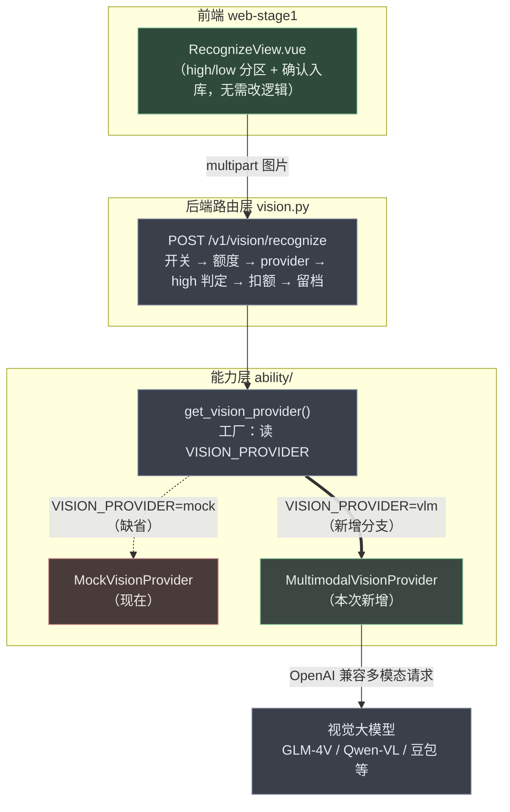
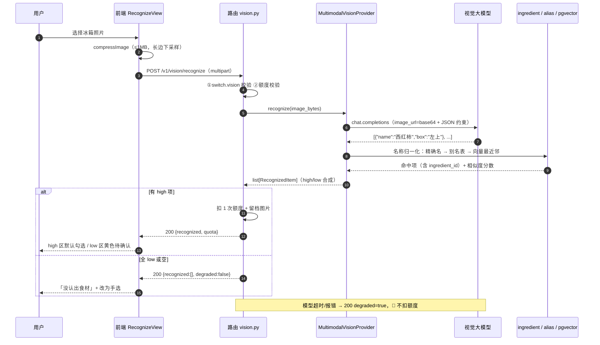
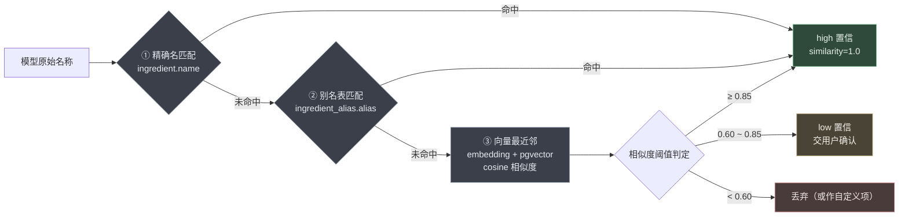

# 08 - 拍照识别真实视觉模型接入方案（V0.1）

| 项 | 内容 |
| --- | --- |
| 文档编号 | 08-拍照识别真实视觉模型接入方案-V0.1 |
| 关联需求 | PRD §7.2（P-07 上传页 / P-08 确认页）｜NFR-6.1~6.4（识别准确率与降级）｜RL-5（识别须确认）｜RL-3（不判定可食性） |
| 关联测试 | 《AI厨娘智能烹饪助手-全面功能测试报告.md》TC-039 / TC-039b / OBS-02 / DEF-11 |
| 关联代码 | `backend/app/ability/providers.py`｜`backend/app/api/v1/vision.py`｜`backend/app/ability/llm.py`｜`backend/app/ability/embedding.py`｜`web-stage1/src/views/RecognizeView.vue` |
| 触发背景 | 用户实测上传冰箱照片后"没识别出食材"，质疑是否应接入多模态 LLM |
| 版本 | V0.1（方案稿，待甲方确认后进入实施） |
| 日期 | 2026-10-12 |

---

## 一、现象核查与定性：不是"坏了"，是"阶段一本来就没接"

### 1.1 证据链（三条硬证据）

**证据 1：请求确实到达后端，且识别"成功"了。**
工作区 `backend/uploads/` 下存在当日留档：

```
uploads/20261012/dd424a7f9390485faa2540cfcd2829f3.jpg   262376 bytes
uploads/20261012/e9b7a068dc1346478195a54072940428.jpg   262376 bytes
```

`vision.py` 第 ⑨ 步「留档图片」**只在存在 high 置信项、且已成功扣减额度时才执行**。两张图字节数完全相同，说明是同一张照片上传了两次。**结论：接口返回了非空结果，用户看到的不是空白页，而是"内容对不上"。**

**证据 2：把 mock 逻辑对这两张图复现一遍，输出完全可预测。**

```
dd424a7f...jpg -> 大蒜(high) 胡萝卜(low) 黄瓜(high) 洋葱(high) 鸡蛋(high) 西兰花(high)
e9b7a068...jpg -> 大蒜(high) 胡萝卜(low) 黄瓜(high) 洋葱(high) 鸡蛋(high) 西兰花(high)
```

**证据 3：根因定位在代码，不在配置错误。**

| 位置 | 事实 |
| --- | --- |
| `providers.py` → `MockVisionProvider.recognize()` | 对图片字节做 sha256 → 用哈希驱动随机种子 → 从 12 个固定家常食材里**确定性抽 3~6 个**，每项 75% 概率标 high。**全程不读取图片像素** |
| `providers.py` → `_build_vision_provider()` | 读 `VISION_PROVIDER`，缺省 `mock`；非 `mock` 取值 → 告警并**回退 mock** |
| `backend/.env` | **未配置 `VISION_PROVIDER`** → 实际运行即 mock |
| 接口 docstring | 自述"阶段一 mock 视觉适配器，额度 3/日·会员 10/日" |

### 1.2 定性结论

| 维度 | 判定 |
| --- | --- |
| 是不是缺陷 | **不是**。属阶段一既定定位，测试报告已将其记为观察项 OBS-02「识别内容为 mock，返回结果与图片实际内容无关 —— 属阶段一定位，非缺陷」 |
| 是不是配置错误 | 不是。`.env` 缺少 `VISION_PROVIDER` 就是设计缺省值（mock） |
| 用户预期是否合理 | **完全合理**。「拍一下冰箱」这个入口对用户的承诺是"厨娘帮你认食材"，mock 实现无法兑现该承诺 |
| 触发条件 | 任何真实照片、任何用户、任何环境下都必然"认错"（不是偶发） |

> **一句话**：您的判断方向是对的 —— **这里确实必须接真实视觉模型**；但要补一句更准确的表述：**不是"应该接"，而是"阶段一故意留了桩，接口层早已为接真实模型做好了抽象，只是工厂分支还没写"。**

---

## 二、接入前置：现有架构已经为您省掉了 80% 的工作

这是本方案最值得先说的一点 —— **接入点已经预留好了**：



| 已就绪能力 | 说明 | 本次是否要改 |
| --- | --- | --- |
| `VisionProvider` 抽象基类 | 定义 `recognize(bytes) -> list[RecognizedItem]` | 不改 |
| 工厂 + 进程级单例 | `get_vision_provider()` 读环境变量分支 | **只加一个分支** |
| 路由层全链路 | 开关校验 / 额度扣减 / high 判定 / 异常降级不扣额 / 图片留档 / 24h 清理 | **零改动** |
| 前端确认页 | high 默认勾选、low 黄色区人工确认、确认入库调 `/vision/confirm` | 仅调超时，逻辑零改动 |
| `confirm` 存在性校验 | 逐名查 `ingredient.name` + `ingredient_alias.alias` | **不改**（但它决定了本次的最大工程难点，见 4.4） |
| 远程开关 `switch.vision` | 灰度与紧急下线 | 复用 |

**所以真正的工作量不在"调通模型"，而在"让模型说的话落回我们自己的食材字典"。** 这是本方案的核心判断。

---

## 三、视觉方案选型对比

### 3.1 合规硬约束（先于技术选型）

本项目对「数据资质」有明确红线（生成式 AI 备案、PIPL、数据出境、图片素材版权）。拍照识别引入一个新的敏感面：**用户上传的是自家冰箱/厨房的真实照片，可能包含人像、住址信息、外卖单据、药品等**。因此选型必须先把这条锁死：

| 约束 | 要求 | 对选型的影响 |
| --- | --- | --- |
| 数据出境 | 用户图片若传输至境外模型服务，可能构成个人信息出境，需单独评估与告知同意 | **优先境内模型服务**；境外模型需走数据出境合规评估 + 单独同意，不建议在阶段一 demo 阶段承担 |
| 生成式 AI 备案 | 使用境内已备案的模型服务，服务提供者备案信息需可披露 | 选已备案的境内开放平台，避免自建未备案模型对外服务 |
| PIPL / 告知同意 | 图片用途、留存期限、删除机制需在隐私政策与页面说明中告知 | 现有"24h 自动清理 + 仅内存读取"是良好基础，需补文案 |
| RL-5 识别须确认 | 识别结果**必须用户确认**才入库 | 现有 confirm 流程已满足，**接入真实模型后必须保持不自动入库** |
| RL-3 不判定可食性 | 不得由 AI 判定食材能否食用 | 只输出"识别到什么"，**禁止输出"这个还能吃吗"类结论** |

### 3.2 四方案对比

| 方案 | 实现成本 | 开发复杂度 | 识别准确率 | 延迟 | 单次成本 | 合规风险 | 上线时间 | 综合评价 |
| --- | --- | --- | --- | --- | --- | --- | --- | --- |
| **A 境内多模态大模型（VLM）**<br>GLM-4V / Qwen-VL / 豆包视觉 | 低 | 低 | 中高（家常场景约 70~90%，估算） | 2~8s | 约 ¥0.005~0.03 次（估算，需按厂商报价核对） | **低**（境内、已备案） | 快 | **推荐**：零训练、可识别长尾食材、天然输出中文家常菜名、可直接产出结构化 JSON |
| B 境外 VLM<br>GPT-4o / Claude / Gemini | 低 | 低 | 高 | 2~8s | 约 ¥0.02~0.1 次（估算） | **高**：触发数据出境评估 | 受合规阻塞 | 备选：仅当甲方明确接受出境合规路径时考虑 |
| C 自建专用检测模型<br>YOLO / RT-DETR 微调 | 高 | 高 | 高（固定类目内可达 90%+） | **<200ms** | 近乎 0（自建 GPU） | 低（数据不出域） | **慢**：需标注 + 训练 + 调优 | 备选：适合类目固定的规模化场景，但需 ≥5000 张标注与标注人力 |
| **D 混合：检测召回 + VLM 命名** | 高 | 高 | 最高 | 0.5~3s | 中 | 低 | 慢 | 备选：精度优化路径，建议作为 A 上线后的第二阶段 |

### 3.3 推荐结论

**先落地方案 A（境内多模态大模型）**，理由：

1. **零训练、零标注启动** —— 阶段一 demo 与阶段二小程序可快速达成"能用"，评测集可后补；
2. **天然处理中文家常语境** —— 直接输出"西红柿/猪五花肉/小葱"这类我们字典里的叫法，配合别名表归一化成本最低；
3. **合规成本最低** —— 境内已备案服务，不触发出境评估；
4. **架构零阻力** —— 现有 `VisionProvider` 抽象 + 工厂分支即为它而设；
5. **可通过向量兜底解决长尾** —— 项目已有 `pgvector` + `embedding.py`，可做"名称语义最近邻"，这是方案 A 相对方案 C 的独特优势（C 的新食材必须重训）。

**演进路径**：A（本期）→ 若准确率不达 NFR-6.1~6.3，叠加 D 的检测召回层（触发条件：评测集上 Top-3 准确率连续两轮 < 90%）。

---

## 四、技术实现方案

### 4.1 识别全链路时序（含降级分支）



### 4.2 `MultimodalVisionProvider` 设计要点

```python
class MultimodalVisionProvider(VisionProvider):
    """真实多模态视觉识别实现（OpenAI 兼容协议）。"""

    def recognize(self, image_bytes: bytes) -> list[RecognizedItem]:
        # ① 预检：体积/格式/像素下限，不合格直接返回 []
        # ② 调 chat_with_image：system 约束"只输出 JSON 数组，name 用中文家常叫法，
        #    禁止输出任何食用安全性判断（RL-3）"
        # ③ JSON 解析容错：剥离 ```json 围栏 / 截取首个 [ ... ] / 解析失败 → []
        # ④ 名称归一化（4.4 三件套）→ 拿到 ingredient_id 与相似度
        # ⑤ 非食材噪声过滤（4.6）
        # ⑥ 置信度合成（4.5）→ RecognizedItem 列表
        # ⑦ 排序：high 在前、相似度降序，最多返回 N=12 条
```

**关键约束（与现有 mock 的接口契约保持一致）**：

| 契约 | 要求 | 原因 |
| --- | --- | --- |
| 返回项 `name` 必须能被 confirm 校验通过 | 归一化后只返回字典内存在的名称 | 否则前端"确认入库"会大量 skipped，用户感知为"认出来了却用不了" |
| `ingredient_id` 尽量非空 | 归一化命中即填库内 ID | 前端 `onConfirm` 依赖名称匹配已选食材 |
| **绝不向上抛异常** | 所有内部失败返回 `[]` | 路由层靠返回空走"不扣额度"路径 |
| 不输出可食性/安全性结论 | system prompt 显式禁止 | **RL-3 红线** |

### 4.3 `LLMClient` 扩展：新增 `chat_with_image()`

现有 `chat(system, user)` 只支持纯文本。视觉模型（GLM-4V / Qwen-VL / 豆包视觉）**均提供 OpenAI 兼容协议**，所以扩展开销很小：

```python
def chat_with_image(self, system: str, user: str, image_bytes: bytes,
                    mime: str = "image/jpeg", temperature: float = 0.1,
                    max_tokens: int = 800) -> LLMResult:
    """多模态补全：image_url 传 base64 data URL（不落盘、不外链）。"""
    b64 = base64.b64encode(image_bytes).decode()
    resp = self._client.chat.completions.create(
        model=settings.VISION_MODEL,          # 与文本模型分离配置
        messages=[
            {"role": "system", "content": system},
            {"role": "user", "content": [
                {"type": "text", "text": user},
                {"type": "image_url",
                 "image_url": {"url": f"data:{mime};base64,{b64}"}},
            ]},
        ],
        temperature=temperature,              # 识别要确定性 → 取低值
        max_tokens=max_tokens,
    )
```

**注意**：视觉模型与文本模型应**分离配置**（可指向不同 base_url / key / model），因为 `deepseek-flash` 是纯文本模型，不能用于图像输入。这意味着要新增一组环境变量：

| 新增变量 | 示例 | 说明 |
| --- | --- | --- |
| `VISION_PROVIDER` | `vlm` | `mock`（缺省）/ `vlm` |
| `VISION_BASE_URL` | 所选厂商 OpenAI 兼容端点 | 与文本 LLM 解耦 |
| `VISION_API_KEY` | `***` | 独立密钥，便于单独限流与吊销 |
| `VISION_MODEL` | 厂商视觉模型名 | 便于横向切换 |
| `VISION_TIMEOUT_SECONDS` | `20` | 视觉请求一般慢于文本 |
| `VISION_MAX_ITEMS` | `12` | 单次返回上限，防长尾噪声刷屏 |

### 4.4 关键工程点：识别结果与食材字典的对齐（本次最大难点）

VLM 的输出是**自由文本**，而 `ingredient` 表是**受控词表**。实测会遇到的典型情况：

| 模型可能输出 | 问题 | 归一化处理 |
| --- | --- | --- |
| 西红柿 | 字典主名是「番茄」 | 别名表命中 → 番茄 |
| 鸡蛋 6个 / 一盒鸡蛋 | 带数量、量词 | 剥离数量/量词后匹配 |
| 猪五花、五花肉、带皮五花 | 一物多名 | 别名表 + 向量最近邻 |
| 保鲜盒 / 冰箱门 / 塑料袋 | 非食材噪声 | 噪声词表 + 向量兜底阈值拦截 |
| 老干妈 / 某品牌酸奶 | 库外商品名 | 归入 low 置信让用户手选（不丢弃） |

> **注意**：`MockVisionProvider` 之所以"永远能 confirm 成功"，是因为它**只在字典里挑名字**。真实模型没有这个保证 —— 这是本次接入真正的工作量所在，也是失败体验的主要来源。

**三路归一化管道（按成本从低到高，逐级下探）**：



**复用优势**：第 ③ 路可以直接复用项目已有的 `app/ability/embedding.py` + `pgvector`，无需新增基础设施 —— 这也是推荐方案 A 而非方案 C 的核心技术理由。

### 4.5 置信度合成规则（把 VLM 输出映射到现有 high/low 双区 UI）

VLM 不提供原生置信度，需要**合成**。规则建议如下（可调，落为常量表便于回归）：

| 场景 | 归一化结果 | 合成置信度 | UI 表现 |
| --- | --- | --- | --- |
| 精确命中字典主名 | 有 `ingredient_id` | **high** | 绿区，默认勾选 |
| 命中别名表 | 有 `ingredient_id` | **high** | 绿区，默认勾选 |
| 向量相似度 ≥ 0.85 | 有 `ingredient_id` | **high** | 绿区，默认勾选 |
| 向量相似度 0.60 ~ 0.85 | 有 `ingredient_id` | **low** | 黄区，需手工勾选 |
| 模型标注为不确定/遮挡/模糊 | 有或无 | **low** | 黄区，需手工勾选 |
| 未归一化且非噪声 | 无 | 不返回（或走自定义输入） | — |

> 这样设计的收益：**前端 high/low 双区 UI、确认入库流程、降级提示全部无需改动**，接入成本集中在后端一个 provider + 一个归一化模块。

### 4.6 非食材噪声过滤

冰箱照片里最常见的"假阳性"：保鲜盒、冰箱门、塑料袋、瓶盖、包装盒、手、宠物。处理三层：

1. **模型侧**：system prompt 明确"只列出可食用食材，忽略容器/包装/电器/人体"；
2. **词表侧**：维护噪声词表（容器/包装/电器/其他）做二次拦截；
3. **阈值侧**：向量相似度 < 0.60 直接丢弃，避免"西瓜霜""老干妈"被强行归到"番茄"。

### 4.7 降级链与额度红线（🔥 不可破坏）

| 场景 | 行为 | 额度 |
| --- | --- | --- |
| 模型正常 + 有 high 项 | 返回结果 | 扣 1 次 |
| 模型正常 + 全 low/空 | 返回空 + "未能准确识别" | **不扣** |
| 模型超时 / 报错 / JSON 解析失败 | `degraded=true` + "请手动选择食材" | **不扣** |
| 未配置 Key / Key 失效 | 同上报错降级 | **不扣** |
| `switch.vision=false` | 403，入口置灰 | 不涉及 |

**建议保留 mock 作为最终兜底开关**（`VISION_PROVIDER=mock` 可随时切回），用于演示环境断网或模型故障时的"至少能演示"降级，同时在灰度期做 A/B 对照。

### 4.8 前端改动评估（极小）

| 项 | 现状 | 建议改动 |
| --- | --- | --- |
| 上传/压缩 | `compressImage(file, 1MB)`，超限才重编码 | 建议**主动下采样长边至 1280px**（降 token 成本 + 降延迟），逻辑基本不动 |
| 调用超时 | `postVisionRecognize` **未显式设超时**，用实例默认 12s | **补 30s per-request 超时**（对齐 DEF-01 的修复手法，`INNOVATION_GENERATE_TIMEOUT_MS` 同款） |
| 等待文案 | "正在识别食材…" | 补"通常 3–8 秒，最长约 20 秒" |
| high/low 双区 | 已实现 | 不改 |
| 确认入库 | 已实现（RL-5 满足） | 不改 |
| 空结果文案 | "没认出食材，换个角度再试一次" | 建议补"或改为手选" |

---

## 五、性能、成本与延迟预算

| 指标 | 预算（估算，需实测校准） | 依据 |
| --- | --- | --- |
| 图片预处理（前端压缩） | < 800ms | 现有实现，长边下采样后更快 |
| 网络上传（1MB 内） | < 1.5s | 家宽/4G 量级 |
| 模型首字节 | 1~3s | 视觉模型普遍慢于文本 |
| 模型完整结构化输出 | 2~8s（P95 ≤ 15s） | 输出限制 `max_tokens=800` 后收敛 |
| 归一化（含向量检索） | < 200ms | pgvector 索引检索，项目已有 |
| **端到端** | **P95 ≤ 10s，预留 30s 超时** | 前端 12s 默认超时必须上调 |
| 单次成本 | 约 ¥0.005~0.03（估算） | 按 1280px 图 + 约 1.3k 视觉 token + 约 300 输出 token 粗算 |
| 日成本量级 | 1000 日活 × 3 次免费 × ¥0.02 ≈ ¥60/日（估算） | 免费额度 3 次/日已构成天然成本闸门（该额度限制在此处反而是优势） |

> ⚠️ 上述成本为量级估算，**实施前必须按所选厂商官方报价页核对**，并在成本表中标注真实单价常量（沿用 `llm.py` 中 `PRICE_*_CNY_PER_M` 的占位模式）。

**并发与限流**：视觉请求延迟高、单价高，建议在 provider 层加**信号量并发上限**（如 8）与**单用户 QPS 限制**，避免被单一用户刷爆额度外的成本。

---

## 六、验收指标与评测集（这是排期里的隐藏工作量）

报告 §8.3 已明确：识别准确率指标 **NFR-6.1~6.3 需在接真模型后回归**（Top-3 ≥ 90% / 召回 ≥ 85% / 纠正率 ≤ 15%）。这些指标**无法用现有环境验证**，必须先有评测集：

| 交付物 | 要求 | 说明 |
| --- | --- | --- |
| 评测集 | ≥ 100 张真实冰箱/食材照片，覆盖：单食材、多食材堆叠、遮挡、弱光、反光、竖拍/横拍 | 建议含 20% 困难样本 |
| 金标注 | 每张标注真实食材集合（以字典名称为准） | **由人标注，不得由模型生成** |
| 指标脚本 | Top-3 命中率 / 召回率 / 用户纠正率三项自动计算 | 纳入一键回归（现有 `run_regression.py` 体系） |
| 用户纠正率数据源 | 前端 confirm 页"用户取消勾选 / 新增手选"的行为埋点 | **需新增埋点**（指标定义见 PRD §8.9 埋点章节） |

> **PM 提醒**：评测集标注是本次接入中被最容易低估的工作量，建议**与模型接入并行启动**，否则会出现"功能上线了但无法举证达标"的验收空档。

---

## 七、合规红线核对表（实施前逐项勾选）

| 检查项 | 要求 | 本方案落点 | 状态 |
| --- | --- | --- | --- |
| RL-5 识别须确认 | 未确认不入库 | 保持现有 `/vision/confirm` 流程，**不自动写入已选** | ✅ 设计满足 |
| RL-3 不判定可食性 | 不得输出可否食用 | system prompt 显式禁止；输出仅含食材名 | ⏳ 待实现校验 |
| 数据出境 | 优先境内模型 | 推荐方案 A（境内已备案） | ⏳ 待甲方确认 |
| 生成式 AI 备案 | 使用已备案服务 | 所选境内厂商需可披露备案信息 | ⏳ 待确认 |
| PIPL 告知同意 | 用途/期限/删除告知 | 现有 24h 清理 + 仅内存读取；**需补页面说明与隐私政策条款** | ⏳ 待补文案 |
| 图片留档 | 有期限、可删除 | 现有 `_save_image` 24h 清理；建议**仅在用户确认成功后才留档**（当前是有 high 项即留档） | ⏳ 建议优化 |
| 未成年人保护 | 不得诱导上传含人像照片 | 上传提示可补"请勿拍摄含人像的照片" | ⏳ 建议补充 |
| 额度一致性 | 免费 3 次/日、会员 10 次/日 | 与 DEF-10 修复后口径一致 | ✅ 已一致 |

---

## 八、工作分解与依赖

| 序 | 任务 | 交付物 | 依赖 |
| --- | --- | --- | --- |
| W1 | 厂商选型 + 账号开通 + 备案信息确认 | 选型结论、密钥、备案披露口径 | **Q-V1（待甲方决策）** |
| W2 | `LLMClient.chat_with_image()` + 配置项 | 客户端扩展 + 单测（含异常/超时） | W1 |
| W3 | `MultimodalVisionProvider` 实现 | provider 类 + JSON 容错解析 + 单测 | W2 |
| W4 | 名称归一化服务（精确/别名/向量三路） | 归一化模块 + 单测（含脏输入用例集） | 无（可并行） |
| W5 | 置信度合成 + 噪声过滤 | 规则常量表 + 单测 | W3、W4 |
| W6 | 工厂分支 + 灰度开关 + 降级链回归 | 工厂扩展；验证"失败不扣额度"红线不回退 | W3 |
| W7 | 前端超时与文案微调 + 主动下采样 | 前端改动 + vitest | 无（可并行） |
| W8 | 评测集构建（≥100 张标注） + 指标脚本 | 评测集、指标报告 | W1（口径） |
| W9 | 端到端复测 + 准确率回归 | 复测报告（对齐 TC-039b / OBS-02 关闭） | W1~W8 |

**依赖就绪度分级**：

| 依赖项 | 分级 | 最晚就绪时限 | 影响与替代 |
| --- | --- | --- | --- |
| 视觉模型账号与密钥 | **阻塞** | 开发启动前 | 未就绪则 W2~W3 无法联调；可先用 mock 跑通单测 |
| 甲方对"是否允许数据出境"的裁定 | **阻塞** | 选型前 | 未裁定则只能走境内方案 |
| 评测集标注人力 | 并行 | 上线前 | 缺失则 NFR-6.1~6.3 无法举证，只能自评 |
| 备案信息披露口径 | 并行 | 上线前 | 影响隐私政策与页脚披露文案 |
| 前端埋点（纠正率数据源） | 可绕过 | 上线后一轮 | 缺失则纠正率指标暂用人工统计 |

---

## 九、风险与遗留

| 编号 | 风险 | 概率 | 影响 | 等级 | 应对 |
| --- | --- | --- | --- | --- | --- |
| RK-V1 | 归一化不到位 → confirm 大量 skipped，用户感知"认出来却用不了" | 4 | 4 | **16 高** | 三路归一化 + 阈值下调至 low 不丢弃 + confirm 失败项引导手选 |
| RK-V2 | 若选境外模型触发数据出境合规问题 | 2 | 5 | 10 中 | 默认境内方案；境外需单独评估+单独同意 |
| RK-V3 | 端到端延迟超前端超时 → 用户侧再次 ERR_ABORTED | 3 | 4 | 12 中 | 前端超时上调至 30s；图片下采样；必要时并入异步任务方案 |
| RK-V4 | 视觉成本超预算 | 2 | 3 | 6 低 | 免费额度 3 次/日 + 并发闸门 + 成本看板 |
| RK-V5 | 评测集缺失导致验收无法举证 | 4 | 3 | 12 中 | 与开发并行启动标注 |
| RK-V6 | 图片留档合规（隐私政策未覆盖） | 3 | 3 | 9 中 | 补隐私条款；留档时机改为"用户确认后" |
| RK-V7 | 模型误识别导致用户信任下降（如把保鲜盒认成豆腐） | 3 | 3 | 9 中 | 空/错/模糊一律走 low 或空态，配合"改为手选"降级路径 |

**遗留问题（本文档不覆盖）**：语音识别（`MockASRProvider` 同为 mock，接入方式与本文档同构，可复用 `chat` 通道另行立项）。

---

## 十、待甲方决策点

| 编号 | 问题 | 备选 | 建议 |
| --- | --- | --- | --- |
| **Q-V1** | 视觉模型服务商与部署区域？ | ①境内 VLM（推荐）②境外 VLM（需出境评估）③自建检测模型 ④混合 | ①境内 VLM；境外需先出数据出境评估 |
| **Q-V2** | 接入时机？ | ①阶段一立即补做（演示可"真识别"）②并入阶段二 16 周范围 | 若近期有演示需求 → ①；否则 → ② 以控制范围 |
| **Q-V3** | 免费识别额度是否调整？ | ①维持 3 次/日 ②下调 ③上调 | ①维持（视觉单价高于文本，3 次/日已是成本闸门） |
| **Q-V4** | 是否保留 mock 作为兜底/灰度对照？ | ①保留并做灰度 A/B（推荐）②彻底移除 | ①保留：断网/模型故障时仍可演示 |
| **Q-V5** | 评测集标注由谁投入？ | ①乙方自建 ②甲方提供真实样本 | 建议 ②提供样本 + ①标注，样本真实性决定指标可信度 |
| **Q-V6** | 图片留档时机是否改为"用户确认后"？ | ①即留档（现状）②确认后留档 | ②更贴合 PIPL 最小必要原则 |

---

## 附录 A：涉及文件清单

| 文件 | 角色 | 本次是否改动 |
| --- | --- | --- |
| `backend/app/ability/providers.py` | provider 抽象 + mock + 工厂 | **新增** `MultimodalVisionProvider` + 工厂分支 |
| `backend/app/ability/llm.py` | OpenAI 兼容客户端 | **新增** `chat_with_image()` |
| `backend/app/ability/embedding.py` | 向量化（归一化第 ③ 路复用） | 复用，可能微调 |
| `backend/app/api/v1/vision.py` | 路由 + 额度 + 降级 | **零改动**（建议仅调"留档时机"） |
| `backend/app/core/config.py` | 配置项 | **新增** VISION_* 变量 |
| `backend/.env` / `.env.example` | 环境变量 | **新增** VISION_* 示例 |
| `web-stage1/src/api/endpoints.ts` | 接口封装 | **补** 30s per-request 超时 |
| `web-stage1/src/utils/image.ts` | 压缩 | 建议增加长边下采样 |
| `web-stage1/src/views/RecognizeView.vue` | 识别页 | 文案微调，逻辑不动 |

## 附录 B：可复核的关键事实

| 事实 | 出处 |
| --- | --- |
| 视觉 provider 当前为 mock，靠 sha256 确定性抽 3~6 个固定食材，75% 标 high | `providers.py` L121-158 |
| `VISION_PROVIDER` 缺省 `mock`，未知取值亦回退 mock | `providers.py` L209-230 |
| `.env` 未配置 `VISION_PROVIDER` | `backend/.env` |
| 免费额度 3 次/日、会员 10 次/日 | `vision.py` L54-55 |
| 图片仅在有 high 项时留档，且每次调用清理 >24h 文件 | `vision.py` L177-201、L295 |
| 全低置信与 provider 异常均**不扣额度** | `vision.py` L260-284 |
| 前端识别请求未设独立超时（用实例默认 12s） | `web-stage1/src/api/endpoints.ts` L661-667 |
| 前端 high/low 双区 UI 与确认入库已实现 | `RecognizeView.vue` L232-283 |
| 测试报告已把"识别结果为 mock"记为 OBS-02 | 测试报告 §6 观察项 |

---

**合规声明**：本方案为产品设计参考，具体实施请结合公司合规与法务要求确认；成本与延迟数据均为估算，实施前需按所选厂商官方报价与实际压测结果核对。

*08-拍照识别真实视觉模型接入方案-V0.1 · 2026-10-12*
