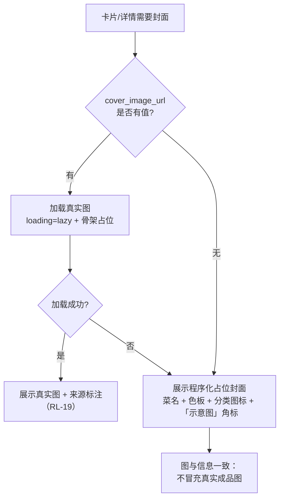

# 13 · 推荐结果卡片图片呈现方案（含菜谱详情成品图）V0.1

> 文档编号：13　｜　版本：V0.1　｜　日期：2026-10-12　｜　编写：乙方 PM（司南）
> 关联文档：《01-PRD》§7.7 P-13 菜谱详情 / §7.2 推荐列表（RL-17、RL-19、NFR-1.7、NFR-2.6）、《03-UI原型界面描述清单》§6 P-10 与 §1 W-02、《05-项目操作手册》§5.6、`2026-10-12` 日志（开源参考清单）
> 代码基线：`web-stage1/src/views/RecommendView.vue`、`RecipeDetailView.vue`、`backend/app/models/recipe.py`、`backend/app/seed/corpus_howtocook.py`、`backend/app/ability/uploads.py`
> 状态：**待甲方确认**（Q-53 ~ Q-57，其中图片来源为阻塞项）

---

## 1. 问题诊断（实测证据）

### 1.1 现象

推荐结果页（W-02）的菜谱卡片**只有文字**，无任何图片区域；菜谱详情页（W-03）**同样没有成品图**。整端（含详情）目前是"零图片"形态。

### 1.2 代码级证据（逐条可复核）

| # | 证据 | 位置 | 结论 |
| --- | --- | --- | --- |
| E1 | 卡片模板仅三段：`.card-head`（菜名 + 为什么推荐给你）/ `.card-meta`（耗时/难度/热量/覆盖率）/ `.card-tags`（缺料/设备） | `RecommendView.vue` L415-490 | **模板里没有图片位** |
| E2 | 前端契约无图片字段 | `web-stage1/src/api/types.ts` L34-61 `RecommendResultItem` | 即使后端有图，前端也拿不到 |
| E3 | 后端响应模型无图片字段 | `backend/app/schemas/recommend.py` L29+ `RecommendResultItem` | **推荐链路整条不携带图片** |
| E4 | 数据库**已有**该字段：`cover_image_url String(255) nullable` | `backend/app/models/recipe.py` L81 | 无需 DDL 变更（利好） |
| E5 | 但字段全为 NULL，且是**主动留空**：`cover_image_url=None  # 🔴 语料图片禁止复用（05-V1.1 §5.6），封面留空` | `backend/app/seed/corpus_howtocook.py` L964 | 语料菜谱**被规则禁止配图** |
| E6 | 无任何静态/媒体服务挂载（无 `StaticFiles`、无 `/media` 路由） | `backend/app` 全量 grep | **即使填了 URL 也取不到图** |
| E7 | 详情页无成品图 | `RecipeDetailView.vue` 全量 grep `cover\|image\|img` 无命中 | 与 PRD §7.7 区域 1 要求不符 |
| E8 | 后台（admin-web）无菜谱图片上传能力 | `admin-web/src` grep `cover_image` 零命中 | 阶段二需补运营侧能力 |
| E9 | 本地存在图片语料 `backend/data/HowToCook/dishes/**/*.jpg`（约 250 张）；其仓库 LICENSE 实为 **Unlicense（公有领域）** | `backend/data/HowToCook/LICENSE` | 与项目自定"禁止复用"规则存在**待澄清的冲突**（见 §5、Q-55） |
| E10 | `backend/uploads/{yyyymmdd}/` 有 **24 小时自动清理**逻辑 | `backend/app/ability/uploads.py` L25 `cleanup_uploads(..., max_age_hours=24)` | 🔴 菜谱封面图**绝不可**放该目录，否则会被清理任务误删 |

### 1.3 根因

需求早已定义（PRD §7.7 详情页头部要求"成品图"、UI 清单 P-10 卡片要求"菜名/图/…"），但实现阶段因**语料图片版权顾虑（§5.6 规则）**选择整体留空，且**未设计替代方案**（既没有占位封面，也没有媒体服务），于是"有字段、无内容、无通路"三者叠加，形成全端无图。

---

## 2. 需求依据核对

| 依据 | 原文要点 | 实现一致性 |
| --- | --- | --- |
| PRD §7.7 页面结构序 1 | 详情页头部＝**成品图 + 简介** | ❌ **缺失** |
| PRD §7.7 交互规则 5 | 数据来源必须标注（附录 B 版权合规） | ⚠️ 文字来源已标注，图片来源未涉及 |
| PRD 表 L273 **RL-19 图片素材版权** | §7.7 → **成品图来源标注** | ❌ 无图可标，规则悬空 |
| PRD 表 L271 **RL-17 菜谱语料版权** | §7.7 → 来源标注 | ✅ 已有 `source_label` / `source_license` |
| PRD L204 **NFR-1.7 内容版权合规** | 详情页来源标注 | ⚠️ 同上 |
| PRD L211 **NFR-2.6 性能** | 详情 P95 ≤ 2s → **图片懒加载 + 骨架屏** | ❌ 无图，配套方案亦未设计 |
| UI 清单 §6 P-10 | 卡片（菜名 / **图** / 耗时 / 难度 / 热量 / 覆盖率 + 缺失食材 + 设备） | ❌ **卡片缺"图"** |
| UI 清单 §1 W-02 | ① 食材摘要 ② 三档分组 ③ 推荐卡片 …（未显式列"图"） | ⚠️ 阶段一口径未明示，属细化空间 |

**结论**：**推荐卡片图片**在 UI 清单 P-10（阶段二口径）中已明确要求；**详情页成品图**在 PRD §7.7（阶段一 US-E3）中已明确要求。二者均属"需求已定义、实现未落地"。

---

## 3. 变更性质判定

| 项 | 定性 | 处置 | 计费 |
| --- | --- | --- | --- |
| 详情页成品图缺失（PRD §7.7 明示、阶段一） | **乙方偏离需求 → 返工** | 直接补齐，不需 CR | ❌ 不计费 |
| 推荐卡片图片（UI 清单 P-10 已要求，阶段一口径未明示） | **需求落实 + 阶段一口径细化** | 与甲方确认阶段一口径即可 | 争议项，建议不计费 |
| 程序化占位封面（PRD/UI 清单均未定义此形态） | **需求文档未覆盖的新增** | 若采用则纳入 CR | ✅ 按增量评估 |
| 媒体服务路由 + 后台图片上传能力 | 技术实现（支撑上述需求） | 随上述条目一并实现 | 后台上传属阶段二能力 |
| 真实成品图的素材采集与录入 | 运营动作 | 见 §5 方案 A/B | 素材工作量另计 |

> 🔴 本方案**不涉及风控链路改动**，双闸门与过敏原硬过滤完全不受影响；但**图片来源**牵涉 RL-19 与版权合规，属甲方必须拍板项。

---

## 4. 核心难点：图片来源（本方案的真正瓶颈）

卡片加图在技术上很简单（字段已有、栅格已就绪），**难的是"这张图凭什么能放"**：

1. **RL-19 要求"成品图来源标注"** → 无来源、无许可的图不能上；
2. 现有语料（HowToCook）图片虽然仓库协议为 Unlicense（公有领域），但项目自定规则 `05-V1.1 §5.6` 明确"语料图片禁止复用"，两者冲突未解；
3. 若使用与菜品不符的图（通用图库 / AI 生成），存在**误导风险**——用户看到"红烧肉"配了一张不是这道菜的图，属虚假呈现，触及食品内容真实性边界。

因此本方案把"图片来源"单列为**阻塞级决策**，而不是默认拿现成语料图片填上了事。

---

## 5. 方案对比与选型（图片来源）

| 方案 | 图片来源 | 版权风险 | 落地速度 | 图与菜一致性 | 综合评价 |
| --- | --- | --- | --- | --- | --- |
| **A 甲方自建图库** | 甲方拍摄/采购并授权 | 低（有授权链） | 慢（需拍摄/采购） | **高（真实成品图）** | ✅ 阶段二**目标形态** |
| **B 公有领域 / CC0 图库** | Wikimedia / Openverse 等 CC0 素材 | 低（需逐张核验许可与署名要求） | 中 | **低（多为通用食材图）** | ⚠️ 仅作过渡，须逐张核验 + 标注来源 |
| **C 复用 HowToCook 语料图** | 仓库内 ~250 张 | ⚠️ 仓库 LICENSE 为 Unlicense，但 `05 §5.6` 禁止复用 | 快 | 高（原菜谱配图） | ⚠️ **须甲方法务明确破例**（Q-55），否则不可用 |
| **D 程序化占位封面** | 前端 SVG 生成（菜名 + 色板 + 分类图标 + 「示意图」角标） | **零风险**（无第三方素材） | **最快（即日可交付）** | 不适用（**明确标注为示意图**，不冒充成品图） | ✅ **阶段一推荐** |
| **E 不入图，维持现状** | — | 无 | — | — | ❌ 已否决（与 P-10 / §7.7 不符） |
| **F AI 生成成品图** | 文生图 | 中（生成物权属 + 平台合规） | 中 | 低（易失真、与菜不符） | ⚠️ 阶段一不建议；若采用**必须**标注「AI 生成示意图」+ 不得暗示口味/健康结论 |

### 选型结论（两阶段路线）

> **阶段一 = 方案 D（程序化占位封面）＋ 打通「字段 → 接口 → 媒体服务 → 卡片」全链路**；
> **阶段二 = 方案 A（甲方自建图库）替换占位图，按 RL-19 落地来源标注**；方案 C 仅在法务破例时作为快捷备选。

**理由**：阶段一是可演示原型，核心诉求是**消除"纯文字"观感**并**证明图片链路可用**——方案 D 能用零版权风险的方式立刻达成，且不会留下"用了别人图片"的合规尾巴；真实成品图的采集是甲方侧运营动作，不应阻塞阶段一演示。

---

## 6. 推荐方案设计

### 6.1 图片取用链路（含兜底）

**占位封面生成规则（方案 D）**

| 要素 | 规则 |
| --- | --- |
| 底色 | 按 `cooking_method`（炒 / 炖煮 / 蒸 / 烤 / 凉拌 / 汤羹 / 主食 / 甜点）映射 8 色暖色板；缺省回落到按首个主料 `category`（veg/meat/seafood/…）映射 |
| 图标 | 与烹饪方式对应的单色图标（🍳 / 🍲 / 🥘 / 🥗 / 🍰 等），**不依赖颜色单独传达信息**（对齐 §0.4 不依赖颜色） |
| 文字 | 菜名，最多 2 行，超出省略；字号随容器自适应 |
| 角标 | 固定「**示意图**」，不可关闭 |
| 实现 | 前端共享组件 `RecipeCover.vue` 输出 SVG（可内联或 data-URI），**零后端依赖、零素材版权风险** |
| 失败兜底 | 真实图加载失败/超时 → 回落占位封面，**绝不出现裂图** |

### 6.2 卡片布局（含对比与推荐）

| 布局 | 形态 | 优点 | 缺点 |
| --- | --- | --- | --- |
| **L1 顶部大图（推荐）** | 卡内顶部通栏图（16:9），下方为现有 title / meta / tags | 视觉冲击强，符合餐饮类 App 心智；移动端友好 | 单卡高度增加约 40%，一屏可见卡数减少 |
| L2 左侧缩略图 | 左 88px 方形图 + 右侧信息，横向排布 | 信息密度不变，一屏卡数不变 | 300px 卡宽下信息被挤压，图小视觉弱 |
| L3 顶部大图 + 栅格降列 | L1 ＋ 栅格 `minmax(300px)` → `minmax(340px)` | 图幅比例舒展 | 需改既有栅格参数，列数变化影响既有观感 |

**推荐 L1**：现有 `.card-list` 已是 `grid-template-columns: repeat(auto-fill, minmax(300px, 1fr))`（`RecommendView.vue` L615-619），**天然响应式，无需改栅格**；仅在卡内顶部插入图片区块即可。

### 6.3 关键交互与状态规则

| # | 规则 |
| --- | --- |
| 1 | 图片区**必须**懒加载 + 骨架占位（NFR-2.6：详情 P95 ≤ 2s） |
| 2 | 图片 **alt 文本 = 菜名 +（占位时）「示意图」**，保证不依赖图片传达信息 |
| 3 | 深色模式：卡片图区加半透明遮罩或描边，避免图与深色背景糊在一起 |
| 4 | 三态：加载＝骨架灰块（保持卡高不跳动，防布局抖动 CLS）；无图＝占位封面；失败＝同上回落占位 |
| 5 | 点击图片区＝点击卡片（跳 W-03），图片不单独承载操作，避免交互歧义 |
| 6 | 图片不得承载**任何**健康/口味结论（如"低脂"角标），仅作视觉呈现（RL 内容宣传） |

### 6.4 菜谱详情页成品图（一并补齐，属返工）

| 项 | 规则 |
| --- | --- |
| 位置 | PRD §7.7 区域 1「头部 成品图 + 简介」，置于过敏原警示条（区域 0）之后 |
| 尺寸 | 16:9 或 4:3，宽度撑满内容区；阶段一单尺寸 |
| 来源标注 | 真实图时展示「图片来源：XXX」；占位图时展示「**示意图**」 |
| 缺失兜底 | 无图 → 占位封面；**不得**留白或塌陷 |
| 与卡片一致 | 同源取用（同一个字段 + 同一个占位规则），禁止两处规则分叉 |

---

## 7. 数据与接口设计

### 7.1 数据库

| 项 | 结论 |
| --- | --- |
| `recipe.cover_image_url` | **已存在，直接复用，无需 DDL** |
| 建议新增（可选，RL-19 支撑） | `cover_image_source`（图片来源标注，如「甲方自摄」/「CC0: 出处」/「AI 生成」）与 `cover_image_kind`（`real` / `placeholder` / `ai`），便于前端按 kind 决定是否打「示意图」角标，避免用"是否有 URL"反推语义 |
| 🔴 素材存放目录 | 新建 `backend/assets/recipe_covers/`，**严禁**放 `backend/uploads/`（该目录有 24h 自动清理，见 E10） |

### 7.2 接口变更

| 接口 | 变更 | 兼容性 |
| --- | --- | --- |
| `POST /v1/recommend` | `RecommendResultItem` **新增** `cover_image_url: string \| null`（建议同时带 `cover_image_kind`） | 新增可选字段，向后兼容 |
| `GET /v1/recipes/{id}` | 响应补充同名字段（详情页成品图用） | 同上 |
| `GET /v1/innovate/*`（创新菜） | 创新菜同样需要封面 → 复用同一字段语义 | 阶段二对齐 |
| **新增媒体服务** | `GET /v1/media/recipe-covers/{filename}`（或挂载 `StaticFiles` 到 `/media`），并同步 `nginx/*.conf` 加 location | 新增能力 |

### 7.3 依赖就绪度

| 依赖项 | 所属 | 就绪状态 | 分级 | 最晚就绪时限 | 替代方案 |
| --- | --- | --- | --- | --- | --- |
| `cover_image_url` 字段 | DB | ✅ 已就绪 | — | — | — |
| 推荐/详情响应契约补字段 | 后端 | ⚠️ 待改 | **并行** | 联调前 | 前端可先用 `recipe_id` 本地映射占位色板（无图也能上线） |
| 媒体服务路由 | 后端 + nginx | ❌ 未就绪 | **阻塞（仅真实图）** | 配图上线前 | 阶段一用占位封面（纯前端）可**完全绕过** |
| 图片来源授权（RL-19） | 甲方 | ❌ **未决** | **阻塞（真实图）** | 阶段二配图前 | 见 §5 方案 D |
| 后台图片上传 | 后端 + admin-web | ❌ 未就绪 | 并行 | 阶段二运营前 | 阶段一由 seed/脚本灌入 URL |

> 关键洞察：**阶段一采用占位封面方案时，"媒体服务 + 图片来源授权 + 后台上传"三个阻塞项全部可绕过**，交付不被卡住。

---

## 8. 合规红线对照

| 红线/规则 | 本方案落地 |
| --- | --- |
| **RL-19 图片素材版权（成品图来源标注）** | 真实图必须展示来源标注；后台录入时强制必填来源字段，不允许上传无来源图 |
| **RL-17 菜谱语料版权** | 不改动既有 `source_label` / `source_license` 标注；图片标注与之并列展示 |
| **NFR-1.7 内容版权合规** | 占位封面为程序生成，不引入第三方素材；CC0 素材逐张核验许可与署名要求 |
| **NFR-2.6 性能（P95 ≤ 2s）** | 图片懒加载 + 骨架占位 + 单尺寸压缩（阶段一 ≤ 120KB/张） |
| **§0.4 不依赖颜色** | 占位封面同时用**图标 + 文字**传达分类，色彩仅辅助 |
| **内容宣传红线（法定营养声称 / 功效 / 绝对化）** | 图片与角标**不得**出现"低脂/无糖/高蛋白/养生"等字样；占位角标固定为「示意图」 |
| **食品安全（RL-3 不做可食性判定）** | 图片不承载任何"新鲜度/可食性"判断性表达 |
| **AI 创新菜标识（若创新菜配图）** | 创新菜图必须保留「未经人工审核」与 AI 生成标识，不得因配图而弱化 |

---

## 9. 异常与边界清单

| # | 场景 | 期望行为 |
| --- | --- | --- |
| 1 | 图片 URL 为空 | 展示占位封面（菜名 + 色板 + 图标 + 「示意图」） |
| 2 | 图片 404 / 超时 / 解码失败 | 自动回落占位封面，**不出现裂图、不留白** |
| 3 | 图片加载中 | 骨架灰块，保持卡片高度稳定（防 CLS 抖动） |
| 4 | 超长菜名 | 占位封面文字最多 2 行省略；不影响卡片高度 |
| 5 | 弱网 / 离线 | 已加载过的图走缓存；未加载走占位；页面仍可读 |
| 6 | 深色模式 | 图片区加描边/遮罩，保证与背景可区分 |
| 7 | 图片比例异常（用户上传竖图） | 统一 `object-fit: cover` 裁切，不拉伸变形 |
| 8 | 图与菜不符（真实图误配） | 属数据质量问题：需建立"配图与菜名一致性"抽检；发现即回落占位 |
| 9 | 无障碍 | `alt` = 菜名；图片不作为唯一信息载体 |
| 10 | 后台误将封面放入 `uploads/` | 目录硬性隔离 + 校验拦截，防止被 24h 清理任务删除 |

---

## 10. 验收标准（Given / When / Then）

| 编号 | 验收项 | 验收标准 |
| --- | --- | --- |
| AC-01 | 卡片有图 | Given 进入推荐结果页；Then **每张卡片均有图片区**（真实图或占位封面），无"纯文字卡" |
| AC-02 | 全端一致 | Given 点击卡片进详情；Then 详情页头部有成品图/占位封面，与卡片同源规则 |
| AC-03 | 无版权风险 | Given 阶段一部署；Then 所有展示图片均为程序生成占位封面，**无任何第三方素材文件**进入仓库 |
| AC-04 | 兜底不裂图 | Given 图片 URL 失效；When 加载失败；Then 回落占位封面，无裂图、无留白、无布局抖动 |
| AC-05 | 性能 | Given 20 张卡片的推荐页；Then 图片懒加载生效，首屏不等待非可视区图片，页面 P95 ≤ 2s |
| AC-06 | 来源标注（真实图） | Given 配了真实成品图的菜谱；Then 展示来源标注（RL-19），且后台不允许提交无来源图 |
| AC-07 | 不冒充真实图 | Given 占位封面；Then 可见「示意图」角标且不可关闭；alt 文本含"示意图" |
| AC-08 | 深色模式 | Given 深色模式；Then 图片区与背景可区分，文字可读（WCAG AA） |
| AC-09 | 目录隔离 | Given 菜谱封面存储；Then 位于 `backend/assets/recipe_covers/`，经 24h 清理任务后**依然存在** |
| AC-10 | 无障碍 | Given 屏幕阅读器；Then 图片朗读菜名，不依赖图片传达关键信息 |
| AC-11 | 合规用语 | Given 任一图片与角标；Then 无"低脂/无糖/高蛋白/养生"等违禁表述（违禁词自查通过） |

---

## 11. 需求追踪矩阵（RTM）

| 编号 | 需求描述 | 依据 | 方案章节 | 落点 | 验收 | 状态 |
| --- | --- | --- | --- | --- | --- | --- |
| R-01 | 详情页成品图（返工） | PRD §7.7 区域 1 | §6.4 | `RecipeDetailView.vue` + 媒体服务 | AC-02 | 待确认 |
| R-02 | 推荐卡片图片 | UI 清单 §6 P-10 | §6.2 | `RecommendView.vue` | AC-01 | 待确认 |
| R-03 | 图片懒加载 + 骨架 | NFR-2.6 | §6.3 | 前端 | AC-05 | 待确认 |
| R-04 | 成品图来源标注 | RL-19 | §7.1 / §8 | DB 字段 + 前端 | AC-06 | 待 Q-54 |
| R-05 | 素材版权合规 | RL-17 / NFR-1.7 | §5 / §8 | 全链路 | AC-03 | 待 Q-53/Q-55 |
| R-06 | 占位封面兜底 | 本方案新增 | §6.1 | `RecipeCover.vue` | AC-04 / AC-07 | 待 Q-56 |
| R-07 | 封面存储目录隔离 | 代码质量（E10） | §7.1 | `backend/assets/` | AC-09 | 待确认 |
| R-08 | 后台图片上传（阶段二） | UI 清单 K-xx | §7.3 | admin-web | — | 阶段二 |
| R-09 | 无障碍与深色适配 | §0.4 | §6.3 | 前端 | AC-08 / AC-10 | 待确认 |

---

## 12. 工作量估算（估算，非承诺）

| 阶段 | 内容 | 估算 |
| --- | --- | --- |
| **阶段一（占位封面）** | `RecipeCover.vue` 组件 + 卡片布局（L1）+ 详情页头部 + 懒加载/骨架/深色/alt | 1.5 人日 |
| | 推荐/详情响应契约补 `cover_image_url`（可空）+ 类型同步 | 0.5 人日 |
| | 测试（含兜底/暗色/无障碍/违禁词自查） | 0.5 人日 |
| | **小计** | **≈ 2.5 人日** |
| **阶段二（真实图）** | 媒体服务路由 + nginx location + 尺寸压缩 | 1 人日 |
| | 后台图片上传 + 来源必填校验 + 一致性抽检 | 2 人日 |
| | 素材采集/拍摄与录入（甲方运营） | 另计（按菜谱数量） |
| | **小计** | **≈ 3 人日（不含素材）** |

**影响面**：需更新《01-PRD》（图片与素材章节回写）、《02-架构》（响应契约 + 媒体服务）、《03-UI清单》（P-10/W-02/W-03 图片位细化）、《04-部署手册》（nginx location + 素材目录与备份）。不影响：风控引擎、双闸门、过敏原硬过滤、编排图结构。

---

## 13. 待确认问题（甲方）

| 编号 | 问题 | 影响 | 建议 |
| --- | --- | --- | --- |
| **Q-53** | 真实成品图的**来源**定哪个方案（A 甲方自建 / B CC0 图库 / C 复用语料 / F AI 生成）？ | 决定 RL-19 标注口径与素材工作量 | 建议阶段二走 **A（甲方自建）**，此前先用 D |
| **Q-54** | RL-19「成品图来源标注」的**位置与粒度**：卡片角标 / 详情页统一标注 / 两者都要？ | 影响卡片信息密度与后台字段 | 建议**详情页统一标注**，卡片仅在非真实图时打「示意图」 |
| **Q-55** | HowToCook 仓库 LICENSE 为 Unlicense（公有领域），与 `05-V1.1 §5.6`「语料图片禁止复用」冲突 —— 是否**法务破例**允许复用并标注来源？ | 若破例可立即获得 ~250 张高一致性配图 | 建议提请法务出具意见，不自行推断 |
| **Q-56** | 阶段一是否接受**仅上程序化占位封面**（零版权风险、约 2.5 人日即可交付），真实成品图放阶段二？ | 决定阶段一是否被素材授权阻塞 | **建议采纳**（否则演示将长期无图） |
| **Q-57** | 卡片布局认可 **L1 顶部大图**（会减少一屏可见卡数）还是 **L2 左侧缩略图**（信息密度优先）？ | 影响推荐页信息密度与观感 | 建议 L1，移动端优先 |
| Q-58 | 是否需要为「AI 创新菜」同步配图（含 AI 标识与「未经人工审核」声明叠加）？ | 影响创新模块范围 | 建议阶段二随创新模块一并处理 |

---

## 14. 附录 · 代码证据索引

| 证据 | 文件 | 位置 |
| --- | --- | --- |
| 卡片模板无图片位 | `web-stage1/src/views/RecommendView.vue` | L415-490 |
| 卡片栅格（已可响应式） | 同上 | L615-619 |
| 推荐结果类型无图片字段 | `web-stage1/src/api/types.ts` | L34-61 |
| 推荐响应模型无图片字段 | `backend/app/schemas/recommend.py` | `RecommendResultItem` |
| 菜谱封面字段已存在 | `backend/app/models/recipe.py` | L81 |
| 种子主动留空封面 | `backend/app/seed/corpus_howtocook.py` | L964 |
| 无媒体服务挂载 | `backend/app`（grep `StaticFiles` 无命中） | — |
| 详情页无图 | `web-stage1/src/views/RecipeDetailView.vue` | grep 无命中 |
| 后台无图片上传 | `admin-web/src` | grep `cover_image` 无命中 |
| 语料图片与协议 | `backend/data/HowToCook/LICENSE`（Unlicense） | — |
| uploads 24h 清理 | `backend/app/ability/uploads.py` | L25 |

---

> 本方案为产品设计参考，具体实施请结合公司合规与法务要求确认。
> 🔴 阻塞项提示：**真实成品图的来源与授权（Q-53 / Q-55）未决前，不得将任何第三方素材图片放入仓库**；阶段一请按方案 D 占位封面交付。
