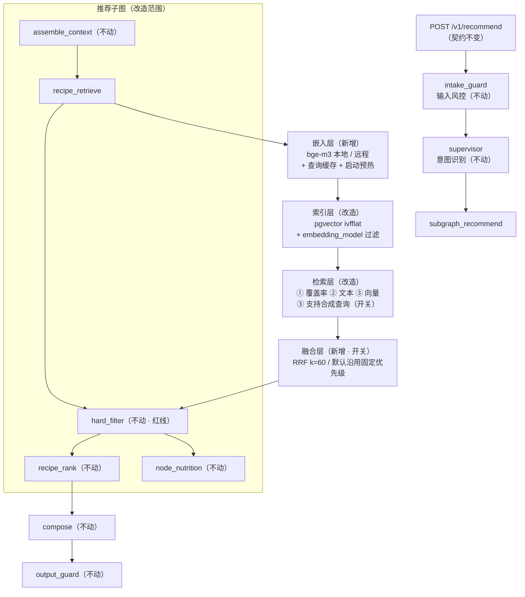
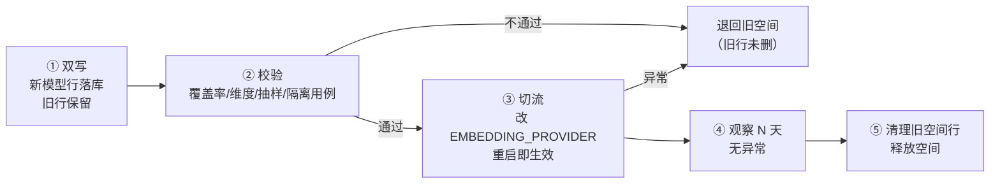

# 14 · 向量模型 + RAG 检索升级设计方案 V0.1

> 文档编号：14　｜　版本：V0.1　｜　日期：2026-10-12　｜　编写：乙方（技术方案）
> 关联文档：《02-架构设计与数据库设计文档-V1.1》§4.5 技术栈 / §10.6 向量索引 / §ARC-Q-3、《05-项目操作手册-V1.1》§5.5 向量索引重建、《01-PRD》§7.2 推荐列表（NFR-2.6 性能）、《06-需求变更单-CR-20261008-01》
> 代码基线：`backend/app/ability/embedding.py`、`retrieval.py`、`ranking.py`、`app/models/recipe.py`（RecipeEmbedding）、`alembic/versions/b8d3f5a21c60_stage2_data_layer_extension.py`、`tests/test_vector_retrieval.py`
> 状态：**待甲方确认**（Q-59 ~ Q-63）

---

## 1. 设计目标与非目标

### 1.1 目标

| # | 目标 | 可衡量口径 |
| --- | --- | --- |
| G1 | 把默认的**哈希伪向量**替换为真语义向量模型（bge-m3），让「想吃点酸辣开胃的」这类**无语料字段可表达的意图**能被召回 | 语义查询的 Top-10 命中率显著提升（需建立标注评测集，见 §10） |
| G2 | 让**手选食材路径**也接入向量召回（当前完全不走向量） | 同一组食材，开关 on/off 的候选集差异可量化 |
| G3 | 三路召回融合从「固定优先级」升级为 **RRF**，降低手工调权 | 融合后 Top-8 稳定性（多次调用结果一致）不回退 |
| G4 | **不破坏任何现有功能**：契约不变、风控不变、默认行为不变、可一键回滚 | 现有 pytest 285 全绿；`test_vector_retrieval.py` 8 用例断言不变 |

### 1.2 非目标（明确不做）

| # | 不做 | 原因 |
| --- | --- | --- |
| N1 | **不让大模型参与推荐决策**（重排以外的生成式排序） | `rank_reasons` 要可解释、回归要可复现、A/B 要可归因；且 LLM 打分不可测 |
| N2 | **不用 LLM 自由生成菜谱** | 菜谱必须带过敏原标注 / 量化用量 / 设备字段，否则 `hard_filter` 硬过滤失效（RL 红线）。生成类需求已由 `innovation` 子图承担 |
| N3 | 不引入新的向量库（Milvus/faiss） | 架构 §ARC-Q-3 已定：390 篇量级 pgvector 足够，运维最简；规模化再迁 |
| N4 | 不改 `hard_filter` 与排序公式 | 硬过滤先于排序是不可颠倒的红线；排序权重已可远程配置，无需改造 |
| N5 | 不做 chunk 分块检索 | 菜谱为结构化文档，整篇一条向量已足够；分块反而破坏「一道菜一个结果」的语义 |

---

## 2. 现状盘点

### 2.1 已有资产（**可直接复用，无需重建**）

| # | 资产 | 位置 | 说明 |
| --- | --- | --- | --- |
| A1 | **嵌入提供方抽象** | `ability/embedding.py::EmbeddingProvider` | `embed(texts) -> list[list[float]]`，约定 1024 维 + L2 归一化（点积即余弦）→ **换模型不改调用方** |
| A2 | 提供方工厂（进程单例） | `get_embedding_provider()` | 按 `EMBEDDING_PROVIDER`（`hash` 缺省 / `bgem3`）选择；单例保证回填与查询同一嵌入空间 |
| A3 | 哈希兜底实现 | `HashEmbeddingProvider` | 确定性、纯标准库、无模型依赖 → **保留为离线/降级兜底** |
| A4 | **向量表双列结构** | `models/recipe.py::RecipeEmbedding` | `embedding_json`（JSONB 便携列，ORM 可见）+ `embedding vector(1024)`（仅迁中存在，raw SQL 访问） |
| A5 | **pgvector 索引** | 迁移 `b8d3f5a21c60` | `ivfflat(vector_cosine_ops, lists=100)`，扩展不可用时优雅跳过（SAVEPOINT 包裹，迁移绝不失败） |
| A6 | **双分支检索** | `retrieval.py::_vector_search` | `probe_pgvector()` 可用 → raw SQL `<=>` Top-20；不可用 → JSONB 纯 Python 点积（无 numpy）**结果等价** |
| A7 | **幂等回填 + 惰性触发** | `ensure_embeddings` / `lazy_backfill` | 按 `recipe_id` 跳过已有行；verified 计数为 0 时持锁回填 → 无需人工预热 |
| A8 | **分区红线已实现** | `retrieval.py` 向量 SQL | 默认 `WHERE source='verified'`；`include_private_owner` 显式开启创新链路 |
| A9 | **降级链完备** | 全链路 | 探测失败 / SQL 失败 / 提供方异常 → 均降级为关键词路径，接口恒 200 |
| A10 | **向量测试基线** | `tests/test_vector_retrieval.py` | 8 用例：hash 确定性、默认 provider、回填幂等、混合开关、**分区隔离**、探测降级、SQL 失败降级、Top-K 截断 |
| A11 | 架构选型已定 | 02 文档 §4.5 / §ARC-Q-3 | 向量 **pgvector**、Embedding **bge-m3（本地部署，规避数据出境）**、bge-m3 权重 **MIT 许可** |

> **结论：这套 RAG 的骨架已经完整**——抽象层、双列存储、双分支检索、幂等回填、分区隔离、降级链、测试基线全都在位。本次升级是**"把占位实现填实 + 接通三处断路"**，不是重建。

### 2.2 缺口清单

| # | 缺口 | 证据 | 影响 |
| --- | --- | --- | --- |
| **GAP-1** | `BGEM3Provider` 是 `NotImplementedError` 占位（构造函数即抛） | `embedding.py` L164-201 | 真语义向量不可用；当前向量召回退化为"字面字符重叠" |
| **GAP-2** | **手选食材路径完全不走向量**：`if use_vector and query_text:` 要求文本非空 | `retrieval.py` L384 | 用户只选食材时只有 SQL 覆盖率召回，RAG 的向量一半不参与 |
| **GAP-3** | 三路融合为「并集去重 + 固定优先级」，非 RRF | `retrieval.py` L460-468 | 无法按路径置信度融合；权重隐含在代码里，不可调 |
| **GAP-4** | **无嵌入空间版本标识**：同一表可能混存不同模型产出的向量 | `RecipeEmbedding` 无 `embedding_model` 列 | 换模型时新旧向量**余弦相似度无意义** → 检索结果错乱（换模型的最大风险） |
| **GAP-5** | **全量重建入口不存在**：《05-操作手册》§5.5 写 `python -m app.cli build_embeddings --rebuild`，但仓库中**无 `app/cli.py`，全仓搜索 `build_embeddings` 零命中** | 已实测 | 大批量语料变更后无法重建；文档与代码不一致 |
| **GAP-6** | 环境变量未接线：`EMBEDDING_PROVIDER` / `RETRIEVAL_VECTOR` 仅在代码内 `os.environ.get` 读取，**未写入 `.env.example` / docker-compose** | 已实测 | 部署侧无法开启能力（运维盲区） |
| **GAP-7** | 依赖缺失：`requirements.txt` 无 `FlagEmbedding` / `sentence-transformers` / `torch` | 已实测 | 需新增依赖与模型 volume（架构 §4.5 已规划 `VOL3: volume: models / bge-m3 权重`） |
| **GAP-8** | `ivfflat lists=100` 对当前数据量偏大（≈390 行） | 迁移 `b8d3f5a21c60` | 建库过细导致**召回率损失**；推荐 `lists ≈ √n ≈ 20` |

---

## 3. 核心原则：六条"不破坏现有功能"的硬约束

> 这六条是本方案能被接受的前提，任何一条被破坏即视为设计失败。

| # | 约束 | 落地方式 |
| --- | --- | --- |
| **P1** | **默认行为与今天完全一致** | 所有新增能力**默认关闭**；关闭时链路走过今天同样的分支，现有 285 pytest + 8 向量用例断言不变 |
| **P2** | **接口契约零改动** | `POST /v1/recommend` 请求/响应结构、字段名、三档语义全部不动 → **前端零改动** |
| **P3** | **风控链路零改动** | `hard_filter`（SQL 布尔 WHERE）顺序与语义不动，仍是 `weighted_rank` 的唯一输入来源；一票否决控制流短路、`safe_mode` 保守模式、双重闸门全部不动 |
| **P4** | **分区红线不动** | 默认仅检索 `source='verified'`；AI 私有菜谱（`ai_private`）绝不出现在默认推荐 |
| **P5** | **降级链延长而非替换** | 新提供方加载失败 → 自动回落 `HashEmbeddingProvider` → 再失败回落关键词路径；**接口恒 200，绝不抛到编排层之外** |
| **P6** | **每个开关独立可回滚** | 嵌入空间切换走「双写 → 校验 → 切流 → 清理」四段式；任一步失败可立即退回旧空间（旧行不删） |

---

## 4. 目标架构



**分层职责**

| 层 | 变化 | 说明 |
| --- | --- | --- |
| 嵌入层 | 🆕 新增 | 真模型 + 缓存 + 预热 + 双形态（本地/远程） |
| 索引层 | 🔧 改造 | 表加 `embedding_model` 列；检索按当前模型过滤；ivfflat 参数校正 |
| 检索层 | 🔧 改造 | ③ 向量路径支持"无文本但有食材"的合成查询（开关） |
| 融合层 | 🆕 新增 | RRF 融合（开关）；关闭时完全走现有固定优先级 |
| 排序层 | ⛔ **不动** | `weighted_rank` / `hard_filter` 一行不改 |

---

## 5. 改造设计

### 5.1 C1 · 嵌入提供方实现（补 GAP-1 / GAP-7）

**接口保持 A1 不变**（`embed(texts) -> list[list[float]]`，1024 维 L2 归一化），因此调用方零改动。

**三种形态，同一抽象：**

| 形态 | 实现 | 适用 | 备注 |
| --- | --- | --- | --- |
| `hash`（缺省保留） | 现有 `HashEmbeddingProvider` | 离线 / 单测 / 无模型环境降级 | **不删**，P5 依赖它 |
| `bgem3_local` | `FlagEmbedding.BGEM3FlagModel("BAAI/bge-m3", use_fp16=True)` → `encode(texts)["dense_vecs"]` | 生产（架构 §4.5 口径：本地部署规避数据出境） | 权重落 `models` volume；启动期预热 |
| `bgem3_api` | OpenAI 兼容 `/v1/embeddings`（bge-m3 服务） | 无大内存/无 GPU 环境 | ⚠️ 属"数据出境/第三方处理"范畴，**须甲方确认**（Q-63） |

**改造要点**

1. `BGEM3Provider.__init__` 由「抛异常」改为「惰性加载 + 加载失败抛 `EmbeddingUnavailableError`」；`get_embedding_provider()` 捕获该异常 → **回落 HashEmbeddingProvider 并打 WARNING**（满足 P5）。
2. **必须逐条 L2 归一化**（bge-m3 原生输出未归一化）→ 保证"点积即余弦"约定不被破坏（否则 JSON 分支与 pgvector 分支结果不一致）。
3. 维度固定 1024 → 与现有 `vector(1024)` 列**天然兼容，无需改表维度**。
4. 新增查询嵌入 **LRU 缓存**（键 = `model + 归一化文本`，容量 512）→ 缓解 NFR-2.6 P95 压力。

### 5.2 C2 · 嵌入空间版本标识（补 GAP-4，**本方案最关键的安全设计**）

**问题**：哈希向量与 bge-m3 向量都是 1024 维，**维度兼容但语义空间不兼容**。若同表混存，余弦相似度毫无意义 → 检索结果错乱，且**不报错**（最危险的失败模式）。

**设计**：`recipe_embedding` 增加列

| 列 | 类型 | 默认 | 说明 |
| --- | --- | --- | --- |
| `embedding_model` | `VARCHAR(32) NOT NULL DEFAULT 'hash-v1'` | `hash-v1` | 嵌入空间标识；已有行自动回填为 `hash-v1`，**零破坏** |

**检索侧**：`_vector_search` 的 SQL/ORM 条件追加 `WHERE embedding_model = :current_model`（`current_model` 由 `get_embedding_provider()` 暴露）。

**兼容保证**：
- 新列有 `NOT NULL DEFAULT` → 迁移对存量行原子回填，**无需数据修复脚本**
- 旧代码（不认该列）读到的行语义不变
- `downgrade` 直接 drop 列，无残留

> 若甲方倾向"零 DDL"，备选方案是**用 `source` 字段编码模型**（如 `verified:bge-m3-v1`）——**不推荐**：会污染分区红线的语义，且破坏 A8 的既有约束。

### 5.3 C3 · 全量重建入口（补 GAP-5，属**缺陷修复**）

《05-操作手册》§5.5 承诺的 `python -m app.cli build_embeddings --rebuild` **实际不存在**（全仓零命中）。补齐方式二选一：

| 方案 | 做法 | 评价 |
| --- | --- | --- |
| **a（推荐）** | 新增 `app/cli.py`，暴露 `build_embeddings [--rebuild] [--model NAME] [--batch N]` | 兑现手册承诺；与 Docker 运维命令一致 |
| b | 在 `app/seed/__main__.py` 加子命令 | 改动更小，但语义上"重建索引"不属于 seed |

**行为定义**：

| 参数 | 行为 |
| --- | --- |
| 无参 | 增量：仅补齐**当前模型下**缺失的行（等价现有 `ensure_embeddings`） |
| `--rebuild` | 删除**当前模型**的行后全量重建（**不触碰其他模型的行** → 为双写与回滚留空间） |
| `--batch N` | 批量嵌入批大小（默认 32；CPU 推理建议 16–32，GPU 可放大） |

**幂等与安全**：重建只影响 `embedding_model = current` 的行；失败时保留旧行（先写新行、校验通过后再删旧行）。

### 5.4 C4 · 手选食材路径的合成查询（补 GAP-2）

**现状**：`if use_vector and query_text:` → 只选食材、不带文本时**零向量参与**。

**设计**：当 `query_text` 为空但 `ingredient_ids` 非空时，用食材名构造**合成查询文本**再走向量：

| 方案 | 合成模板 | 评价 |
| --- | --- | --- |
| **a（推荐）** | `" ".join(食材名)`（如 `土豆 青椒 五花肉`） | 最贴近嵌入源的构成（菜谱向量 = 菜名 + 主料名），无冗余词稀释 |
| b | `"用{食材}做的家常菜"` | 引入模板词，可能对所有查询产生同向偏移，稀释区分度 |
| c | 不做合成，改为"食材向量求平均/求并集" | 改动大且需重新定义相似度语义，收益不确定 |

**为什么值得做**：SQL 覆盖率召回只能命中"含该食材的菜谱"，无法区分"这几样食材搭配起来像什么菜"。合成查询让向量补上"整体组合语义"。

⚠️ **必须默认关闭**：这会改变现有手选路径的召回集合 → 可能影响既有验收口径。开关 `RETRIEVAL_VECTOR_FOR_INGREDIENTS`，默认 `off`；`off` 时行为与今天**逐字节一致**。

### 5.5 C5 · 融合层 RRF（补 GAP-3）

**现状**（`retrieval.py` L460-468）：
```
覆盖数降序 → 菜名命中优先 → 向量相似度降序 → recipe_id 升序
```
这是"拍死的优先级"，无法表达"向量强命中但覆盖率低"的候选该排哪。

**设计**：RRF（Reciprocal Rank Fusion）
```
score(d) = Σ_path  1 / (k + rank_path(d)),  k = 60
```
| 优点 | 说明 |
| --- | --- |
| 免调权 | 只用**排名**不用原始分数 → 天然规避"覆盖率整数 vs 余弦相似度小数"量纲不一致 |
| 稳定 | 对单路异常（如向量路径降级）鲁棒 |
| 可解释 | 可回溯"该候选由哪几路召回、各路排名第几" → 写入 trace 供 W-06 取证 |

⚠️ **必须默认关闭**：`RETRIEVAL_FUSION=fixed`（默认）| `rrf`。关闭时**完全走现有四段优先级**，`test_hybrid_retrieval_vector_on_and_off`、`test_top_k_truncation` 断言不变。

### 5.6 C6 · 配置接线（补 GAP-6 / GAP-8）

**新增环境变量（写入 `.env.example` + docker-compose，并在 `core/config.py` 集中声明）**

| 变量 | 默认 | 作用 | 回滚 |
| --- | --- | --- | --- |
| `EMBEDDING_PROVIDER` | `hash` | `hash` \| `bgem3_local` \| `bgem3_api` | 改回 `hash` |
| `EMBEDDING_MODEL_NAME` | `bge-m3` | 空间标识（写入 `embedding_model` 列） | 改回 `hash-v1` |
| `EMBEDDING_BATCH_SIZE` | `32` | 重建批大小 | — |
| `EMBEDDING_API_BASE` / `_KEY` | 空 | 仅 `bgem3_api` 用 | — |
| `RETRIEVAL_VECTOR` | `on` | 向量路径总开关（**现网已是 on**） | 置 `off` |
| `RETRIEVAL_VECTOR_FOR_INGREDIENTS` | **`off`** | 合成查询（C4） | 置 `off` |
| `RETRIEVAL_FUSION` | **`fixed`** | 融合策略（C5） | 置 `fixed` |
| `EMBEDDING_WARMUP` | `on` | 启动期预热模型 | 置 `off` |

**索引参数校正（GAP-8）**：`ivfflat lists=100` → 数据量约 390 行时建议 `lists ≈ √n ≈ 20`。**索引重建属运维动作**（`REINDEX` 或重建），不进应用迁移；写入《05-操作手册》§5.5 操作说明。

---

## 6. 嵌入空间切换流程（双写 → 校验 → 切流 → 清理）



| 阶段 | 动作 | 验收门槛 | 失败处置 |
| --- | --- | --- | --- |
| ① 双写 | `build_embeddings --model bge-m3`，新行 `embedding_model='bge-m3-v1'`；旧 `hash-v1` 行**不删** | 新增行数 = published 菜谱数 | 中断即可，旧链路不受影响 |
| ② 校验 | ⓐ 覆盖率 ≥ 99% ⓑ 维度全为 1024 ⓒ 随机抽 20 组查询人工目检 Top-10 相关度 ⓓ **重跑 `test_partition_isolation_ai_private`** ⓔ 手选+文本双路径冒烟 | 全部通过 | 不切流，保留 hash 空间 |
| ③ 切流 | 改 env → 重启（`probe_cache` 为模块级缓存，**必须重启生效**） | P95 达标；三档分布无异常 | 改回 env + 重启（秒级回滚） |
| ④/⑤ 清理 | 观察窗结束后删旧空间行 | 磁盘与索引回收 | 可延后，无紧迫性 |

> 🔴 **绝对禁止**：跳过 ① 直接在原行上 `--rebuild`。那会产生"部分行新空间、部分行旧空间"的混合态，检索**不报错但结果错乱**。

---

## 7. 开关矩阵与灰度策略

| 开关 | 默认 | 影响面 | 推荐开启顺序 |
| --- | --- | --- | --- |
| `EMBEDDING_PROVIDER` | `hash` | 向量语义质量 | **第 1 步**（先换模型，不改策略） |
| `RETRIEVAL_VECTOR_FOR_INGREDIENTS` | `off` | 手选路径召回集合 | 第 2 步（模型稳定后） |
| `RETRIEVAL_FUSION` | `fixed` | 三路排序方式 | 第 3 步（前两步稳定后） |

**灰度原则**：一次只动一个开关；每个开关开启前先跑对比评测（§10.2），有量化结论再开。

---

## 8. 性能与容量（NFR-2.6：详情 P95 ≤ 2s）

| 项 | 评估 | 对策 |
| --- | --- | --- |
| 模型加载 | bge-m3 FP16 ≈1.1GB 权重，加载 10–30s | **启动期预热**（`EMBEDDING_WARMUP`），不占首请求 |
| 单条查询嵌入 | CPU 推理约 50–200ms（取决于机器） | LRU 缓存（热点查询 0ms） |
| 批量重建 | 390 条 / batch 32 ≈ 13 批 | 离线执行，不影响线上 |
| 向量检索 | ivfflat 390 行 ≈ 毫秒级 | 修正 `lists` 提升召回率 |
| **总预算** | 查询嵌入 + 检索 < 300ms（估算） | 若超预算 → `RETRIEVAL_VECTOR=off` 一键降级回关键词路径（现有能力） |
| 存储 | 390 行 × 1024 维 × 4B ≈ 1.6MB（JSONB + 向量列各一份） | 可忽略 |

⚠️ **待确认**：阶段一目标机器（腾讯云单机 Docker）的**内存与 CPU 规格**是否满足本地推理——若不满足，只能走 `bgem3_api`（涉出境口径，见 Q-63）或推迟到阶段二（见 Q-59）。

---

## 9. 合规与红线对照

| 红线/规则 | 本方案落地 |
| --- | --- |
| **数据出境** | 优先 `bgem3_local` 本地部署（架构 §4.5 口径）；`bgem3_api` 为可选项，**启用前须甲方确认**；菜谱文本本身不含个人信息 |
| **RL-17 / RL-19 版权** | bge-m3 权重 **MIT 许可**（02 文档 L1563 已登记），需进 **B-D8 开源组件清单**；不引入新语料 → 无新增版权风险 |
| **NFR-9.4 / NFR-9.7 分区硬约束** | 保留 `WHERE source='verified'`；**新增的 `embedding_model` 过滤不改变分区语义**，两个条件是 AND 关系 |
| **RL 过敏原不得降权** | 向量只作用于**召回**；`hard_filter` 位置与语义不变，被过滤项仍**结构上无法进入打分** |
| **RL-2 风控不可跳过** | 检索层改动全部位于 `intake_guard` 之后、`output_guard` 之前，**不产生绕闸路径** |
| **可解释性（rank_reasons）** | 排序公式不变 → 理由生成不变；RRF 额外把"由哪几路召回"写入 trace（只增不减） |
| **最小化原则** | 不新增外部数据源、不新增用户数据采集 |

---

## 10. 验收标准

### 10.1 不破坏现有功能（**优先验收**）

| 编号 | 验收项 | 标准 |
| --- | --- | --- |
| AC-01 | 默认配置回归 | 全部开关保持默认值时，`pytest` **285 通过 / 1 跳过**不变；`test_vector_retrieval.py` 8 用例断言**逐条不变** |
| AC-02 | 契约不变 | 同一请求响应 JSON 的键集合与字段类型与升级前**完全一致**（golden 快照对比） |
| AC-03 | 风控不变 | `hard_filter` 过滤计数、被过滤清单、一票否决响应、`safe_mode` 行为全部不变 |
| AC-04 | 分区隔离 | `test_partition_isolation_ai_private` 在新旧空间下均通过 |
| AC-05 | 降级链 | 模拟 provider 加载失败 / pgvector 不可用 / SQL 异常 → 均回落且接口 200 |
| AC-06 | 回滚 | 改回 `EMBEDDING_PROVIDER=hash` 重启后，行为与升级前一致 |

### 10.2 新增能力验收

| 编号 | 验收项 | 标准 |
| --- | --- | --- |
| AC-07 | 真语义召回 | 标注评测集（≥50 条语义查询，如"想吃点酸辣开胃的"）Top-10 命中率 ≥ 基线（**基线需先测**） |
| AC-08 | 空间隔离 | 存在 `hash-v1` 与 `bge-m3-v1` 两类行时，检索只返回当前模型的行（构造用例断言） |
| AC-09 | 手选走向量 | 同一组食材，开关 on/off 的候选集差异可量化输出（评测报告） |
| AC-10 | RRF 生效 | `RETRIEVAL_FUSION=rrf` 时 Top-8 结果稳定（重复调用一致），且 trace 可见各路排名 |
| AC-11 | 重建入口 | `python -m app.cli build_embeddings --rebuild --model bge-m3-v1` 可执行；幂等（连跑两次行数不变） |
| AC-12 | 性能 | NFR-2.6 P95 不回归；查询嵌入缓存命中率可观测 |
| AC-13 | 文档一致 | 《05-操作手册》§5.5 命令与实际 CLI **完全对应**（消除 GAP-5 不一致） |

---

## 11. 分期实施路线

| 阶段 | 内容 | 前置 | 里程碑建议 |
| --- | --- | --- | --- |
| **P0 · 准备（阶段一可做，零行为变更）** | C2 加 `embedding_model` 列 + 迁移；C3 补 CLI；C6 配置接线与 `.env.example`；`BGEM3Provider` 加载骨架 + 失败回落；索引 `lists` 校正 | 甲方确认 Q-59/Q-61 | 与现有阶段一收尾同步 |
| **P1 · 启用真模型（阶段二）** | 装依赖 + 模型 volume + 预热；走 §6 四段式切换；建立评测集，出对比报告 | P0 完成；机器规格满足 Q-60 | 阶段二 M1 内 |
| **P2 · 策略升级（阶段二）** | `RETRIEVAL_VECTOR_FOR_INGREDIENTS` → on；`RETRIEVAL_FUSION` → rrf；评测复盘 | P1 稳定 ≥1 个观察窗 | 阶段二 M2 |

**为什么 P0 可以现在就做**：它只新增列 / 补 CLI / 接配置，**全部是默认关闭的"接线"**，不改变任何现有行为 → 满足 P1 约束，且不阻塞阶段一验收。

---

## 12. 风险登记册

| 编号 | 风险 | 类别 | 概率 | 影响 | 等级 | 应对 |
| --- | --- | --- | --- | --- | --- | --- |
| RK-01 | **嵌入空间混存导致检索结果错乱（不报错）** | 技术 | 3 | 5 | **15 高** | C2 版本列 + §6 四段式切换 + AC-08 用例断言 |
| RK-02 | bge-m3 本地推理超 P95 预算 | 技术 | 3 | 4 | 12 中 | 预热 + LRU 缓存 + `RETRIEVAL_VECTOR=off` 降级；必要时切 `bgem3_api` |
| RK-03 | 阶段一机器内存不足（模型 ≈1.1GB） | 进度 | 3 | 3 | 9 中 | 先测规格（Q-60）；不足则推迟 P1 到阶段二 |
| RK-04 | 新增依赖（torch 等）体积大、构建慢 | 技术 | 4 | 2 | 8 中 | 依赖分层：推理依赖仅装于 api 镜像；或改走独立 embedding 服务 |
| RK-05 | 手选走向量后推荐结果变化引发验收争议 | 需求 | 3 | 4 | 12 中 | 默认 off + 灰度 + 评测报告先行（Q-62） |
| RK-06 | `bgem3_api` 触发数据出境口径问题 | 合规 | 2 | 5 | 10 中 | 仅作可选形态，默认不启用；启用前书面确认（Q-63） |
| RK-07 | `ivfflat` 参数不当致召回率损失 | 技术 | 3 | 2 | 6 低 | 校正 `lists` + 评测集回归 |
| RK-08 | 文档与代码持续不一致（如 GAP-5 类问题复发） | 运营 | 4 | 2 | 8 中 | 把 CLI 命令纳入回归断言（AC-13） |

---

## 13. 工作量估算（估算，非承诺）

| 项 | 内容 | 估算 |
| --- | --- | --- |
| P0 | 迁移 + CLI + 配置接线 + provider 骨架 + 索引校正 + 用例 | 2.5 人日 |
| P1 | 依赖与镜像 + 模型 volume + 预热 + 评测集建设 + 切换与报告 | 3 人日 |
| P2 | 合成查询 + RRF + trace 增强 + 评测复盘 | 2 人日 |
| 文档 | 02 §10.6 回写、05 §5.5 修正、B-D8 补 bge-m3、本方案升级 V1.0 | 1 人日 |
| **合计** | — | **≈ 8.5 人日（估算）** |

> 影响面：需更新《02 架构》（索引层设计 + 新列）、《05 操作手册》（§5.5 命令修正 + 切换 SOP）、《01 PRD》（性能口径若变化）、《B-D8 开源组件清单》（bge-m3 权重 + FlagEmbedding 依赖）。**不影响**：前端、风控引擎、编排图结构、API 契约。

---

## 14. 变更性质判定

| 项 | 定性 | 处置 | 计费 |
| --- | --- | --- | --- |
| 启用 bge-m3 替换 hash 占位 | **兑现 02 架构 §4.5 既有选型**（非新增需求）；但阶段一 spec D5 明确"不下载向量模型" → 属阶段二内容 | 阶段一提交需甲方确认；阶段二正常实施 | 阶段二范围内 |
| 补 `app/cli.py`（05 §5.5 命令不存在） | **文档与代码不一致 → 缺陷修复** | 直接修正 | ❌ 不计费 |
| 加 `embedding_model` 列 / 配置接线 | 技术实现（无对外行为变更） | 直接实施 | ❌ 不计费 |
| 手选食材路径走向量（C4） | **检索策略变更** → 改变推荐结果排序，可能影响既有验收口径 | **建议走 CR 或书面确认** | 按增量评估 |
| RRF 融合（C5） | 同上 | 同上 | 同上 |

---

## 15. 待确认问题（甲方）

| 编号 | 问题 | 影响 | 建议 |
| --- | --- | --- | --- |
| **Q-59** | 阶段一 spec D5 写"不下载向量模型"，02 架构 §4.5 写"bge-m3 本地部署"，两者口径冲突——本升级放阶段一还是阶段二？ | 决定交付节奏 | 建议 **P0 放阶段一（零行为变更），P1/P2 放阶段二** |
| **Q-60** | 目标部署机器的**内存 / CPU 规格**是多少？是否接受 bge-m3 本地推理带来的 P95 变化？ | 决定能否本地推理 | 需甲方提供规格或允许实测 |
| **Q-61** | 是否接受"**默认关闭 + 灰度开启**"的交付方式（确保不触碰现有验收）？ | 决定验收口径 | 强烈建议接受 |
| **Q-62** | C4（手选走向量）与 C5（RRF）是否按 CR 立项？ | 计费与范围 | 建议立项，或至少书面确认 |
| **Q-63** | 是否允许 `bgem3_api`（第三方嵌入 API）作为可选形态？涉及数据出境口径 | 合规 | 建议仅作技术预留，默认不启用 |

---

## 16. 附录

### 16.1 代码证据索引

| 证据 | 位置 |
| --- | --- |
| Provider 抽象与约定 | `app/ability/embedding.py` L98-127 |
| Hash 实现 | 同上 L129-161 |
| BGEM3 占位（构造即抛） | 同上 L164-201 |
| 工厂与环境变量 | 同上 L204-227 |
| pgvector 双重探测（模块级缓存） | 同上 L230-269 |
| 嵌入源文本 = 菜名 + 主料辅料 | 同上 L272-295 |
| 幂等回填 | 同上 L298-358 |
| 惰性回填 + 进程锁 | 同上 L366-401 |
| 向量双分支检索 + 分区限定 | `app/ability/retrieval.py` L192-293 |
| **向量路径仅在文本非空时启用**（GAP-2） | 同上 L384 |
| 三路融合固定优先级（GAP-3） | 同上 L460-468 |
| 硬过滤（红线，不可降权） | `app/ability/ranking.py` L214-299 |
| 7 因子加权 + Top8 | 同上 L324-462 |
| 向量表结构与 CHECK 约束 | `app/models/recipe.py` L167-215 |
| 迁移：pgvector 容错 + ivfflat lists=100 | `alembic/versions/b8d3f5a21c60_stage2_data_layer_extension.py` |
| 向量用例基线（8 条） | `tests/test_vector_retrieval.py` |
| AI 私有向量写入 | `app/api/v1/innovation.py` L408-441 |

### 16.2 实测发现的不一致清单（建议一并修正）

| # | 不一致 | 证据 | 处置 |
| --- | --- | --- | --- |
| 1 | 05 手册 §5.5 的 `python -m app.cli build_embeddings --rebuild` **命令不存在** | `app/` 下无 `cli.py`；全仓 `build_embeddings` 零命中 | 补 CLI（C3）或修正文档 |
| 2 | `EMBEDDING_PROVIDER` / `RETRIEVAL_VECTOR` 未写入任何配置文件 | 仅代码内 `os.environ.get` | 接线（C6） |
| 3 | `ivfflat lists=100` 与当前数据量（≈390）不匹配 | 迁移文件 | 索引校正（GAP-8） |
| 4 | 阶段一"不下载向量模型"与架构 bge-m3 本地部署口径冲突 | 02 §4.5 vs 阶段一 spec D5 | 由 Q-59 裁决 |

---

> 本方案为技术设计参考，具体实施请结合公司合规与法务要求确认。
> 🔴 **实施前置条件**：Q-59 / Q-61 确认后方可进入 P0；Q-62 确认后方可进入 P2。
