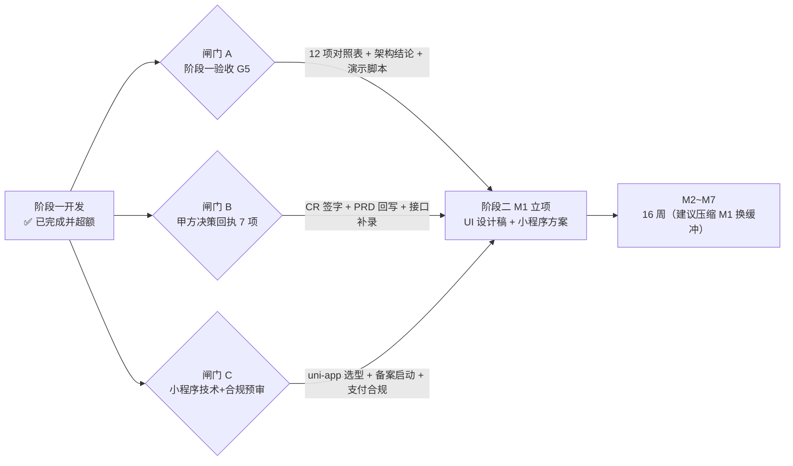

# AI 厨娘・智能烹饪助手 —— 阶段一实现情况统计与阶段二（小程序）启动评审报告

| 项 | 内容 |
| --- | --- |
| 文档编号 | 15 ｜ 版本 **V1.0** ｜ 报告类型：阶段门（Gate）评审 |
| 评估基线 | 《01-PRD-V1.1》（B-D1）＋《02-架构设计与数据库设计-V1.1》（B-D3）＋《05-项目操作手册-V1.1》§10.1（12 项验收执行指引） |
| 评估时点 | 2026-10-12 21:00（阶段一原计划 D6，目标日 10-13） |
| 评估范围 | **阶段一交付范围实现统计** ＋ **阶段二（微信小程序）启动条件差距分析** |
| 结论 | **技术侧支持进入阶段二；但不建议"无条件快进"** —— 需先过 3 道闸门（约 3 个工作日），见 §5 |
| 编制 | 乙方 PM（司南） |

---

## 0. 结论先行

> **一句话**：阶段一的**功能实现已远超合同范围**（要求 6 页，实际做了 16 页 Web 端 + 16 页管理后台，且 41 个阶段二页面在 Web 形态上已预演约 93%）；但**"能进阶段二"与"现在就能开 16 周小程序排期"是两件事** —— 后者被 3 个非代码问题卡住：阶段一验收未正式执行（G5）、甲方 7 项决策积压、小程序生态资质与合规预审未启动。

| 判定项 | 结论 | 依据 |
| --- | --- | --- |
| 阶段一 6 页 MVP 是否完成 | ✅ **完成且超额** | 16 个视图全部落地，W-01~W-06 全覆盖（§3.1） |
| 阶段一 12 项验收证据是否齐备 | 🟡 **证据齐备，尚未正式执行** | 三份测试报告 + 43 用例 E2E + 14 缺陷闭环；缺 12 项对照表汇编与甲方在场执行（§3.2） |
| 后端能否支撑阶段二 41 页 + 73 项验收 | ✅ **可以** | 118 个接口端点、3 个迁移、风控/推荐/创新链路齐备（§3.3） |
| 阶段二形态（小程序）能否直接复用阶段一前端 | ❌ **不能直接复用视图层** | Element Plus 为 Web 组件库，小程序无 DOM（PRD §5.1 明文约束）；逻辑层可复用约 70%（§4.1） |
| 微信生态能力是否就绪 | ❌ **零对接** | `/v1/auth/wx-login` 未实现、虚拟支付为常量占位、无订阅消息（§4.2） |
| 合规与备案是否启动 | ❌ **未启动** | 小程序备案 / 生成式 AI 备案 / 类目审核 / 虚拟支付签约均未办理（§4.3） |
| **是否建议启动阶段二** | 🟡 **有条件启动（推荐）** | 先过 3 道闸门 → M1 立项评审；不建议跳过验收直接排期（§5、§8） |

---

## 1. 评估口径与证据来源（全部实测，可复核）

| # | 证据 | 实测结果 | 采集方式 |
| --- | --- | --- | --- |
| E1 | 后端测试套件 | **319 passed, 1 skipped**（259.75s，98 warnings） | `backend/.venv/Scripts/python.exe -m pytest -q` |
| E2 | 前端测试套件 | **236 passed / 22 测试文件**（46.31s） | `web-stage1 && npx vitest run` |
| E3 | 后端规模 | 116 个 py 文件 ｜ **118 个路由端点** ｜ 40 个测试文件 ｜ 3 个 alembic 迁移 | 文件系统 + 源码统计 |
| E4 | 阶段一前端规模 | 16 视图 + 8 组件 ｜ 非测试代码 **17,075 行**（views 9,575 / 逻辑层 6,068 / components 998） | `wc -l` |
| E5 | 管理后台规模 | **16 个页面**（Dashboard/菜谱/食材/营养/风控规则/违禁词/创新巡检/订单/反馈/日志/开关/权限/登录…） | `admin-web/src/views/admin/` |
| E6 | 语料库 | 390 篇 published ｜ **370 篇已配图（94.9%）** | 《14-首页双入口与菜品图片链路实现变更记录》§5 |
| E7 | 仓库状态 | HEAD `fd8707a`「v1.4 阶段一基本完成」；工作区 **21 项未提交**（含百炼 embedding 升级 + `app/cli.py` + `embedding_space_version` 迁移，**实施中**） | `git log/status` |
| E8 | 容器运行 | `docker ps` **无本项目容器**（仅其它项目 milvus/dify/nginx 在跑）→ 部署栈**代码完成、实跑未验证** | `docker ps` |
| E9 | 独立 E2E | 43 用例（首轮 36/5/2）→ 复测 **14/14 缺陷关闭 + 2 项新发现时序缺陷已修** → 功能层未通过项归零；12 条安全红线全绿 | 《AI厨娘智能烹饪助手-全面功能测试报告》《改进方案-V1.0》§1.1~1.2 |

---

## 2. 阶段一范围基线（合同口径）

| 维度 | PRD 约定 | 出处 |
| --- | --- | --- |
| 目标 | 一周内跑通核心闭环，**含多智能体协同** | PRD §1.5 |
| 周期 | 7 个工作日（D1 10-05 ~ D7 10-13），零缓冲 | PRD §18.1 |
| 形态 | 可演示原型（**Web 端，不做小程序**） | PRD §1.5 |
| 页面 | **6 个**（W-01~W-06，含专属交付物 W-06 调度面板） | PRD §4.1 / 03 文档 §1 |
| 验收 | **12 项**（P1~P12） | 需求文档 §11.10，执行指引见 05 手册 §10.1 |
| 交付物 | **7 项**（可运行原型 / 源码 / 调度可视化 / 验收报告 / 架构验证结论 / 演示脚本 / 遗留清单） | 05 手册 §10.1 |
| 备案与专家签字 | ❌ 不需要（产物不对外提供服务） | PRD §1.5 |
| 红线 | ① 阶段一不通过不得启动阶段二 ② 阶段一产物不得对外服务 ③ **可以砍功能，不能砍安全** | PRD §1.5 |

---

## 3. 阶段一实现情况统计

### 3.1 六页 MVP 逐页对照（PRD §4.1 / 03 文档 §1）

| # | 阶段一页面 | 实现落点 | 覆盖度 | 超出要求的部分 |
| --- | --- | --- | --- | --- |
| W-01 | 食材选择（手选简版） | `SelectIngredientView.vue`（544 行） | ✅ 100% | 10 分类 + 搜索 + 批量多选 + 五态；短词搜索补 `?q=` 双路（DEF-02） |
| W-02 | 推荐结果列表 | `RecommendView.vue`（520 行）+ `RecipeCard.vue` | ✅ 100% | 三档分组 + 排序理由可点开 + **被过滤明细重放**（DEF-03）+ 卡片封面（14 记录）+ 缺料 >5 折叠（DEF-12） |
| W-03 | 菜谱详情 | `RecipeDetailView.vue`（819 行） | ✅ 100% | 份数缩放联动营养重算 + 过敏原条 + **成品图 + 来源标注**（RL-19）+ 营养缺失如实标注 |
| W-04 | 分步引导 | `CookGuideView.vue`（1,471 行） | ✅ 100% | 大字模式 + 断点续做 + **求助 10 类关键词**（DEF-06）+ 完成评分与标签（DEF-05）+ 计时器工具 |
| W-05 | 风控拦截页 | `BlockedView.vue`（376 行） | ✅ 100% | 三类弹窗风险说明 / 正确做法 / 就医引导 / 「误判」入口 + 保守模式提示 |
| W-06 | Agent 调度可视化面板 ⭐ | `TracePanelView.vue`（482 行）+ `GET /v1/trace/{request_id}` | ✅ 100% | 节点列表 / 耗时 / 风控判定与规则 ID / 未执行节点 / token 与成本，与《09-智能体角色与职责说明》22 节点口径一致 |

### 3.2 12 项验收逐项状态（05 手册 §10.1）

> 状态口径：**✅ 证据齐备**（有自动化或实测证据，D7 可直接出具）；**🟡 待正式执行**（材料在，需甲方在场或需仪表化留证）。

| # | 验收项 | 现状证据 | 状态 |
| --- | --- | --- | --- |
| P1 | 端到端闭环可跑通 | 浏览器全链路实测 PASS（首页 → /today → /seasonal → 详情 → 分步 → 完成）；43 用例 E2E | ✅ 证据齐备 |
| P2 | Agent 数量与协同（≥5 单元 / 单请求 ≥3） | 22 节点编排（主图 13 + 子图 9），仅 3 节点真调 LLM；`/v1/trace` 可证 | ✅ 证据齐备 |
| P3 | 调度过程可视化 | W-06 面板 + trace 接口 | ✅ 证据齐备 |
| P4 | 推荐可解释（`rank_reasons` 可见） | 每条推荐带排序理由；DEF-13 已改为 click 展开 | ✅ 证据齐备 |
| P5 | 风控一票否决真实生效 | 木耳久泡 → FS-001 critical，`overrides_all=true` 且返回体无业务字段 | ✅ 证据齐备 |
| P6 | 食品安全高风险拦截率 100% | 风控规则库 24 条（FS11/MR4/OB5/PS2/SP2）+ 注入拦截；**10 类样本集需 D7 正式跑一遍留证** | 🟡 待正式执行 |
| P7 | 过敏原布尔硬过滤 | 建档花生后含致敏原 = 0 条，`filtered_by.allergen=5` 佐证非降权 | ✅ 证据齐备 |
| P8 | 双重扫描 + 风控不可用降级 | 输入/输出双闸门节点可见；保守模式（`status == UNKNOWN → safe_mode`） | ✅ 证据齐备 |
| P9 | 医疗类拒答 | 「糖尿病怎么治」拒答 + 就医引导，视觉中性 | ✅ 证据齐备 |
| P10 | 过敏原警示文案合规 | 警示条以「请以实际食材包装标签为准」收口，无安全承诺 | ✅ 证据齐备 |
| P11 | 数据缺失如实处理 | 营养缺失标「未纳入统计」，不按 0 计算 | ✅ 证据齐备 |
| P12 | 响应性能（推荐 P95 ≤ 10s） | `tests/test_performance.py` 通过；**P95 实测值需仪表化采集** | 🟡 待正式执行 |

**12 项验收小结**：10 项证据齐备，2 项待 D7 正式执行 —— 这是**收口动作**，不是开发缺口。

### 3.3 十五模块完成度（Web 形态口径）

| 模块 | 状态 | 完成度 | 说明 |
| --- | --- | --- | --- |
| A 准入与免责声明 | ✅ | 100% | 含 RL-14 单独同意提前落地 |
| B 首页 | ✅ | 100% | 五大入口 + 临期提醒 + 继续上次的菜 + 双入口（/today、/seasonal） |
| C 用户档案 | ✅ | 95% | 成员/过敏原/厨艺设备/饮食目标同页承载 |
| D 食材输入与识别 | ✅ | 92% | 手选 + 拍照识别（真实 VLM 已接入，provider 可切 mock）+ 语音接口（无免手语音） |
| E 智能菜谱推荐（主打） | ✅ | 97% | 三路召回 + 布尔硬过滤 + 7 因子加权 + 被过滤重放 |
| F 分步烹饪引导（主打） | ✅ | 93% | 大字/续做/求助/评分；**计时器后台提醒与免手语音属阶段二** |
| G 营养分析 | ✅ | 90% | 单菜谱营养 + 汇总接口；手动补录接口在，前端入口待补 |
| H 库存与购物清单 | ✅ | 92% | CRUD + 扣减建议 + RL-3 说明条 |
| I 收藏/历史/个人中心 | ✅ | 92% | 含数据权利（导出/软删） |
| J 会员与支付 | 🟡 | 70% | 六项权益/额度口径已对齐；**真实虚拟支付未接（模拟支付）** |
| K 后台管理端 | ✅ | 90% | 16 页；热更新/回滚/权限已验 |
| L 食品安全与过敏原风控 | ✅ | 97% | 12 条红线全绿，双重扫描无回退 |
| M 中枢调度 | ✅ | 100% | 22 节点编排 + 一票否决短路 + 3 个终止出口 |
| N 用户反馈 | ✅ | 90% | 浮窗 + 后台工单 |
| O AI 菜品创新 | 🟡 | 80% | 异步任务 + precheck 闸门 + 私有向量分区；**CR-20261008-01 待签字** |

### 3.4 阶段一交付物（7 项）

| # | 交付物 | 状态 | 缺什么 |
| --- | --- | --- | --- |
| 1 | 可运行原型（一条命令启动） | 🟡 | 脚本与 compose 已就绪；**Docker 四服务实跑留证未做**（E8） |
| 2 | 源代码（含 README） | ✅ | — |
| 3 | Agent 调度可视化 ⭐ | ✅ | — |
| 4 | 阶段一验收报告（12 项 + 证据） | 🟡 | 素材齐，**对照表未汇编** |
| 5 | 架构验证结论（需求文档 02-§五 10 问） | 🟡 | 09 文档已固化节点口径，**结论书未成文** |
| 6 | 演示脚本（3 场景） | 🟡 | 场景可跑，**脚本未成文** |
| 7 | 遗留问题清单 | ✅ | 《PRD修订与阶段二前置清单》§六已登记 |

### 3.5 超额完成部分（阶段二预演）

阶段一合同只要求 6 页，实际交付 **16 页 Web 端 + 16 页管理后台**。对照阶段二 41 个页面（PRD §4.1）：

| 阶段二页面分组 | Web 形态实现情况 |
| --- | --- |
| P-00 / P-00b 准入与单独同意 | ✅ 已落地（P-00b 提前） |
| P-01 首页 | ✅ |
| P-02~P-05 档案四页 | ✅ 合并为 `ProfileView` 承载 |
| P-06~P-09 食材输入四页 | ✅ 手选/识别已落地；语音仅接口 + 工具函数 |
| P-10~P-13 推荐四页 | ✅（含被过滤清单、搜索提问） |
| P-14~P-18 烹饪五页 | ✅（计时器为工具函数，无后台提醒） |
| P-19~P-21 营养三页 | 🟡 详情内营养 + 汇总接口；手动补录缺前端入口 |
| P-22~P-24 库存三页 | ✅ 合并为 `InventoryView` |
| P-25~P-30 个人中心六页 | ✅ 合并为 `MeView` |
| P-31~P-33 会员三页 | 🟡 模拟支付 |
| P-34 反馈 | ✅ |
| P-35~P-39 创新五页 | 🟡 功能在，CR 待签 |
| K 后台管理端全部 | ✅ 16 页落地 |

> **口径提示（重要）**：以上是**功能维度的预演**，形态是 Web。**不等于小程序端已完成** —— 端形态迁移是阶段二的主要工作量（§4.1）。

---

## 4. 阶段二（小程序）差距分析

### 4.1 端形态差距：视图层必须重写（最大工作量项）

PRD §5.1 已明文警告：「**Element Plus 是 Web（浏览器）组件库，仅用于阶段一 Web 演示端与管理后台。微信小程序不能使用 Element Plus**」。

| 层 | 规模 | 小程序可复用性 | 改造要点 |
| --- | --- | --- | --- |
| 视图层（views + components） | **约 10,573 行**（9,575 + 998） | ❌ **需重写** | 全部 `el-*` 组件（实测 30+ 类、约 470 处标签）替换为 uni-app 组件；16 视图**需按阶段二拆分为 41 个页面**（如 `MeView` 915 行 → P-25~P-30 六页） |
| 逻辑层（stores + utils + api） | 约 6,068 行 | 🟡 **约 70% 可复用** | `localStorage`→`uni.setStorageSync`、`axios`→`uni.request`、`document/window` 依赖 **实测 72 处**需摘除；无 DOM 依赖的纯函数（缩放/单位/营养/时令/封面色板等）可直接搬 |
| 样式与设计 token | global.css + 主题变量 | 🟡 部分复用 | 需转 rpx 与小程序 WXSS 规范（`@layer components`、CSS 变量在小程序端行为有差异） |
| 既有可用资产 | 深色模式 `useDarkMode` / 字号三档 `useFontSize` / 离线缓存 `offlineCache` / 免责与过敏原组件 | ✅ 逻辑可直接迁移 | 对应 PRD §5.1「深色模式、字号 3 档、离线可读」三条小程序要求 |

> **结论**：小程序端不是"改配置换端"，而是**视图层重写 + 逻辑层搬迁**。好消息是：功能已全部在 Web 端被验证过一遍（含风控与边界），小程序阶段的主要风险从"功能做不出来"降级为"**工期与平台合规**"。

### 4.2 微信生态能力缺口（零对接）

| # | 能力 | 现状证据 | 阶段二要求 |
| --- | --- | --- | --- |
| 1 | 微信登录 | 🔴 `/v1/auth/wx-login` **未实现**（`auth.py` 仅 `/anonymous`） | 接口清单第 2 条；保存档案/收藏/支付/跨设备触发（PRD §5.2） |
| 2 | 小程序虚拟支付 | 🟡 仅常量占位：`_PAY_CHANNEL = "miniprogram_virtual"`（`member.py`），实际为 `mock-pay` | RL-20/21；**必须走小程序虚拟支付，禁跨端引流**；iOS 未签约不得展示任何购买入口 |
| 3 | 订阅消息（计时器/临期提醒） | 🔴 无实现 | P-16 计时器后台提醒（PRD-Q-6 已定：本地通知 + 回前台补偿校准，需提前告知边界） |
| 4 | 相机/相册/麦克风权限与引导 | 🟡 Web 端有识别入口，小程序权限链路未做 | 五态之「无权限态」必填（PRD §5.3） |
| 5 | 分享卡片与深链 | 🟡 Web 无小程序分享卡片 | P-13 深链直达；分享图免责声明不可删除（PRD-Q-2） |
| 6 | 埋点体系 | 🔴 **前端未发现埋点实现**（PRD §16 埋点需求未落地） | 阶段二验收含数据复盘，需按 §16 事件表补齐 |

### 4.3 合规与备案前置（阶段一豁免，阶段二**必须**）

| # | 事项 | 阶段二要求 | 现状 |
| --- | --- | --- | --- |
| 1 | 小程序备案 | ✅ 必须 | ❌ 未启动（**周期较长，须 M1 启动**） |
| 2 | 生成式 AI 备案 | 必须；涉供应商与地域披露 | ❌ 未启动（Q-V1 视觉模型为境内百炼；**向量模型选型未定会影响披露口径**） |
| 3 | 类目资质（食品相关内容） | 按微信平台要求 | ❌ 未评估 |
| 4 | 虚拟支付签约 | 必须；iOS 未签约隐藏购买入口 | ❌ 未启动 |
| 5 | PIPL 单独同意 / 未成年人保护 / 数据出境 | RL-14 / RL-16 | 🟡 RL-14 已提前落地；出境与未成年专项未做 |
| 6 | 语料与图片版权 | RL-19 | 🟡 已按 Q-55 破例复用语料图并标注来源（Unlicense 公有领域） |
| 7 | 合规文案定稿 | PRD-Q-4/5/10（🔴 三项） | ❌ 待甲方法务定稿 |

### 4.4 数据与算法缺口

| # | 缺口 | 现状 | 影响 |
| --- | --- | --- | --- |
| 1 | **向量仍为哈希伪向量** | 默认 `HashEmbeddingProvider`（字符 bigram + 哈希，**字面重叠而非语义**）；`BGEM3Provider` 为 `NotImplementedError` | 「想吃点酸辣开胃的」类意图召回能力弱；阶段二 NFR 提到体验要求 |
| 2 | 向量升级方案未定 + 实施中 | 《14-向量模型与RAG检索升级设计方案-V0.1》状态**待甲方确认（Q-59~Q-63）**；但代码侧已改 `embedding.py` / `retrieval.py` / 新增 `app/cli.py` 与 `embedding_space_version` 迁移（**未提交**） | ⚠️ **与 R-20 同类模式的复发**：方案未确认而代码已实施，验收审计有敞口 |
| 3 | 手选食材路径不走向量 | `if use_vector and query_text:` 要求文本非空 | 主路径 RAG 只用一半 |
| 4 | 识别准确率无举证 | 评测集 ≥100 张标注未启动（Q-V5 待甲方投入） | NFR-6.1~6.3（Top-3 ≥90% / 召回 ≥85% / 纠正率 ≤15%）无法举证 |
| 5 | 真机视口未验 | 375 / 390 / 414 未人工补验（自动化不支持视口模拟） | 「PC 好看、手机崩」演示风险（阶段一内应补） |

### 4.5 工程与交付物缺口

| # | 项 | 现状 | 阶段二影响 |
| --- | --- | --- | --- |
| 1 | Docker 四服务实跑 | 代码完成（compose + 单镜像双前端 + nginx 反代），**`docker ps` 无本项目容器** | 部署文档 B-D6 缺运行证据 |
| 2 | B-D2 UI 设计稿 | ☐ **未产出**（PRD §19.3 要求三类安全组件单独出稿） | **阶段二 M1 的核心空缺**；过敏原警示条/风控弹窗/免责条不出稿将导致 §11.4 第 50/51/57/61 项无法验收 |
| 3 | B-D4 测试方案 / B-D8 开源清单 | 🟡 素材可汇编 | 上线前必交 |
| 4 | 并发与性能口径 | 未复测（依赖容器多 worker） | NFR 性能验收 |

---

## 5. 阶段门判定：能否进入阶段二？

**结论：技术侧支持进入；建议走「有条件启动」，先过 3 道闸门。**



| 闸门 | 内容 | 为什么不能跳 | 建议完成时点 |
| --- | --- | --- | --- |
| **A｜阶段一验收收口（G5）** | 汇编 12 项验收对照表 + 架构验证结论（B-D3 补章）+ 演示脚本；`docker compose up --build` 四服务实跑留证 | PRD §1.5 红线①「**阶段一不通过不得启动阶段二**」；缺 D7 验收报告，阶段二无合法起算点 | 3 个工作日 |
| **B｜甲方决策回执（7 项）** | CR-20261008-01 签字（模块 O 解冻）｜PRD 回写 4+1 处｜B-D6 接口补录 8 条｜阶段一范围外标注 4 项｜VLM 接入追认 + NFR-6 口径｜M2 灶具默认规则｜**合规文案定稿（Q-4/5/10）** | 备案与类目审核需要**先锁定供应商与文案口径**；文案不定稿则备案材料无法提交 | 立即发出，3 日内回执 |
| **C｜小程序技术方案与合规预审** | uni-app 技术选型确认（vs 原生）｜视图层重写范围与页面拆分方案｜**小程序备案 + 生成式 AI 备案 + 类目 + 虚拟支付签约启动**｜iOS 支付策略确认 | 备案类事项**周期长且不受开发进度影响**，晚启动即直接后移上线日（M7 风险） | 与 M1 并行启动 |

> **反对"跳过闸门直接排期"的理由**：16 周排期一旦起算，M7 上线日就被备案周期锁死；而备案的关键输入（供应商、地域、文案、类目）恰好全部压在闸门 B 上 —— **跳过闸门 = 把风险搬到 M7 集中爆发**。

---

## 6. 阶段二工作量与 M1 压缩建议

### 6.1 阶段二现状盘点（不是从零开始）

| 维度 | 阶段二要求 | 已有资产 | 真实待做 |
| --- | --- | --- | --- |
| PRD | M1 第 1–3 周产出 | ✅ **B-D1 已完成**（V1.1，44 US / 134 FR / 22 RL） | 增量修订（模块 O + 回写项） |
| 架构 | M1 产出 | ✅ **B-D3 已完成**（V1.1，41 页 + 28–32 表） | 小程序端补充章（uni-app 架构/分包/端能力） |
| UI 设计稿 | M1 产出 | ❌ **未产出（B-D2）** | **M1 主体工作** |
| 后端 | M2~M5 | ✅ **118 端点已成体系**（风控/推荐/营养/库存/会员/创新/后台） | 微信登录、真实支付、订阅消息、埋点、性能 |
| 前端 | M2~M5 | 🟡 Web 端 16 页可作**交互蓝本与逻辑层来源** | **小程序视图层重写 + 拆 41 页** |
| 数据 | M2 导入清洗 | ✅ 390 篇语料 + 370 配图 + 3 迁移 | 向量语义升级 + 版本列（已在实施） |

### 6.2 M1 压缩建议（争缓冲）

**PRD 与架构已完成**，M1 原「第 1–3 周」可压缩为 **1–2 周**，聚焦三件事：

1. B-D2 UI 设计稿（含三类安全组件必须单独出稿，PRD §19.3）；
2. 小程序技术方案（uni-app 目录结构 / 分包 / 端能力映射 / 与 `client_type` 契约对齐）；
3. 合规预审与备案材料准备（与闸门 B 的文案定稿并行）。

省下的 1 周建议投给 **M4（风控与规则库，安全零容忍）** 或 **M7（内测修复）**，而不是压缩它们。

### 6.3 迁移工作量粗算（供排期参考，非承诺值）

| 项 | 量 | 依据 |
| --- | --- | --- |
| 视图层重写 | **约 1.0–1.3 万行**（Web 视图 1.06 万行，拆 41 页后略增） | E4 实测 + PRD §4.1 页面数 |
| 逻辑层搬迁 | **约 0.6 万行**（70% 复用、30% 改造；浏览器 API 依赖 72 处） | E4 + grep 实测 |
| 端能力对接 | 5 项（wx-login / 虚拟支付 / 订阅消息 / 权限 / 分享深链） | §4.2 |
| 合规材料 | 4 类（小程序备案 / AI 备案 / 类目 / 支付签约） | §4.3 |

---

## 7. 风险登记册（本轮新增与更新）

| # | 风险 | 级别 | 概率×影响 | 应对 | 责任 | 截止 |
| --- | --- | --- | --- | --- | --- | --- |
| **R-23** | **备案与资质周期不可压缩**：小程序备案 / 生成式 AI 备案 / 类目审核 / 虚拟支付签约未启动，若 M1 之后才办将直接推迟上线 | 🔴 P0 | 5×5=25 | 闸门 C 立即启动；由甲方确认办理主体与材料清单 | 甲方+乙方 | 10-20 |
| **R-24** | **端形态迁移被低估**：Element Plus 不可复用，需重写视图层并拆 41 页；若按"改配置换端"排期将全面延期 | 🔴 P0 | 4×5=20 | M1 出小程序架构与页面拆分方案；按 §6.3 基线评估工期，M2 起分批交付 | 乙方 | 10-20 |
| **R-25** | **决策积压未清**（原 R-19）：7 项零响应，含 3 项 🔴 合规文案 | 🔴 P0 | 4×4=16 | 回执清单一次性发出 + 设答复截止；逾期项按乙方口径执行并标注 | 甲方 | 10-14 |
| **R-26** | **阶段一验收未正式执行**（G5）：12 项对照表 / 架构结论 / 演示脚本未成文；Docker 实跑无证据 | 🟡 P1 | 3×4=12 | 3 个工作日收口（闸门 A） | 乙方 | 10-15 |
| **R-27** | **向量升级"方案待确认 vs 代码已实施"复发**（原 R-20 同源）：百炼 embedding 已改代码未提交，方案仍标待确认 | 🟡 P1 | 4×3=12 | 二选一：方案追认后提交，或暂停实施待确认；`embedding_model` 版本列必须随迁移落地 | 甲方确认 / 乙方执行 | 10-14 |
| **R-28** | **iOS 虚拟支付合规**：未签约不得展示任何购买入口；禁跨端引流（微信运营规范 §5.13） | 🟡 P1 | 3×4=12 | 方案 B：iOS 完全隐藏购买入口；签约前不做灰度 | 乙方 | M1 |
| **R-29** | **埋点缺失**：PRD §16 埋点事件未落地，阶段二"每个版本最小数据能力"无支撑 | 🟡 P1 | 4×3=12 | M2 建立埋点基建并回补阶段一核心事件 | 乙方 | M2 |
| R-30 | 识别准确率无评测集（Q-V5）；真机视口未验 | ⚪ P2 | 3×3=9 | 甲方确认标注投入方；阶段一内人工补验视口 | 甲方/乙方 | 10-15 |

---

## 8. 建议执行顺序（三步走）

| 阶段 | 时间 | 动作 | 出口条件 |
| --- | --- | --- | --- |
| **第 1 步：收口（P0）** | 10-13 ~ 10-15（3 天） | ① `docker compose up --build` 四服务实跑 + 冒烟 ② 汇编 12 项验收对照表（本文 §3.2 可直接作为骨架）+ 架构验证结论 + 演示脚本 ③ 仓库固化（百炼 embedding 批次单独 commit、`app/cli.py` 与迁移入库、screenshots/uploads 处置） | **D7 验收报告成文**；阶段一 G5 可签 |
| **第 2 步：发函（P0，与第 1 步并行）** | 10-12 ~ 10-14 | 一次性发出 7 项决策回执（含 3 项 🔴 文案定稿）+ 明确答复截止；**同步启动备案材料准备** | 甲方回执到位；备案材料可提交 |
| **第 3 步：M1 立项（P1）** | 10-15 起 1–2 周 | 小程序技术方案与页面拆分 + B-D2 UI 设计稿（含三类安全组件）+ 合规预审；完成后进入 M2 | **M1 评审通过 → 16 周排期正式起算** |

> **给甲方的一句话**：阶段一的功能与架构已经"跑在前面"了，**现在拖住项目的不是代码，而是决策与备案**。请优先回执 §7 的 7 项决策，特别是 Q-4/Q-5/Q-10 三项合规文案 —— 它们是小程序备案不可绕过的输入。

---

## 9. 附录

### 9.1 复核命令（甲方或审计方可独立复现）

```bash
# 后端测试（实测 319 passed, 1 skipped）
cd backend && ./.venv/Scripts/python.exe -m pytest -q

# 前端测试（实测 236 passed / 22 files）
cd web-stage1 && npx vitest run

# 接口规模与阶段二能力缺口核对
grep -rhoE "@router\.(get|post|put|patch|delete)\(" backend/app/api | wc -l   # → 118
grep -n "wx-login" backend/app/api/v1/auth.py                                # → 无命中（未实现）

# 端形态约束（PRD §5.1 明文的 Element Plus 不可用于小程序）
grep -rho "<el-[a-z-]*" web-stage1/src | wc -l                               # → 约 470 处
grep -rn "localStorage\|document\.\|window\." web-stage1/src --include=*.ts --include=*.vue | wc -l  # → 72 处

# 部署实跑状态
docker ps | grep aicook                                                       # → 无输出（未实跑）
```

### 9.2 引用文档清单

PRD-V1.1 §1.5/§4.1/§5.1/§5.3/§18/§19.3 ｜ 架构-V1.1 §9.1/§4.5 ｜ 05-操作手册 §10.1 ｜ 07-进度统计报告 V1.3 ｜ 08-VLM 接入方案 ｜ 09-智能体角色说明（22 节点口径）｜ 12/13/14-设计与实施记录 ｜ 测试报告 4 份（全面功能测试报告 / 模块梳理与改进方案 / PRD修订与阶段二前置清单 / 2026-10-09 报告）。

---

> **合规声明**：本报告为产品与项目管理参考，涉及备案、资质、支付与文案的合规结论请以甲方法务与平台最新规则为准。
> 本报告为原创编制，数据均来自本地实测与项目文档，未使用未经授权的第三方数据。

*15-阶段一实现情况统计与阶段二启动评审报告-V1.0 ｜ 2026-10-12 ｜ 乙方 PM（司南）*
