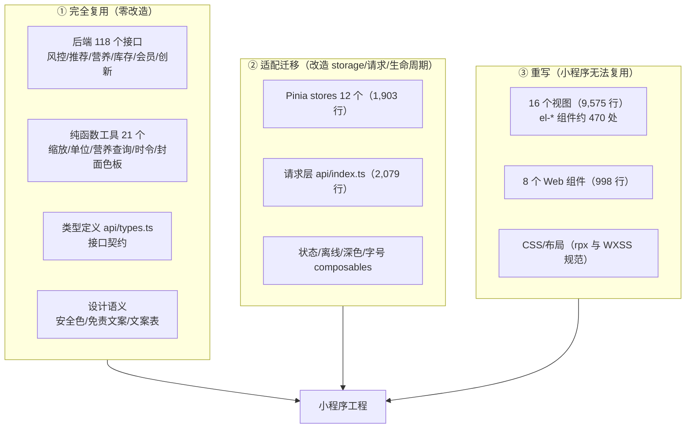

# AI 厨娘・智能烹饪助手 —— 阶段二微信小程序开发设计方案

| 项 | 内容 |
| --- | --- |
| 文档编号 | 16 ｜ 版本 **V1.0** ｜ 文档性质：**阶段二（小程序）技术设计方案** |
| 关联文档 | 《01-PRD-V1.1》（B-D1）｜《02-架构设计与数据库设计-V1.1》（B-D3，§2.3 技术栈 / §5.1 端与形态 / §11 性能）｜《03-UI原型界面描述清单-V1.1》｜《05-项目操作手册-V1.1》§10.2｜《13-推荐结果卡片图片呈现方案》｜《14-向量模型与RAG检索升级设计方案》｜《15-阶段一实现情况统计与阶段二启动评审报告》 |
| 代码基线 | `web-stage1/`（阶段一 Web 端，16 视图 / 17,075 行非测试代码）｜`backend/`（118 个路由端点 / 3 个迁移）｜`admin-web/`（16 页） |
| 状态 | **待评审**（待确认问题见 §19，Q-64 ~ Q-75） |
| 编制 | 乙方技术方案组 ｜ 日期：2026-10-12 |

---

## 0. 阅读指引

- 本文是**施工图级方案**：给出目录结构、分包划分、迁移映射、端能力对接、验收口径与排期分解，可直接拆为开发任务。
- 🔴 标记项为**红线或不可妥协约束**，与 PRD 的 `RL-x`、架构的不变量对应。
- 凡涉及平台能力（微信虚拟支付、订阅消息、备案）的结论，**以微信开放平台与工信部最新规则为准**，本文给出的是设计边界与责任划分，不替代平台规则核对。
- 本文不重复 PRD 的需求描述，只写**"怎么建"**；需求口径以 PRD 为准（冲突时以 PRD 为准）。

---

## 1. 设计目标与非目标

### 1.1 目标

| # | 目标 | 可衡量口径 |
| --- | --- | --- |
| G1 | 把阶段一已验证的 41 页功能**完整迁移到微信小程序原生形态** | PRD §4.1 全部 41 个页面/弹层 + 3 个全局组件可访问、无功能缺失 |
| G2 | **安全能力零降级**：过敏原硬过滤、风控一票否决、双重扫描、识别须确认 | 阶段二 16 项安全与内容验收**零缺陷**（05 手册 §10.2） |
| G3 | 业务逻辑**零前端复刻**：硬过滤/排序/风控/营养计算全部在后端 | 前端代码中不存在过敏原/难度/设备过滤与排序打分实现（代码审查项） |
| G4 | 满足小程序性能与体验硬指标 | 首页可见 ≤1.5s；推荐 P95 ≤6s、详情 P95 ≤2s、步骤切换 P95 ≤300ms（架构 §11） |
| G5 | 满足平台合规：备案、类目、虚拟支付、隐私与未成年保护 | 备案受理凭证 + iOS 策略落地 + 隐私协议与单独同意链路完整 |
| G6 | 支撑后续快速迭代（热更新优先） | 菜谱/风控规则/开关/季节词表**全部远程化**，改内容不发版（NFR-4.2） |

### 1.2 非目标（明确不做）

| # | 不做 | 原因 |
| --- | --- | --- |
| N1 | **不在小程序端实现任何业务规则**（过滤、排序、营养计算、风控判定） | 架构 §2.3 明文：业务逻辑全部在后端；安全逻辑必须只有一处实现 |
| N2 | **不使用 Element Plus** 或任何 Web 组件库 | PRD §5.1：小程序无 DOM，Element Plus 不可用 |
| N3 | 不迁移 **W-06 Agent 调度面板** | 阶段一专属交付物/运维面板，不面向 C 端用户 |
| N4 | 不做 App / H5 / 支付宝小程序多端发布 | 合同仅约定微信小程序；H5 构建仅用于本地调试 |
| N5 | 不做小程序端管理后台 | 管理后台为独立 Web（已实现 16 页） |
| N6 | 不引入重型 UI 框架全家桶 / 重型图表库 | 分包 2MB 硬约束下体积优先 |
| N7 | 不做小程序端本地风控兜底规则 | 风控不可用 → 走**保守模式**（后端判定），前端只呈现 |

---

## 2. 设计输入与硬约束

### 2.1 来自 PRD / 架构的硬约束

| # | 约束 | 出处 | 设计落点 |
| --- | --- | --- | --- |
| C1 | 小程序用 **uni-app** 编译 | PRD §5.1 / 架构 §2.3 | §4 技术选型 |
| C2 | 接口以 **`client_type`** 区分端，**不得在小程序端做业务逻辑判断** | NFR-4.4 | §11 接口契约 |
| C3 | 底部 4 Tab：首页 / 我的冰箱 / 收藏·历史 / 我的；层级 ≤3；烹饪引导沉浸式全屏且返回二次确认 | PRD §4.3 | §6 分包与导航 |
| C4 | 每页五态（加载/空/错误/无权限/离线）必填；关键页面低置信/降级态 | PRD §5.3 + 覆盖矩阵 | §9.3 状态组件 |
| C5 | 字号 3 档（14/16/18px → rpx 折算）+ **烹饪模式 ≥32px 专档**；深色模式全页面；关键操作热区 ≥44×44pt；安全提示"不依赖颜色" | PRD §5.5 | §9.2 设计 token |
| C6 | 免责声明 6 处附着（首页/详情/营养/风控页/分享图/过敏原条） | NFR-1.4 + PRD §5.6 | §9.4 安全组件 |
| C7 | 4 个模块级远程开关（推荐/识别/问答/支付）**实测后端已实现 5 键**（+创新） | PRD §5.8 vs `config.py` | ⚠️ §19 Q-64 待裁定 |
| C8 | 离线可读：进入烹饪引导时步骤写入本地存储；断网可读 | NFR-3.6 / 架构 §11 | §8.6 离线方案 |
| C9 | 计时器后台 5 分钟误差 ≤3s：**本地通知 + 回前台补偿校准**，且须**提前告知用户边界** | PRD-Q-6 | §8.5 计时器方案 |
| C10 | 识别结果 `need_user_confirm` 恒为 true，不可配置关闭 | RL-5 | §13.2 |
| C11 | 埋点 38 个事件 | PRD §16 | §14 |

### 2.2 来自微信平台的硬约束（小程序特有）

| # | 约束 | 影响 | 应对 |
| --- | --- | --- | --- |
| P1 | **主包 ≤2MB / 单分包 ≤2MB / 整包 ≤20MB**（以平台最新规则为准） | 41 页 + 组件 + 静态资源必须分包 | §6 分包设计 |
| P2 | tabBar 页面**必须在主包** | 首页/冰箱/收藏历史/我的四页压主包 | §6.2 |
| P3 | 网络请求**仅 HTTPS + 已备案域名白名单**；本地调试可关闭校验 | 需要域名与 HTTPS 证书（当前 nginx 仅 80） | §16 部署前置 |
| P4 | 无 DOM / 无 `window` / 无 `localStorage` | 阶段一逻辑层需适配层 | §7 |
| P5 | 虚拟支付必须走**小程序虚拟支付**；**不得引导至 App/公众号/H5/网站** | 支付与会员模块 | §8.3 / §13.4 |
| P6 | iOS 未签约虚拟支付 → **不得展示任何购买入口**（含不可用按钮） | 会员中心呈现策略 | §8.3 方案 B |
| P7 | 订阅消息需**平台模板审核**且为一次性订阅（用户逐次授权） | 计时器/临期提醒 | §8.4 |
| P8 | 相机/相册/麦克风均需**用户授权**，拒绝后需引导设置 | 五态之无权限态 | §8.7 |
| P9 | 生成式 AI 需**算法备案/大模型备案**；小程序需**工信部备案** | 上线前置 | §13.5 |
| P10 | 分享（`onShareAppMessage`/`onShareTimeline`）图片尺寸与生成时机受限 | 分享图免责声明 | §8.8 |

---

## 3. 与阶段一的关系：三层资产复用边界 ★

阶段一的资产按**可复用性**分三层，这是排期估算的基础。



### 3.1 三层资产明细

| 层 | 内容 | 规模（实测） | 处理方式 | 复用率 |
| --- | --- | --- | --- | --- |
| **① 后端与服务层** | 118 个端点（v1 + admin）｜风控引擎｜推荐子图｜3 个迁移 | 116 py 文件 | **直接复用**，仅补齐微信生态接口（§11.3） | 100% |
| **① 契约与类型** | `api/types.ts`、接口响应模型 | — | **直接复用**（复制为小程序包内类型） | 100% |
| **① 纯函数工具** | `unit.ts`/`scaling.ts`/`nutritionQuery.ts`/`seasonal.ts`/`cover.ts`/`recipe.ts`/`today.ts`/`searchRouting.ts`/`askFlow.ts`/`timer.ts`/`inventory.ts` | 约 2,086 行中 **≈75%** 无浏览器依赖 | **直接搬运**，仅 `toast`/`apiError` 需换实现 | ≈75% |
| **② 状态层** | 12 个 Pinia store（1,903 行） | `session`/`profile`/`ingredients`/`recommend`/`cooking`/`inventory`/`me`/`config`/`home`/`ask`/`innovation` | **适配迁移**：storage 替换 + 生命周期对齐 | ≈85% |
| **② 请求层** | `api/index.ts` + `endpoints.ts` + `dayMenu.ts` + `seasonal.ts` | 2,079 行 | **整体重写底层**：`axios` → `uni.request` 封装；**上层函数签名不变** | ≈60% |
| **② composables** | `useDarkMode`/`useFontSize` | — | 换为 `uni.getSystemInfo` + `wx.onThemeChange` | ≈70% |
| **③ 视图层** | 16 视图 + 8 组件 | **10,573 行** | **重写**（拆 41 页，见 §6） | 0%（逻辑可参考） |
| **③ 样式** | `global.css` + 各页 scoped | — | 重写为 rpx + WXSS，token 语义保留 | 语义复用 |

### 3.2 浏览器 API 依赖清单（实测 72 处，迁移必须逐条处理）

| 文件 | 命中数 | 依赖类型 | 替换方案 |
| --- | --- | --- | --- |
| `composables/useDarkMode.ts` | 12 | `window.matchMedia` / `localStorage` | `wx.onThemeChange` + `uni.setStorageSync` |
| `stores/ingredients.ts` | 11 | `sessionStorage`（已选食材持久化） | `uni.setStorageSync`（同步 API 语义一致） |
| `composables/useFontSize.ts` | 11 | `localStorage` / `document.documentElement` 字号注入 | 全局字号变量存 storage + 根组件动态计算 rpx |
| `stores/cooking.ts` | 8 | `localStorage` / 时间戳工具 | `uni.setStorageSync` + `uni.getSystemInfoSync` |
| `utils/offlineCache.ts` | 7 | `localStorage`（离线步骤缓存） | `uni.setStorageSync` + `wx.getFileSystemManager`（大文本） |
| `stores/session.ts` | 6 | `localStorage`（匿名 ID） | `uni.setStorageSync` |
| `views/HomeView.vue` / `CookGuideView.vue` | 5 + 5 | `window` 滚动 / 屏幕常亮 / 计时 | `onPageScroll` / `wx.setKeepScreenOn` / 本地计时器 |
| 其余 13 个文件 | 各 1–3 | 零散 `document`/`navigator` | 逐条替换（见 §20.3 checklist） |

> 🔴 **迁移纪律**：禁止在业务代码里直接调用 `localStorage`/`window`；小程序工程内**只允许**通过 `utils/storage.ts` 与 `utils/platform.ts` 两个适配层访问平台能力，便于未来多端扩展与静态检查。

---

## 4. 技术选型

### 4.1 基础栈（与 PRD §5.1 / 架构 §2.3 一致，不新增技术方向）

| 层 | 选型 | 说明 |
| --- | --- | --- |
| 框架 | **uni-app（Vue 3 + Vite + TypeScript）** | 甲方技术栈基线；Vue3 语法与阶段一一致，逻辑层可平移 |
| 语言 | TypeScript（`strict`） | 与阶段一同标准，类型定义直接复用 |
| 构建 | Vite（uni-app 内置） | 与阶段一构建心智一致 |
| 状态管理 | **Pinia** | 沿用阶段一；持久化改自研 storage 适配器（§10） |
| 网络 | **uni.request 封装层** | 见 §11.2；不使用 axios |
| UI 组件 | 见 §4.2 选型对比 | M1 需 POC 验证 |
| 图表 | **轻量自绘优先**，环形图按需引入 `ucharts` | 控制分包体积 |
| 测试 | **Vitest（逻辑层复用阶段一用例）+ miniprogram-automator（页面级）** | §15 |
| 代码规范 | ESLint + Prettier + `@uni-helper/uni-app-types` | 与阶段一 ruff/eslint 风格一致 |

### 4.2 UI 组件库选型对比（M1 决策项）

| 方案 | 优点 | 风险 | 体积 | 与深色/大字适配 | 结论 |
| --- | --- | --- | --- | --- | --- |
| **A. wot-design-uni** | Vue3 + TS 原生、类型友好、组件较全、样式克制易覆盖 | 社区规模中等；需锁定版本 | 中（支持按需） | 好（支持 CSS 变量主题） | **推荐（基础件层）** |
| B. uni-ui（官方） | 与 uni-app 同源、最稳、体积小 | 复杂交互组件偏少（表单校验、步骤条需自研） | 小 | 一般（需自研主题） | **备选/补充** |
| C. uview-plus | 组件最全、生态成熟 | 样式较重、覆盖成本高、与自定义设计冲突多 | 大 | 一般 | 不推荐（与体积约束冲突） |
| D. nutui-uniapp | 设计规范好、TS 完整 | 体积偏大、依赖较重 | 大 | 好 | 不推荐（体积） |
| E. 纯自研 | 体积最小、与阶段一设计 100% 一致 | 工期最长（表单/弹层/日期选择全自研） | 最小 | 完全可控 | 仅用于**业务组件** |

> **推荐组合**：**A 作为基础件（按钮/表单/弹层/列表/日期/滑块）+ 业务组件自研移植**（阶段一已有 `RecipeCard`/`RecipeCover`/`AllergenAlertBar`/`DisclaimerBar`/`DisclaimerGate`/`AskChatCard`/`FeedbackFab` 的设计语义可直搬）。M1 必须做 **POC 验证三项**：① 主包体积增量；② 深色模式与字号 3 档联动；③ 无障碍热区 ≥44×44pt。

### 4.3 明确不引入

- ❌ `element-plus` / `@element-plus/icons-vue`（Web 专用，PRD §5.1 红线）
- ❌ `axios`（改用 `uni.request` 封装）
- ❌ Web 版 ECharts / 重型图表（营养环形图按需轻量实现）
- ❌ 任何"在小程序端做业务规则"的工具库（如前端排序/过滤工具）

---

## 5. 工程结构

### 5.1 仓库与工程布局

> **待确认 Q-65**：小程序工程采用「**同仓多包**」（`web-mini/` 与 `web-stage1/` 并列，共享 `packages/shared` 类型与工具，pnpm workspace）还是「**独立仓库**」。本文按**同仓多包**设计（便于类型与纯函数复用、版本同步），若甲方要求独立仓库，§7 的复用改为发布私有 npm 包方式。

```
AI_Cook/
├── backend/                      # 后端（复用，新增微信生态接口）
├── web-stage1/                   # 阶段一 Web 演示端（保留，作为交互蓝本与逻辑来源）
├── admin-web/                    # 管理后台（Web，阶段二 M6 同期上线）
├── web-mini/                     # 🆕 阶段二微信小程序（uni-app）
│   ├── src/
│   │   ├── pages/                # 页面（按分包目录组织，见 §6）
│   │   │   ├── index/            #   主包：首页、免责、登录、档案
│   │   │   ├── fridge/           #   主包：我的冰箱（tabBar）
│   │   │   ├── favorites/        #   主包：收藏·历史（tabBar）
│   │   │   ├── me/               #   主包：我的（tabBar）
│   │   │   ├── recommend/        #   分包：推荐链路
│   │   │   ├── cooking/          #   分包：烹饪引导
│   │   │   ├── nutrition/        #   分包：营养 + 库存
│   │   │   ├── member/           #   分包：会员与订单
│   │   │   └── innovation/       #   分包：AI 创新
│   │   ├── components/           # 业务组件（自研移植）
│   │   ├── components-base/      # 基础件二次封装（统一主题/热区）
│   │   ├── stores/               # Pinia（迁移自阶段一）
│   │   ├── api/                  # 请求层（含 uni.request 适配）
│   │   ├── utils/                # 纯函数（搬运）+ 适配层
│   │   ├── platform/             # 🆕 端能力封装（login/pay/subscribe/media/share）
│   │   ├── styles/               # 设计 token（rpx/CSS 变量）、深色、字号三档
│   │   ├── static/               # 图片/图标（体积审计对象）
│   │   └── pages.json / manifest.json / theme.json
│   ├── tests/                    # Vitest（纯函数）+ automator（页面）
│   └── package.json
├── packages/shared/              # 🆕 跨端共享：类型定义 + 纯函数（web-stage1 与 web-mini 共用）
├── docker-compose.yml            # 新增 HTTPS/域名下发
└── scripts/
```

### 5.2 环境与配置

| 环境 | 用途 | API 基址 | 说明 |
| --- | --- | --- | --- |
| `dev` | 本地开发 | `http://127.0.0.1:8000` | 开发者工具关闭域名校验 |
| `test` | 体验版/内测 | `https://test.<域名>` | 需 HTTPS + 备案域名 |
| `prod` | 正式版 | `https://api.<域名>` | 白名单域名（request/uploadFile/downloadFile 三类都要登记） |

- 环境通过 `uni-app` 的 `process.env.NODE_ENV` + `manifest.json` 的 `appid` 区分，**构建脚本注入**（不硬编码）。
- 🔴 `client_type` 固定为 `miniprogram`，在请求层统一注入（§11.2）。
- 敏感配置（AppSecret）**只存后端**，小程序端不落任何密钥（VLM/LLM Key 同理）。

---

## 6. 页面架构与分包设计

### 6.1 页面总览（41 页 + 3 全局组件，对应 PRD §4.1）

| 分包 | 包含页面 | 页数 | 预下载策略 | 体积目标 |
| --- | --- | --- | --- | --- |
| **主包** | P-00 免责、P-00b 单独同意、P-01 首页、P-02 档案列表、P-03 成员编辑、P-04 厨艺设备、P-05 饮食目标、P-22 我的冰箱、P-26 收藏、P-27 做菜历史、P-25 我的、404/异常页 | 12 | — | **≤1.6MB**（留 400KB 余量） |
| `pkg-recommend` | P-06 食材选择、P-07 拍照、P-08 识别确认、P-09 语音、P-10 推荐列表、P-11 被过滤清单、P-12 搜索提问、P-13 菜谱详情 | 8 | 首页 idle 预下载 | ≤1.5MB |
| `pkg-cooking` | P-14 过敏原二次确认、P-15 分步引导、P-16 计时器、P-17 问厨娘、P-18 完成评分 | 5 | 进入 P-13 时预下载 | ≤1.2MB |
| `pkg-nutrition` | P-19 营养页、P-20 今日/7 天汇总、P-21 手动补录、P-23 条目编辑、P-24 购物清单 | 5 | 进入 P-18 时预下载 | ≤1.0MB |
| `pkg-member` | P-28 拿手菜、P-29 设置、P-30 关于、P-31 会员中心、P-32 权益预览、P-33 订单列表、P-34 反馈 | 7 | 「我的」页预下载 | ≤1.0MB |
| `pkg-innovation` | P-35 创新入口、P-36 条件确认、P-37 结果、P-38 详情、P-39 我的创新菜 | 5 | 推荐/详情 idle 预下载 | ≤1.0MB |
| 全局组件 | G-01 风控拦截弹窗（三类）、G-02 免责声明条、G-03 过敏原警示条 | 3 | **主包**（必须） | 已含主包 |

> 🔴 **分包纪律**：安全组件（G-01/G-03）必须随主包加载，**不得放入分包** —— 否则在分包未下载完时可能出现"安全提示缺失"（RL 风险）。

### 6.2 导航与路由

| 项 | 设计 |
| --- | --- |
| tabBar（4 个） | 首页（`pages/index/index`）｜我的冰箱（`pages/fridge/index`）｜收藏·历史（`pages/favorites/index`，内部双 Tab 承载 P-26/P-27）｜我的（`pages/me/index`） |
| 层级 | ≤3 层；深链从分享卡片直达 P-13（`pkg-recommend`） |
| 沉浸式全屏 | P-15 分步引导：`navigationStyle: custom` + `wx.setKeepScreenOn(true)` + 返回二次确认（`onBackPress` 拦截 + 自定义导航栏） |
| 路由守卫对齐阶段一 | `/select → /recommend` 未选食材拦截逻辑改为**页面内前置校验**（小程序无全局路由守卫钩子时，用 `onLoad` + `beforeRouteEnter` 兼容方案），异常兜底文案一致（PRD §5.7） |
| 页面栈上限 | 小程序页面栈上限 10 层 → **逐级 `navigateBack` 优先**，禁止长链 `navigateTo` 堆栈 |

### 6.3 与阶段一的页面映射（拆页规则）

阶段一为"一页承载多功能"，小程序需按 PRD 拆为独立页面：

| 阶段一文件 | 行数 | 拆分为小程序页面 |
| --- | --- | --- |
| `ProfileView.vue` | 872 | P-02 档案 + P-03 成员编辑 + P-04 厨艺设备 + **P-05 饮食目标**（4 页） |
| `InventoryView.vue` | 931 | P-22 冰箱 + P-23 条目编辑 + **P-24 购物清单**（3 页） |
| `MeView.vue` | 915 | P-25 我的 + P-26 收藏 + P-27 历史 + P-28 拿手菜 + P-29 设置 + P-30 关于（6 页，其中 26/27 合并入 tabBar 页） |
| `MemberView.vue` | 386 | P-31 会员中心 + P-32 权益预览 + P-33 订单列表（3 页） |
| `InnovateView.vue` | 720 | P-35~P-39（5 页，创新为多步流程，需拆） |
| `RecommendView.vue` | 520 | P-10 + P-11 被过滤清单（2 页） |
| `RecognizeView.vue` | 404 | P-07 拍照/选图 + P-08 识别确认（2 页） |
| `CookGuideView.vue` | 1,471 | P-15 + P-16 计时器浮层 + P-17 问厨娘浮层 + P-18 完成评分（1 页 + 3 浮层） |
| 其余（Select/Detail/Blocked/Home/Today/Seasonal/NotFound） | — | 1:1 对应 |

---

## 7. 逻辑层迁移方案

### 7.1 迁移映射表（逐文件）

| 阶段一文件 | 小程序落点 | 改造内容 | 风险 |
| --- | --- | --- | --- |
| `api/index.ts` | `web-mini/src/api/request.ts` | 底层换 `uni.request`（含超时、`X-Request-Id` 幂等头、`client_type` 注入、错误码映射） | 中 |
| `api/endpoints.ts` | 同名 | 仅把 baseURL 换为环境变量 | 低 |
| `api/types.ts` | `packages/shared/types/` | **零改造**，双端共享 | 低 |
| `stores/session.ts` | 同名 | 匿名 ID 改用 `uni.getStorageSync` + `uni.login` 衔接 | 中 |
| `stores/profile.ts` | 同名 | 保持 `ensureAnonReady()` 前置（阶段一 NEW-01 修复经验必须保留） | **高**（历史缺陷） |
| `stores/ingredients.ts` | 同名 | `sessionStorage` → `uni.setStorageSync`；注意小程序 storage 上限 10MB | 中 |
| `stores/recommend.ts` | 同名 | 保留 `askMode` 守卫（阶段一 NEW-02 修复经验必须保留） | **高**（历史缺陷） |
| `stores/cooking.ts` | 同名 | 步骤推进本地化（P95 ≤300ms 不走网络）；断点续做持久化 | 中 |
| `stores/inventory.ts` / `me.ts` / `home.ts` / `ask.ts` / `innovation.ts` / `config.ts` | 同名 | 基本平移；`innovation` 轮询改 `setInterval` + 页面 `onHide` 暂停 | 中 |
| `utils/unit.ts` / `scaling.ts` / `nutritionQuery.ts` / `seasonal.ts` / `cover.ts` / `recipe.ts` / `today.ts` / `searchRouting.ts` / `askFlow.ts` / `inventory.ts` | `packages/shared/utils/` | **直接搬运** | 低 |
| `utils/timer.ts` | 同名 | 后台计时改 `Date.now()` 差值补偿（§8.5） | 中 |
| `utils/offlineCache.ts` | 同名 | storage + 文件系统的双通道 | 中 |
| `utils/toast.ts` | 同名 | 换 `uni.showToast` | 低 |
| `utils/apiError.ts` | 同名 | 保留错误码映射，新增小程序网络错误分段 | 低 |
| `utils/image.ts` | 同名 | **换 `uni.compressImage` / `uni.chooseMedia`** | 中 |
| `utils/voiceCommand.ts` | 同名 | 换 `uni.getRecorderManager` + ASR 上传 | 中 |
| `utils/nutritionQuery.ts` | `packages/shared/utils/` | 零改造 | 低 |
| `composables/useDarkMode.ts` | `platform/theme.ts` | `wx.onThemeChange` + `uni.getSystemInfo.theme` | 低 |
| `composables/useFontSize.ts` | `platform/fontSize.ts` | 三档字号 → 全局 rpx 变量 | 低 |

### 7.2 迁移"三不"纪律

1. **不改业务语义**：迁移过程中**不得**调整任何过滤/排序/风控判定逻辑（这些都在后端，前端本就没有，但要防止"顺手补上"）。
2. **不丢历史修复**：阶段一 E2E 修复的 14 项缺陷中，前端侧修复必须逐一回归（见 §20.1 checklist，如 NEW-01 孤儿匿名用户、NEW-02 askMode 覆写）。
3. **不引入第二套业务规则**：小程序端若出现"难度过滤""过敏原判断"等代码，一律视为**设计违规**（代码审查红线项）。

---

## 8. 端能力适配（微信生态）

### 8.1 微信登录

| 项 | 设计 |
| --- | --- |
| 触发时机 | 保存档案 / 收藏 / 支付 / 跨设备同步（PRD §5.2）—— **不做强制登录** |
| 流程 | `uni.login()` 取 `code` → `POST /v1/auth/wx-login`（🆕 后端新增）→ 后端 `code2session` 换 `openid/unionid` → 绑定/新建用户 → 返回 `session_token` + 合并匿名数据 |
| 匿名衔接 | 登录后**必须把匿名会话期的档案/已选食材/历史合并到正式账号**（否则用户体验断链） |
| 降级 | `code` 换取失败（网络/平台异常）→ 保持匿名态继续可用，提示"登录暂不可用，已保留本地数据" |
| 🔴 合规 | 仅取 `openid`；**不索取昵称头像**（非必要）；如需昵称，用微信新的头像昵称填写组件且说明用途 |

> ⚠️ 现状：`/v1/auth/wx-login` **未实现**（`auth.py` 仅 `/anonymous`）→ 列为 M2 首个后端任务。

### 8.2 拍照识别（相机/相册）

| 项 | 设计 |
| --- | --- |
| 选择 | `uni.chooseMedia({ count: 1, mediaType: ['image'], sourceType: ['camera','album'], sizeType: ['compressed'] })` |
| 压缩 | `uni.compressImage` → 目标边长 ≤1280px、体积 ≤1MB（降本 + P95≤5s） |
| 上传 | `uni.uploadFile` → `POST /v1/vision/recognize`（契约不变：`recognized / quota / degraded`） |
| 额度 | 免费 3 次/日、会员 10 次/日（阶段一 DEF-10 口径，**全源一致**）；`degraded=true` 不扣额 |
| 🔴 确认 | 识别结果**必须**进入 P-08 确认页，`need_user_confirm` 恒 true → `POST /v1/vision/confirm` 才入库（RL-5） |
| 权限 | 相机/相册拒绝 → P8 无权限态：说明原因 + `uni.openSetting` 引导 |
| 图片留存 | 维持"有 high 项即留档 + 24h 自动清理"（Q-V6 待确认，若改"确认后留档"仅后端调整） |

### 8.3 虚拟支付（🔴 RL-20 / RL-21）

| 项 | 设计 |
| --- | --- |
| 支付通道 | **小程序虚拟支付**（`wx.requestVirtualPayment` 或平台最新虚拟支付能力）；后端 `_PAY_CHANNEL='miniprogram_virtual'` 已就位 |
| 幂等 | 订单号幂等 + 支付回调 + **主动查单双通道**（资金三件套：幂等 + 对账 + 资损监控，不可砍） |
| 对账 | 日对账任务（订单 vs 平台账单），差异留痕告警 |
| 🔴 禁引流 | **任何**页面不得出现"去 App / 公众号 / H5 / 网站"支付引导（含文案、图片、客服话术） |
| 🔴 iOS 策略（方案 B） | 未签约 → **完全隐藏**会员入口/权益预览购买按钮/订单支付按钮，**连不可用按钮也不展示**；「我的」页 iOS 不出现会员卡片 |
| 降级 | 支付模块远程开关关闭 → 会员入口隐藏，已购权益可查看（PRD §5.8） |
| 测试 | 沙箱/开发版验证；上线前必须完成签约或按方案 B 隐藏 |

> ⚠️ 现状：`member.py` 为 `mock-pay` 占位 → M5 替换为真实虚拟支付。

### 8.4 订阅消息（计时器 / 临期提醒）

| 项 | 设计 |
| --- | --- |
| 能力 | `uni.requestSubscribeMessage`（一次性订阅）；模板需先在平台申请并审核（P7） |
| 场景 1：计时器 | PRD-Q-6 已定：**本地通知 + 回前台补偿校准**；订阅消息作为增强，**且必须提前告知边界**（"小程序切后台提醒可能延迟，建议回到小程序查看"） |
| 场景 2：临期提醒 | PRD §8.6 明确 **V1.0 仅站内提醒**（首页提醒条 + 库存标记），订阅消息放 V1.1（Q-32）→ **本期不做订阅** |
| 授权时机 | 在用户**主动**创建计时器时请求授权，不在启动时弹（避免打扰与拒授权） |
| 兜底 | 拒绝授权 → 仅本地提醒（计时页内 + 回前台校准），功能不降级但需说明 |

### 8.5 计时器（后台准确性）

| 项 | 设计 |
| --- | --- |
| 多路并发 | ≥3 个计时器（PRD §8.3）；全局 store 管理，跨页面存活 |
| 精度 | **记录绝对触发时间戳**（`Date.now() + duration`），显示时用 `setInterval(200ms)` 读差值 → 后台回来自然校准（满足 5 分钟误差 ≤3s） |
| 页面隐藏 | `onHide` 停止高频渲染但不丢时间戳；`onShow` 立即重算并补提示 |
| 提醒 | 声音（`uni.createInnerAudioContext`）+ 震动（`uni.vibrateLong`）+ 视觉（页面浮层） |
| 边界告知 | 首次使用弹一次性说明（PRD-Q-6 要求**提前告知**） |

### 8.6 离线可读（NFR-3.6）

| 项 | 设计 |
| --- | --- |
| 写入时机 | 进入 P-15 分步引导时，把菜谱步骤 + 用量 + 过敏原标注写入 `uni.setStorageSync`（key: `offline_recipe_{id}`） |
| 容量 | 单菜谱 JSON ≤50KB；最多缓存 20 篇（LRU 淘汰），总 ≤1MB（小程序 storage 上限 10MB） |
| 离线呈现 | 已缓存 → 正常可读；未缓存 → 置灰 + 说明"需联网加载"，**不转圈卡死** |
| 网络感知 | `uni.onNetworkStatusChange` 全局监听 → 顶部离线条 |

### 8.7 权限与无权限态（五态必填）

| 权限 | 触发场景 | 拒绝后处理 |
| --- | --- | --- |
| 相机 / 相册 | P-07 拍照识别 | 说明 + `uni.openSetting` 引导 + 保底"手选食材"入口（不阻断主链路） |
| 麦克风 | P-09 语音输入 / P-15 语音指令 | 说明 + 引导；语音为**增强功能**，拒绝不影响手动手动下一步 |
| 网络（弱网/断网） | 全局 | 离线条 + 已缓存内容可读 |

### 8.8 分享与深链

| 项 | 设计 |
| --- | --- |
| 分享入口 | P-13 菜谱详情（`onShareAppMessage`）+ 分享到朋友圈（`onShareTimeline`） |
| 分享图 | canvas 生成（含菜名 + 关键信息 + **免责声明按固定比例 + 水印式重复**，PRD §5.6） |
| 🔴 诚实边界 | 产品内**无法**技术上阻止裁剪（PRD §5.6 已声明）；如需更强约束，改用不可裁剪的分享卡片模板 |
| 深链 | 分享卡片 `path` 直达 `pkg-recommend` 的 P-13（带 `recipe_id`）；打开时若分包未下载 → 平台自动下载，需 **loading 兜底页** |
| 隐私 | 分享**不携带**用户健康/过敏原信息 |

---

## 9. 组件体系与设计 token

### 9.1 组件分层

| 层 | 组件 | 来源 |
| --- | --- | --- |
| 基础件 | 按钮 / 输入 / 表单 / 弹层 / 列表 / 日期 / 滑块 / 开关 / 标签 / 空态 / 骨架 | UI 库（§4.2 选型）二次封装，统一主题与热区 |
| 业务件 | `RecipeCard`（含封面回落）/ `RecipeCover` / `AllergenAlertBar` / `DisclaimerBar` / `DisclaimerGate` / `AskChatCard` / `FeedbackFab` / `TimerPanel` / `NutritionRing` / `IngredientGrid` | **自研**（移植阶段一设计语义） |
| 🔴 安全件 | `RiskBlockModal`（三类：食品/过敏/医疗）/ `AllergenAlertBar` / `DisclaimerBar` | **自研 + 主包内置**（PRD §19.3 要求单独出稿） |

### 9.2 设计 token（rpx 体系）

| token | 值 | 说明 |
| --- | --- | --- |
| 基准 | 设计稿 750px 宽 = 750rpx（1rpx = 0.5px @375） | 阶段一 px 值 × 2 得 rpx |
| 字号 | 小 28rpx / 标准 32rpx / 大 36rpx（对应 14/16/18px） | 全局 CSS 变量 `--font-size-base`，由 `platform/fontSize.ts` 写入根节点 style |
| 烹饪模式专档 | **≥64rpx**（32px，50cm 可读） | 独立于用户设置，进入 P-15 即生效 |
| 热区 | **≥88rpx × 88rpx**（44pt） | 阶段一 DEF-14「热区过小」教训 → 全局审查项 |
| 圆角 | 卡片 24rpx / 控件 12rpx | 沿用阶段一语义 |
| 安全色 | 红（阻断）/ 橙（需确认）/ 蓝灰（信息） | **必须同时带图标 + 文字**（不依赖颜色，NFR-3.5）；需出灰度稿验证 |
| 深色模式 | CSS 变量双套（`theme.json` + `darkmode: true`） | 全页面覆盖，对比度满足 WCAG AA |

### 9.3 五态组件标准化

每个数据页强制使用统一状态组件，避免"每个页面各写一套"：

| 态 | 组件 | 规范 |
| --- | --- | --- |
| 加载 | `<SkeletonPage>` | 骨架屏优先；**禁止全屏白屏转圈 >2s** |
| 空 | `<EmptyState>` | 图标 + 说明 + **下一步行动按钮**（不得纯空白） |
| 错误 | `<ErrorState>` | 分网络/服务/超时；均有「重试」；不暴露技术细节 |
| 无权限 | `<PermissionGuide>` | 说明原因 + `openSetting` 路径 |
| 离线 | `<OfflineBar>` + 内容置灰 | 已缓存可读 |
| 降级（补充） | `<DegradedBar>` | 「本次部分内容未能生成」（US-M3）；保守模式条（RL-4） |

### 9.4 文案与安全收口

- 全部面向用户文案从 `styles/copy.ts` 单一来源取（沿用阶段一 `constants/copy.ts` 思路），禁止散落硬编码。
- 🔴 过敏原警示条固定句式，必须以「**请以实际食材包装标签为准**」收口，**不得出现安全承诺**（RL-2）。
- 🔴 营养页禁止法定营养声称（低脂/无糖/高蛋白），只用「每份约含…」+「估算值，非实测值」（RL-9）。

---

## 10. 状态管理与数据流

### 10.1 store 清单与职责（迁移自阶段一）

| store | 小程序职责 | 持久化 | 改造点 |
| --- | --- | --- | --- |
| `session` | 匿名 ID、登录态、token | ✅ storage | 新增 `wx-login` 合并逻辑 |
| `profile` | 家庭档案 / 成员 / 过敏原 / 厨艺设备 / 饮食目标 | ✅ storage（缓存）+ 服务端为准 | 保留 `ensureAnonReady()` 前置（NEW-01 修复） |
| `ingredients` | 食材库、已选食材、搜索 | ✅ storage | `sessionStorage` → `uni.setStorageSync` |
| `recommend` | 推荐结果、被过滤明细、`askMode` | 🟡 仅会话内存 | 保留 askMode 守卫（NEW-02 修复） |
| `cooking` | 烹饪会话、步骤游标、计时器、求助 | ✅ storage（断点续做） | 步骤推进本地化，不走网络 |
| `inventory` | 冰箱条目、临期计算 | ✅ storage | 临期"站内提醒"（订阅消息本期不做） |
| `me` | 收藏 / 历史 / 拿手菜 / 营养汇总 | ❌ | 平移 |
| `config` | 远程开关（5 键）、远程文案 | ✅ short TTL（60s） | 启动拉取 + 前台恢复刷新 |
| `home` / `ask` / `innovation` | 首页聚合 / 问答流 / 创新任务轮询 | ❌ | 轮询在 `onHide` 暂停 |

### 10.2 持久化适配器（Pinia 不支持小程序插件的替代方案）

| 项 | 设计 |
| --- | --- |
| 方案 | **自研 `storageAdapter`**（`utils/storage.ts`），暴露 `get/set/remove/clear`，内部调 `uni.getStorageSync` 等 |
| 理由 | 社区 `pinia-plugin-persistedstate` 依赖 Web storage；小程序端需自研，且**便于未来换端** |
| 容量治理 | 小程序单 key ≤1MB、总量 ≤10MB；本方案**单 store 上限 256KB**，超限按 LRU 清理并上报日志 |
| 敏感数据 | 🔴 过敏原/健康目标为**敏感个人信息**：本地**不持久化明文**（仅存 session 内存 + 服务端），需要离线场景只缓存"是否已建档"布尔量 |
| 版本迁移 | storage 加 `schema_version`，结构变更时清理旧键（避免脏数据，阶段一 NEW-01 教训） |

### 10.3 数据流原则

1. **服务端为准**：所有业务判定（过滤/排序/风险/营养）结果来自后端；本地只做展示层派生（颜色、分组、单位换算）。
2. **单次请求单次写入**：推荐/识别等主链路结果统一写入 store，页面只读，禁止页面各自缓存（防状态分裂）。
3. **幂等键贯穿**：所有写操作携带 `request_id`（或 `X-Request-Id`），与后端幂等键一致（架构 §9）。
4. **前台恢复刷新**：`onShow` 时按需刷新开关/额度/临期（不做全量重拉，避免闪烁）。

---

## 11. 接口契约与端差异

### 11.1 请求层设计

| 项 | 设计 |
| --- | --- |
| 封装 | `api/request.ts`：统一 baseURL（环境注入）、`client_type: 'miniprogram'` 自动注入、`X-Request-Id` 幂等头、超时（默认 15s；识别 30s；创新 60s） |
| 错误映射 | HTTP/网络/业务码 → 统一 `ApiError`（沿用阶段一 `utils/apiError.ts` 语义）→ 页面用 `<ErrorState>` 呈现 |
| 重试 | 仅 **GET 幂等只读**接口自动重试 1 次（指数退避）；写操作**不自动重试**（防重复下单/扣减） |
| 并发 | 主链路串行守卫（防连续点击重复请求），用请求锁 + 按钮 loading 禁用 |
| 上传 | `uni.uploadFile`（图片），需域名白名单 `uploadFile` 类 |
| 降级 | 后端 5xx → 展示「服务暂不可用」+ 重试；风控不可用 → 呈现**保守模式条**（RL-4） |

### 11.2 端差异声明（NFR-4.4）

| 项 | Web 阶段一 | 小程序阶段二 |
| --- | --- | --- |
| `client_type` | `web_stage1` | **`miniprogram`** |
| 业务逻辑 | 全在后端 | **同**（不得在端上判断） |
| 登录 | 匿名会话 | 匿名 + 微信登录（可升级） |
| 支付 | mock-pay | **小程序虚拟支付** |
| 上传图 | `<input type=file>` | `chooseMedia` + `uploadFile` |
| 存储 | localStorage/IndexedDB | `uni.setStorageSync` + 文件系统 |

### 11.3 需新增/改造的后端接口（施工清单）

| # | 接口 | 用途 | 关键点 | 状态 |
| --- | --- | --- | --- | --- |
| 1 | `POST /v1/auth/wx-login` | 微信登录 | `code` → `code2session`；绑定/合并匿名数据；返回 token | 🔴 **未实现**（M2 首任务） |
| 2 | `POST /v1/pay/virtual/order` | 创建虚拟支付订单 | 订单幂等（业务主键 + 渠道流水）；返回支付参数 | 🆕（替代 `mock-pay`） |
| 3 | `POST /v1/pay/virtual/callback` | 支付结果回调 | 验签 + 幂等 + 状态机防回跳 | 🆕 |
| 4 | `GET /v1/pay/order/{order_no}` | 主动查单（双通道兜底） | 回调丢失时补偿 | 🆕 |
| 5 | `POST /v1/track/events` | 埋点批量上报 | 批量 + 失败丢弃不阻断主流程 | 🆕（若采自建通道，见 Q-73） |
| 6 | `POST /v1/vision/recognize` | 拍照识别 | **契约不变**（`recognized/quota/degraded`），仅端侧换上传方式 | ✅ 已实现 |
| 7 | `GET /v1/config/switches` | 远程开关 | **实测已实现 5 键**（PRD 写 4 个，见 Q-64） | ✅ 已实现 |
| 8 | `GET /v1/media/recipe-covers/*` | 菜品封面静态资源 | 小程序需 HTTPS + `downloadFile` 白名单 | ✅ 已实现（需部署侧补） |
| 9 | `/v1/**` 全量 | 业务接口 | 统一支持 `client_type: miniprogram` | ✅ 已实现（字段已存在） |

> 资金三件套（幂等 + 对账 + 资损监控）为 2/3/4 号接口的**不可砍项**（PRD §7.5 专项清单）。

---

## 12. 性能设计

### 12.1 指标体系（对齐架构 §11）

| 场景 | 目标 | 手段 |
| --- | --- | --- |
| 小程序启动 → 首页可见 | ≤1.5s | 主包精简、首页数据并行、骨架屏、`onLaunch` 预取开关/档案 |
| 推荐响应 | P95 ≤6s / P99 ≤10s | 后端缓存（Redis 10min）+ 前端骨架 + 进度提示（"正在为你挑选"） |
| 食材识别 | P95 ≤5s | 前端压缩 + 上传体积控制 + 异步进度 |
| 步骤切换 | **P95 ≤300ms（完全本地）** | 步骤数据一次性随详情下发并缓存，切换零网络 |
| 菜谱详情 | P95 ≤2s | 图片懒加载 + 骨架屏 + 高频详情缓存（后端 30min） |
| 计时器后台误差 | 5 分钟 ≤3s | 绝对时间戳 + 回前台校准（§8.5） |

### 12.2 小程序特有优化

| 项 | 措施 |
| --- | --- |
| 主包体积 | 只放 tabBar 页 + 全局组件；图标用字体/单色 SVG（避免 PNG 大图）；主包图片 ≤100KB |
| 分包预下载 | `pages.json` 配 `preloadRule`：首页 idle → `pkg-recommend`；P-13 → `pkg-cooking`；P-18 → `pkg-nutrition`；「我的」→ `pkg-member` |
| 长列表 | 食材网格（261+ 条）与推荐列表用**虚拟列表或分页**，避免一次性 setData 大数组（小程序渲染层性能瓶颈） |
| setData 纪律 | 只提交变化字段；禁止整对象回写；大数组分片提交 |
| 图片 | 封面 `mode="aspectFill"` + 懒加载 + 占位色块；**建议迁 CDN 并压至 ≤120KB**（NFR-2.6，阶段二事项，见 Q-74） |
| 缓存策略 | 菜谱详情/食材库/季节词表本地缓存 + 版本号失效（后端改内容不改端） |
| 首屏白屏 | 启用骨架屏组件，**禁止全屏转圈 >2s**（PRD §5.3 硬约束） |

### 12.3 体积审计卡点（CI 强制）

| 卡点 | 阈值 | 失败处理 |
| --- | --- | --- |
| 主包 | >1.6MB | 构建失败，需拆分或压缩资源 |
| 单分包 | >1.5MB | 构建失败 |
| 静态资源 | 单图 >120KB | 告警（阶段二图片压缩目标） |
| 依赖体积 | 新增依赖 >50KB（gzip） | 需评审（写进 PR 模板） |

---

## 13. 安全与合规落地

### 13.1 红线在小程序端的落点（逐条）

| 红线 | 小程序实现要求 | 验收方式 |
| --- | --- | --- |
| RL-1 高危拦截 | 命中 → **跳转/弹出 G-01 阻断态**，页面**不展示任何业务内容**；展示"未生成任何内容"状态 | 高危样本集跑测，断言响应体无业务字段 |
| RL-3 不判定可食性 | 库存/临期处固定说明条（首页 + 冰箱 + 编辑弹窗三处） | 文案断言 |
| RL-4 不跳过风控 | 所有用户输入（搜索/提问/求助/创新）**先过风控**；风控不可用 → 保守模式条 | 日志双闸门 + 保守模式演练 |
| RL-5 识别须确认 | P-08 强制确认页；`need_user_confirm` 恒 true，**前端不可绕过、不可配置关闭** | UI 层人工验证（阶段一 M-03 遗留 → 小程序必须补做） |
| RL-6 过敏原硬过滤 | 建档后含致敏原菜谱**不出现在推荐**（后端布尔过滤）；被过滤清单可查看 | 后端 `filtered_by.allergen` + 前端"含致敏原数 = 0"断言 |
| RL-7 医疗拒答 | 拒答卡（视觉中性）+ 就医引导 | 问句样本集 |
| RL-9 营养声称 | 客观陈述句式，禁法定声称 | 文案扫描（违禁词库） |
| RL-14 单独同意 | P-00b 弹层（保存过敏原/健康目标时触发），**独立于总免责** | 链路测试 |
| RL-19 图片版权 | 封面上标注来源（"图片来源：HowToCook 语料配图（Unlicense 公有领域）"） | 详情页来源标注行 |
| RL-20 禁止引流 | 全端文案扫描：无 App/公众号/H5/网站支付引导 | 文案 + 客服话术扫描 |
| RL-21 iOS 支付 | 未签约 → 不展示任何购买入口（含不可用按钮） | iOS 真机走查 + 代码条件渲染审查 |

### 13.2 过敏原"五处生效"在小程序端的对应（PRD §10.2）

| # | 位置 | 小程序落点 |
| --- | --- | --- |
| 1 | 推荐列表卡片 | `RecipeCard` 过敏原徽标 |
| 2 | 菜谱详情顶部 | `AllergenAlertBar` 常驻 |
| 3 | 烹饪引导页顶部 | `AllergenAlertBar`（大字模式同样可见） |
| 4 | 过敏原二次确认（P-14） | 进入烹饪前弹层（`allergen_conflict_ack`） |
| 5 | 被过滤清单说明 | P-11 明确"因过敏原被过滤 N 道" |

> 🔴 **任一处缺失即为验收缺陷。** 竞品/自查时按此五处逐一点验。

### 13.3 隐私与数据最小必要

| 项 | 措施 |
| --- | --- |
| 收集范围 | 仅 openid + 用户主动填写的档案；**不采集位置、通讯录、剪贴板** |
| 敏感信息 | 过敏原/健康目标单独同意（RL-14）+ 本地不落明文（§10.2）+ 不入 trace（架构 §13） |
| 用户权利 | 导出 / 删除申请入口（「我的-设置-数据权利」），沿用阶段一链路 |
| 未成年人 | 不做诱导性功能；不设诱导分享/强制授权；监护人相关文案到位 |
| 隐私协议 | 小程序后台《用户隐私保护指引》必须与实际采集项一致（审核高频驳回点） |
| 图片 | 识别图 24h 清理；分享图不含健康信息 |

### 13.4 支付合规（🔴 重点）

1. 仅使用**小程序虚拟支付**；不得出现任何跨端支付引导。
2. iOS 未签约 → **方案 B：完全隐藏购买入口**（会员卡片、权益预览按钮、订单支付按钮全部隐藏，含 disabled 态）。
3. 支付成功 → 权益立即生效；失败/超时 → 订单可人工修正、权益可补发（保留后台操作路径）。
4. 订单页展示需含：商品、金额、订单号、支付时间；退款口径需明确（若 V1.0 不做退款，需在页面说明）。

### 13.5 上线前置合规清单（责任划分）

| # | 事项 | 责任方 | 前置依赖 | 状态 |
| --- | --- | --- | --- | --- |
| 1 | 小程序主体注册 + **工信部备案** | 甲方（主体资质） | 营业执照、域名 | ❌ 未启动 |
| 2 | **生成式 AI 算法备案/大模型备案** | 甲方 + 乙方技术材料 | 模型供应商与地域锁定（含向量模型选型，见 §14 文档） | ❌ 未启动 |
| 3 | 小程序类目（工具/生活服务相关）资质 | 甲方 | 类目要求的证明文件 | ❌ 未评估 |
| 4 | **虚拟支付签约** | 甲方 | 主体资质 + 支付协议 | ❌ 未启动 |
| 5 | 隐私保护指引 + 隐私协议 | 乙方起草，甲方法务定稿 | Q-4/5/10 文案定稿 | 🟡 部分 |
| 6 | 域名备案 + HTTPS 证书 + 白名单配置 | 乙方运维 | 已备案域名 | ❌ 未启动（当前 nginx 仅 80 端口） |
| 7 | 订阅消息模板（计时器） | 乙方申请，甲方账号操作 | 小程序认证主体 | ❌ |
| 8 | B-D4/B-D6/B-D8 文档 | 乙方 | — | 🟡 |

---

## 14. 埋点与可观测

### 14.1 埋点落地（PRD §16 的 38 个事件）

| 分组 | 事件 | 小程序落点 |
| --- | --- | --- |
| 启动/合规 | `app_enter` `disclaimer_agree` | `onLaunch` / P-00 勾选 |
| 输入 | `ingredient_manual_select` `ingredient_photo_upload` `ingredient_recognize_result` `ingredient_recognize_correct` | P-06 / P-07 / P-08 |
| 推荐 | `recommend_request` `recommend_impression` `recommend_click` `filtered_by_allergen` | P-10 / P-11 |
| 详情/烹饪 | `recipe_detail_view` `cook_start` `cook_step_next` `cook_voice_command` `cook_help_request` `cook_complete` `cook_abandon` `cook_rating` | P-13 / P-15~P-18 |
| 营养/库存 | `nutrition_view` `inventory_add` `inventory_expiring_click` | P-19 / P-22 |
| 安全 | `safety_block` `medical_refuse` | G-01 阻断态 |
| 搜索/付费/反馈 | `search_no_result` `subscribe_click` `purchase_success` `feedback_submit` | P-12 / P-31 / P-34 |
| 创新（12 个） | `innovation_enter` `innovation_precheck` `innovation_blocked` `innovation_generate` `innovation_result` `innovation_reason_view` `innovation_adopt` `innovation_cook` `innovation_feedback` `innovation_index` `innovation_reuse` | P-35~P-39 |

> **实现纪律**：埋点在 `utils/track.ts` 统一封装，**批量 + 异步 + 失败不影响主流程**；事件名与 PRD §16 表**逐字一致**（口径可核对）。🔴 `safety_block` / `medical_refuse` / `innovation_blocked` 三个安全类事件**优先保证上报**（用于合规举证）。

### 14.2 前端异常与可观测

| 项 | 设计 |
| --- | --- |
| 异常捕获 | `App.onError` + `onUnhandledRejection` + 请求层拦截 → 上报（含版本号、页面路径、`request_id`） |
| 环境标识 | 上报带小程序版本 / 基础库版本 / 机型 / 系统 |
| 脱敏 | 🔴 不上报健康信息、过敏原明文、用户标识（仅匿名 ID 哈希） |
| 对账 | 埋点指标与后端 `agent_trace` 口径互校（如付费转化率） |

---

## 15. 测试方案（对齐 B-D4）

### 15.1 分层测试

| 层 | 工具 | 覆盖对象 | 目标 |
| --- | --- | --- | --- |
| 单元测试 | Vitest | 纯函数（单位换算/缩放/营养查询/时令/封面色板/计时器校准） | 复用阶段一用例（236 条中可迁移部分）**通过率 100%** |
| 页面级自动化 | `miniprogram-automator` | 41 页主流程 + 五态 | 关键链路 ≥30 条用例 |
| 接口集成 | pytest（后端，已有 319 条） | 新增微信登录/支付/埋点接口 | 新增用例全绿 |
| 真机矩阵 | 人工 | iOS / Android × 375 / 390 / 414 | 视觉与热区走查（补齐阶段一未验项） |
| 安全专项 | 人工 + 脚本 | 12 条红线 + 16 项安全验收 | **零缺陷** |

### 15.2 五态覆盖矩阵（小程序 41 页，节选必填页）

| 页面 | 加载 | 空 | 错误 | 无权限 | 离线 | 降级 |
| --- | --- | --- | --- | --- | --- | --- |
| P-00 免责 | — | — | ✅ | — | — | — |
| P-03 成员编辑 | ✅ | ✅ | ✅ | — | — | — |
| P-06 食材选择 | ✅ | ✅ | ✅ | — | ✅ | — |
| P-07/P-08 识别 | ✅ | ✅ | ✅ | **✅ 必填** | ✅ | **✅ 必填** |
| P-10 推荐列表 | ✅ | **✅ 必填** | ✅ | — | ✅ | ✅ |
| P-13 菜谱详情 | ✅ | — | ✅ | — | **✅ 必填** | — |
| P-15 分步引导 | — | — | ✅ | ✅ | ✅ | — |
| P-19 营养页 | ✅ | ✅ | ✅ | — | ✅ | **✅ 必填** |
| P-22 冰箱 | ✅ | ✅ | ✅ | — | ✅ | — |
| P-31 会员 | ✅ | — | ✅ | — | ✅ | ✅（iOS 隐藏） |

### 15.3 关键测试场景（必须人工验）

1. **深链直达**：分享卡片 → P-13（分包未下载）→ loading 兜底 → 正常打开。
2. **后台计时**：创建 3 个计时器 → 切后台 5 分钟 → 回来误差 ≤3s 且提示正常。
3. **断网**：进入 P-15 后断网 → 步骤可读；未缓存页明确置灰。
4. **风控不可用**：后端开关模拟 → 端呈现保守模式条，且**不直连模型**。
5. **过敏原硬过滤**：建档花生 → 推荐结果含致敏原数 = 0；被过滤清单数量对齐。
6. **iOS 支付隐藏**：iOS 真机进入「我的」→ 无任何会员/购买入口。
7. **拒绝权限**：拒绝相机 → P-07 无权限态 + 手选保底入口可用。

---

## 16. 构建、发布与部署前置

### 16.1 构建与发布流水线

| 环节 | 方式 |
| --- | --- |
| 构建 | `npm run build:mp-weixin` → `dist/build/mp-weixin`（CI 注入环境变量与 appid） |
| 体积审计 | 构建后跑体积卡点脚本（§12.3），超限失败 |
| 上传 | `miniprogram-ci` 上传体验版（CI 持有上传密钥，密钥不入库） |
| 发布 | 后台提交审核 → 灰度（体验版/自定义版）→ 全量 |
| 回滚 | 小程序支持"回退版本"；**内容类改动不发版**（远程配置，NFR-4.2） |

### 16.2 部署前置（当前缺口）

| # | 前置项 | 现状 | 要求 |
| --- | --- | --- | --- |
| 1 | 已备案域名 | ❌ | 小程序 request/uploadFile/downloadFile **白名单仅接受备案域名** |
| 2 | HTTPS（443） | ❌ 当前 nginx 仅 `listen 80` | 证书 + 443 + HTTP→HTTPS 跳转；`proxy_read_timeout` ≥120s（与 dev 侧对齐，05 手册 §五） |
| 3 | TLS 版本 | — | TLS 1.2+（微信要求） |
| 4 | 静态资源域名 | 🟡 后端 `/v1/media/` | 建议迁 CDN（Q-74），或至少开启 gzip + 强缓存 |
| 5 | 后端并发 | 🟡 未压测 | 小程序上线需按 NFR 压测（多 worker + 容器实跑） |
| 6 | 容器实跑留证 | ❌ `docker ps` 无本项目容器 | 阶段一收口项（15 报告 §5 闸门 A） |

---

## 17. 工作分解与排期（M1 ~ M7 映射）

> 排期基线沿用 PRD §18.2 的 16 周结构；下表按**本方案的真实工作量**分解，标注估算人日（**估算值，非承诺值**，需 M1 评审后确认）。

| 里程碑 | 本方案对应工作 | 关键交付 | 估算 |
| --- | --- | --- | --- |
| **M1（建议压缩至 1–2 周）** | 小程序技术方案评审（本文）｜UI 组件库 POC｜页面拆分与分包方案定稿｜B-D2 UI 设计稿（含三类安全组件）｜合规材料准备 | 选型结论 + 设计稿 + 分包方案 | 8–12 人日 |
| **M2（基础框架）** | 工程搭建（uni-app + CI + 体积卡点）｜请求层与 storage 适配层｜Pinia 迁移 12 store｜P-00/P-00b/P-01/P-25 主包页｜**后端 `/v1/auth/wx-login`**｜档案四页 | 可跑通骨架 + 登录 | 18–24 人日 |
| **M3（核心链路）** | `pkg-recommend` 8 页（含 P-13 详情、被过滤清单、搜索提问）｜虚拟列表与骨架屏｜图片封面链路 | 推荐闭环可用 | 20–26 人日 |
| **M4（烹饪 + 风控）** | `pkg-cooking` 5 页｜计时器（回前台校准 + 边界告知）｜问厨娘浮层｜风控三类弹窗 + 保守模式｜过敏原五处生效 | 烹饪闭环 + 安全验收材料 | 18–24 人日 |
| **M5（营养 + 库存 + 会员）** | `pkg-nutrition` 5 页｜`pkg-member` 7 页｜**虚拟支付接入 + 资金三件套**｜埋点 38 事件 | 全功能闭环 | 22–28 人日 |
| **M6（后台 + 优化）** | 管理后台（已实现 16 页，补图片上传/创新巡检）｜性能优化（分包/缓存/CDN）｜埋点看板｜无障碍与真机走查 | 性能与运营就绪 | 14–18 人日 |
| **M7（内测上线）** | 内测修复｜审核材料与备案对接｜灰度 → 全量｜交付 B-D4/B-D6/B-D7/B-D8 | 上线 | 12–16 人日 |

**工作量构成（估算）**：视图层重写 ≈ 10.5k 行 ｜ 逻辑层迁移 ≈ 6.1k 行 ｜ 端能力对接 5 项 ｜ 后端新增 5 类接口 ｜ 合规材料 8 项。

> ⚠️ **压缩建议**：M1 因 PRD/架构已就绪可压 1 周，把该周投给 **M4（安全）** 或 **M7（内测）**；但**不得压缩 M5 的支付三件套与 M4 的安全项**。

---

## 18. 风险登记册（本方案新增）

| # | 风险 | 级别 | 概率×影响 | 应对 | 责任人 | 截止 |
| --- | --- | --- | --- | --- | --- | --- |
| R-31 | **备案与资质周期不可压缩**（小程序备案/AI 备案/类目/虚拟支付签约） | 🔴 P0 | 5×5=25 | M1 立即启动；甲方确认办理主体与材料清单 | 甲方 | M1 内 |
| R-32 | **视图层重写工作量被低估**（10.5k 行 + 拆 41 页） | 🔴 P0 | 4×5=20 | 按 §6.3 拆页规则排期；M2 起分批交付；CI 体积卡点防返工 | 乙方 | M2 |
| R-33 | **主包 2MB 超限**（tabBar 4 页被迫进主包） | 🟡 P1 | 3×4=12 | 主包预算 ≤1.6MB；资源瘦身 + 图标字体化；M2 起持续审计 | 乙方 | M2 |
| R-34 | **虚拟支付政策与 iOS 策略变化** | 🟡 P1 | 4×4=16 | 方案 B 完全隐藏；签约与平台规则以最新公告为准；不做跨端引流 | 双方 | M5 |
| R-35 | **计时器后台可靠性预期落差**（用户以为能后台响铃） | 🟡 P1 | 3×3=9 | 首次使用一次性说明 + UI 明示边界（PRD-Q-6 已定） | 乙方 | M4 |
| R-36 | **订阅消息模板审核不通过**（导致增强提醒不可用） | ⚪ P2 | 3×3=9 | 以本地提醒为主路径，订阅消息为增强；模板文案提前准备 | 乙方 | M4 |
| R-37 | **历史缺陷在迁移中复发**（NEW-01 孤儿匿名用户 / NEW-02 askMode 覆写） | 🟡 P1 | 3×4=12 | §20.1 回归清单纳入 M2 验收，逐条断言 | 乙方 | M2 |
| R-38 | **HTTPS/域名白名单未就绪**阻断真机联调 | 🟡 P1 | 3×3=9 | 部署前置（§16.2）列为 M2 准入条件 | 乙方 | M2 |
| R-39 | 真机视口/无障碍走查缺失（阶段一遗留） | ⚪ P2 | 3×3=9 | M6 专项走查（375/390/414 + 灰度稿） | 乙方 | M6 |

---

## 19. 待确认问题（Q-64 ~ Q-75）

| 编号 | 问题 | 乙方建议 | 影响 | 阻塞 |
| --- | --- | --- | --- | --- |
| **Q-64** | **远程开关口径不一致**：PRD §5.8 写「4 个模块」（推荐/识别/问答/支付），但后端 `config.py` 实测为 **5 键**（+ `switch.innovation`） | 以 **5 键为准**，PRD 回写为 5 个（创新模块开关需保留，模块 O 已入阶段二） | PRD 一致性 / 验收口径 | 🔴 |
| **Q-65** | 小程序工程形态：**同仓多包**（推荐）还是独立仓库？ | 同仓多包（`web-mini/` + `packages/shared`），便于类型与纯函数复用 | 工程结构 / 协作方式 | 🟡 |
| **Q-66** | UI 组件库选型（wot-design-uni 基础件 + 业务组件自研）是否认可？ | 认可并允许 M1 做 POC 验证后定稿 | 开发效率与体积 | 🟡 |
| **Q-67** | uni-app 编译模式与版本锁定（Vue3 + Vite + TS） | 锁定小版本，写入 B-D3 附录 | 构建稳定性 | 🟡 |
| **Q-68** | 分包体积预算（主包 ≤1.6MB、单分包 ≤1.5MB）是否接受为 CI 硬卡点 | 接受；超限即构建失败 | 质量门禁 | 🟡 |
| **Q-69** | **已备案域名与 HTTPS 证书**由谁提供、何时就绪？ | 甲方提供备案域名，乙方配置证书与 nginx 443 | 🔴 阻塞真机联调 | 🔴 |
| **Q-70** | 虚拟支付签约主体与 iOS 策略（方案 B：完全隐藏）确认 | 采用方案 B；签约完成后再开放 iOS | 合规与上线 | 🔴 |
| **Q-71** | 订阅消息本期范围：仅计时器，临期提醒维持站内（PRD §8.6 已定）？ | 确认仅计时器 | 范围 | 🟡 |
| **Q-72** | 微信登录是否索取昵称头像？ | **不索取**（最小必要），仅 openid | 隐私合规 / 审核 | 🟡 |
| **Q-73** | 埋点通道：自建 `POST /v1/track/events` 还是微信自定义分析？ | **自建**（口径与后端 `agent_trace` 互校，便于 G 指标核算） | 数据能力 | 🟡 |
| **Q-74** | 菜品封面是否迁 CDN / OSS？ | 阶段二迁 CDN（压至 ≤120KB，NFR-2.6），阶段一维持静态服务 | 性能与成本 | ⚪ |
| **Q-75** | 是否保留 H5 构建能力（仅调试用，不影响合同范围）？ | 保留（开发效率），不作为交付端 | 工程 | ⚪ |

> 其中 **Q-64 / Q-69 / Q-70 为阻塞项**，需在 M1 立项评审前答复。

---

## 20. 附录

### 20.1 阶段一前端修复回归清单（迁移中不得丢，逐条断言）

| # | 阶段一修复 | 小程序侧必须保持 | 验证方式 |
| --- | --- | --- | --- |
| 1 | NEW-01 孤儿匿名用户（`ensureAnonReady()`） | 档案/推荐/收藏全部读写前置确保匿名态就绪 | 深链直达 P-03 建档后 → 推荐过滤仍生效 |
| 2 | NEW-02 askMode 覆写 | 问厨娘结果不被手选推荐重拉覆盖 | 双次问句结果独立 |
| 3 | DEF-02 短菜名丢词 | 搜索双路（带 `q` + `/select`） | 短词搜索有结果 |
| 4 | DEF-03 被过滤明细 | P-11 明细与统计行数量一致 | 对账断言 |
| 5 | DEF-05 评分幂等 | finish 重复提交 → 409，历史可查 | 接口断言 |
| 6 | DEF-06 求助 10 类关键词 | 问厨娘命中同类库 | 关键词样本 |
| 7 | DEF-09 计量单位克/毫升/勺 | 全站量化 + 「1 勺 ≈ 15ml」 | 文案扫描 |
| 8 | DEF-12 缺料 >8 不入档 / >5 折叠 | 同规则保留 | 极端样本 |
| 9 | DEF-14 热区 ≥44px | 小程序 ≥88rpx | 走查 |
| 10 | 深链入口状态持久化 | storage 版本号 + 启动自检 | 冷启动恢复测试 |

### 20.2 端能力 API 映射表（Web → 小程序）

| 能力 | 阶段一（Web） | 阶段二（小程序） |
| --- | --- | --- |
| 请求 | `axios` | `uni.request` |
| 上传 | `FormData` + axios | `uni.uploadFile` |
| 存储 | `localStorage` / IndexedDB | `uni.setStorageSync` / `getFileSystemManager` |
| 主题 | `matchMedia` | `wx.onThemeChange` + `theme.json` |
| 取图 | `<input type="file">` | `uni.chooseMedia` |
| 压缩 | canvas 压缩 | `uni.compressImage` |
| 录音 | `MediaRecorder` | `uni.getRecorderManager` |
| 振动 | — | `uni.vibrateLong` |
| 常亮 | Wake Lock（受限） | `wx.setKeepScreenOn` |
| 分享 | 无原生 | `onShareAppMessage` / `onShareTimeline` |
| 支付 | mock | `虚拟支付` |
| 权限 | 浏览器权限 API | `uni.authorize` / `uni.openSetting` |
| 网络感知 | `navigator.onLine` | `uni.onNetworkStatusChange` |
| 路由 | `vue-router` | `pages.json` + `uni.navigateTo` |

### 20.3 浏览器 API 替换清单（实测 72 处 → 逐文件处理）

| 文件 | 命中 | 替换 |
| --- | --- | --- |
| `composables/useDarkMode.ts` | 12 | → `platform/theme.ts`（`onThemeChange` + storage） |
| `stores/ingredients.ts` | 11 | `sessionStorage` → `utils/storage.ts` |
| `composables/useFontSize.ts` | 11 | → `platform/fontSize.ts`（根节点 CSS 变量） |
| `stores/cooking.ts` | 8 | → `utils/storage.ts` + 本地时间戳 |
| `utils/offlineCache.ts` | 7 | → `utils/storage.ts` + 文件系统（大文本） |
| `stores/session.ts` | 6 | → `utils/storage.ts` + `uni.login` |
| `views/HomeView.vue` | 5 | → `onPageScroll` / 组件生命周期 |
| `views/CookGuideView.vue` | 5 | → `setKeepScreenOn` + 本地计时 |
| `views/ProfileView.vue` | 3 | → storage 适配 |
| `views/MeView.vue` / `components/FeedbackFab.vue` / `api/index.ts` | 2×3 | → 适配层 / `uni.request` |
| `views/TracePanelView.vue` / `RecommendView.vue` / `utils/voiceCommand.ts` / `utils/image.ts` / `stores/profile.ts` / `stores/home.ts` / `components/DisclaimerGate.vue` / `api/seasonal.ts` / `api/dayMenu.ts` / `App.vue` | 各 1 | → 逐条替换（`App.vue` → `onLaunch`） |

> 落地要求：迁移完成后跑静态检查（禁用 `localStorage|window|document|navigator` 关键词），命中即 CI 失败。

### 20.4 与阶段二 73 项验收的对应

| 验收清单 | 项数 | 本方案对应章节 |
| --- | --- | --- |
| 功能验收 | 34 | §6 页面架构 + §7 迁移 + §8 端能力 |
| 非功能验收 | 14 | §12 性能 + §13.3 隐私 + §15.3 场景 |
| **安全与内容验收（零容忍）** | 16 | §13.1 红线落点 + §13.2 过敏原五处 + §13.4 支付合规 |
| 交付物验收 | 9 | §16 构建发布 + §17 排期交付物 + B-D4/B-D6/B-D7/B-D8 |

---

> **合规声明**：本方案为技术设计参考，涉及备案、资质、支付与内容合规的具体要求请以甲方法务意见与微信开放平台、工信部最新规则为准。
> 本方案为原创编制，全部技术结论基于本项目代码实测与项目文档（PRD-V1.1 / 架构-V1.1 / 测试报告），未使用未经授权的第三方数据与素材。

*16-阶段二微信小程序开发设计方案-V1.0 ｜ 2026-10-12 ｜ 乙方技术方案组*
