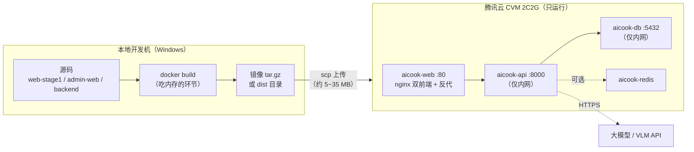

# AI 厨娘・智能烹饪助手 —— Web 端上线部署与小程序真机运行方案

| 项 | 内容 |
| --- | --- |
| 文档编号 | 17 ｜ 版本 **V0.1** ｜ 文档性质：**上线部署与真机运行操作方案** |
| 关联文档 | 《04-腾讯云Docker一键部署操作手册-V1.1》（部署基线，§0.2 阶段差异 / §1 端口规划 / §2.1 规格 / §5.3~5.6）｜《15-阶段一实现情况统计与阶段二启动评审报告-V1.0》（R-23 / R-24）｜《16-阶段二微信小程序开发设计方案-V1.0》（§2.2 平台硬约束 P1~P10 / §16 部署前置）｜《01-PRD-V1.1》（RL-12 / RL-13 / RL-20 / RL-21） |
| 代码基线 | `docker-compose.yml`｜`Dockerfile.web`｜`nginx/nginx.conf`｜`web-stage1/`｜`admin-web/`｜`web-mini/`（41 页，`appid=touristappid`） |
| 实测服务器 | 腾讯云 CVM：**2 核 2 GB** / 系统盘 50 GB（已用 24.1 GB）/ 公网带宽 **3 Mbps** / 流量包 30 GB / **Ubuntu Server 24.04 LTS 64bit** / 已预装 **Docker CE 27.5.1** |
| 状态 | **待确认**（待决问题 Q-76 ~ Q-81） |
| 编制 | 乙方技术方案组 ｜ 日期：2026-10-13 |

---

## 0. 阅读指引与结论速览

- 本文回答两件事：**Web 端怎么上这台服务器**、**小程序怎么在手机上跑起来**。
- 🔴 标记项为红线或不可妥协约束；凡涉及平台能力（备案、域名白名单、虚拟支付）的结论，**以微信开放平台与工信部最新规则为准**，本文给的是设计边界与责任划分。
- ⚠️ **本文与 04 手册存在一处口径冲突**（阶段一「产物不得对外提供服务」），已在 §2.5 单列，需甲方先拍板再执行。

**结论速览**

| 问题 | 结论 |
| --- | --- |
| 这台 2C2G 服务器够用吗？ | **运行够、构建不够**。四个容器运行态约 1.0~1.5 GB（可跑）；但在服务器上执行 `Dockerfile.web` 的两次 `npm ci` + `vue-tsc` + `vite build` 峰值超 1.5 GB，**OOM 风险高** → 前端构建放本地，服务器只运行（§2.2 方案 B/C） |
| Web 端上线最短路径 | 本地构建 → 传输产物 → 服务器 `docker load` / 挂载 dist → `docker compose up -d` → `seed` → 冒烟（§2.3，约 30~60 分钟，不含镜像传输时间） |
| 小程序怎么在手机上跑 | **有四条路径，成本差 100 倍**：① 开发者工具「预览」扫码（**约 30 分钟，免备案**）→ ② 真机调试 ③ 体验版 ④ 正式发布（**周级，需备案 + HTTPS 域名白名单**）（§3.1） |
| 现在最卡的是什么 | **不是技术，是时间**。备案 / 类目 / 虚拟支付签约周期不可压缩（15 号报告 R-24），而「体验版与正式版必须走 HTTPS 已备案域名白名单」→ **给外部试用的路径被备案卡住**；内部演示走预览二维码可绕开（§3.4） |
| 🔴 必须注意 | 当前 `web-mini` 默认 `API_BASE_URL = http://127.0.0.1:8000`，**真机上 127.0.0.1 指向手机自身**，不改必然连不上后端 → 这是「手机上跑不起来」的最常见原因（§3.3） |

---

## 1. 现状核对（实测，2026-10-13）

| # | 组件 | 实测现状 | 上线影响 |
| --- | --- | --- | --- |
| 1 | `docker-compose.yml` | 4 服务：`db`(pgvector/pg16) + `api`(FastAPI) + `web`(nginx 双前端) + `redis`(预留) | 结构可直接用于上线 |
| 2 | `api` 服务 `ports` | **发布了宿主机 `8000:8000`** | ⚠️ 与 04 手册 §1「8000 不对外、宿主机不发布」**冲突**，上线前必须移除（§2.5 项 1） |
| 3 | `nginx/nginx.conf` | 仅 `listen 80`；**无 `gzip`、无缓存头、无 443** | 3 Mbps 带宽下首屏偏慢；小程序正式版无法满足 HTTPS 要求 |
| 4 | `nginx.conf` 反代 | `/v1/`、`/api/`、`/admin/v1/` → `api:8000`，`X-Request-Id` 透传，`proxy_read_timeout 65s` | ✅ 与编排接口耗时匹配，无需改 |
| 5 | `web-stage1/src/api/index.ts` | `baseURL: '/'`（同源相对路径） | ✅ 前端**零改动**，全部走后端反代 |
| 6 | `Dockerfile.web` | 多阶段：`node:20-alpine` 构建 `web-stage1`（`base=/`）+ `admin-web`（`--base=/admin/`，含 `type-check`）→ `nginx:alpine` 运行层 | 构建重、运行轻 → 构建与运行应分离 |
| 7 | `backend/Dockerfile` | 多阶段 Python 3.11 slim，`alembic upgrade head` 后启 uvicorn，带 `HEALTHCHECK` | ✅ 依赖无 torch 等重包（纯 wheel），**服务器上构建可行** |
| 8 | 镜像加速前缀 | 全部走 `docker.m.daocloud.io`（因当前网络直连 Docker Hub 被劫持） | 腾讯云内网建议改用 `mirror.ccs.tencentyun.com`，见 §2.3 步骤 0 |
| 9 | 硬编码凭据 | `POSTGRES_PASSWORD="123456"`、`ADMIN_PASSWORD="Admin@123456"`、`ADMIN_JWT_SECRET` 默认 `aicook-admin-dev-secret-change-me` | 🔴 上线前必须全部更换（§2.5 项 2） |
| 10 | `web-mini` AppID | `manifest.json` 与 `project.config.json` 均为 **`touristappid`** | 🔴 预览/上传前必须替换为真实 AppID（§3.2 步骤 1） |
| 11 | `web-mini` 请求基址 | `API_BASE_URL = import.meta.env.VITE_API_BASE_URL \|\| 'http://127.0.0.1:8000'` | 🔴 真机必须改为手机可达地址（§3.3） |
| 12 | `web-mini` 域名校验 | `project.config.json` → `"urlCheck": false` | ✅ 开发版预览可真机联调 http 接口；**体验版/正式版不适用**（必须 HTTPS 白名单） |
| 13 | `web-mini` 构建产物 | `dist/build/mp-weixin/` 已产出（`app.json` / `pages` / `components` 齐备） | ✅ 可直接导入微信开发者工具 |
| 14 | 服务器规格对比 | 04 手册 §2.1 阶段一建议 **2 核 4 GB**，实配 **2 核 2 GB**（低一档） | 建议加 2 GB swap 兜底（§2.3 步骤 0） |

---

## 2. Web 端上线方案

### 2.1 目标形态与资源账



**内存账（运行态，估算）**

| 容器 | 常驻内存（估算） | 说明 |
| --- | --- | --- |
| `aicook-db` (PG16 + pgvector) | 250 ~ 450 MB | 默认 `shared_buffers` 较小，28~32 表数据量可控 |
| `aicook-api` (FastAPI + LangGraph) | 300 ~ 500 MB | 无本地 embedding 模型时轻量；若后续启用本地 bge-m3 需 ≥8 GB（04 §2.1） |
| `aicook-web` (nginx alpine) | 10 ~ 30 MB | 纯静态 + 反代 |
| `aicook-redis` | 10 ~ 30 MB | 阶段二预留，当前不强依赖 |
| 系统 + Docker daemon | 250 ~ 400 MB | Ubuntu 24.04 最小化 |
| **合计** | **≈ 0.9 ~ 1.4 GB** | 2 GB 可跑，**余量薄** → 建议加 swap |

**构建态（在服务器上 `docker build`）**：`Dockerfile.web` 需两次 `npm ci` + 一次 `vue-tsc --noEmit`（`admin-web` 16 页）+ 两次 `vite build`，实测峰值常超 1.5 GB，与上面运行态叠加 → **2C2G 上 OOM 风险高**，且失败后重跑要重下 node_modules。

> **结论：构建与运行分离，本地出产物、服务器只运行。**

### 2.2 三种构建路径对比

| 方案 | 做法 | 服务器内存 | 传输量 | 本地依赖 | 综合 |
| --- | --- | --- | --- | --- | --- |
| **A 服务器构建** | 上传源码，服务器 `docker compose up -d --build` | ❌ 高风险 OOM | 源码数十 MB | 无 | ❌ 不推荐（可用 2 GB swap 兜底但慢） |
| **B 镜像搬运**（推荐） | 本地 `docker build` → `docker save \| gzip` → `scp` → 服务器 `docker load` | ✅ 仅 load | 约 **25~35 MB** | 本地 Docker Desktop | ✅ **推荐**：保留「单镜像托管双前端」既定方案，服务器零构建依赖、可复现 |
| **C 静态搬运** | 本地只跑 `npm run build` 出 dist → 上传 dist → 服务器 nginx 容器挂载 | ✅ 最小 | 约 **3~8 MB** | 本地 Node 20+ | ✅ 备选：本地上行带宽差时首选，但需新增 nginx 挂载覆盖文件（偏离既定单镜像方案） |

**推荐顺序：B → C。** 若本地家宽上行 <2 Mbps 且时间紧，直接用 C（只传 dist，几分钟传完）。

> 📌 `Dockerfile.web` 是多阶段构建，`save` 后只含 **运行层**（`nginx:alpine` + 两份 dist），不含 node 构建层，所以体积可控。

### 2.3 推荐路径（方案 B）操作步骤

**步骤 0 ｜ 服务器准备（一次性）**

```bash
# 0.1 时区与基础检查
sudo timedatectl set-timezone Asia/Shanghai
nproc && free -h && df -h && docker --version && docker compose version

# 0.2 补 2 GB swap 兜底（2C2G 强烈建议；api 构建 + 运行叠加时防止 OOM）
sudo fallocate -l 2G /swapfile && sudo chmod 600 /swapfile
sudo mkswap /swapfile && sudo swapon /swapfile
echo '/swapfile none swap sw 0 0' | sudo tee -a /etc/fstab
free -h

# 0.3 配置腾讯云内网镜像加速（替换 daocloud 前缀，拉取更快更稳）
sudo mkdir -p /etc/docker
sudo tee /etc/docker/daemon.json >/dev/null <<'EOF'
{
  "registry-mirrors": ["https://mirror.ccs.tencentyun.com"],
  "live-restore": true
}
EOF
sudo systemctl daemon-reload && sudo systemctl restart docker && docker info | grep -A2 "Registry Mirrors"

# 0.4 部署目录
sudo mkdir -p /opt/ai-cook && sudo chown -R $USER:$USER /opt/ai-cook && cd /opt/ai-cook
```

**步骤 1 ｜ 本地构建前端镜像（Windows PowerShell）**

```powershell
cd D:\Code_Work\AI_Cook
docker build -f Dockerfile.web -t aicook-web:20261013 .
docker images aicook-web
docker save aicook-web:20261013 -o aicook-web.tar
# 压缩（Git Bash）：约 60~80 MB → 25~35 MB
gzip -k aicook-web.tar
```

**步骤 2 ｜ 上传（本地执行）**

```bash
# 只上传服务器真正需要的东西：后端源码 + compose 文件 + nginx 配置 + 前端镜像
scp aicook-web.tar.gz root@<服务器IP>:/opt/ai-cook/
scp -r backend root@<服务器IP>:/opt/ai-cook/
scp docker-compose.yml docker-compose.prod.yml root@<服务器IP>:/opt/ai-cook/
scp -r nginx root@<服务器IP>:/opt/ai-cook/
# 注意：backend/.dockerignore 已排除 data/ tests/ .env；backend/.env 需单独按 §2.5 项 2 生成后上传
```

**步骤 3 ｜ 服务器加载镜像并启动**

```bash
cd /opt/ai-cook
docker load -i aicook-web.tar          # 或 gunzip 后再 load

# 3.1 只构建后端（纯 Python wheel，2C2G 可行；pip 已用阿里云镜像）
docker compose -f docker-compose.prod.yml build api

# 3.2 拉起全栈
docker compose -f docker-compose.prod.yml up -d
docker compose -f docker-compose.prod.yml ps
docker compose -f docker-compose.prod.yml logs -f api | head -40

# 3.3 首次初始化种子数据（幂等：食材 / 菜谱 / 风控规则 / 管理员）
docker compose -f docker-compose.prod.yml exec api python -m app.seed
```

**步骤 4 ｜ 冒烟验证**

```bash
curl -sS -o /dev/null -w "%{http_code}\n" http://127.0.0.1/v1/healthz     # 期望 200
curl -sS -o /dev/null -w "%{http_code}\n" http://127.0.0.1/              # 期望 200（web-stage1）
curl -sS -o /dev/null -w "%{http_code}\n" http://127.0.0.1/admin/        # 期望 200（admin-web）
docker compose -f docker-compose.prod.yml exec db psql -U postgres -d aicook -c "\dt" | head -20
```

**`docker-compose.prod.yml`（新增，生产覆盖文件）**

```yaml
# 用途：生产环境覆盖文件。与 docker-compose.yml 叠加使用：
#   docker compose -f docker-compose.yml -f docker-compose.prod.yml up -d
# 前置：Docker Compose 插件版本需 ≥ 2.24（服务器 Docker CE 27.5.1 通常已满足，
#       用 `docker compose version` 核对）。序列型键（ports 等）默认是「合并」而非
#       「替换」，必须用 !reset 才能清空，否则 api 的 8000 仍会发布到宿主机。
services:
  web:
    image: aicook-web:20261013       # 直接使用本地 load 的镜像，不在服务器构建
    build: !reset null               # 清空 build 段，彻底消除服务器构建可能
  api:
    ports: !reset []                 # 🔴 取消宿主机 8000 发布（与 04 手册 §1 对齐）
    environment:
      ADMIN_JWT_SECRET: ${ADMIN_JWT_SECRET:?必须显式提供}
      ADMIN_PASSWORD: ${ADMIN_PASSWORD:?必须显式提供}
  db:
    environment:
      POSTGRES_PASSWORD: ${DB_PASSWORD:?必须显式提供}
```

> 若 Compose 版本 <2.24（不支持 `!reset`），退路方案：把 `docker-compose.yml` 复制为 `docker-compose.prod.yml` 作为**独立文件**，在其中直接删掉 `api.ports` 与 `web.build`、把 `web.image` 指向已 load 的镜像，并 `docker compose -f docker-compose.prod.yml up -d`（不使用叠加）。

### 2.4 安全组配置（腾讯云控制台）

| 方向 | 协议 | 端口 | 来源 | 阶段一（限 IP 演示） | 阶段二（公网） |
| --- | --- | --- | --- | --- | --- |
| 入站 | TCP | 22 | 办公网 IP | ✅ 限来源 | ✅ 限来源 |
| 入站 | TCP | 80 | 办公网 IP / 0.0.0.0 | ✅ **限来源 IP** | ✅ 0.0.0.0/0（配合 301 跳 443） |
| 入站 | TCP | 443 | 0.0.0.0/0 | ❌ | ✅ |
| 入站 | TCP | 5432 / 6379 / 8000 | — | 🔴 **禁止开放** | 🔴 **禁止开放** |
| 出站 | ALL | ALL | — | 默认放通（调大模型 API 需要） | 同左 |

> 🔴 `8000` 必须从 `docker-compose.yml` 的 `api` 服务里**移除**（仅改安全组不够——端口不发布才是根本）。`5432` / `6379` 已在 compose 中未发布，保持现状。

### 2.5 上线前必办清单（6 项，按优先级）

| # | 事项 | 落点 | 不做的后果 |
| --- | --- | --- | --- |
| 1 | **移除 `api` 的宿主机 8000 发布** | `docker-compose.prod.yml` | 攻击面暴露，且与 04 手册 §1 矛盾 |
| 2 | **更换全部硬编码凭据** | `DB_PASSWORD` / `ADMIN_PASSWORD` / `ADMIN_JWT_SECRET`（走环境变量，不写进 compose） | 数据库与后台被直接接管 |
| 3 | **确认「是否对外提供服务」** | 见下方 ⚠️ 冲突说明 | 阶段一红线；且提前公开会触发生成式 AI 备案问题（RL-12） |
| 4 | **nginx 开 gzip + 静态缓存** | `nginx/nginx.conf`：`gzip on; gzip_types text/css application/javascript application/json; gzip_min_length 1k;`、`location ~* \.(js\|css\|woff2\|png\|jpg)$ { expires 7d; add_header Cache-Control "public, immutable"; }` | 3 Mbps 带宽下首屏明显变慢 |
| 5 | **域名 + HTTPS**（若公网 / 小程序联调） | 域名备案（ICP）→ 腾讯云免费 DV 证书 → nginx 443（04 手册 §5.4 已给模板） | 小程序体验版 / 正式版**无法联网** |
| 6 | **备案与资质前置确认** | 小程序备案（工信部）+ 生成式 AI 服务备案（RL-12）+ 类目资质 + 虚拟支付签约（RL-20/21） | 卡死在「不能发布」，且这批周期不可压缩（15 号报告 R-24） |

> ⚠️ **与 04 手册的口径冲突（需甲方拍板）**
> 04 手册 §0.2 明文：**「阶段一红线：产物不得对外提供服务。安全组务必限制来源 IP，或仅用内网地址访问。提前放出会直接触发生成式 AI 备案问题。」**
> 本次需求中的「上线」，若指**公网任何人可访问** → 已越过该红线，须先确认备案口径（走 CR 或书面确认）；若指**给自己 / 甲方演示** → 建议按上表「阶段一（限 IP 演示）」执行，安全组 80 只放行办公网 IP。
> **建议**：先按「限来源 IP」上线（零合规风险、当天可用），待域名备案完成后切换 443 + 放通（走 CR-YYYYMMDD-NN 留痕）。

### 2.6 带宽与首屏提示（3 Mbps）

| 项 | 实测口径 | 影响与建议 |
| --- | --- | --- |
| 公网带宽 | **3 Mbps ≈ 375 KB/s 峰值** | 首屏需转出全部 JS/CSS |
| 前端静态资源 | 未 gzip 时约 1.2~2.5 MB；gzip 后约 **350~700 KB** | 🔴 **必须开 gzip**，否则首屏 5~8 s |
| 首屏目标（16 号方案 G4） | 首页可见 ≤1.5 s | 开 gzip + 静态缓存后可接近 |
| 拍照识别上传 | nginx `client_max_body_size 10m` | 3 Mbps 下上传 1 MB 图约 3 s、10 MB 图约 30 s → **建议前端压到 ≤1 MB 再上传**（属前端改造项，另行排期） |
| 并发 | 3 Mbps 下同时 3~5 人访问静态资源即接近打满 | 演示阶段控制并发人数；正式推广建议升带宽或接 CDN |

---

## 3. 小程序如何「在手机上运行」

### 3.1 四条路径对比（核心）

| 路径 | 前置条件 | 大约耗时 | 手机上怎么打开 | 需要备案/HTTPS？ | 适用场景 |
| --- | --- | --- | --- | --- | --- |
| **① 开发者工具「预览」**（真机扫码） | ① 已注册小程序拿 **AppID**；② 微信账号被加为该小程序**开发者**；③ `VITE_API_BASE_URL` 指向手机可达地址 | **30 分钟** | 手机微信**扫工具生成的二维码**，直接在真机运行 | ❌ 不需要（`urlCheck:false` 生效） | ✅ **内部演示 / 自测（推荐先走这条）** |
| **② 真机调试** | 同 ①（工具 → 真机调试） | 10 分钟 | 手机微信扫码，带 vConsole 日志面板 | ❌ 不需要 | ✅ 联调排错（看请求、看报错） |
| **③ 体验版** | ① 同上 + 上传代码 + 后台设「体验版」+ 添加**体验成员**；② **HTTPS 已备案域名**并加入「服务器域名」白名单 | **1~2 小时**（域名就绪前提下） | 微信扫码 / 后台打开，发给体验成员 | 🔴 **需要** | 甲方试用、可反复访问 |
| **④ 正式发布** | ③ 全部 + 小程序**备案**（工信部）+ 类目与资质（AI 生成内容类）+ 隐私协议与用户隐私保护指引 + 生成式 AI 服务备案 + 虚拟支付签约 | **周级（不可压缩）** | 微信内搜索 / 分享卡片 | 🔴 **需要** | 对外上线 |
| （参考）⑤ H5 构建临时预览 | 无 | 20 分钟 | 手机浏览器打开网址 | ❌ | 仅视觉走查；**与 16 号方案 N4「不做 H5 发布」冲突**，需单独确认 |

> 📌 **关键结论**：想让手机**今天就跑起来**，走 **①**，不需要备案、不需要域名。想让**甲方自己随时打开**，至少要走到 **③**，而 ③ 起就依赖「HTTPS + 已备案域名」——这正是 15 号报告 R-24 那条不可压缩的关键路径。

### 3.2 最短路径操作步骤（路径 ①，约 30 分钟）

| 步 | 操作 | 落点 / 命令 | 备注 |
| --- | --- | --- | --- |
| 1 | 注册小程序，获取 **AppID** | mp.weixin.qq.com → 注册 → 小程序 | ⚠️ 主体类型决定后续类目与虚拟支付能力；个人主体通常**不足以支撑 AI 生成内容类目与虚拟支付**，正式上线前须确认主体资质 |
| 2 | 替换占位 AppID | `web-mini/src/manifest.json` → `mp-weixin.appid`；`web-mini/project.config.json` → `appid` | 当前为 `touristappid`，**不替换则无法预览/上传** |
| 3 | 添加开发者 | 小程序后台 → 成员管理 → 添加开发者（输入自己 / 同事微信号） | 只有开发者能预览真机 |
| 4 | 设置接口地址 | 构建前设 `VITE_API_BASE_URL`（见 §3.3） | ⚠️ 不改必然连不上 |
| 5 | 构建小程序产物 | `cd web-mini && npm run build:mp-weixin`（或 `npm run dev:mp-weixin` 监听热更新） | 产物落 `dist/build/mp-weixin/` |
| 6 | 导入工程 | 微信开发者工具 → 导入项目 → 目录选 `D:\Code_Work\AI_Cook\web-mini` | `miniprogramRoot` 已指向 `dist/build/mp-weixin/`，导入的是 **web-mini 根目录**而不是 dist |
| 7 | 关闭域名校验 | 工具 → 详情 → 本地设置 → 勾选「不校验合法域名、web-view、TLS 版本以及 HTTPS 证书」 | `project.config.json` 已设 `urlCheck:false`，此处为双保险 |
| 8 | 点「预览」→ 手机微信扫码 | 工具右上角「预览」 | 手机即刻运行，无需备案 |
| 9 | 连不上时排查 | 工具 → **真机调试**（路径 ②），看 Network 面板实际请求地址与报错 | 90% 的问题在 `API_BASE_URL` 与安全组 |

### 3.3 🔴 手机上后端从哪来（三种口径，必须选一种）

`web-mini/src/api/request.ts` 当前默认 `http://127.0.0.1:8000`。**在真机上，`127.0.0.1` 指向手机自己**，所以必须改成手机能访问到的地址。

| 口径 | `VITE_API_BASE_URL` 取值 | 网络条件 | 适用 | 限制 |
| --- | --- | --- | --- | --- |
| **a. 开发机局域网 IP** | `http://192.168.x.x:8000` | 手机与开发机**同一 Wi-Fi** | ✅ 路径①②联调（最常用） | 需本机 `api` 发布 8000（本地 compose 现状已发布）；IP 变化需重构建 |
| **b. 服务器公网 IP** | `http://<服务器IP>`（经 nginx 80 反代，不带端口） | 手机任意网络 | ✅ 路径①②，且不占用本机资源 | 需安全组放行 80；**仅建议临时**，正式前须改 HTTPS |
| **c. 备案域名 HTTPS** | `https://<域名>` | 手机任意网络 | 🔴 **路径③④唯一合法口径** | 依赖 ICP 备案 + DV 证书 + 服务器域名白名单 |

> ⚠️ **口径 b 的安全提醒**：把 80 放通公网即等同 §2.5 项 3 的「对外提供服务」，请确认合规口径后再执行；优先用口径 a 做内部联调。
>
> 📌 **构建时注入方式**（Vite 环境变量，构建期生效、非运行时读取）：
> ```bash
> # PowerShell
> $env:VITE_API_BASE_URL="http://192.168.1.10:8000"; npm run build:mp-weixin
> # Git Bash
> VITE_API_BASE_URL=http://192.168.1.10:8000 npm run build:mp-weixin
> ```
> 注意：`request.ts` 注释已记录历史缺陷（曾以 `MODE==='development'` 区分导致 build 产物走 `https://api.example.com`），**改地址一律走环境变量，不要改源码分支**。

### 3.4 上传与提审前检查清单（路径 ③④）

| # | 检查项 | 依据 | 状态 |
| --- | --- | --- | --- |
| 1 | 主包 ≤2 MB / 单分包 ≤2 MB / 整包 ≤20 MB | 16 号 §2.2 P1、§6 分包设计 | 待实测（`npm run audit:size`） |
| 2 | 服务器域名白名单（`request` 合法域名，**必须 HTTPS**） | 16 号 §2.2 P3 | ❌ 依赖域名备案 |
| 3 | 隐私协议 + 用户隐私保护指引（相机/相册用途说明） | 16 号 §2.2 P8、C6 | 待确认 |
| 4 | 免责声明 6 处附着（首页/详情/营养/风控页/分享图/过敏原条） | 16 号 C6、NFR-1.4 | 待核 |
| 5 | 识别结果 `need_user_confirm` 恒为 true | 16 号 C10（RL-5） | ✅ 架构已约束 |
| 6 | iOS 未签约虚拟支付 → **不展示任何购买入口** | 16 号 P6、RL-21 | ✅ `platform/pay` 已守卫 |
| 7 | 类目与资质（AI 生成内容相关） | 16 号 P9、RL-12/RL-13 | ❌ 外部周期依赖（R-24） |
| 8 | 小程序备案（工信部，未备案不可发布） | 16 号 P9 | ❌ 外部周期依赖（R-24） |
| 9 | 未成年人保护相关呈现 | RL-14 | 待核 |
| 10 | 埋点 38 个事件 | 16 号 C11、PRD §16 | 待核 |

---

## 4. 待确认问题（Q-76 ~ Q-81）

| 编号 | 问题 | 影响 | 建议 |
| --- | --- | --- | --- |
| **Q-76** | 本次 Web「上线」是**限来源 IP 的内部演示**，还是**公网公开访问**？ | 决定是否需要立即启动 ICP 备案；决定是否触碰 04 手册阶段一红线 | 建议先限 IP 演示（当天可用、零合规风险），公网走 CR 后切换 |
| **Q-77** | 是否已有**已备案域名**？若无，域名注册 + ICP 备案由谁推进、预期完成时间？ | 直接决定小程序路径 ③④ 的启动时间（关键路径） | 建议 3 日内启动（R-24 唯一不可压缩项） |
| **Q-78** | 小程序主体是**企业还是个人**？是否已完成主体注册并拿到 AppID？ | 个人主体通常无法满足 AI 生成内容类目与虚拟支付签约 | 建议走企业主体；AppID 先注册（个人主体也可先用于内部预览） |
| **Q-79** | 是否接受新增 `docker-compose.prod.yml` 与 `nginx.conf` 的 gzip / 缓存改动？ | 涉及既定交付物变更，需留痕 | 建议接受并记入 B-D6 部署文档；若需变更留痕请开 CR |
| **Q-80** | 服务器是否可**升配**（2C2G → 2C4G）或长期挂 2 GB swap？ | 影响 api 构建余量与后续本地 embedding 可行性 | 短期：加 swap；阶段二启用本地 bge-m3 前必须升到 ≥8 GB（04 §2.1） |
| **Q-81** | 本次是否走「H5 临时预览」给非开发者看界面（路径 ⑤）？ | 与 16 号方案 N4「不做 H5 发布」冲突 | 建议不走；内部演示统一用预览二维码 |

---

## 5. 风险登记册（本次上线相关）

| 编号 | 风险描述 | 类别 | 概率 | 影响 | 等级 | 应对措施 | 责任人 | 状态 |
| --- | --- | --- | --- | --- | --- | --- | --- | --- |
| RK-01 | 在 2C2G 服务器上构建前端导致 OOM，构建中断 | 技术 | 4 | 3 | **12 中** | 构建与运行分离（§2.2 方案 B/C）；服务器补 2 GB swap | 乙方 | 建议采纳 |
| RK-02 | 小程序真机连不上后端（`127.0.0.1` 误用 / 安全组未放行） | 技术 | 4 | 2 | **8 中** | 按 §3.3 选定口径写入 `VITE_API_BASE_URL`；用真机调试看 Network | 乙方 | 待执行 |
| RK-03 | 备案 / 类目 / 虚拟支付签约未启动，卡死正式发布 | 进度/合规 | 4 | 5 | **20 高** | 3 日内启动备案；内部演示走预览二维码绕开；纳入 R-24 跟踪 | 甲方 | 🔴 跟踪中 |
| RK-04 | 公网开放触碰 04 手册阶段一红线（生成式 AI 备案前置） | 合规 | 3 | 5 | **15 高** | 默认限来源 IP；公网需 Q-76 拍板 + CR 留痕 | 双方 | 待决策 |
| RK-05 | 硬编码凭据随镜像 / 仓库外泄 | 安全 | 3 | 5 | **15 高** | 上线前换密钥并走环境变量；历史凭据视为已泄漏 | 乙方 | 待执行 |
| RK-06 | 3 Mbps 带宽下首屏超 1.5 s，演示体验受损 | 体验 | 4 | 2 | **8 中** | 开 gzip + 静态缓存；控制演示并发；必要时升带宽 / 接 CDN | 乙方 | 待执行 |
| RK-07 | 流量包 30 GB 用尽（照片上传 + 静态资源反复下载） | 运营 | 3 | 3 | **9 中** | 监控流量包（重置时间 2026-11-10）；控制上传图体积 | 甲方 | 待监控 |

---

## 6. 附录

### 6.1 通信端口与访问矩阵（上线后）

| 访问目标 | 地址 | 说明 |
| --- | --- | --- |
| 用户端 Web | `http://<域名或IP>/` | `web-stage1/dist`，SPA history 回退 |
| 管理后台 | `http://<域名或IP>/admin/` | `admin-web/dist`，默认账号 `admin`（密码上线前必须更换） |
| 健康检查 | `http://<域名或IP>/v1/healthz` | 亦可用于负载 / 监控探活 |
| 后端 API | 不直接暴露 | 全部经 nginx 反代 `/v1/`、`/api/`、`/admin/v1/` |
| 小程序 | 微信客户端内 | 开发版走预览二维码；体验版 / 正式版走 HTTPS 域名白名单 |

### 6.2 回滚路径

```bash
# 镜像级回滚（保留上一版镜像 tag 即可秒级回退）
docker tag aicook-web:上一版本 aicook-web:current
docker compose -f docker-compose.prod.yml up -d web

# 全栈停止（数据保留在命名卷 pgdata / uploads，down 不删卷）
docker compose -f docker-compose.prod.yml down
```

> 🔴 **禁止** `down -v`（会删除 `pgdata` / `uploads` 命名卷，数据不可恢复）。

### 6.3 与 04 手册的关系

本文是 04 手册的**增量补充**，不替代它：04 提供从零装 Docker 到全栈启动的完整脚本与环境准备；本文补充 ① 2C2G 低配下的构建/运行分离策略、② 实测发现的 6 项上线前必办项、③ 小程序真机运行四条路径。冲突处（阶段一是否可对外）以 04 手册红线为基准，需甲方裁决（Q-76）。

---

> **合规声明**：本方案为产品设计参考，具体实施请结合公司合规与法务要求确认。产品上线涉及小程序备案、生成式 AI 服务备案（RL-12/RL-13）、个人信息保护（RL-10）与虚拟支付平台规则（RL-20/RL-21），实际资质与备案要求以工信部、微信开放平台最新规则为准。
