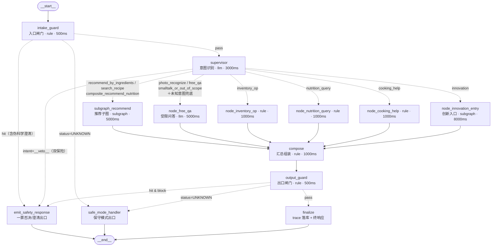
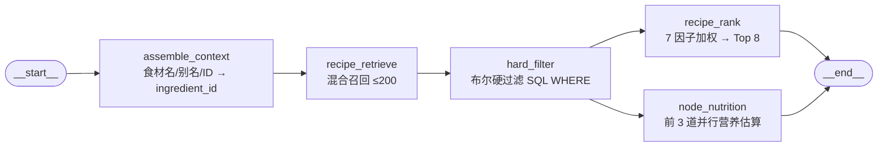

# AI 厨娘 · LangGraph 图结构分析（V1.0）

> 分析对象：`backend/app/graph/`（LangGraph 1.x）
> 分析方法：源码精读 + **实际编译并导出图拓扑**（`build_main_graph().get_graph()` / `draw_mermaid()`）+ 真实调用链路埋点验证
> 代码事实来源：`main_graph.py` / `registry.py` / `state.py` / `runner.py` / `nodes/*` / `subgraphs/*`
> 结论口径：本文所有节点名、边、路由分支、状态字段均以**运行期导出结果**为准，与设计文档不一致处单独标注为「文档漂移」

---

## 1. 总览

AI 厨娘的编排层由 **1 张主图 + 2 张独立子图**构成，共 3 个 `StateGraph` 实例：

| 图 | 编译入口 | 真实节点数 | 拓扑形态 | 是否注册进主图 |
| --- | --- | --- | --- | --- |
| **主图** `main` | `build_main_graph()` | **13** | 双侧闸门 + 中枢路由 + 汇聚 + 三出口 | —（本身即装配体） |
| **推荐子图** `recommend` | `build_recommend_subgraph()` | **5** | 线性 + 末端 **并行 fan-out** | ✅ 以包装节点 `subgraph_recommend` 注册 |
| **创新子图** `innovation` | `build_innovation_subgraph()` | **4** | 纯线性 | ❌ **刻意不注册**（`subgraphs/__init__.py` 只导入 recommend） |

三张图的公共特征：

- **无 checkpointer、无 `interrupt`**：三处均为 `builder.compile()` 裸编译，`recursion_limit` 分别为主图 60 / 推荐子图 40 / 创新子图 30（`runner.py:294`、`recommend.py:507`、`innovation.py:1385`）。
- **主图节点由注册表动态装配**：`for spec in registry.values(): builder.add_node(spec.name, spec.node_factory())`（`main_graph.py:158-159`），但**边是硬编码的**——可插拔只覆盖「节点实现」，不覆盖「拓扑位置」。
- **trace 用 `operator.add` reducer 累加**，是「Agent 调度可视化面板」（`GET /v1/trace/{request_id}`）的数据源。

---

## 2. 主图拓扑（运行期导出，权威）



**运行期实测节点集（13）**：`intake_guard`、`supervisor`、`subgraph_recommend`、`node_free_qa`、`node_inventory_op`、`node_nutrition_query`、`node_cooking_help`、`node_innovation_entry`、`compose`、`output_guard`、`finalize`、`emit_safety_response`、`safe_mode_handler`。
**运行期实测边集（24）**：`START→intake_guard` 1 条；**条件边 13 条**（3 组 `add_conditional_edges`：入口闸门 3 + 中枢 7 + 出口闸门 3）；业务节点→`compose` 6 条；`compose→output_guard` 1 条；出口→END 3 条。

### 2.1 拓扑红线（已通过运行期校验）

1. **`__end__` 的入边只有 3 条**，全部来自 `finalize` / `emit_safety_response` / `safe_mode_handler` → 不存在绕过出口闸门直达 END 的路径。
2. **`intake_guard` 与 END 无直连** → 一票否决必经 `emit_safety_response` 短路出口。
3. **条件边均显式给出目标白名单**（`add_conditional_edges` 第三参数），路由函数若返回白名单外节点，LangGraph 在**编译期**即报错——拓扑可审计、可测试。
4. **全部 13 个节点从 START 可达**，且**无出度为 0 的死节点**（运行期遍历验证）。
5. **`output_guard` 位于 `compose` 之后、三个出口之前** → 输出侧闸门不可绕过。

> 对应单测：`backend/tests/test_graph_structure.py`（关键节点存在 / END 入边来源 / 闸门不直连 END / 否决体纯净）+ `test_graph_extension.py`（新节点存在 + 无绕闸路径 + 复合意图路由）。**实测 18 passed**。

---

## 3. 三个路由函数（确定性、零 LLM 参与）

| 路由函数 | 挂载点 | 白名单目标 | 判定逻辑 |
| --- | --- | --- | --- |
| `route_after_intake_guard` | `intake_guard` | `supervisor` / `emit_safety_response` / `safe_mode_handler` | `status=="UNKNOWN"` → 保守模式；`hit` → 否决出口；否则放行 |
| `route_after_supervisor` | `supervisor` | `INTENT_ROUTES` 全部值 + `emit_safety_response` | `intent=="__veto__"` → 否决出口；否则查 `INTENT_ROUTES`，**未命中兜底 `node_free_qa`** |
| `route_after_output_guard` | `output_guard` | `finalize` / `emit_safety_response` / `safe_mode_handler` | `UNKNOWN` → 保守模式；`hit && block` → 否决出口；`hit && !block` → 放行 finalize |

**关键设计点**：LLM（`supervisor`）**只输出意图标签**，`意图 → 节点`的映射由代码字典 `INTENT_ROUTES` 固定，模型无权决定调用哪个工具。

### 3.1 `INTENT_ROUTES` 全量映射（10 类意图，运行期核对无遗漏/无多余）

| intent（`supervisor.INTENTS`） | 目标节点 |
| --- | --- |
| `recommend_by_ingredients` | `subgraph_recommend` |
| `search_recipe` | `subgraph_recommend` |
| `composite_recommend_nutrition`（M.3 复合） | `subgraph_recommend` |
| `nutrition_query` | `node_nutrition_query` |
| `cooking_help` | `node_cooking_help` |
| `inventory_op` | `node_inventory_op` |
| `innovation`（模块 O） | `node_innovation_entry` |
| `photo_recognize` | `node_free_qa` |
| `free_qa` | `node_free_qa` |
| `smalltalk_or_out_of_scope` | `node_free_qa` |

**LLM 降级**：`supervisor` 捕获 `LLMError` 或 JSON 解析失败 → `_keyword_fallback` 关键词兜底（同样覆盖复合意图与创新意图），trace span 标 `degraded`。

---

## 4. 推荐子图 `subgraph_recommend`



- **并行实现**：`hard_filter` fan-out 两条边分别连 `recipe_rank` 与 `node_nutrition`，二者在**同一 superstep 内并行执行**，两条分支都连 END，**全部结束后**才返回主图进入 `compose`。
- **并行分支的约束**：`node_nutrition` 无法依赖 `recipe_rank` 输出，因此按 `hard_filter` 输出序取前 3 道估算（与最终 Top 重合度高，源码注释留档）。
- **召回策略**：`settings.RETRIEVAL_VECTOR` 开关（默认 `on`）→ pgvector raw SQL / `embedding_json` Python 点积双分支，全程兜底降级不抛错。
- **E.9 反馈接线**：`state.user_id` 存在时加载 `load_feedback_penalty`（dislike → −0.5）传入 `weighted_rank`；无 `user_id` 时空惩罚、排序行为不变。
- **OBS-03**：包装节点把问句文本与食材库做最长匹配（「土豆淀粉」优先于「土豆」），命中 ≤10 个去重食材名并入 `ingredients`。

### 4.1 ⭐ 父子图状态隔离（关键工程约束）

推荐子图**不复用主图 `CookingState`**，而是定义独立 `RecommendSubgraphState`，其 trace 通道命名为 **`sub_trace`**：

```
主图 CookingState.trace       : Annotated[list[dict], operator.add]
子图 RecommendSubgraphState.sub_trace : Annotated[list[dict], operator.add]
```

**原因（源码明确记载「已实测踩坑」）**：若子图复用同名 `trace` 通道，子图会把继承自主图的 span 原样写回，再经主图 `operator.add` 累加 → **trace 重复**。
**实现方式**：包装节点 `subgraph_recommend_node` 只向子图传请求上下文（**不含主图 trace**），子图结束后手动把 `sub_trace` 映射回主图 `trace` 键。`node_nutrition` 是主图节点工厂，通过 `_rename_trace()` 适配器把返回的 `trace` 键改名为 `sub_trace` 后接入子图。

> 运行期验证：一次正常推荐落库 **11 行** trace（intake_guard / supervisor / assemble_context / recipe_retrieve / hard_filter / node_nutrition / recipe_rank / subgraph_recommend / compose / output_guard / finalize），**无重复 span**，隔离机制生效。

---

## 5. 创新子图 `innovation`（模块 O）


### 5.1 与主图的接线方式（**非 LangGraph 子图**）

创新子图**不是主图的 LangGraph 子图节点**，而是被**命令式函数调用**：

- `node_innovation_entry`（主图节点）→ 调用 `run_innovation_precheck()` + `run_innovation_generate()`
- `run_innovation_generate()` 内部再 `get_compiled_innovation_subgraph().invoke(state, ...)` 执行子图
- 同一组函数也被 API 层直接调用（`app/api/v1/innovation.py`，同步接口 + 异步 job 化两条路径）

**因此创新子图有 3 个调用入口**，主图只是其中之一。

### 5.2 各节点红线

| 节点 | 关键行为 |
| --- | --- |
| `innovation_precheck` | 复用 `run_precheck_core`：① 食材逐个过 `RiskEngine.scan("input")`（**逐个扫描**，避免安全食材拼接误伤组合规则）；② 用户过敏原 ∩ 食材致敏原非空 → **直接拒绝**（`INNOVATION_ALLERGEN`，比过滤更严）；③ 特殊人群 + 高危食材 → 拒绝（`INNOVATION_SPECIAL_POP`）；④ `flavor_pairing_rule` **taboo** 命中 → 拒绝（`INNOVATION_TABOO`）。**风控 UNKNOWN / 查表异常一律保守拦截**（宁拦不放） |
| `innovation_property_match` | 查 `ingredient_property` 五属性；缺失标 `missing=true`（「性质数据待补充」），**不阻断流程** |
| `innovation_pairing_check` | 🔴 **搭配结论必须查表，LLM 无权决定搭配**；`conflict` 记入依据要求生成避开；技法建议须在 `technique_library` 白名单（`in_whitelist=true`）内才允许进 prompt，否则置 `None` |
| `innovation_generate` | 受约束生成（技法白名单 + 用量 **100% 量化**、禁「适量/少许/若干」+ 步骤含 `duration_sec`）→ 量化违例**重试一次** → 再违例降级**本地规则模板生成器** → output 闸门 → 落库 `innovation_recipe`（`status='generated'`、`visibility='private'`、`basis.generated_by` 标 `llm`/`template`） |

- **LLM 硬超时**：`LLM_HARD_TIMEOUT_SECONDS = 80.0`，经进程级线程池 `future.result(timeout=...)` 实现；超时即放弃并降级模板（**刻意不用 `with`**，避免退出时 join 阻塞线程导致超时失效）。
- **被拦截时的短路**：`blocked=True` 后，`property_match` / `pairing_check` / `generate` 三个节点直接返回 `status="skipped"` 的 span，不执行任何业务逻辑。

---

## 6. 状态模型

| 状态类 | 图 | trace 通道 | 备注 |
| --- | --- | --- | --- |
| `CookingState` | 主图 | `trace`（`operator.add`） | 23 个字段：请求元信息 7 / 安全域 4 / 业务数据 10 / 响应与可观测 2 |
| `RecommendSubgraphState` | 推荐子图 | `sub_trace`（`operator.add`） | 与主图**不同名**，防 span 重复累加 |
| `InnovationState` | 创新子图 | `sub_trace`（`operator.add`） | 含 `blocked` / `issues` / `risk_log_written` / `generated_by` |

**主图关键字段流**：

```
runner._init_state
  ├─ request_id / trace_id / user_id_hash / input_text / ingredients
  ├─ user_id（payload 带 user_id 时才注入；专用节点与创新链路查库依赖）
  └─ safety_profile（SafetyProfile.model_dump()）
       ↑ R-2：payload 非空字段 > family/family_member 档案并集（最严格口径）
       ↑ equipment 另取 user_skill_profile（一人一份，与家庭档案解耦）

intake_guard   → input_verdict
supervisor     → intent
子图           → resolved_ingredient_* / candidates / filtered_candidates / filtered_by / results / nutrition / partial_failures
业务节点       → qa_answer（含 M.4/M.5 专用节点与创新入口的模板话术）
compose        → response（草稿）
output_guard   → output_verdict（+ 可能的 qa_answer 二级替换 + notice）
finalize       → response（终态，补 trace_id）
```

**trace span 七态**：`ok` / `degraded` / `failed` / `timeout` / `not_executed` / `skipped_by_veto`（源码另有 `blocked`、`skipped` 两个子图内用值，见 §8）。

---

## 7. 可观测性与三出口取证

三个终止节点各自负责 trace 落库（`persist_trace`，失败仅告警、绝不阻断响应）：

| 出口 | 触发条件 | 响应结构 | trace 取证 |
| --- | --- | --- | --- |
| `finalize` | 正常通过双侧闸门 | `request_id` / `safe_mode=false` / `results` / `filtered_by` / `qa_answer` / `notice` / `partial_failures` / `disclaimer_id` / `trace_id` | 全量 span + 自身 span |
| `emit_safety_response` | 入口 `hit`（含伪科学 `block=false` 的**澄清**）或出口 `hit && block` | **仅** `request_id` / `blocked` / `overrides_all` / `risk{...}` / `disclaimer_id` / `trace_id`，**绝不含 `results`/`candidates`/`nutrition`** | 为缺失业务节点补 `not_executed`，`output_guard` 补 `skipped_by_veto`、`finalize` 补 `skipped_by_veto`，并写 `risk_log` |
| `safe_mode_handler` | 任一闸门 `status=UNKNOWN` | `safe_mode=true` + TXT-G06 固定话术 | 业务节点与 `output_guard` 补 `not_executed`，并写 `risk_log(action="safe_mode")` |

**运行期验证（一票否决，`「木耳泡一晚上明天炒行吗」`）**：落库 **15 行** trace，业务节点全部 `not_executed`、`output_guard`/`finalize` 为 `skipped_by_veto`、`emit_safety_response` 为 `ok`；响应键恰为 `{blocked, disclaimer_id, overrides_all, request_id, risk, trace_id}`，无业务字段泄漏。
**运行期验证（伪科学澄清，`「豆腐和菠菜一起吃会相克吗」`）**：走同一出口，`blocked=false`、`overrides_all=false`、`risk.rule_code=PS-001`、`category=pseudoscience` → 返回**科普澄清**而非拦截。

---

## 8. 已核实的结构性发现（风险 / 缺陷清单）

> 以下均为**运行期实测确认**，非静态推测。

### 🔴 发现 1：`BUSINESS_NODE_NAMES` 的追加**未生效**（真实缺陷）

`nodes/innovation_entry.py:208-209` 试图把新节点录入业务节点清单：

```python
from app.graph.nodes.common import BUSINESS_NODE_NAMES, make_span, now_ms
...
if "node_innovation_entry" not in BUSINESS_NODE_NAMES:
    BUSINESS_NODE_NAMES = (*BUSINESS_NODE_NAMES, "node_innovation_entry")
```

**问题**：这是对 `innovation_entry` **模块自身命名空间**的重新绑定（`import` 产生的是值拷贝绑定），`common.BUSINESS_NODE_NAMES` 与 `guards.BUSINESS_NODE_NAMES` 都不受影响。

**实测证据**：

```
common.BUSINESS_NODE_NAMES          : (... 11 项，无 node_innovation_entry)
guards.BUSINESS_NODE_NAMES is common tuple?  True
guards sees node_innovation_entry?           False
```

**后果**：`emit_safety_response` / `safe_mode_handler` 为一票否决补 `not_executed` span 时，**`node_innovation_entry` 永远不会被补标**——上述 15 行 veto trace 中确实没有该节点，取证链存在缺口。
**修复方向**：改为就地修改 `common` 的清单（如 `common.BUSINESS_NODE_NAMES += (...)`，或把清单改为 `list` 并 `append`），或统一由 `common.py` 静态维护完整清单。

### 🟠 发现 2：注册表 `timeout_ms` / `forms` 是**纯元数据，从未被消费**

`AgentSpec` 声明了 `forms`（rule/llm/compute/subgraph）与 `timeout_ms`（架构文档 §4.6 超时矩阵），但全仓库 grep **没有任何读取点**（`spec.timeout_ms` / `spec.forms` 零匹配）。

**后果**：架构文档 §4.6 的「超时与降级矩阵」（如 `intake_guard` 500ms、整链路 12s）**在当前实现中并未被强制执行**；真正的兜底只有节点内部 try/except 与 `recursion_limit`。注册表声明与实际约束能力不一致，容易被误读为已实现。

### 🟠 发现 3：创新子图 trace 使用**独立的 trace_id**（thread_id 断裂）

`run_innovation_generate` 内部自行生成 `trace_id = f"tr_{uuid4().hex[:8]}"`，与主图 `trace_id` **不同**。

**实测证据**：以 `trace_id='tr_MAIN_1'` 调用 `node_innovation_entry`，落库 4 行创新 span 的 `thread_id` 全部为 `tr_5365fc9e`（子图自生成），而非 `tr_MAIN_1`。

**后果**：调度面板按 `request_id` 查询仍能找到这些 span（`request_id` 有透传），但**同一请求的 trace 被拆成两个 thread_id**，按 thread_id 维度做会话级回放/统计会断裂。

### 🟠 发现 4：创新主图路径上 `precheck` 被**重复执行 3 次**

`node_innovation_entry` 的执行序列：
1. `run_innovation_precheck()` → `run_precheck_core()`（第 1 次）
2. `run_innovation_generate()` 内部 `pre = run_precheck_core(...)`（第 2 次）
3. 子图 `innovation_precheck` 节点 → `run_precheck_core()`（第 3 次）

**实测证据**：以 `ingredients=['鸡蛋']` 调用该节点，`run_precheck_core` 命中 **3 次**。

**后果**：同一请求重复执行 3 轮「食材解析 + 逐食材风控扫描 + 过敏原比对 + taboo 查表」，纯浪费 DB 往返与规则匹配；功能上无错误（幂等拦截），但延迟与数据库负载被放大。

### 🟡 发现 5：`state["safe_mode"]` 是**只写不读的初始值**

`runner._init_state` 写入 `"safe_mode": False`，但**没有任何节点把 state 的该字段改为 `True`**（`safe_mode=True` 只出现在**响应体**构造处：`guards.py:284`、`finalize.py:56`、`runner.py:302`）。保守模式语义完全由响应体承载，state 字段形同占位。

### 🟡 发现 6：三张图**均无 checkpointer、无 `interrupt`**（与设计文档冲突）

架构文档 §4.5 声明 `subgraph_vision` / `subgraph_innovation` / `subgraph_cooking` **有独立 checkpointer + `interrupt`**；实际代码中：

- 三处 `builder.compile()` 均**未传 checkpointer**；
- 全仓库无 `interrupt(` 调用（`Command` 亦零使用）；
- 创新子图注释明确写「generate 后即 END，采纳走 API 状态机，**不做 interrupt**」。

### 🟡 发现 7：设计文档描述的子图**大部分不存在**（文档漂移）

架构文档 §4.3 / §4.5 列出 `subgraph_vision`、`subgraph_qa`、`subgraph_cooking`，并给出 `photo_recognize → subgraph_vision`、`free_qa → subgraph_qa` 的映射；实际代码中：

- 只存在 `subgraph_recommend` 与 `subgraph_innovation`（后者且未注册进主图）；
- `photo_recognize` / `free_qa` / `smalltalk_or_out_of_scope` **全部路由到同一个 `node_free_qa`**；
- 无任何视觉 / 烹饪会话子图，`INTENT_ROUTES` 与文档 §4.3 示例不一致。

### 🟡 发现 8：若干文档字符串与实现不一致（低危，建议顺手订正）

| 位置 | 文档描述 | 实际 |
| --- | --- | --- |
| `state.py` 类 docstring | `intent：supervisor 识别的意图（8 类枚举）` | `INTENTS` 为 **10 类** |
| `state.py` 类 docstring | `filtered_by：{allergen, dietary_restriction, difficulty}` | `compose.py` 实际写 **4 键**（含 `equipment`） |
| `supervisor.py:250` 注册描述 | 「LLM 意图识别（**9 类**含 M.3 复合意图）」 | `INTENTS` 为 **10 类**（含 `innovation`） |
| `innovation.py` 生成节点 docstring | 多处写「**25s** 硬超时」 | 常量为 **80.0s**（注释另说明 25→80 的调整） |
| 架构文档 §4.4 | 双保险用 `Command(goto=...)` | 实现为 `intent="__veto__"` + 路由字典映射（源码注释已说明该取舍） |

### 🟡 发现 9：否决 trace 中**子图包装节点未被补标**（轻微不对称）

`BUSINESS_NODE_NAMES` 收录的是推荐子图**内部**节点（`assemble_context` / `recipe_retrieve` / `hard_filter` / `recipe_rank` / `node_nutrition`），而主图中实际执行的是包装节点 `subgraph_recommend`。一票否决时，内部节点被补 `not_executed`，但 `subgraph_recommend` 本身没有对应 span——面板上会出现「内部节点未执行」却看不到「父节点状态」的轻微不一致。

---

## 9. 结构健康度小结

| 维度 | 结论 |
| --- | --- |
| **拓扑红线** | ✅ 全部成立（无绕闸路径、无直连 END、全节点可达、条件边白名单闭合） |
| **可测试性** | ✅ 图结构断言已落单测，18 passed |
| **状态隔离** | ✅ 子图 `sub_trace` 隔离有效，无 span 重复（运行期验证） |
| **可插拔（NFR-4.1）** | ⚠️ 仅节点实现可插拔；新增节点仍需手改 `main_graph.py` 的边与路由白名单 |
| **超时治理** | ❌ 注册表 `timeout_ms` 未接入执行，超时矩阵未落地 |
| **取证完整性** | ⚠️ `node_innovation_entry` 缺 `not_executed` 补标（发现 1） |
| **trace 一致性** | ⚠️ 创新链路 thread_id 断裂（发现 3） |
| **冗余执行** | ⚠️ 创新路径 precheck ×3（发现 4） |
| **文档一致性** | ⚠️ 设计文档与实现存在多处漂移（发现 5/6/7/8） |

**建议修复优先级**：
1. **P0** 发现 1（`BUSINESS_NODE_NAMES` 未生效）——直接影响风控取证链完整性，改动量极小。
2. **P1** 发现 4（precheck ×3）——`node_innovation_entry` 可直接调用子图或复用已算出的 precheck 结果，消除 2 次重复查库。
3. **P1** 发现 3（trace_id 断裂）——把主图 `trace_id` 透传进 `run_innovation_generate`，统一 thread_id。
4. **P2** 发现 2（超时未接入）——要么接入执行（节点级 `asyncio.wait_for` / 线程池），要么在文档与注册表注释中明确标注「元数据，暂未强制」。
5. **P3** 发现 5/6/7/8/9——文档订正与清单静态化。
