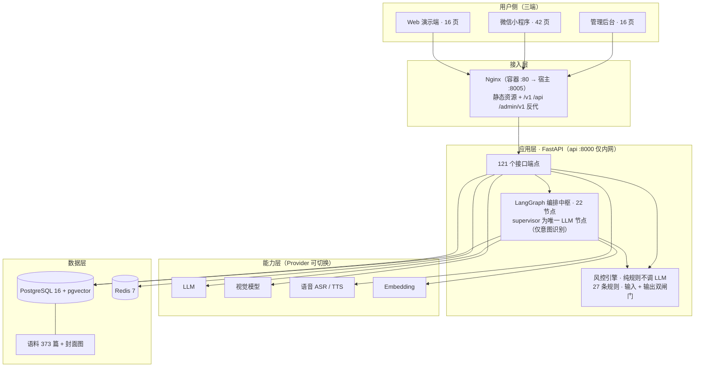

# AI 厨娘 · 智能烹饪助手 —— 项目介绍文档

| 项 | 内容 |
| --- | --- |
| 文档名称 | AI 厨娘 · 智能烹饪助手 —— 项目介绍文档 |
| 文档编号 | B-D9-PROJ-INTRO |
| 版本 | V1.0 |
| 编制日期 | 2026-10-16 |
| 编制方 | 乙方 PM（司南） |
| 文档定位 | 项目对外介绍：可用于甲方汇报、阶段评审、答辩陈述与作品集展示 |
| 数据来源 | 项目开发文档 21 份 + 测试报告 4 份 + **本地代码库实测**（统计时点 2026-10-16）+ 线上服务实探 |
| 读者对象 | 甲方项目干系人、评审/答辩老师、候选人面试官、新加入项目的研发同学 |

> **阅读指引**：第一章给出一页速览，急用可只看第一章；第二章至第六章回答「做什么 / 为什么做 / 给谁用 / 怎么用」；第七章技术栈、第八章问题与解决、第九章 AI 工具分工，是研发与评审关注的重点。

---

## 一、一页速览

### 1.1 三句话结论

1. **这是一个把「食品安全责任从用户手里接过来」的家庭烹饪助手**：覆盖「食材输入 → 智能推荐 → 分步引导 → 营养分析 → 库存管理 → 会员服务」的完整链路，用多智能体编排 + 纯规则风控实现。
2. **已从"能跑的 Demo"走到"部署在线的系统"**：三端合计 **75 页**（Web 16 + 小程序 42 + 管理后台 16 + 404 兜底），后端 **121 个接口端点 / 118 个模块**，自动化测试 **600+ 条**（后端 319 + Web 236 + 小程序 45），生产环境全端点 200。
3. **当前瓶颈不在代码，而在外部资质**：小程序备案、生成式 AI 备案、类目资质、虚拟支付签约尚未启动 —— 这是全项目唯一**不受开发进度影响**的关键路径。

### 1.2 关键指标卡（代码库实测）

| 维度 | 指标 | 实测值 |
| --- | --- | --- |
| 交付规模 | 页面总数 | **75 页**（Web 16 ｜ 小程序 42 ｜ 后台 16 ｜ 404×1） |
| | 前端代码量 | **≈56,289 行**（Web 21,467 ｜ 小程序 25,875 ｜ 后台 4,814 ｜ 共享包 4,133） |
| | 后端模块 / 接口端点 | **118 个模块 / 121 个端点 / 3 个数据库迁移** |
| | 编排节点 | **22 个**（主图 13 + 推荐子图 5 + 创新子图 4） |
| 数据资产 | 菜谱语料 | **373 篇菜品 md**（10 个分类 + template） |
| | 封面图 | **537 张**（语料侧素材） |
| | 风控规则库 | **27 条**（FS 11 ｜ MR 4 ｜ OB 5 ｜ PS 2 ｜ SP 2 ｜ INNO 3） |
| 质量 | 后端 pytest | **319 passed / 1 skipped** |
| | 前端 vitest | **Web 236 + 小程序 45，全通过** |
| | E2E 用例 | **43 条**，14 个缺陷全部闭环 |
| | 安全红线 | **12 条全绿** |
| | 全页面验收 | **16/16 可达，控制台 0 error，19 张截图存证** |
| 上线 | 生产环境 | **已上线**（`http://YOUR_SERVER_IP:8005`，用户端/后台/健康检查全 200，DB up） |
| 总体完成度 | 加权综合 | **≈88%**（功能 ≈91%，上线链路 ≈15%） |

> **口径说明**：代码量统计范围为 `.vue / .ts / .js` 源文件，**不含** `node_modules` 与第三方依赖；页面数为路由注册数；语料数为 `backend/data/HowToCook/dishes/` 下的菜品文档数。

---

## 二、项目是做什么的

### 2.1 一句话定位

> **AI 厨娘是一个面向家庭做饭人群的智能烹饪助手**：用户把「家里有什么食材」和「家里人有什么忌口」告诉它，它给出可解释、可执行的菜谱推荐，并一路陪用户把菜做出来、把营养记下来、把库存管起来。

### 2.2 核心能力地图（15 个业务模块）

| 模块 | 名称 | 完成度 | 一句话说明 |
| --- | --- | --- | --- |
| A | 准入与免责声明 | 100% | 先同意后使用，含敏感信息单独同意 |
| B | 首页 | 100% | 五大入口聚合 + 临期提醒 + 断点续做 |
| C | 用户档案 | 95% | 家庭成员 / 过敏原 / 厨艺设备 / 饮食目标 |
| D | 食材输入与识别 | 95% | 手选 + 拍照识别 + 语音输入三条路 |
| **E** | **智能菜谱推荐（主路径）** | **98%** | 三路召回 + 布尔硬过滤 + 7 因子排序 |
| **F** | **分步烹饪引导（主路径）** | **95%** | 大字单步 / 断点续做 / 求助 / 计时器 |
| G | 营养分析 | 95% | 单菜谱营养 + 按日按餐汇总，缺失如实标注 |
| H | 库存与购物清单 | 95% | 库存 CRUD + 临期查询 + 扣减两段式确认 |
| I | 收藏 / 历史 / 个人中心 | 95% | 含数据导出与注销级联清理 |
| J | 会员与支付 | 75% | 权益口径已对齐，真实虚拟支付待签约 |
| K | 后台管理端 | 88% | 16 页运营与风控配置侧 |
| **L** | **食品安全与过敏原风控（底线）** | **97%** | 27 条规则，输入 + 输出双闸门 |
| **M** | **中枢调度（架构中枢）** | **100%** | 22 节点编排 + 一票否决短路 |
| N | 用户反馈 | 90% | 浮窗 + 后台工单双向闭环 |
| O | AI 菜品创新 | 80% | 私有向量分区合成新菜，变更单待签 |

**小结**：15 个模块中 **12 个达到 90% 以上**，仅会员支付（待签约）、AI 菜品创新（待签字）、后台细节三项待收口。

### 2.3 与普通菜谱应用的三点差异

| 维度 | 普通菜谱应用的常见做法 | 本项目的做法 |
| --- | --- | --- |
| 食品安全 | 写在用户须知里，交给用户「自己注意」 | **系统侧强制拦截**：命中高危即控制流短路，不生成任何内容 |
| 过敏原 | 在菜谱里标注，或做口味降权 | **布尔硬过滤**：数据库层直接剔除，且排序函数的输入集只能来自过滤输出集 |
| 推荐逻辑 | 全量召回 + 模型打分，结果不可解释 | **全程无大模型**：规则 + 加权，输出「为什么推荐给你」与被过滤明细重放 |

---

## 三、为什么要做这个项目

### 3.1 出发点：四个真实痛点

| # | 痛点 | 具体表现 |
| --- | --- | --- |
| 1 | **有食材，不知道做什么** | 冰箱里明明有菜，但想不出能组合成什么菜，食材放坏 |
| 2 | **菜谱不区分人和条件** | 网上的菜谱不考虑用户厨艺水平，也不管家里有没有对应设备 |
| 3 | **过敏原靠人记** | 家庭有过敏成员时只能人脑记忆，一旦疏漏后果严重 |
| 4 | **营养数据留不下来** | 做完菜不知道营养够不够，数据无法累积，也没法复盘 |

### 3.2 一个关键的产品判断

> 大部分同类产品把「食品安全」当作**免责条款**处理；本项目把它当作**系统能力**处理。

落到设计上就是三条不可协商的约束：

1. **不把可食性判断交给 AI** —— AI 只做识别与检索，识别结果必须用户确认（`need_user_confirm` 恒为 `true`）。
2. **不做安全承诺** —— 涉及食材安全时统一收口到「请以实际食材包装标签为准」，不输出医疗或安全结论。
3. **不让风险绕过闸门** —— 一票否决等于**控制流短路**，而不是「标记后丢弃」；风控异常时进入保守模式，绝不把请求透传给模型。

### 3.3 项目性质与交付节奏

| 项 | 内容 |
| --- | --- |
| 项目性质 | 甲乙方外包项目，我方为**乙方（开发方）** |
| 协作约定 | 需求变更必须走变更单 `CR-YYYYMMDD-NN`，**口头变更一律无效**；乙方文档与需求文档冲突时**以需求文档为准** |
| 交付物 | 8 类：PRD ｜ UI 设计稿 ｜ 架构设计 ｜ 测试方案 ｜ 源码 ｜ 部署运维接口 ｜ 测试报告 ｜ 开源组件清单 |
| 阶段一 | **7 个工作日**交付 Web 可演示原型（合同基准 6 页，实际交付 **16 页**） |
| 阶段二 | **16 周**交付微信小程序（42 页）+ 管理后台（16 页） |

---

## 四、项目主要服务哪些用户

### 4.1 目标用户总览

**核心人群**：有在家做饭习惯、且家里不止一个人吃饭的家庭用户。共同特征是**决策成本高**（要同时满足多人口味、忌口、厨艺水平、现有食材）和**容错成本高**（过敏原一旦疏漏后果严重）。

| 用户类型 | 特征 | 核心诉求 | 对应功能 |
| --- | --- | --- | --- |
| **家庭主厨**（核心） | 每天/隔天做饭，负责全家饮食 | 快速决定做什么、别浪费食材、别踩过敏原 | 推荐、库存、档案、分步引导 |
| **过敏家庭照护者** | 家中有过敏成员 | 绝对不能被推荐到含过敏原的菜 | 档案（过敏原必填）、硬过滤、过滤重放、致敏原警示条 |
| **厨房新手** | 厨艺生疏、设备有限 | 步骤要看得清、能随时问、别做失败 | 大字分步引导、求助问答、难度与设备过滤 |
| **健康管理者** | 关注热量与营养摄入 | 知道今天吃了多少、缺什么 | 营养分析、饮食目标、营养汇总 |
| **运营 / 风控人员**（B 端） | 平台侧，非消费者 | 配规则、看数据、管内容、查日志 | 管理后台 16 页 |

### 4.2 典型用户画像

**画像一：忙碌的家庭主厨（主用户）**
> 下班回家，冰箱里剩三样菜，不想再想菜单；希望打开就能看到「今天吃什么」，三分钟内决定，二十分钟内开饭；做完顺手把食材从库存里扣掉。

**画像二：有过敏成员的家庭照护者（高价值用户）**
> 孩子对花生过敏。她需要的是「系统帮我保证不漏」，而不是「我自己看标签」。她会用「显示被我过滤掉的菜」去核对系统判断，也会在认为误判时上报。

**画像三：厨房新手（成长型用户）**
> 只会煮面，家里只有一口锅和一个微波炉。他需要的是能被设备与难度过滤后的菜谱，以及烹饪时能随时问「这一步的火候怎么掌握」。

### 4.3 用户需求 → 功能映射

| 用户原话（需求来源） | 产品回应 | 落地模块 |
| --- | --- | --- |
| 「不知道做什么」 | 零输入直出「今天吃什么」、时令推荐 | E |
| 「买回来的菜总放坏」 | 库存临期提醒 + 推荐侧临期优先因子 | H → E |
| 「家里人过敏，怕漏」 | 过敏原必填 + 数据库层硬过滤 + 过滤原因可查看 | C / L / E |
| 「菜谱步骤看不清、看不完」 | 大字单步、进度条、断点续做 | F |
| 「做菜时想问问」 | 求助问答（结合当前步骤上下文）、语音播报 | F / 语音 |
| 「不知道吃了多少」 | 营养汇总、按日按餐聚合、缺失如实标注 | G |
| 「不想被推荐不喜欢的」 | 不喜欢走**降权**而非过滤（口味偏好不应让菜消失） | E |

---

## 五、用户是怎么使用这个项目的

### 5.1 端到端主旅程


### 5.2 首次使用（第 1 次进来）

| 步骤 | 用户看到什么 | 系统在做什么 |
| --- | --- | --- |
| 1 | 首屏免责声明条 + 敏感信息单独同意 | 同意落库（`/v1/consent/*`），未同意不进入主流程 |
| 2 | 建档引导：家庭成员、过敏原、厨艺水平、厨房设备、饮食目标 | 无家庭自动建档；**过敏原为必选项** |
| 3 | 食材选择页（10 个分类 + 别名搜索，可批量多选） | 食材名/别名归一为 `ingredient_id` |
| 4 | 推荐结果页 | 三路召回 → 布尔硬过滤 → 7 因子排序 → 取 Top 8 |
| 5 | 菜谱详情页（顶部致敏原警示条、逐行标注） | 营养估算并行产出 |

> **一个刻意的体验设计**：如果候选不足 8 道，系统**如实说明不填充** —— 实测选 3 样食材只返回 2 道，页面提示「现有食材组合有限，宁缺毋滥」。不用低分菜谱凑数，是可信度的一部分。

### 5.3 日常使用（第 N 次进来）：四条快捷入口

| 入口 | 路径 | 适用场景 |
| --- | --- | --- |
| 手选食材 | `/select` → `/recommend` | 明确知道手里有什么 |
| 零输入直出 | `/today` | 什么都不想选，就要一个答案 |
| 时令推荐 | `/seasonal` | 想按季节吃当季菜 |
| 拍照 / 语音 | `/recognize` ｜ 语音点菜 | 懒得打字，随手拍或直接说 |

### 5.4 烹饪过程中

- **大字单步显示** + 进度条（第 N 步 / 共 M 步）；
- **并行计时器**：5 个预设计时 + 自定义；
- **随时求助**：结合当前步骤上下文作答，每个会话最多 3 次（防滥用）；
- **断点续做**：中途退出后，首页出现续做条，会话携带菜谱步骤快照；
- **退出保护**：退出需二次确认（「继续做菜 / 确认退出」）；
- **完成回流**：可选评分 → 写入反馈表 → 生成营养记录。

### 5.5 一条特殊但重要的路径：风控拦截

```
用户输入「发芽土豆能吃吗」
   → 命中规则 FS-003（发芽 / 变青土豆 · 龙葵素）
   → 控制流短路，直达终止节点 emit_safety_response
   → 前端跳转 /blocked 拦截页
   → 页面呈现三类内容：⛔ 风险说明｜✅ 正确做法｜🏥 就医引导
   → 返回体仅含 6 个安全字段，不含任何业务字段
   → 页面明确标注「本次请求未生成任何内容」
```

> 这条路径**不依赖任何外部模型**，纯规则短路，是现场演示最稳的一条链路。

### 5.6 三端形态与适用场景

| 端 | 技术形态 | 页数 | 适用场景 | 当前状态 |
| --- | --- | --- | --- | --- |
| Web 演示端 | Vue 3 + Vite + Element Plus | 16 | 浏览器演示、评审验收、快速体验 | **已上线运行** |
| 微信小程序 | uni-app + Vue 3 + Pinia | 42 | 手机端日常使用（厨房场景） | 代码完工，待 AppID 与真机联调 |
| 管理后台 | Vue 3 + Element Plus | 16 | 运营配规则、看数据、处理工单 | 已上线运行 |

---

## 六、技术栈

### 6.1 分层技术栈明细

| 层 | 选型 | 说明 |
| --- | --- | --- |
| Web 演示端 | Vue 3 + Vite + TypeScript + Pinia + Element Plus | 阶段一交付物，16 个视图 |
| 微信小程序 | uni-app + Vue 3 + Vite + TS + Pinia + `packages/shared` | 42 页分包注册，逻辑层与 Web 复用 |
| 管理后台 | Vue 3 + Element Plus | 16 个业务视图 |
| 共享逻辑包 | `packages/shared`（TypeScript） | 请求、状态、业务逻辑三端复用 |
| 后端 | Python 3.11 + FastAPI + SQLAlchemy 2.0 + Pydantic v2 | 118 个模块、121 个端点、46 个测试文件 |
| 数据校验 | Pydantic v2 | 接口契约与 API 文档天然同源 |
| 迁移 | Alembic | 3 个数据库迁移 |
| 编排 | **LangGraph** | 主图 13 节点 + 推荐子图 5 + 创新子图 4 |
| 数据库 | PostgreSQL 16 + **pgvector** | 单库 `aicook`，28–32 张表 |
| 缓存 | Redis 7 | 当前为预留 |
| 部署 | Docker Compose + Nginx | 4 服务：web / api / db / redis |
| AI 能力 | LLM ｜ VLM ｜ ASR ｜ TTS ｜ Embedding | 全部 **Provider 化**，mock ↔ 真实可一键切换 |

### 6.2 系统架构



### 6.3 四条关键选型理由

| 选型 | 为什么这么选 |
| --- | --- |
| **LangGraph 而非 if-else / 纯 LangChain** | ① 状态与流转显式可断言（18 条图结构单测）；② 天然支持并行分支与条件边短路，「一票否决」在图层面就是一条条件边；③ 每节点自动产生 trace span，可回放。LangChain 解决「怎么调模型」，LangGraph 解决「多个能力怎么组织」 |
| **大模型只放在意图识别** | 推荐要的是可解释、可测试、可复现。LLM 只做它擅长的意图分类（输出意图标签），**不决定调用哪个工具** —— 路由由代码字典 `INTENT_ROUTES` 决定，消除「幻觉选工具」的风险面 |
| **阶段一不引入额外中间件** | PostgreSQL + pgvector 单库起步，规模化后再迁 Milvus，避免阶段一过度设计 |
| **AI 能力全部 Provider 化** | 意图识别、拍照识别、语音、嵌入均可在 mock 与真实模型间切换，**缺省回退 mock**，保证服务一定能启动，也便于测试与离线开发 |

---

## 七、项目中比较特殊的问题与解决方法

### 7.1 问题总览

| # | 问题 | 类别 | 解决方向 | 结果 |
| --- | --- | --- | --- | --- |
| 1 | 纯手选食材路径不触发向量召回，RAG 只用到一半 | 算法 | 补齐三路召回缺口 + 修复向量升级遗留工程缺口 | 已闭环，双文档留痕 |
| 2 | 「过敏原硬过滤」与「口味降权」两套语义容易混用 | 架构 | 硬过滤用 SQL 布尔条件；排序函数输入集**只能**来自过滤输出集 | 12 条安全红线全绿 |
| 3 | 2C2G 服务器上构建前端镜像必然 OOM | 部署 | 构建与运行分离：本地构建 → save → scp → load | 生产环境全端点 200 |
| 4 | 镜像加速源「配了但不生效」 | 部署 | 先经加速拉官方镜像，再 `docker tag` 打带前缀别名 | 已固化进部署脚本 |
| 5 | 语音录制在 http + 公网 IP 下静默失效且不报错 | 前端 / 浏览器规范 | 上 HTTPS；纯 TTS 播报不受影响（部分可用而非全不可用） | 登记为风险 R-31 |
| 6 | 「一票否决」被实现成「标记后丢弃」 | 架构 | 条件边直达终止节点，节点入口再查一次否决标记（双保险） | 否决响应体仅 6 个安全字段 |
| 7 | Python import 是值拷贝，节点清单追加未生效 | 代码陷阱 | 改为对 common 模块就地修改 / 清单静态化 | 自检 P0 发现，已给修复方向 |
| 8 | 小程序真机请求指向手机自身 | 配置 | 构建期注入 `VITE_API_BASE_URL`，不可硬编码 `127.0.0.1` | 已规范为构建期注入 |
| 9 | 语料导入不落库图片行 →「补图 ≠ 产品有图」 | 数据口径 | 独立图片链路改造，口径写入验收文档 | 避免验收分歧 |
| 10 | 端口纪律与安全暴露 | 运维 | api/db/redis 端口不对外发布，仅 web 暴露 8005 | 待安全组复查确认 |

### 7.2 典型案例深剖

#### 案例一：为什么过敏原必须是布尔硬过滤，而不是降权

**现象**：早期设计讨论中，过敏原与「不喜欢」都被放在同一个权重体系里作为扣分项。

**根因**：降权只是把分数调低，菜谱**仍然留在候选集里**。一旦候选不足，或权重被远程调低，它就可能重新浮上来。

**解法**（三层结构约束）：

1. 过敏原在「检索」与「排序」之间作为**独立节点**，落到数据库 `WHERE` 的布尔条件（`?|` 数组运算符）；
2. 排序函数 `weighted_rank` 的输入集**只能**是过滤节点的输出集 —— 从代码结构上杜绝「给过敏原菜谱打分后放回」；
3. 权重虽然存在远程配置里可热调，但**无论怎么调都改不动过滤节点的布尔条件**。

**结论**：一句话概括 —— **可调的是排序，不是安全**。同时刻意保留语义区分：用户「不喜欢」走降权（−0.5），因为**不喜欢不等于不能吃**。

---

#### 案例二：「一票否决」到底是「短路」还是「丢弃」

**现象**：很多实现的做法是命中风险后打一个标记，业务逻辑照常跑完，最后只是不返回结果。

**根因**：这种做法下，中间**可能已经调用了模型、写了数据**，风控形同虚设。

**解法**：

- 命中即通过**条件边直接越过全部业务节点**，直达终止节点 `emit_safety_response`，让业务节点连执行机会都没有；
- **双保险**：图入口拦一次，每个业务节点入口再检查一次否决标记，命中即以 `skipped_by_veto` 返回；
- 实测取证：一票否决落库 15 行 trace，业务节点全部标注 `not_executed`。

**结论**：这三层防护叠在一起，才有「12 条安全红线全绿」这个结论；也才有底气在页面上写「本次请求未生成任何内容」。

---

#### 案例三：2C2G 服务器上构建镜像必然 OOM

**现象**：在腾讯云 2 核 2G 的 CVM 上执行前端镜像构建，进程被杀。

**根因**：`Dockerfile.web` 需要两次依赖安装（`npm ci`）+ 一次 Vue 类型检查（`vue-tsc`），峰值内存超过 1.5GB，超出服务器可用内存。

**解法**：**构建与运行分离**。

| 环节 | 在哪做 | 做什么 |
| --- | --- | --- |
| 构建 | 本地开发机 | `docker build` → `docker save` 为 tar |
| 传输 | — | `scp` 上传镜像 tar |
| 运行 | 服务器 | `docker load` 后由 Compose 启动 |

**结论**：服务器只负责运行镜像，不再承担构建负载；同时通过 Compose 设置保守资源上限（web 0.5C/192M、api 1C/768M、db 0.65C/512M、redis 0.25C/128M）避免相互挤压。

---

#### 案例四：镜像加速源「配了但不生效」

**现象**：服务器上 `daemon.json` 已配置 `registry-mirrors`，但拉取镜像仍然极慢甚至超时。

**根因**：加速源只对**不带 registry 前缀**的官方镜像名生效。一旦镜像名写死了完整域名（如 `docker.io/library/xxx`），Docker 会直连该域名，绕过镜像加速。

**解法**：两步走 —— 先经加速源正常拉取官方镜像，再用 `docker tag` 给它打上带前缀的别名，供 Compose 引用。该动作已固化进部署脚本的固定步骤。

**结论**：这是一个「配置看起来正确、行为却不符合直觉」的典型问题，解法写进脚本才不会在下次部署时重踩。

---

#### 案例五：语音功能「代码都对，点下去没反应，也不报错」

**现象**：ASR 接口、前端调用、错误处理全部就绪，在 http + 公网 IP 环境下点击录音没有任何反应，控制台**也没有报错**。

**根因**：麦克风采集 API（`getUserMedia`）只在**安全上下文**（HTTPS 或 localhost）下可用，这是浏览器规范，不是程序缺陷。非安全上下文下它是**静默失效**的。

**解法**：上 HTTPS 域名（同时也是小程序体验版/正式版的强制要求）；在获得 HTTPS 之前，把它登记为风险项 R-31 并对外说明。

**结论**：值得区分的是，纯 TTS 播报走 `<audio>` 元素，**不受安全上下文限制** —— 所以这是「部分可用」而不是「全部不可用」，这一点在演示与验收时要讲清楚，避免被误解为功能未实现。

---

#### 案例六：向量召回在某些路径下根本不触发

**现象**：手选三样食材，推荐结果明显偏少。

**根因**：代码中的判断是 `if use_vector and query_text:` —— 而纯手选食材的路径不产生任何文本，`query_text` 恒为空，条件恒为假。

**解法**：补齐三路召回（覆盖率 / 文本 / 向量）的生效条件与工程缺口，并同步修复向量升级遗留的三个问题（建向量 CLI、Provider 配置项、向量空间版本迁移列）。

**结论**：已闭环并采用双文档留痕（方案文档 + 实现变更记录）。这条**没有被藏起来**，而是登记为改进项写进交付文档 —— 把问题写在明面上，比假装不存在更有价值。

---

### 7.3 从这些问题里沉淀的工程习惯

| 习惯 | 具体做法 |
| --- | --- |
| 数字可复现 | 交付文档附录给出核对命令，任何人可独立跑出同样的数字 |
| 口径可追溯 | 每个数值标注统计范围与定义（如「语料补图 ≠ 产品有图」） |
| 结论带证据 | 不写「体验良好」，写「16/16 可达、控制台 0 error、19 张截图」 |
| 风险明面化 | 主动整理风险登记册（33 条），未完成项不隐藏 |
| 结构可断言 | 图结构写单测（18 条拓扑断言），不只靠人工检查 |

---

## 八、项目中使用的 AI 工具与分工

本项目在「代码开发」与「文档/评估」两条线上引入四款 AI 工具协同，每款工具承担边界清晰的角色。

### 8.1 工具分工总表

| 工具 | 承担任务 | 典型产出 | 在项目中的价值 |
| --- | --- | --- | --- |
| **WorkBuddy** | **整理开发文档 + 对功能进行评估** | PRD、架构与数据库设计、UI 原型清单、部署手册、操作手册、进度统计分析报告、全景汇总报告、页面测试报告、变更单、风险登记册 | 文档体系与评估基准的「中台」：既产出交付文档，也承担功能完成度的横向核对 |
| **Trae CN** | **初步构建项目整体框架代码** | 三端工程骨架（Web / 小程序 / 后台）、后端目录结构与基础路由、基础页面与通用组件 | 快速把架构设计落成可运行的骨架，缩短「从零到能跑」的时间 |
| **Qoder** | **调整部分区域、优化升级** | 局部模块的功能调整与代码优化（如语音能力接入、向量检索升级、页面细节与交互修正） | 在既有骨架内做精细化改造，适合「范围明确、上下文清晰」的增量改动 |
| **Codex** | **项目上线部署** | `Dockerfile.web`、`docker-compose.prod.yml`、`.env.production.example`、Nginx 配置、8 步部署脚本、生产环境部署执行与验证 | 把「在本地能跑」变成「在服务器上稳定运行」 |

### 8.2 逐工具说明

#### 8.2.1 WorkBuddy —— 文档体系与功能评估

**承担什么**
1. **文档生产线**：从需求基线（PRD）到架构设计、UI 原型清单、部署手册、操作手册，以及贯穿全程的进度报告与变更单，形成 21 份编号文档的完整体系。
2. **功能评估**：对代码库做实测盘点，逐模块核对完成度（15 个模块 / 11 个核心模块详解），输出全景汇总报告与风险登记册。

**关键产出示例**

| 产出 | 说明 |
| --- | --- |
| PRD V1.1 | 需求基线，含 22 条合规红线（RL）定义 |
| 02-架构设计与数据库设计 V1.1 | 分层架构、状态机、数据模型与硬约束 |
| 07-项目进度统计分析报告 V1.4 | 多轮评估，收敛到加权完成度 |
| 全景汇总报告 V1.1 | 11 个核心模块逐一定位 / 流程 / 规则 / 接口 / 页面 / 证据 |
| 页面测试报告 | 16/16 页面可达，含 19 张截图存证 |
| 变更单 CR-20261008-01 | 需求变更走单留痕 |

**为什么放在这里**：这类工作强调**结构化、可追溯、口径一致**，且需要跨文档交叉核对（例如「模块完成度」必须与代码实测一致）。这正好是 AI 辅助在文档效率上的强项。

#### 8.2.2 Trae CN —— 初步构建整体框架

**承担什么**：把架构设计中的目录结构、分层约定、路由骨架、通用组件一次成型，产出一个「能跑起来、但业务待填」的工程底座。

**产出形态**

| 端 | 骨架内容 |
| --- | --- |
| Web 演示端 | Vite 工程、路由表、Element Plus 接入、视图目录与占位页、请求封装 |
| 微信小程序 | uni-app 工程、`pages.json` 分包结构、Pinia store 骨架 |
| 管理后台 | Vue 3 工程、布局与菜单、管理类页面骨架 |
| 后端 | 目录分层（api / graph / ability / safety / models / seed）、路由注册、配置加载 |

**为什么放在这里**：框架搭建是**重复度高、模式固定**的工作，交给 AI 快速铺开可以显著压缩前期耗时，把人的精力留给架构决策与业务逻辑。

#### 8.2.3 Qoder —— 局部调整与优化升级

**承担什么**：在已有骨架和业务代码的基础上，做**范围明确**的增量改造与优化。

**在本项目中的典型场景**

| 场景 | 改造内容 |
| --- | --- |
| 语音能力接入 | 新增 ASR / TTS / 语音指令接口与前端调用，接入百炼语音服务 |
| 向量检索升级 | 补齐三路召回缺口、Provider 配置项、向量空间版本迁移 |
| 页面与交互修正 | 推荐卡片图片呈现、首页双入口重构、详情页警示条与过滤重放 |
| 局部重构 | 风控短路路径、节点注册表装配方式调整 |

**为什么放在这里**：这类任务**上下文边界清晰、验收标准明确**（改哪一块、改成什么样很清楚），适合交给擅长在既有代码中做精准修改的工具，改动面可控、便于回归验证。

#### 8.2.4 Codex —— 上线部署

**承担什么**：把项目从「本地可运行」推进到「服务器可稳定运行」。

**产出与执行内容**

| 环节 | 具体内容 |
| --- | --- |
| 镜像构建 | `Dockerfile.web`：前端构建产物 + Nginx 运行镜像 |
| 编排定义 | `docker-compose.prod.yml`：web / api / db / redis 四服务，端口隔离与资源上限 |
| 环境配置 | `.env.production.example`：WEB_PORT / WEB_IMAGE / DB_PASSWORD / ADMIN_PASSWORD / ADMIN_JWT_SECRET |
| 反向代理 | `nginx/nginx.conf`：gzip、静态缓存、TTS 流式播报不缓冲 |
| 部署脚本 | `scripts/deploy.sh` 8 步：基础镜像准备 → 语料校验 → 占位符拒绝 → 端口断言 → 等待健康检查（180s）→ 冒烟验证 |
| 上线验证 | 用户端 / 管理后台 / 健康检查 / API 健康检查全部 200；数据库连通正常 |

**为什么放在这里**：部署涉及大量「配置细节 + 失败重试 + 环境差异」，也是本项目踩坑最密集的一段（构建 OOM、镜像加速、端口纪律）。把这一环单独交给工具执行，能把踩坑经验固化进脚本，形成可重复的部署路径。

### 8.3 分工原则与协作经验

**分工原则：按「任务确定性」划分，而不是按「代码量」划分**

| 任务特征 | 交给谁 | 理由 |
| --- | --- | --- |
| 需要跨文档核对、口径统一、结构化输出 | WorkBuddy | 强在结构化与一致性 |
| 从零铺开、模式重复、规模大 | Trae CN | 强在快速生成骨架 |
| 范围明确、上下文清晰、增量改动 | Qoder | 强在既有代码内的精准修改 |
| 环境相关、需要执行与验证、易踩坑 | Codex | 强在执行与落地 |

**四条协作经验**

1. **AI 出骨架，人做决策**：技术选型、风控边界、状态机设计这类决策不能外包给工具，工具负责把它们实现出来。
2. **每个工具都要有验收标准**：框架能不能跑、改动有没有回归、部署有没有 200 —— 没有验证的产出不算完成。
3. **踩坑必须落成脚本或文档**：镜像加速、构建 OOM 这类问题，只在会话里解决一次就等于没解决。
4. **工具边界要清晰，避免互相覆盖**：框架、局部改造、部署三段分开，减少「改一处坏一处」的风险。

---

## 九、项目现状与后续计划

### 9.1 当前状态

| 维度 | 状态 |
| --- | --- |
| Web 演示端 | **已上线运行**（8005，全端点 200） |
| 管理后台 | **已上线运行** |
| 微信小程序 | 代码完工（42 页注册），**待 AppID 与真机联调** |
| 后端 / 数据 | 319 单测通过，3 个迁移，线上数据库连通 |
| 风控 | 27 条规则，12 条安全红线全绿 |
| 阶段一验收 | **12 项验收未正式执行**（待召开验收会议） |
| 资质类 | 小程序备案 / 生成式 AI 备案 / 类目资质 / 虚拟支付签约**未启动** |

### 9.2 后续优先级

| 优先级 | 事项 | 说明 |
| --- | --- | --- |
| **P0** | 小程序资质办理 | 全项目唯一**不受开发进度影响**的关键路径，须立即确认主体与资料清单 |
| **P0** | 阶段一验收会议 + 变更单签字 | 材料 100% 就绪，需正式走完流程 |
| **P0** | 生产环境安全复查 | 确认 api 8000 未发布、安全组未放通 5432/6379，Swap 扩容 |
| **P1** | HTTPS + 备案域名 | 语音输入与小程序体验版的共同硬前提 |
| **P1** | 语料文本合规清洗 | 上游语料含功效/医疗宣称表述，需按 RL-7 / RL-11 清洗 |
| **P2** | 向量语义升级 | 当前为哈希伪向量（字面重叠），可升级为真实语义嵌入 |
| **P2** | 埋点体系 | 阶段二数据复盘的基础 |

---

## 十、附录

### 10.1 文档资产清单（21 份编号文档）

| 编号 | 文档 | 编号 | 文档 |
| --- | --- | --- | --- |
| 00 | 架构设计与技术方案建议书 V0.1 | 12 | 首页双入口重构设计方案 V0.1 |
| 01 | PRD V1.1（需求基线） | 13 | 推荐结果卡片图片呈现方案 V0.1 |
| 02 | 架构设计与数据库设计 V1.1 | 14 | 向量模型与 RAG 检索升级方案 V0.1 ×2 |
| 03 | UI 原型界面描述清单 V1.1 | 15 | 阶段一收口评审报告 V1.0 |
| 04 | 腾讯云 Docker 一键部署操作手册 V1.1 | 16 | 阶段二微信小程序开发设计方案 V1.0 |
| 05 | 项目操作手册 V1.1 | 17 | 上线部署与小程序真机运行方案 V0.1 |
| 06 | 需求变更单 CR-20261008-01 | 18 | 腾讯云 8005 生产部署指南 V1.0 |
| 07 | 项目进度统计分析报告 V1.4 | 19 | LangGraph 图结构分析 V1.0 |
| 08 | 拍照识别真实视觉模型接入方案 V0.1 | 20 | 项目答辩讲稿 V1.0 |
| 10 | 同类开源项目参考清单 V0.1 | 21 | **本文档 · 项目介绍文档 V1.0** |
| 汇总 | 项目全景汇总报告 V1.1 + 页面测试报告 | — | — |

### 10.2 独立复核方式

```bash
# 线上服务
curl -fsS http://YOUR_SERVER_IP:8005/v1/healthz     # → {"status":"ok","database":"up","version":"1.0.0"}

# 后端测试
cd backend && ./.venv/Scripts/python.exe -m pytest -q          # → 319 passed, 1 skipped

# 前端测试
cd web-stage1 && npx vitest run                                 # → 236 passed / 22 files
cd web-mini   && npx vitest run                                 # → 45 passed / 7 files

# 规模核对
grep -rhoE "@router\.(get|post|put|patch|delete)\(" backend/app/api | wc -l    # → 121
find web-mini/src/pages -name "*.vue" | wc -l                                  # → 42
find backend/app/seed -name "*.py" | xargs grep -ohE "(FS|MR|OB|PS|SP|INNO)-[0-9]+" | sort -u | wc -l   # → 27
```

### 10.3 数据来源

项目开发文档 00–20 共 21 份 ｜ 测试报告 4 份 ｜ 项目全景汇总报告 V1.1 ｜ 页面测试报告 2026-10-14（含 19 张截图）｜ 本地代码库实测（2026-10-16）｜ 线上服务实探。

---

> **合规声明**：本方案为产品与管理参考，涉及备案、资质、支付与文案的合规结论请以甲方法务与平台最新规则为准。本文档为原创编制，数据来自本地实测与线上实探，未使用未经授权的第三方数据；示例数据均为虚构或已脱敏。

*B-D9-PROJ-INTRO ｜ 项目介绍文档 V1.0 ｜ 2026-10-16 ｜ 乙方 PM（司南）*
