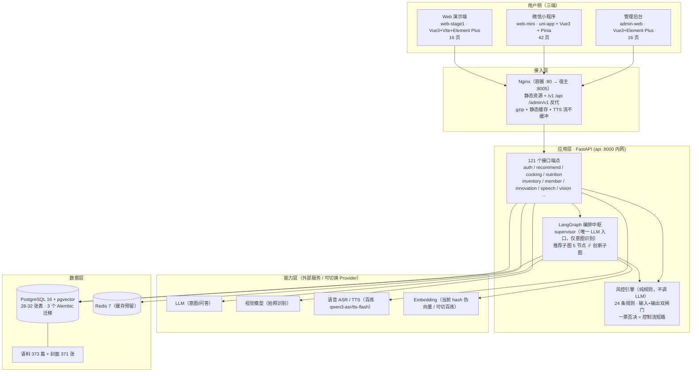
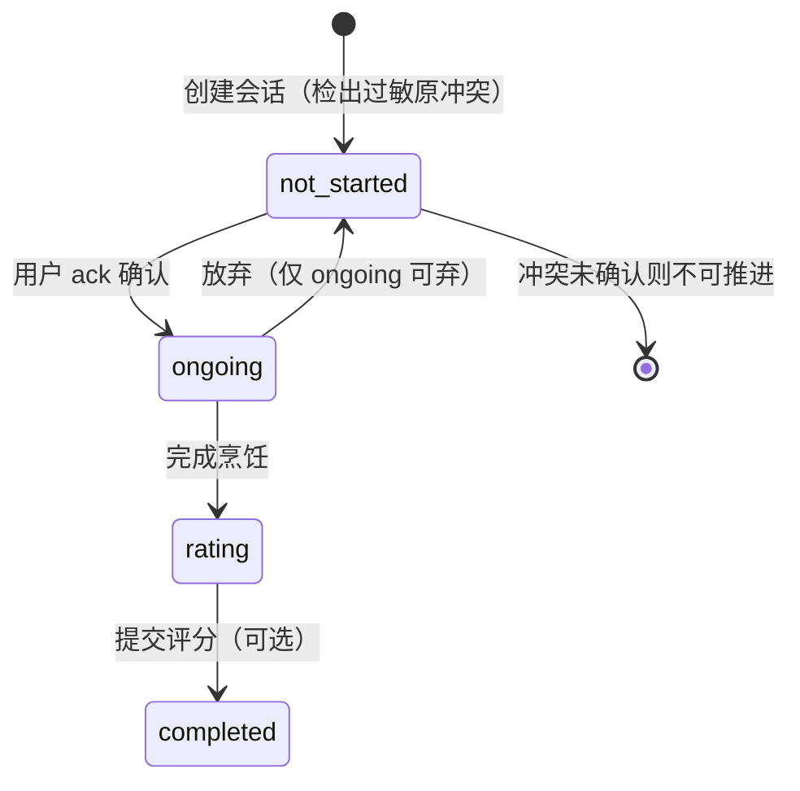
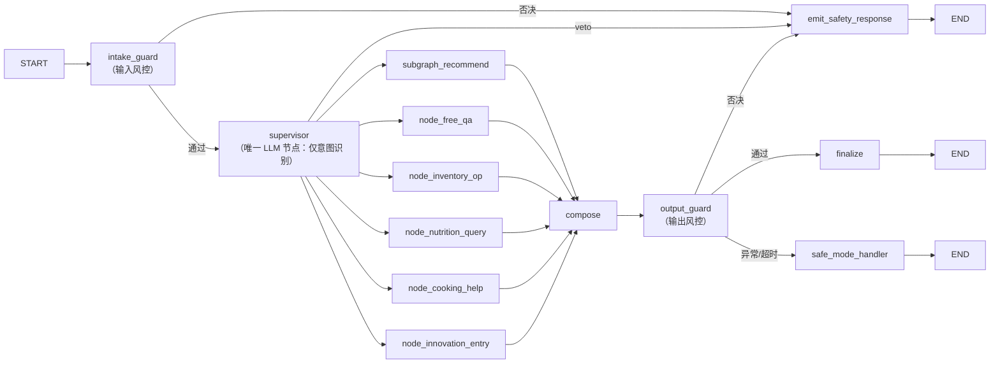
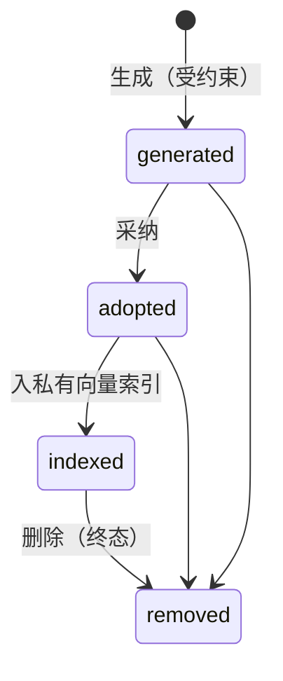

# AI 厨娘・智能烹饪助手 —— 项目全景汇总报告

| 项 | 内容 |
| --- | --- |
| 报告名称 | AI 厨娘・智能烹饪助手 —— 项目全景汇总报告 |
| 报告编号 | PM-RPT-20261014-02 |
| 版本 | **V1.1（新增「四、核心功能模块详解」章节）** |
| 评估时点 | 2026-10-14 19:55 |
| 编制方 | 乙方 PM（司南） |
| 数据来源 | **本地代码库实测** ＋ 项目开发文档 18 份 ＋ 测试报告 4 份 ＋ **线上服务实探** |
| 报告定位 | 面向甲方与项目内部的全景盘点：**核心功能模块详解**、资产、实现、质量、上线、合规、风险、下一步 |
| 变更记录 | V1.0（19:40）首次全景汇总 ｜ **V1.1（19:55）新增第四章「核心功能模块详解」（11 个核心模块逐一定位/流程/规则/接口/页面/证据）＋ 风控规则数修正为 27 条** |

> **本次核心变化**：相较 10-13 的《07-进度统计分析报告 V1.4》，本次新增三项**已落地事实** —— ① **Web 端已部署上线并在运行**（生产地址实测 200）；② 新增**语音能力**（ASR / 语音指令 / TTS）；③ **全页面测试完成**（16/16 可达 + 19 张截图存证）。

---

## 一、一页速览（结论先行）

### 1.1 三句话结论

1. **代码侧已跑在计划前面**：阶段一合同要求 6 页，实际交付 **Web 16 页 + 管理后台 16 页 + 小程序 42 页**，三端共 **47,736 行**前端代码 + 后端 **118 个模块 / 121 个接口端点**。
2. **上线已从"待验证"变为"已完成"**：生产环境 `http://YOUR_SERVER_IP:8005` 用户端 / 管理后台 / 健康检查**全部 200**，数据库 `up`。
3. **当前瓶颈不在代码，而在"纸面与资质"**：① 阶段一 12 项验收未正式执行（G5）；② 甲方 7 项决策积压；③ 小程序备案 / 生成式 AI 备案 / 类目资质 / 虚拟支付签约**未启动** —— 它们是全项目唯一**外部不可压缩**的关键路径。

### 1.2 核心指标卡

| 维度 | 指标 | 实测值 |
| --- | --- | --- |
| **交付规模** | 页面总数（三端） | **74 页**（Web 16 + 后台 16 + 小程序 42） |
| | 前端代码量 | **47,736 行**（Web 18,486 + 后台 3,375 + 小程序 25,875） |
| | 后端模块 / 接口端点 | **118 个 py 模块 / 121 个端点 / 3 个数据库迁移** |
| **质量** | 后端单测 | **319 passed / 1 skipped** |
| | 前端单测 | **Web 236 passed（22 文件）+ 小程序 45 passed（7 文件）** |
| | E2E | **43 用例**，14 缺陷全闭环，12 条安全红线全绿 |
| | 页面验收 | **16/16 可达，控制台 0 error，19 张截图存证** |
| **数据资产** | 菜谱语料 | **373 篇 md（10 分类）** + **371 张封面图** |
| | 风控规则库 | **27 条**（FS-001~011 / MR-001~004 / OB-001~005 / PS-001~002 / SP-001~002 ＋ 创新专项 INNO-001~003） |
| **上线** | 生产环境 | **已上线**（8005，全端点 200，DB up） |
| **文档** | 交付文档 | **项目开发文档 18 份 + 测试报告 4 份 + 页面汇总 1 份** |
| **总体完成度** | 加权综合 | **≈88%**（功能 ≈91%，上线链路 ≈15%） |

---

## 二、项目定位与协作模式

| 项 | 内容 |
| --- | --- |
| 项目性质 | 甲乙方外包项目，我方为**乙方（开发方）** |
| 产品定位 | 面向**家庭做饭人群**的智能烹饪助手：食材→推荐→分步引导→营养→库存→会员全链路 |
| 核心形态 | 多智能体（LangGraph 编排）＋ 食品安全风控 ＋ 个性化推荐 |
| 交付节奏 | **阶段一**：7 工作日 Web 可演示原型（不做小程序）→ **阶段二**：16 周微信小程序 + 管理后台 |

### 2.1 协作约定（甲方文档明确规定）

| 事项 | 约定 |
| --- | --- |
| 乙方交付物 | B-D1 PRD｜B-D2 UI 设计稿｜B-D3 架构设计｜B-D4 测试方案｜B-D5 源码｜B-D6 部署运维接口｜B-D7 测试报告｜B-D8 开源组件清单 |
| 文档权限 | 01 需求基线乙方**只能评论不能改**；06 合规区只读；07 项目管理双方共编 |
| 冲突处理 | 乙方文档与需求文档冲突 → **以需求文档为准** |
| PRD 定位 | **不重写需求文档**，只做交互细化 + 章节引用 |
| 需求变更 | 必须走变更单 `CR-YYYYMMDD-NN`，**口头变更一律无效** |
| 术语口径 | `US-xx` 用户故事 ｜ `FR-x.x` 功能需求 ｜ `NFR-x` 非功能 ｜ `RL-x` **合规红线** ｜ `CR-` 变更单 ｜ `Q-xx` 待确认 |

---

## 三、系统架构总览

### 3.1 端到端架构



### 3.2 技术栈明细

| 层 | 选型 | 说明 |
| --- | --- | --- |
| Web 演示端 | Vue 3 + Vite + TypeScript + Pinia + Element Plus | 阶段一交付物，16 视图 |
| 小程序端 | uni-app + Vue 3 + Vite + TS + Pinia + `packages/shared` | 42 页，逻辑层与 Web 复用 |
| 管理后台 | Vue 3 + Element Plus | 16 页后台 |
| 后端 | Python 3.11 + FastAPI + SQLAlchemy + Pydantic | 118 模块 / 121 端点 / 46 测试文件 |
| 编排 | LangGraph | 主图 + 推荐子图 + 创新子图 |
| 数据库 | PostgreSQL 16 + pgvector | 单库 `aicook`，3 个 Alembic 迁移 |
| 缓存 | Redis 7 | 当前为预留 |
| 部署 | Docker Compose 单机 + Nginx | 4 服务：web / api / db / redis |
| 外部能力 | LLM / VLM / ASR / TTS / Embedding | 全部 Provider 化，可 mock ↔ 真实切换 |

---

## 四、核心功能模块详解（15 模块 A~O）

> 本章分两层：**4.1 模块总览**给出 15 个模块的完成度全景；**4.2 起**对 11 个**核心功能模块**逐一定位、流程、规则、接口、页面与证据。支撑性模块（A/B/I/K/N）在 4.3 统一收口。

### 4.1 模块总览（15 模块 A~O）

| 模块 | 状态 | 完成度 | 关键实现 |
| --- | --- | --- | --- |
| A 准入与免责声明 | ✅ | 100% | 含 RL-14 单独同意提前落地；小程序 consent/disclaimer 页 |
| B 首页 | ✅ | 100% | 五大入口 + 临期提醒 + 断点续做 + 双入口（/today、/seasonal） |
| C 用户档案 | ✅ | 95% | 家庭成员 / 过敏原 / 厨艺设备 / 饮食目标同页承载 |
| D 食材输入与识别 | ✅ | 95% | 手选 + 拍照识别（真实 VLM，provider 可切）+ 语音接口 |
| E 智能菜谱推荐（主打） | ✅ | 98% | 三路召回 + 布尔硬过滤 + 7 因子加权 + 被过滤明细重放 |
| F 分步烹饪引导（主打） | ✅ | 95% | 大字模式 / 断点续做 / 求助 10 类关键词 / 评分 / 计时器 |
| G 营养分析 | ✅ | 95% | 单菜谱营养 + 汇总接口；小程序补齐手动补录页 |
| H 库存与购物清单 | ✅ | 95% | CRUD + 扣减建议 + RL-3 说明条 |
| I 收藏/历史/个人中心 | ✅ | 95% | 含数据权利（导出 / 软删） |
| J 会员与支付 | 🟡 | 75% | 六项权益口径对齐；平台支付抽象层已建；**真实虚拟支付未签约** |
| K 后台管理端 | ✅ | 88% | 16 页；热更新 / 回滚 / 权限已验 |
| L 食品安全与过敏原风控 | ✅ | 97% | 27 条规则（24 主库 + 3 创新专项）+ 注入拦截，全轮次回归绿，12 条红线全绿 |
| M 中枢调度 | ✅ | 100% | 22 节点编排 + 一票否决短路 + 3 个终止出口 |
| N 用户反馈 | ✅ | 90% | 浮窗 + 后台工单 |
| O AI 菜品创新 | 🟡 | 80% | 异步任务 + precheck 闸门 + 私有向量分区；**CR-20261008-01 待签字** |

**小结**：15 模块中 **12 个已达标（≥90%）**，仅 3 个待收口 —— J 会员支付（签约）、O 创新菜（CR）、以及模块 K 的后台细节。

---

### 4.2 核心功能模块详解

> **核心模块选型口径**：命中「用户主路径」或「安全底线」或「架构中枢」三者之一的模块列为核心，共 **11 个**（E / F / L / M / D / O / G / H / J / C / 语音）。

#### 4.2.1 模块 E ｜ 智能菜谱推荐（★ 第一主路径）

| 项 | 内容 |
| --- | --- |
| 模块定位 | 以「用户现有食材 + 档案约束」为输入，输出**可执行**且**可解释**的菜谱推荐 |
| 实现形态 | LangGraph 推荐子图 **5 节点**，**全程不调用大模型**（确定性、可审计、可测） |
| 上游触发 | 手选食材（`/select`）、零输入直出（`/today`）、时令（`/seasonal`）、拍照识别结果 |
| 下游消费 | 菜谱详情 → 烹饪会话；营养估算并行产出 |

**执行链（5 节点）**

| 顺序 | 节点 | 职责 |
| --- | --- | --- |
| 1 | `assemble_context` | 食材名 / 别名 → `ingredient_id` 归一，拼装召回上下文 |
| 2 | `recipe_retrieve` | **三路混合召回**（覆盖率 / 文本 / 向量） |
| 3 | `hard_filter` | **SQL 层布尔硬过滤**（过敏原 / 忌口 / 难度 / 设备） |
| 4a | `recipe_rank` | **7 因子加权排序**，输出 `rank_reasons` |
| 4b | `node_nutrition` | 营养估算（与排序**并行**，互不阻塞） |

**三路召回生效条件（关键口径）**

| 召回路径 | 实现 | 生效条件 |
| --- | --- | --- |
| ① 覆盖率召回 | `recipe_ingredient GROUP BY` 按命中食材数降序 | **恒生效**（主路径基线） |
| ② 文本召回 | 菜名 ILIKE + 文本中食材解析 | 需携带文本查询 |
| ③ 向量召回 | pgvector `<=>` Top-20 / `embedding_json` 点积 | **需 `query_text` 非空** |

> ⚠️ **重要限制**：**纯手选食材路径不走向量召回**（条件为 `if use_vector and query_text:`）→ 阶段一 RAG 实际只用到一半。此限制已记入改进项。

**硬过滤四维（`filtered_by` 四项计数，可向用户重放）**

| 维度 | 规则 | 实现方式 |
| --- | --- | --- |
| 过敏原 | `allergen_codes ∪ ingredient_allergen_codes` 匹配 | **布尔硬过滤**（`?|` 数组运算符），**绝不降权** |
| 忌口 | `dietary_flags` 匹配 | 布尔硬过滤 |
| 难度 | `difficulty <= 用户能力上限` | 数值比较 |
| 设备 | 候选层布尔差集（基础工具豁免、空档案不生效） | 集合运算 |

**7 因子加权（seed 默认权重）**

| 因子 | 权重 | 阶段一实际状态 |
| --- | --- | --- |
| coverage 食材覆盖率 | .30 | ✅ 生效 |
| expiring 临期优先 | .15 | ⚠️ 阶段一为 0 |
| taste 口味匹配 | .15 | ⚠️ 固定 0.5 |
| goal 饮食目标 | .15 | ⚠️ 固定 0.5 |
| difficulty 难度适配 | .10 | ✅ 生效 |
| history 历史偏好 | .10 | ⚠️ 阶段一为 0 |
| popularity 热度 | .05 | ⚠️ 固定 0.5 |

> **阶段一真实排序口径**：无效因子权重按比例摊给 coverage + popularity → 实际主要由 **coverage（约 .375）+ difficulty** 决定排序。权重存于 `remote_config.rank.weights`，**可远程热调**。

**结果契约与可解释性**

- 三档 `match_level`：缺失 0 道（全齐）/ 1–2 道 / ≥3 道；缺失 > 8 的菜谱整条跳过。
- 只取 **Top 8**；不足时**如实说明不填充**（实测：选 3 样食材仅返回 2 道，页面提示「现有食材组合有限，宁缺毋滥」）。
- 卡片展示：耗时 / 难度 / 热量 / 覆盖率 / 缺失食材 / 设备标注 + **「为什么推荐给你」**（`rank_reasons` 可点开）。
- **被过滤明细重放**：「显示被我过滤掉的菜」开关，逐条给出被过滤原因。
- `dislike` 反馈采用**降权（-0.5）**而非过滤 —— 与过敏原硬过滤语义**刻意区分**（口味偏好不应让菜消失）。

| 接口 / 页面 | 落点 |
| --- | --- |
| 接口 | `POST /v1/recommend`（三档结果 + `rank_reasons` + `filtered_by`）、过滤重放接口、`POST /v1/day_menu`、`GET /v1/seasonal` |
| Web 页面 | `/select` → `/recommend`、`/today`、`/seasonal` |
| 小程序页面 | `pages/recommend/*`（select / today / list / filtered / search / detail） |
| 测试证据 | `test_hard_filter` / `test_ranking` / `test_recommend_enhancements` / `test_equipment_filter` / `test_vector_retrieval` |

---

#### 4.2.2 模块 F ｜ 分步烹饪引导（★ 第二主路径）

| 项 | 内容 |
| --- | --- |
| 模块定位 | 把菜谱转成**大字、可断点、可求助**的厨房操作流 |
| 核心载体 | 「烹饪会话」实体（`cooking_session`），带完整状态机 |

**会话状态机（5 态，架构文档 §12.1）**



| 状态 | 允许操作 | 越界行为 |
| --- | --- | --- |
| `not_started` | 确认过敏原（`ack`）→ 转 `ongoing` | **不可推进步骤**（409 冲突） |
| `ongoing` | 推进 / 回退步骤、求助、放弃、完成 | 非 `ongoing` 完成 → 409「重复完成」 |
| `rating` / `completed` | 查看、评分 | 不可重复完成 |

**关键业务规则**

| 规则 | 说明 |
| --- | --- |
| 过敏原冲突前置检查 | **创建会话即检查**，有冲突则置 `not_started`，须用户显式确认才可开工（呼应 RL：识别结果须用户确认） |
| 步骤快照 | 会话携带菜谱步骤**快照**，支持**断点续做**恢复 |
| 求助限额 | 每会话最多 **3 次**当前步骤问答（防滥用） |
| 完成回流 | 完成时可选评分，`rating` 写入 `recipe_feedback`，并生成营养记录（按本地小时判餐次） |
| 退出保护 | 退出需**二次确认**（「继续做菜 / 确认退出」） |

**交互能力**：大字单步显示 ｜ 进度条（第 N 步 / 共 M 步）｜ 上一步/下一步（≥300ms 内切换，本地即时）｜ **并行计时器**（5 个预设计时 + 自定义）｜ 断点续做条（首页呈现）。

| 接口 / 页面 | 落点 |
| --- | --- |
| 接口 | `POST /v1/cooking/sessions`、`GET /sessions/{id}`、`PATCH /sessions/{id}`、`POST /sessions/{id}/help`、`POST /sessions/{id}/finish` |
| Web 页面 | `/cook/:sessionId`（1,471 行，全项目最大视图） |
| 小程序页面 | `pages/cooking/*`（guide / timer / ask / finish / allergen-confirm） |
| 测试证据 | `test_api_cooking` / `test_cooking_help_agent` / `test_cooking_help_topics` |

---

#### 4.2.3 模块 L ｜ 食品安全与过敏原风控（★ 安全底线 · 零容忍）

| 项 | 内容 |
| --- | --- |
| 模块定位 | 产品**不可逾越的一票否决闸门**，位于主图入口与出口两侧 |
| 实现形态 | **纯规则引擎**，**不调用大模型** |

**四条设计铁律**

1. **不调 LLM** → 确定性、可审计、毫秒级、零 token 成本、**无 Prompt 注入面**。
2. **一票否决 = 控制流短路** —— 命中即经条件边直达终止节点 `emit_safety_response`，**不是「标记后丢弃」**。
3. **双重风控**：输入侧 `intake_guard` ＋ 输出侧 `output_guard`，**都不可省**。
4. **降级保守**：风控异常 / 超时 → `safe_mode_handler`（`status == UNKNOWN → safe_mode`），**绝不直连模型**。

**规则库 27 条（分类构成）**

| 前缀 | 类别 | 条数 | 阶段 | 阻断 |
| --- | --- | --- | --- | --- |
| `FS-` | 食品安全高风险（发芽土豆、久泡木耳等） | 11 | 输入 | ✅ block |
| `MR-` | 医疗拒答（诊断/治疗类诉求） | 4 | 输入 | ✅ block |
| `SP-` | 特殊人群（孕产妇/婴幼儿等） | 2 | 输入 | ✅ block |
| `PS-` | 伪科学 / 食物相克 | 2 | 输入 | ⚠️ 不阻断（提示） |
| `OB-` | 输出禁用表述（绝对化 / 承诺 / 违禁词） | 5 | 输出 | ✅ block |
| `INNO-` | 创新菜专项（医疗/输出禁用/伪科学） | 3 | 输入+输出 | ✅ block |

**过敏原处理的架构位置（关键）**

- 过敏原**不是降权项，而是布尔硬过滤**，在「检索」与「排序」之间作为**独立节点**，落到 **DB 层 `WHERE`**；
- 结构上 `weighted_rank` 的输入集**只能**是 `hard_filter` 的输出集 → **从代码结构上杜绝「给过敏原菜谱打分后放回」**。

| 接口 / 页面 | 落点 |
| --- | --- |
| 页面 | `/blocked` 风控拦截页（三类内容：⛔风险说明 / ✅正确做法 / 🏥就医引导 + 「我认为这是误判」入口） |
| 观测 | `trace` 记录命中的规则 ID 与版本（如 `FS-003@rules-v1.0`） |
| 测试证据 | `test_safety_engine` / `test_api_veto` / **12 条安全红线全绿** / 全页面实测真实触发 FS-003 |

> **实测证据**：输入「发芽土豆能吃吗」→ 命中 FS-003（发芽/变青土豆 · 龙葵素）→ 短路返回，前端跳 `/blocked`，页面**明确标注「本次请求未生成任何内容」**，返回体不含任何业务字段。

---

#### 4.2.4 模块 M ｜ 中枢调度（★ 架构中枢）

| 项 | 内容 |
| --- | --- |
| 模块定位 | 多智能体编排中枢，负责意图识别与路由、风控双闸门、结果合成 |
| 规模 | **22 节点**（主图 13 + 子图 9），3 个终止出口 |
| 装配置 | 节点按 `AGENT_REGISTRY` **动态注册装配** → 新增 Agent 只需注册，**不改装配逻辑** |

**主图拓扑**



**调度设计要点**

| 要点 | 说明 |
| --- | --- |
| LLM 边界 | **全图仅 `supervisor` 一个 LLM 节点**，且**只做意图识别**；路由由 `INTENT_ROUTES` **字典**决定 → **LLM 不决定调用哪个工具**（消除幻觉选工具风险） |
| 降级兜底 | LLM 报错 / 解析失败 → **关键词兜底分类**，trace 记 `degraded` |
| 复合意图 | 同时含「推荐诉求」与「营养诉求」→ `composite_recommend_nutrition`，复用推荐子图（营养由并行节点覆盖） |
| 双保险 | 各节点入口检查 `input_verdict.overrides_all`，命中的节点直接以 `skipped_by_veto` 返回、**不执行任何业务逻辑** |
| 可观测 | trace 记录节点 / 耗时 / 风控判定与规则 ID / **未执行节点** / token 与成本 |

| 接口 / 页面 | 落点 |
| --- | --- |
| 接口 | `GET /v1/trace/{request_id}`、`GET /v1/trace` |
| 页面 | `/trace` Agent 调度可视化面板（W-06 ⭐ 专属交付物） |
| 测试证据 | `test_graph_structure` / `test_graph_extension` |

---

#### 4.2.5 模块 D ｜ 食材输入与识别

| 输入方式 | 实现 | 关键规则 |
| --- | --- | --- |
| **手选** | `GET /v1/ingredients`（10 分类 + 关键词含别名搜索） | 支持批量多选；短词搜索双路补齐 |
| **拍照识别** | `POST /v1/vision/*` → 确认识别结果接口 | **VLM Provider 可切换**（真实 VLM ↔ mock）；**额度 3/日·会员 10/日**；确认时校验食材存在性，**伪食材跳过** |
| **语音输入** | `POST /v1/speech/*` | 见 4.2.11 |

> **合规要点**：识别结果 `need_user_confirm` **恒为 `true`**，不可被配置关闭（RL：不得用 AI 判定食材可食性，结果须用户确认）。

| 页面 | Web `/select`、`/recognize`；小程序 `pages/recommend/{select, photo, recognize, voice}` |
| 测试证据 | `test_vision_provider_vlm` / `test_api_vision_speech` / `test_ask_ingredient_merge` |

---

#### 4.2.6 模块 O ｜ AI 菜品创新（阶段二 · CR 待签）

| 项 | 内容 |
| --- | --- |
| 模块定位 | 基于**可观察烹饪科学属性**合成新菜谱，不设专家复审 |
| 数据隔离 | 创新菜写入**用户私有向量分区**（`source='ai_private'` + `owner_user_id`），与公共知识库**物理隔离** |

**单向状态机**



**主流程**

| 步骤 | 接口 | 规则 |
| --- | --- | --- |
| 1 预检 | `POST /v1/innovation/precheck` | 高危 / 过敏原 / 特殊人群 / taboo 四类前置校验 |
| 2 生成 | `POST /v1/innovation/generate` | 预检 + 受约束生成 + 落库；LLM 失败**降级模板**，`generated_by` 标注 `llm` / `template` |
| 3 异步 | `POST /v1/innovation/jobs`（202）→ `GET /jobs/{id}`（轮询） | 长任务异步化，立即受理 |
| 4 采纳 | `POST /recipes/{id}/adopt` | 仅允许 `generated → adopted`，非法流转 422 |
| 5 入索引 | `POST /recipes/{id}/index` | 仅允许 `adopted → indexed` |
| 6 复用 | `POST /recipes/{id}/reuse` | 仅本人 `indexed`/`adopted`，**跨用户隔离** |
| 7 反馈 | `POST /recipes/{id}/feedback` | 评分**回流调整搭配规则权重** |

- 专项风控：`INNO-001`（医疗）/ `INNO-002`（输出禁用）/ `INNO-003`（伪科学）。
- 页面：Web `/innovate`；小程序 `pages/innovation/*`（entry / confirm / result / detail / mine）。
- 测试证据：`test_innovation_degrade` / `test_innovation_jobs`。
- 🔴 **状态：80%，CR-20261008-01 待甲方签字后方可解冻**。

---

#### 4.2.7 模块 G ｜ 营养分析

| 能力 | 接口 | 口径要点 |
| --- | --- | --- |
| 单菜谱营养 | `GET /v1/recipes/{id}/nutrition` | **每份口径**；支持份数缩放重算；**缺失标注，不按 0 计** |
| 营养汇总 | `GET /v1/nutrition/summary` | 按**日 / 按餐**聚合；缺失项**排除出分母**而非计 0 |
| 手动补录 | `POST /v1/nutrition/*` | 描述文本**先过风控闸门**再落库 |

> **核心口径（RL 对应）**：数据缺失时**如实标注「未纳入统计」**，绝不静默按 0 计算 —— 避免误导性营养结论。

| 页面 | Web `/recipe/:id` 营养入口；小程序 `pages/nutrition/*`（summary / today / manual / entry-edit / shopping） |
| 测试证据 | `test_nutrition` / `test_nutrition_consistency` / `test_api_nutrition_summary` |

---

#### 4.2.8 模块 H ｜ 库存与购物清单

| 能力 | 接口 | 规则 |
| --- | --- | --- |
| 库存列表 | `GET /v1/inventory` | 默认在库，**临期优先排序** |
| 新增 / 更新 / 删除 | `POST` / `PATCH /{id}` / `DELETE /{id}` | 更新走**状态机校验** |
| 临期查询 | `GET /v1/inventory/expiring` | N 天窗口**按天分组** |
| 扣减建议 | `POST /v1/inventory/deduct-suggest` | **只建议、不改库存**（防误扣） |
| 扣减确认 | `POST /v1/inventory/deduct-confirm` | 生效并**留痕** |
| 购物清单 | 独立子路由 | 与库存联动 |

> **联动设计**：库存临期数据 → 推荐子图的 `expiring` 因子（阶段二启用后即为「临期优先」）；扣减两段式（建议 / 确认）体现**危险操作二次确认**原则。

| 页面 | Web `/inventory`；小程序 `pages/fridge/index` |
| 测试证据 | `test_api_inventory` / `test_data_layer_v2` |

---

#### 4.2.9 模块 J ｜ 会员与支付

| 能力 | 接口 | 规则 |
| --- | --- | --- |
| 价目表 | `GET /v1/member/plan` | 预览 |
| 会员状态 | `GET /v1/member/me` | 含**识别额度**（免费 3/日、会员 10/日） |
| 创建订单 | `POST /v1/member/orders` | 201 |
| 支付回调 | `POST /v1/member/orders/{order_no}/mock-pay` | **幂等**（重复请求不重复入账） |
| 订单列表 | `GET /v1/member/orders` | — |

**架构与合规**

- 已建**平台支付抽象层** `platform/pay` + **payment 远程开关守卫 CTA**（未开通时隐藏购买入口）—— 结构正确，接入真实支付只需实现适配器。
- 🔴 **红线约束**：虚拟支付**必须走小程序虚拟支付**；**禁止引导至 App / 公众号 / H5 / 网站**（微信运营规范 §5.13）；**iOS 未签约不得展示任何购买入口**（方案 B：完全隐藏）。
- 🔴 **状态：75%** —— 当前为**模拟支付**，真实签约未启动。

| 页面 | Web `/member`；小程序 `pages/member/*`（center / benefits / orders / signature 等 7 页） |
| 测试证据 | `test_api_member` |

---

#### 4.2.10 模块 C ｜ 用户档案与合规同意

| 能力 | 接口 | 关键规则 |
| --- | --- | --- |
| 家庭档案 | `GET` / `PUT /v1/profile/family` | 无家庭自动建档 |
| 家庭成员 | `POST` / `PUT` / `DELETE /v1/profile/members/{id}` | **过敏原必选**；软删，允许删空 |
| 厨艺与设备 | `GET` / `PUT /v1/profile/skill` | **设备白名单校验** |
| 饮食目标 | `GET` / `PUT /v1/profile/diet-goal` | — |
| 免责声明同意 | `POST /v1/consent/disclaimer` | 同意落库 |
| **PIPL 单独同意** | `POST /v1/consent/*` | **敏感个人信息单独同意**落库（RL-14，提前落地） |

> **为什么归入核心**：档案**直接驱动推荐硬过滤的四个维度**（过敏原 / 忌口 / 难度 / 设备）—— 档案缺失或错误会直接放大食品安全风险，故属核心链路而非普通设置页。

| 页面 | Web `/profile`；小程序 `pages/profile/*`（list / member-edit / skill / goal）+ `pages/consent` + `pages/disclaimer` |
| 测试证据 | `test_api_profile` / `test_equipment_filter` / `test_v11_align` |

---

#### 4.2.11 模块 语音 ｜ 语音交互能力（2026-10-14 新增）

| 能力 | 接口 | 实现 |
| --- | --- | --- |
| 语音转文字（ASR） | `POST /v1/speech/asr` | 百炼 `qwen3-asr-flash`，**音频不落盘** |
| 文字转语音（TTS） | `POST /v1/speech/tts` | 百炼 `qwen3-tts-flash` |
| 流式播报 | `GET /v1/speech/tts/stream` | **SSE 边合成边播**（nginx 需 `proxy_buffering off`） |
| 语音指令意图 | `POST /v1/speech/intent` | 白名单优先，未命中时**主 LLM 兜底** |
| 烹饪求助子智能体 | 随 `POST /v1/cooking/sessions/{id}/help` | 结合当前步骤上下文作答 |

**工程特点**：全走 HTTP 外部服务 → **无新增 Python 依赖、无 ffmpeg、不落盘、无新迁移、无新服务**；4 个配置项（`SPEECH_PROVIDER` / `TTS_PROVIDER` / `VOICE_INTENT_ENABLED` / `COOKING_HELP_AGENT_ENABLED`）**均有默认值**，缺省回退 `mock` 不导致启动失败。

> 🔴 **唯一功能级硬约束**：语音输入依赖**安全上下文（HTTPS）** —— `getUserMedia` 仅在 HTTPS 或 localhost 可用；http + 公网 IP 部署下**麦克风静默失效且不报错**。TTS 播报走 `<audio>` 不受影响。

| 页面 | Web `/cook/:sessionId`（语音求助/播报）；小程序 `pages/recommend/voice`、`pages/cooking/ask` |
| 测试证据 | `test_api_vision_speech` / `test_voice_intent` / `test_tts_normalize` / `test_cooking_help_agent` |

---

### 4.3 支撑性模块（A / B / I / K / N）

| 模块 | 定位 | 主要落点 | 状态 |
| --- | --- | --- | --- |
| A 准入与免责声明 | 首屏合规入口，先同意后使用 | Web 首页免责条 + 小程序 consent / disclaimer 页；`/v1/consent/*` | ✅ 100% |
| B 首页 | 五大入口聚合 + 个性化提示 | `GET /v1/home`（开关 / 断点 / 临期 / 档案 / 当季 / 免责一次聚合） | ✅ 100% |
| I 收藏·历史·个人中心 | 个人资产与数据权利 | `/v1/personal/*`（收藏幂等、软删、拿手菜、设置、**数据导出与注销级联清理**） | ✅ 95% |
| K 后台管理端 | 运营与风控配置侧 | `admin-web` 16 页；`/v1/admin/*` | ✅ 88% |
| N 用户反馈 | 双向闭环 | `POST /v1/feedback`（**先过风控闸门**再回执）+ 状态查询；后台工单 | ✅ 90% |

---


---

## 五、各端实现明细

### 5.1 Web 演示端（`web-stage1`，16 视图 / 18,486 行）

| # | 路由 | 页面（规格编号） | 状态 |
| --- | --- | --- | --- |
| 1 | `/` | 首页（W-00 扩展） | ✅ |
| 2 | `/select` | 食材选择（W-01） | ✅ |
| 3 | `/recommend` | 推荐结果（W-02） | ✅ |
| 4 | `/today` | 今天吃什么 | ✅ |
| 5 | `/seasonal` | 时令吃什么 | ✅ |
| 6 | `/recipe/:id` | 菜谱详情（W-03） | ✅ |
| 7 | `/cook/:sessionId` | 分步引导（W-04） | ✅ |
| 8 | `/blocked` | 风控拦截页（W-05） | ✅ |
| 9 | `/trace` | Agent 调度面板（W-06）⭐ | ✅ |
| 10-15 | `/profile` `/inventory` `/me` `/member` `/innovate` `/recognize` | Task 9 扩展页 | ✅ |
| 16 | `/*` | 404 兜底 | ✅ |

> **超额说明**：合同仅要求 6 页（W-01~W-06），实际交付 16 页。

### 5.2 管理后台（`admin-web`，16 视图 / 3,375 行）

Dashboard ｜ 菜谱管理 ｜ 食材管理 ｜ 营养管理 ｜ 风控规则 ｜ 违禁词 ｜ 创新巡检 ｜ 创新规则 ｜ 订单管理 ｜ 反馈工单 ｜ 操作日志 ｜ 开关管理（远程配置）｜ 权限管理 ｜ 调度日志 ｜ 登录 ｜ 布局 —— 全部落地。

### 5.3 小程序端（`web-mini`，42 页 / 25,875 行）

| 分包 | 页数 | 内容 |
| --- | --- | --- |
| 主包 | 11 | 首页 / 免责声明 / 敏感信息授权 / 家庭档案(4) / 冰箱 / 收藏历史 / 我的 / 404 |
| `pages/recommend` | 9 | 怎么吃 / 今天吃什么 / 拍照识别 / 识别结果 / 语音点菜 / 推荐列表 / 筛选结果 / 搜索 / 菜谱详情 |
| `pages/cooking` | 5 | 过敏原确认 / 分步引导 / 计时器 / 烹饪问答 / 完成 |
| `pages/nutrition` | 5 | 营养总览 / 今日摄入 / 手动记录 / 记录编辑 / 购物清单 |
| `pages/member` | 7 | 签名定制 / 设置 / 关于 / 会员中心 / 会员权益 / 我的订单 / 意见反馈 |
| `pages/innovation` | 5 | 入口 / 确认 / 结果 / 详情 / 我的 |

> **状态口径**：**代码层 100%（42/42 页注册）**，但 **AppID 仍为 `touristappid` 占位**，真机联调尚未启动 → 「代码完工 ≠ 可上线」。

### 5.4 后端（`backend/app`，118 模块 / 121 端点 / 3 迁移）

| 分组 | 内容 |
| --- | --- |
| 接口层 `api/v1` | ask / auth / config / consent / cooking / day_menu / feedback / home / ingredients / innovation / inventory / member / nutrition / personal / profile / recipes / recommend / seasonal / **speech** / trace / vision |
| 编排 `graph/` | main_graph + nodes（supervisor / intent_ops / guards / compose / qa / finalize / innovation_entry / nutrition）+ subgraphs（recommend / innovation） |
| 能力 `ability/` | retrieval（三路召回）/ ranking（硬过滤 + 加权）/ embedding / llm / nutrition / member / uploads / voice_intent / cooking_help_agent / providers |
| 风控 `safety/` | engine / sensitive_words / logger / types |
| 数据 | `models/` ＋ `seed/`（语料 / 食材 / 菜谱 / 安全 / 创新 / 配置）＋ `alembic/versions/` 3 个迁移 |
| 测试 | 46 个测试文件 |

**架构硬约束（写死在设计里）**：风控不调 LLM ｜ 一票否决 = 短路 ｜ 过敏原布尔硬过滤 ｜ 双重风控 ｜ 风控异常→保守模式 ｜ `need_user_confirm` 恒 true ｜ 4 个模块级远程开关强制交付。

---

## 六、数据与语料资产

| 资产 | 规模 | 说明 |
| --- | --- | --- |
| 菜谱语料 | **373 篇 md** | HowToCook（Unlicense 公有领域，v1.6.0），10 个分类 + template |
| 封面图 | **371 张** | 覆盖率约 99%（语料侧）；封面路径 `/assets/recipe_covers/` |
| 数据库迁移 | **3 个** | 阶段一初始 schema + 阶段二数据层扩展 + embedding 空间版本 |
| 风控规则 | **27 条** | 主库 24 条：FS(11) / MR(4) / OB(5) / PS(2) / SP(2)；创新专项 3 条 INNO-001~003 |
| ⚠️ 合规待办 | — | 上游语料描述含功效/医疗宣称表述，需专项清洗（RL-7 / RL-11） |

> **重要口径**：语料 seed **不落库图片行**（`cover_image_url` 默认为空），卡片/详情显示图片依赖独立图片链路改造，**"补图 ≠ 产品有图"**。

---

## 七、质量保障与测试证据

### 7.1 自动化测试基线

| 套件 | 结果 | 说明 |
| --- | --- | --- |
| 后端 pytest | **319 passed / 1 skipped** | 46 个测试文件，含风控 / 推荐 / 向量 / 性能 / 语音 |
| Web 端 vitest | **236 passed（22 文件）** | 组件 + 逻辑层 |
| 小程序 vitest | **45 passed（7 文件）** | `packages/shared` 逻辑复用验证 |
| 独立 E2E | **43 用例** | 首轮 36/5/2 → 复测 14/14 缺陷闭环，功能层未通过项归零 |
| 安全红线 | **12 条全绿** | 含一票否决、过敏原硬过滤、医疗拒答、保守模式 |

### 7.2 全页面测试（2026-10-14 新增）

| 指标 | 结果 |
| --- | --- |
| 路由页面 | **16/16 全部可达**，无空白页 |
| 控制台 Error | **0**（仅 1 条低优先组件警告） |
| 核心链路 | ✅ 选食材 → 推荐 → 详情 → 烹饪 **全链路跑通** |
| 风控链路 | ✅ **真实触发**（"发芽土豆能吃吗" → FS-003 短路 → /blocked 完整呈现） |
| 路由守卫 | ✅ 未选食材 / 无拦截数据 / 未知路径 均正确重定向 |
| 截图存证 | **19 张** |

> 唯一已知问题：`NotFoundView.vue` 使用了 `DisclaimerBar` 但未导入注册 → 控制台 1 条 Warn，页面底部免责条不渲染（**低优先，不影响功能**，建议补一行 import）。

---

## 八、部署与上线现状（★ 本轮最大变化）

### 8.1 生产环境实探结果

| 探测项 | 地址 | 结果 |
| --- | --- | --- |
| 用户端首页 | `http://YOUR_SERVER_IP:8005/` | ✅ **200** |
| 管理后台 | `http://YOUR_SERVER_IP:8005/admin/` | ✅ **200** |
| 健康检查 | `http://YOUR_SERVER_IP:8005/healthz` | ✅ **200** |
| API 健康检查 | `http://YOUR_SERVER_IP:8005/v1/healthz` | ✅ **200**，返回 `{"status":"ok","database":"up","version":"1.0.0"}` |

> **结论：Web 端已成功上线并稳定运行，数据库连通正常。**

### 8.2 部署拓扑

| 服务 | 容器端口 | 宿主机端口 | 说明 |
| --- | --- | --- | --- |
| `web` | 80 | **8005** | Nginx 静态前端 + API 反代 |
| `api` | 8000 | **不发布** | FastAPI，仅内网 |
| `db` | 5432 | **不发布** | PostgreSQL 16 + pgvector |
| `redis` | 6379 | **不发布** | 缓存预留 |

- **服务器**：腾讯云 CVM 2C2G / 50G SSD / 4Mbps / 300G 流量 / Ubuntu 24.04 / Docker CE 27.5.1。
- **构建策略**：`Dockerfile.web` 峰值内存 >1.5GB → **必须本地构建 → save → scp → load**（避免 2C2G 上 OOM）。
- **源码交付**：Gitee `https://gitee.com/xyx_1924/ai_cook.git` → 目标路径 `/opt/ai-cook`。
- **凭据隔离**：`backend/.env`（LLM/VLM/语音密钥）与 `.env.production` 均 gitignore，需**单独上传**，不入 Git。
- **资源守卫**：Compose 已设保守上限（web 0.5C/192M、api 1C/768M、db 0.65C/512M、redis 0.25C/128M）。

### 8.3 上线遗留待办

| # | 事项 | 级别 | 说明 |
| --- | --- | --- | --- |
| 1 | 服务器 **Swap 使用率 100%** | 🔴 | 内存压力信号，建议核查并扩容 swap |
| 2 | HTTPS / 域名 | 🔴 | 当前为 HTTP + IP；**语音输入必须 HTTPS**，且小程序体验版/正式版强制 |
| 3 | nginx gzip / 静态缓存生效确认 | 🟡 | 已配置，需确认随镜像生效（4Mbps 下首屏差距明显） |
| 4 | 7000/8000/5432/6379 / 安全组复查 | 🟡 | 确认 api 宿主机 8000 未发布 |
| 5 | 语音 Provider 落生产 | 🟡 | 若线上回退 `mock` 会「功能看着在、其实没接」 |

---

## 九、合规与红线落地状态

### 9.1 22 条红线（RL）落地概览

| 类别 | 红线要点 | 当前落地 |
| --- | --- | --- |
| **食品安全** | 不提供中毒风险指导 / 不输出安全承诺 / AI 不判定可食性 / 不跳风控 / 识别结果须确认 / 过敏原硬过滤 | ✅ 风控引擎 24 条规则 + 双闸门短路 + `need_user_confirm` 恒 true；文案以「请以实际食材包装标签为准」收口 |
| **内容宣传** | 禁医疗宣称 / 绝对化用语 / 法定营养声称 / 食物相克 / 功效宣称 | 🟡 违禁词库已建；**语料文本需专项清洗**（RL-7/RL-11） |
| **数据资质** | 生成式 AI 备案 / 小程序备案 / PIPL 单独同意 / 未成年保护 / 数据出境 / 语料版权 / 开源许可 / 图片版权 | 🟡 RL-14 单独同意已提前落地；**备案/出境/未成年/图片版权未启动** |
| **平台规则** | 虚拟支付走小程序虚拟支付 / 禁跨端引流 / iOS 未签约隐藏购买入口 | 🟡 支付抽象层与开关守卫已建；**签约未启动** |

### 9.2 阶段豁免说明

阶段一产物**不对外提供服务**（PRD §1.5），故备案与专家签字豁免。**阶段二（小程序）必须全部补齐**，且备案类事项周期长、不受开发进度影响。

---

## 十、文档资产清单

### 10.1 项目开发文档（18 份）

| 编号 | 文档 | 版本 | 说明 |
| --- | --- | --- | --- |
| 00 | 架构设计与技术方案建议书 | V0.1 | 已被 02 取代，建议保留 |
| 01 | PRD | V1.1 | B-D1，需求基线 |
| 02 | 架构设计与数据库设计 | V1.1 | B-D3 |
| 03 | UI 原型界面描述清单 | V1.1 | W-01~W-06 |
| 04 | 腾讯云 Docker 一键部署操作手册 | V1.1 | — |
| 05 | 项目操作手册 | V1.1 | 含 §10.1 十二项验收指引 |
| 06 | 需求变更单 CR-20261008-01 | — | **待甲方签字** |
| 07 | 项目进度统计分析报告 | V1.4 | 第五次评估 ≈85% |
| 08 | 拍照识别真实视觉模型接入方案 | V0.1 | — |
| 10 | 同类开源项目参考清单 | V0.1 | — |
| 12 | 首页双入口重构设计方案 | V0.1 | — |
| 13 | 推荐结果卡片图片呈现方案 | V0.1 | — |
| 14 | 向量模型与 RAG 检索升级方案 / 实现变更记录 | V0.1 ×2 | 双文档留痕模式 |
| 15 | 阶段一实现情况统计与阶段二启动评审 | V1.0 | 阶段门评审 |
| 16 | 阶段二微信小程序开发设计方案 | V1.0 | 41 页清单 |
| 17 | 上线部署与小程序真机运行方案 | V0.1 | — |
| 18 | 腾讯云 8005 生产部署指南 | V1.0 | — |

> ⚠️ 工作区当前有 **09（智能体角色说明）与 11（编排图）已删除未提交**，提交前需确认处置方式。

### 10.2 测试报告（4 份，`测试报告/`）

全面功能测试报告 ｜ 测试报告 2026-10-09 ｜ 功能模块梳理与改进方案 V1.0 ｜ PRD 修订与阶段二前置清单 V1.0

### 10.3 项目汇总目录（本次所在目录）

本报告 `AI厨娘-项目全景汇总报告-20261014.md` ＋ `页面测试报告-20261014.md` ＋ `screenshots/`（19 张）

---

## 十一、风险登记册（本轮更新）

| # | 风险 | 级别 | 概率×影响 | 说明 | 应对 |
| --- | --- | --- | --- | --- | --- |
| **R-23** | **程序倒挂**：阶段二代码已完工，而阶段一 12 项验收（G5）未执行、CR 未签 —— PRD §1.5 明文「阶段一不通过不得启动阶段二」 | 🔴 P0 | 5×4=20 | 验收审计最大硬伤 | 发「验收会议 + 对照表 + CR + 资质清单」四合一函件，把既成事实转为正式提案 |
| **R-24** | **资质外部周期未启动**：小程序备案 / 生成式 AI 备案 / 类目资质 / 虚拟支付签约 | 🔴 P0 | 5×5=25 | **全项目唯一不可压缩的关键路径** | 立即确认办理主体与资料清单，与 R-23 合并发函 |
| **R-25** | **甲方决策积压 7 项**（含 3 项 🔴 合规文案定稿） | 🔴 P0 | 4×4=16 | 备案材料需先锁文案口径 | 设答复截止；逾期项按乙方口径执行并标注 |
| R-26 | 阶段一验收材料未汇编成文 | 🟡 P1 | 3×4=12 | 素材 100% 就绪 | 从 15 号报告直接汇编 |
| R-27 | 向量升级「方案待确认 vs 代码已实施」 | ✅ 已闭环 | — | 三缺口已修复，口径已对齐 | 保持双文档留痕 |
| R-28 | iOS 虚拟支付合规 | 🟡 P1 | 3×4=12 | 未签约不得展示购买入口 | 方案 B：iOS 完全隐藏 |
| R-29 | 埋点缺失（PRD §16 未落地） | 🟡 P1 | 4×3=12 | 阶段二数据复盘无支撑 | M2 建埋点基建 |
| R-30 | 识别准确率无评测集 / 真机视口未验 | ⚪ P2 | 3×3=9 | NFR-6 无法举证 | 确认标注投入方 |
| **R-31** | **语音输入依赖 HTTPS** | 🟡 P1 | 4×3=12 | http+公网 IP 下麦克风静默失效 | 上 HTTPS 域名 / 自签证书 |
| **R-32** | **服务器 Swap 100%** | 🟡 P1 | 3×4=12 | 内存压力，可能触发 OOM | 扩容 swap / 升配 |
| **R-33** | **上线后安全组与端口暴露** | 🟡 P1 | 3×4=12 | 8000 若发布将绕过 nginx 与 04 §1 冲突 | 复查 `docker compose ps` 与安全组 |

> ✅ **已闭环**：R-11（Docker 四服务实跑未验证）→ 生产环境已上线全端点 200；R-21（大批未提交）→ 收敛至 10 项。

---

## 十二、待办与下一步优先级

### 12.1 P0（立即）

1. **发出四合一函件**：阶段一验收会议邀请 + 12 项验收对照表 + CR-20261008-01 签字 + **小程序资质办理清单（主体/资料/周期）**。
2. **确认小程序资质路径**：AppID 注册主体、备案、类目、虚拟支付签约 —— 唯一「钱和代码都解决不了」的路径。
3. **生产环境安全复查**：确认 `api 8000` 未发布、安全组未放通 5432/6379、Swap 扩容。
4. **语音 Provider 落生产**：确认线上 `SPEECH_PROVIDER`/`TTS_PROVIDER` 非 `mock`。

### 12.2 P1（本周）

5. 汇编 **B-D7 正式测试报告** + 架构验证结论成文。
6. 修复 `NotFoundView.vue` 的 `DisclaimerBar` 未导入警告。
7. 提交小程序批次与文档变更（清理 09/11 删除、固化 `项目页面汇总`）。
8. 语料描述文本**功效/医疗宣称专项清洗**（RL-7 / RL-11）。
9. **补齐 B-D2 UI 设计稿**（含三类安全组件单独出稿，PRD §19.3）—— 阶段二 M1 核心空缺。

### 12.3 P2（阶段二前置）

10. 小程序端 **HTTPS + 备案域名**（语音与体验版唯一合法口径）。
11. 真机联调专项（AppID 到位后）：`VITE_API_BASE_URL` 构建期注入。
12. 向量语义升级落地（百炼 qwen embedding，须锁北京地域 + `embedding_model` 版本列）。
13. 埋点体系（PRD §16 事件表）。

---

## 十三、附录

### 13.1 独立复核命令（甲方 / 审计方可复现）

```bash
# 线上服务（实测全 200）
curl -fsS http://YOUR_SERVER_IP:8005/v1/healthz    # → {"status":"ok","database":"up","version":"1.0.0"}

# 后端测试
cd backend && ./.venv/Scripts/python.exe -m pytest -q        # → 319 passed, 1 skipped

# 前端测试
cd web-stage1 && npx vitest run                              # → 236 passed / 22 files
cd web-mini   && npx vitest run                              # → 45 passed / 7 files

# 规模核对
grep -rhoE "@router\.(get|post|put|patch|delete)\(" backend/app/api | wc -l   # → 121
find web-mini/src/pages -name "*.vue" | wc -l                                 # → 42
find backend/app/seed -name "*.py" | xargs grep -ohE "(FS|MR|OB|PS|SP|INNO)-[0-9]+" | sort -u | wc -l  # → 27
```

### 13.2 引用文档

01-PRD V1.1 ｜ 02-架构与数据库 V1.1 ｜ 03-UI 原型清单 V1.1 ｜ 05-操作手册 §10.1 ｜ 07-进度报告 V1.4 ｜ 15-阶段一收口评审 ｜ 16-小程序方案 ｜ 17-上线部署方案 ｜ 18-8005 部署指南 ｜ 测试报告 4 份 ｜ 页面测试报告 2026-10-14。

---

> **合规声明**：本报告为产品与项目管理参考，涉及备案、资质、支付与文案的合规结论请以甲方法务与平台最新规则为准。本报告为原创编制，数据均来自本地实测文档与线上实探，未使用未经授权的第三方数据。

*PM-RPT-20261014-02 ｜ 项目全景汇总报告 V1.1 ｜ 2026-10-14 ｜ 乙方 PM（司南）*
